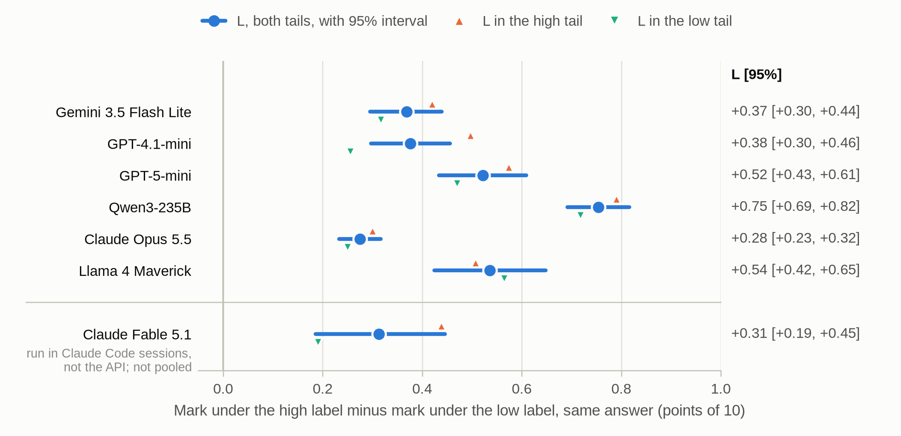
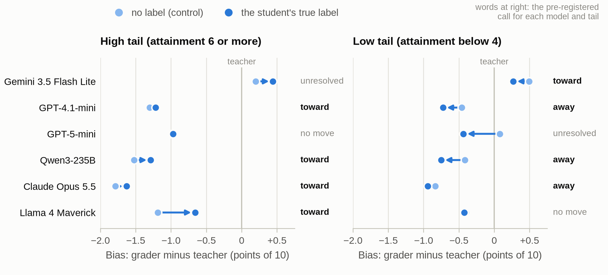
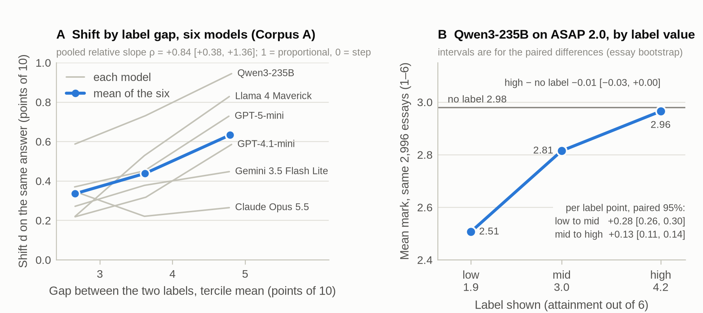
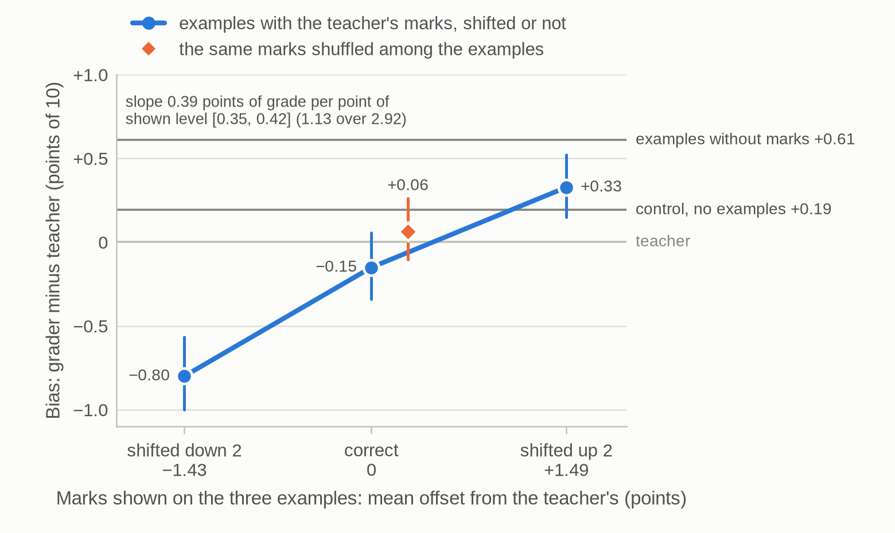
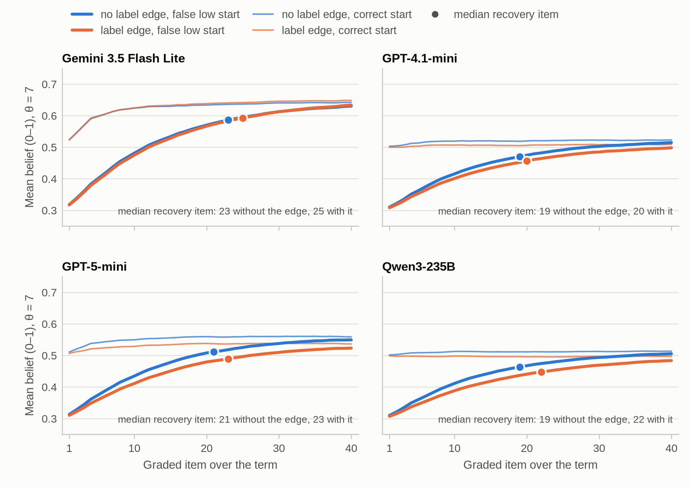
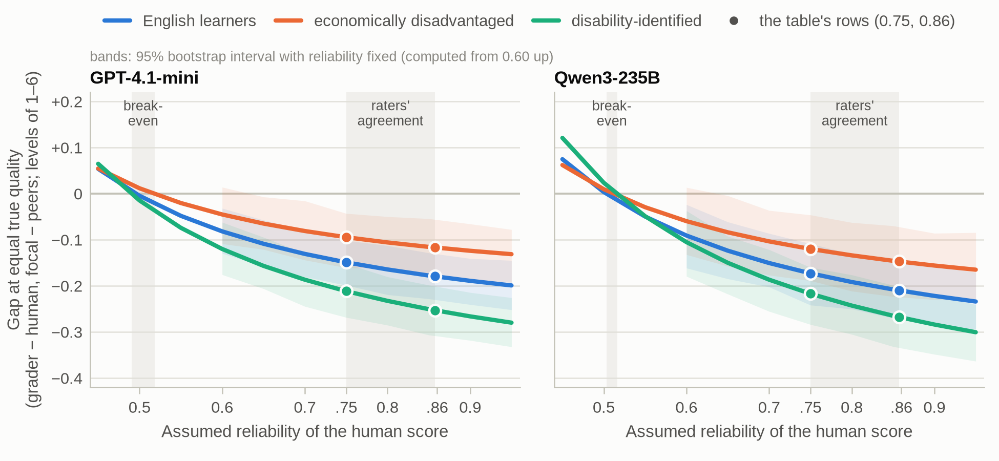

# Learner context changes an LLM grader's marks on identical work: a within-item ablation on six models

### Told a student's attainment, an LLM short-answer grader marks identical work differently on every model I tried. Whether that moves the mark toward or away from the teacher's depends on the model; a false label shifts the mark a student receives on every model tested.

**David S. Porcaro**, Learning Design Alliance

*Research and writing carried out with Claude Code (Claude Opus 5.5, Anthropic). See [AI use](#ai-use).*

---

## Abstract

Learning platforms increasingly pair a grader built on a large language model (LLM) with a learner
model that estimates what each student knows. Sharing that estimate with the grader has an apparent
benefit: it could let the grader interpret an answer in the light of the student's history. Research
on human grading points to the opposite risk, that knowing who wrote the work changes the mark it
receives. I tested which happens with Lazuli's grader, an LLM grader that gives undergraduates
formative feedback as they prepare for human-graded assessments, by grading the same answers under
prompts that differed only in what they said about the student. All the student work comes from
public, teacher-graded corpora.

I tested six models from five developers through their APIs, including Anthropic's frontier model
Claude Opus 5.5 and two open-weights families. Anthropic's top tier, Claude Fable 5.1, could not be
reached through the API route. It graded a 100-answer subset inside Anthropic's Claude Code agent
environment instead, reading prompts byte-identical to the API runs', and showed the same effect. On
every model I tried, identical answers earned more when the student was described as high-attaining
than when described as low-attaining. On the short answers whose students' attainment could be
computed, the difference was 0.28 to 0.75 points on a ten-point scale. On complete student-written
computer programs it was larger for two of three models. On one model it doubled, from 0.52 to 1.04
points, when its reasoning was switched to minimal. Whether this moved marks toward or away from the
teacher's depended on the model. The label was not shown to improve how the grader ranks answers. On three model configurations that mark strong work below the teacher it brought small gains in
agreement, and those gains are
consistent with the label shifting where marks land rather than improving the grader's judgment of the
work. On the one model tested with attempt history, showing a low mark on a previous attempt lowered
the grade on identical work; a high mark did not raise it. Teacher-marked example answers behaved
differently: they moved grades toward the level at which the examples were marked. I also simulated a
course in which grades feed back into the learner model. There the label's effect is amplified by a
factor of 1.066 to 1.167 over a simulated term but stays stable, and its clearest cost falls on
students wrongly recorded as weak.

On 3,000 school essays with demographic data, graded by two models, the label's effect was not larger
for any group I could test. The models' own gap between groups, present with no label at all, was
larger than any gap the label would add, even after correcting for noise in the human scores; whether
the human raters themselves marked every group alike is untested.

Agreement with a human rater, the usual check on an AI grader, did not reveal these effects and on
some runs read them as an improvement. I measure them as drift instead: the same grader, on the same
work, with and without the added information. That check needs no human reference grades, and I
recommend it alongside agreement for any AI grader.

**Keywords:** automated short-answer grading, large language models, LLM-as-a-judge, rater effects,
learner modeling, assessment fairness, measurement

---

## 1. Introduction

### 1.1 Motivation

Lazuli is a learning platform built by the Learning Design Alliance. Its grader is a prompt to a
hosted large language model (LLM) that reads a student's free-text answer, the question and the
activity's assessment criteria, and returns a mark, written feedback for the student, and a short list of evidence
statements about the skills the activity exercises. Beside it sits a learner model: a Bayesian
estimate of each student's mastery of each skill, updated from the evidence the grader returns (the
method descends from knowledge tracing; Corbett & Anderson 1995; Piech et al. 2015).

The grader is in use in undergraduate courses, for formative feedback only: students use it to
practice before assessments that people grade, and nothing the AI generates is used to grade them.
So the marks studied here are not grades of record. What they move is the feedback a student sees
and the learner model's estimate of what the student can do. The platform does not adapt by
default: that estimate is not used to choose what a student sees next, although an individual
course can be built to choose the next item from it. A platform that used such marks to grade, or
to route students, would carry the same effects into a higher-stakes setting.

The grader was built and validated in the usual way. A prompt was written and run over answers that
teachers had already marked, and how closely its marks agreed with the teacher's was reported as one
reliability figure.

The next question was whether giving the grader access to the learner model could improve the learning
experience. The platform already holds an estimate of each student's mastery and a record of their
earlier attempts. Supplied to the grader, that information might let it interpret an ambiguous answer
in the light of what the student has already shown they understand, or judge a resubmission against
the earlier attempt, much as a teacher who knows the student might. Technically the change is small:
the code that calls the grader already has access to the learner model's estimate.

The reliability check could not show whether that change would help or harm students; the next subsection explains why.

### 1.2 Why it matters for the learning experience

In a formative setting the grader's mark is not an end in itself. It shapes the feedback a student
reads, what that student concludes about their own understanding, and the record the learner model
keeps. If the mark depends on what the grader is told about the student as well as on the work, each
of these inherits the dependence. A student the record marks as weak may receive harsher feedback on
an answer that deserved better, and may conclude that they understand less than they do; a student
the record marks as strong may receive generous feedback that hides a gap. Because the grader's
output also updates the learner model, an early wrong estimate could be reinforced rather than
corrected, which is the opposite of what formative feedback is for.

Human grading gives reason to take this seriously. Teachers' grades of the same work shift with
what they know or believe about the student, and poor prior performance is one of the cues that
shifts them (Malouff & Thorsteinsson 2016); expectations can confirm themselves, though such effects
are usually modest and do not accumulate without limit (Jussim & Harber 2005). An LLM grader may or
may not share the tendency, and the background section reviews what is known. What is different is
scale: a platform applies one grader, with one prompt, to every answer from every student, so any
dependence on student information is applied systematically rather than varying from grader to
grader. And because the information a learner model holds tends to track prior attainment, which in
turn differs between groups of students, a design that passes it to the grader is also a design
whose fairness has to be checked.

The usual way to check a grader cannot settle this. A reliability check asks whether the grader's
marks agree with a teacher's on average over many answers. An effect that moves some students' marks
by a few tenths of a point, in a direction that depends on what the grader was told about them, can
leave that average almost untouched, so a check built only on agreement can pass a grader whose marks
depend on more than the work.

### 1.3 Invariance testing as a complement to agreement

A reliability figure says the grader agrees with a teacher about as well as teachers agree with each
other. It does not say whether the mark depends on anything other than the work. "Does this grader
give the same work the same mark whoever it is told wrote it?" is a different question, and it needs a
different instrument: grade the identical answer twice, once with the information and once without,
and measure the difference. That instrument compares the grader with itself. It needs no human grade
at all, so it is not limited by the reference's noise, and it can be run on any answers a team has,
including unmarked ones. It is an established design, known as invariance or counterfactual testing
(Ribeiro et al. 2020; Garg et al. 2019): change an input that should not matter, and check that the
output does not change. It has already been used on essay scorers (Kabra et al. 2022; Wang, Y. et al.
2024) and LLM judges (Ye et al. 2025). The section on measuring the grader against itself describes how I apply it
to learner context.

---

## 2. Background

### 2.1 LLM graders and what agreement with a human can show

Automatic short-answer grading has been studied for two decades (Burrows et al. 2015). General
language models now score free text without task-specific training, and the evidence on how well
they do it is mixed. GPT-4 without training was comparable to hand-engineered models on two
benchmark datasets but worse than specially trained ones (Kortemeyer 2024). Zero- and few-shot GPT
and LLaMA scoring of short answers was "not feasible for practical purposes" in one comparison, with
fine-tuning needed to reach supervised models (Chamieh et al. 2024). On reading-comprehension answers
with a reliable human reference GPT-4 reached kappa 0.91, near parity with expert raters (Henkel et
al. 2025). Graded calibration examples brought GPT-4 close to dedicated essay-scoring systems on
second-language essays, with agreement varying by the writer's first language (Yancey et al. 2023).
A preprint meta-regression of 890 kappa results finds decoder LLMs 0.37 kappa below encoder models on
average, and finds that how hard a task is for human scorers does not predict how hard it is for an
LLM (Hardy 2026, not peer reviewed). Several studies report LLM graders over-scoring or avoiding the
ends of the scale (Seßler et al. 2025; Flodén 2025), and scoring on surface features humans weight
differently (Mathew et al. 2026). Much of the wider LLM-as-a-judge literature concerns judging
chat-assistant answers rather than student work (Zheng et al. 2023).

Almost every one of these evaluations reports agreement with a human score, which treats that score
as ground truth. Williamson et al. (2012) treat agreement as only one of several kinds of evidence for
an automated scorer, beside its consequences for subgroups. Where two human raters exist, the
ground-truth assumption can be checked, and it is weak: Menagerie's authors conclude that "the idea of a 'gold standard' of human grading might be flawed" (Messer et al. 2024).
When the reference is noisy, a machine can appear to match or beat human–human
agreement because of the noise rather than its skill, while on items humans agree about, machine
agreement falls well below theirs (Elangovan et al. 2025). Reliability across 20 judging tasks also
varied with the expertise of the human judges (Bavaresco et al. 2025).

### 2.2 What information about the student does to human graders

Teacher-expectancy research is usually dated from *Pygmalion in the Classroom* (Rosenthal & Jacobson
1968). That study concerned a different question: whether teachers' induced expectations
changed students' later gains on intelligence (IQ) tests. Its analysis was disputed; a synthesis of
18 experiments found the IQ effect small and dependent on how credible the induction was (Raudenbush
1984), and a later review concluded that classroom self-fulfilling prophecies occur but "are
typically small" and "do not accumulate greatly across perceivers or over time" (Jussim & Harber
2005). Effects vary widely between teachers (Rubie-Davies & Hattie 2025).

A better-replicated human finding concerns whether knowing something about the student changes
the mark given to the *same work*. A meta-analysis of
20 experiments (1,935 graders) in which graders received information about a student other than the
work itself, including poor prior performance, found an overall effect of g = 0.36 (Malouff &
Thorsteinsson 2016; g is a standardized mean difference, the gap between conditions in standard
deviations of the grades). University staff who had seen a student give a good rather than a poor
oral presentation gave the same written work higher marks, with a no-information arm in between
(Malouff et al. 2013, 2014). In a field experiment with 832 teachers, a student's randomly assigned
reputation changed the grades of the same essays, and teachers relied on negative information more
than on positive (Chu et al. 2020). That paper frames the choice as whether prior information acts as
a *signal* (a prior that new evidence updates) or a *filter* (a prior that changes how the evidence
is seen). Professional raters drift toward the
score they have just given (Attali 2011). Pre-registered experiments find bias on identical work keyed
on socioeconomic status and cultural capital, not always in one direction (Doyle et al. 2023;
Gil-Hernández et al. 2024). One finding points the other way: teachers' racial bias in
rating a writing sample disappeared when they used a rubric with clearly defined criteria (Quinn
2020).

A related effect operates inside a single human reading: a rater's overall impression carries into
every judgment, the halo effect. Anonymous grading is the standard response to this literature, and
Malouff et al. (2013) argue for it on exactly these grounds.

### 2.3 Fairness in automated scoring

Work on algorithmic bias in education has largely concerned differential accuracy across demographic
groups (Baker & Hawn 2022; Kizilcec & Lee 2022). Automated scoring needs checks for bias toward
sub-populations that aggregate agreement cannot capture (Madnani & Cahill 2018), and the standard
fairness measures can disagree on the same data (Loukina et al. 2019). In measurement the word
"bias" has at least three meanings: a statistical offset against a reference, a harm to a group, and
differential item functioning, a score difference between groups at equal ability (Holland & Wainer
2012).

Attainment is not a protected attribute, and a change in the mark on identical content caused by
information about attainment is not a difference in accuracy. In a real population, however,
attainment can track a protected attribute. An effect keyed on attainment could then become a
demographic one, and an audit that inspects only protected attributes would not see it. Its sign
could go either way: studies of teachers' grading find compensation as well as penalty (Gil-Hernández
et al. 2024). LLMs can also infer demographic attributes from the work itself, and scoring bias was
larger where they inferred a writer's first language correctly (Yang et al. 2025; Kwako & Ormerod
2024). Withholding learner context therefore does not by itself make a grader group-neutral.

### 2.4 LLM judges and the context they are given

That an LLM's judgment depends on what else is in its context is well documented. The order of
candidate answers can be used to skew a comparison (Wang, P. et al. 2024). LLM evaluators favor their
own generations (Panickssery et al. 2024), show anchoring when they judge several attributes in one
pass, and are inconsistent across samples (Stureborg et al. 2024). A framework of controlled
perturbations quantified twelve judge biases, still significant on specific tasks in advanced models
(Ye et al. 2025). Preference training
rewards agreeing with the user's stated view (Sharma et al. 2024), and assigning a persona produces
stereotyped reasoning in models that reject the stereotype when asked directly (Gupta et al. 2024).

Three recent results concern this kind of context directly. The closest: an LLM judge shown a prior
score for the same text as metadata shifts its rating toward that score. Across 185,271 evaluations
the shift's 95% interval excluded zero on seven of eight models, and the response was
"threshold-like": the presence of a prior score mattered more than its value (Kapetanovic et al. 2026,
posted to arXiv in August 2026). Its conditions include a revision framing with no prior score, which
partly separates the framing from the score. Continuous grading history in one conversation drifts an
LLM grader's standards away from expert scores (Zhou et al. 2026). And describing a student's race,
socioeconomic status or school type to ChatGPT changed its evaluation of identical writing when the
description was implied rather than explicit (Warr et al. 2025). So neither "a prior score anchors an
LLM judge" nor "learner information changes an LLM's grade of identical work" is new in general. An
achievement label has also been shown to change what an LLM writes about identical work: told that a
student was low- or high-achieving, four LLMs gave the same essays stereotype-aligned feedback that
changed "how writing was judged" (Tan et al. 2026), though that study measured the wording of the
feedback, not a mark. No study I found gives a short-answer grader an attainment estimate a learner
model would actually hold, or a marked previous attempt on the same item, and measures the shift in
the mark on identical work against a teacher's mark. Style alone can move LLM grades of identical
content by 1–2 points on a 10-point scale (Jadhav et al. 2026, preprint). Named-person audits found
that numerical, decision-relevant anchors in the prompt reduced identity-keyed bias while vague
qualitative detail could increase it (Salinas et al. 2024).

### 2.5 Example answers in the prompt

Showing a model labeled examples is in-context learning, and what the labels contribute is disputed.
On classification and multiple-choice tasks, randomly replacing the labels of demonstrations barely
hurt performance, while removing labels altogether was close to or worse than no demonstrations (Min
et al. 2022). Others found that correct labels matter, depending on configuration (Yoo et al. 2022),
and that larger models follow flipped labels where small ones ignore them (Wei et al. 2023). Prompt
format, choice and order of examples swing few-shot results through biases toward particular answers
(Zhao et al. 2021). For LLM grading specifically, choosing examples at decision boundaries beat
similarity retrieval (Chu, Y. et al. 2026). In LLM-as-a-judge scoring, the score attached to a
reference answer pulls the judge's scores toward it (Li, Q. et al. 2025), and anchor papers in the
prompt raised LLM–human agreement on secondary essays (Choi et al. 2026). Self-consistency, voting
over several sampled answers, was shown on tasks with one verifiable answer (Wang, X. et al. 2023),
which rubric scoring is not. Whether graded examples calibrate a grader, or work by showing the scale
in use rather than by pairing each answer with its correct mark, is therefore open.

### 2.6 Loops in which a model's output becomes its input

When a system's own decisions determine what data it next observes, a feedback loop can run away
(Ensign et al. 2018), converge to a stable point under conditions that can be stated (Perdomo et al.
2020), or harm a group over time even when each decision passes a static fairness test (Liu et al.
2018). LLM outputs fed back into LLM inputs produce side effects that evaluations on static datasets
miss (Pan et al. 2024). In learning analytics, knowledge-tracing algorithms can be inequitable when
they rest on inaccurate student models (Doroudi & Brunskill 2019). A grader that reads the learner
model's estimate and then writes evidence back into it is a loop of this kind, and the single-item
studies above cannot say how it behaves over a course.

---

## 3. Research questions

- **RQ1. A previous attempt and its mark.** Does showing the grader a previous attempt at the same
  question, with its mark, change the grade given to identical current work? Does the mark matter,
  or the earlier answer? Does it improve agreement with the teacher?
- **RQ2. An attainment estimate.** Does telling the grader the student's attainment change the grade
  on identical work? Does the change move grades toward the teacher's mark (a usable prior) or away
  from it? Does it improve accuracy, and how large a gain do the data leave room for?
- **RQ3. Context about the task.** Do three teacher-graded example answers to the same question
  behave differently from context about the student? If they help, is it
  the correct marks that help, or the sight of a marked scale?
- **RQ4. The loop over a course.** If grades update the learner model and the learner model supplies
  the label, does the effect compound, and is the loop stable?
- **RQ5. Generality.** Do the answers hold across models and vendors, reasoning settings, item types
  and score scales?
- **RQ6. Demographic groups.** Does the attainment label's effect on identical work, or the labels a
  deployment would show, differ by demographic group? And with no label, does the grader mark groups
  differently at equal human score?

---

## 4. Method

### 4.1 The system under test

The system is Lazuli's grader as used in undergraduate courses: one prompt template and one response
schema, called through the product's own code. For each answer it receives the question, a scenario,
the assessment criteria (the rubric), a list of the skills the activity exercises, an optional block
of additional context, and the student's response. It returns three things:

- **a score** from 0 to the activity's maximum mark (here 10, or the corpus's own maximum);
- **an evaluation**, the feedback text addressed to the student;
- **evidence statements** in xAPI (Experience API), the standard format the platform's learning
  records use, at most one per relevant skill. The prompt tested here, which Lazuli's classic courses
  use, also caps them at three in total; the platform's studio courses do not apply that cap. Each
  statement carries **a pair of evidence weights**: an alpha, the evidence of success, and a beta, the
  evidence of struggle or error. Their sum says how much this one response tells the platform about
  the skill, on a scale up to 3. Their ratio says how well the student did. The learner model adds
  them to its Beta-distributed belief about that skill.

The product grades each answer in its own call, with no conversation history, and so does the harness.
Every analysis in this paper uses the numeric score; the feedback text was not analyzed. The evidence
weights are the route by which a grade reaches the learner model in the product, and the loop
simulation stands in for them with the score (see the section on the loop over a course).

### 4.2 The evaluation harness, and what it tests

The harness is a command-line program that runs the grader over a
corpus and records every grade. It imports the product's own prompt builder and response schema rather
than a reconstruction of them, so the results cannot reflect a prompt more favorable than the deployed
one. Three components are under test together: the prompt text the builder renders, the response
schema the model must fill, and the model call itself (through the Vercel AI software development kit
(SDK) adapter for each vendor, with that vendor's structured-output mode). What the product does
around the call is bypassed: database reads and writes, anonymization of the response text (the
corpora are already de-identified), dispatch of the evidence statements to the learning record store,
and the learner model's update.

Each experimental arm adds one block of text to the prompt's additional-context section, which is
empty in the shipped configuration. The exact wording of each block is given with the arms in the
design section. Everything else in the prompt is identical across arms, byte for byte.

The harness, and the production grading prompt it imports, are not published with this release.
Internally, each version of the harness the runs used is kept as a hashed, byte-for-byte copy with a
lockfile pinning its libraries, and re-rendering every prompt from those copies reproduces the
prompts the runs sent; that check is part of the reproduction recorded with the release. What is
published is described in the data and code section: the per-case model outputs and the analysis
code that computes every reported result from them. A reader can therefore recompute every result
from the model runs, but cannot re-send the prompts.

### 4.3 Models, configuration and cost

**Why these models.** The original arms used the small, low-cost model tiers used for high-volume
grading, because a grader in routine use runs on them: Gemini 3.5 Flash Lite (called LITE here, with
thinking at its minimum, the setting the product uses for high-volume grading) and, for the tier
comparison, Gemini 3.7 Flash (STANDARD, at its default thinking). The attainment arm also ran on
GPT-4.1-mini and GPT-5-mini. The re-tests added an open-weights model (Qwen3-235B-A22B-2507), a second
open-weights family (Llama 4 Maverick) and Anthropic's frontier model (Claude Opus 5.5), so that the
effect could not be attributed to model size, to one vendor or to one post-training lineage.
Anthropic's top tier, Claude Fable 5.1, was added on a 100-answer subset of the attainment draw, to
check that the effect is not confined to models below the top tier. OpenRouter, the API route used for the other
Anthropic model, could not reach it under the account's zero-data-retention setting,
so it ran in Claude Code sessions, as described below. Within a model, I also varied the one setting
most likely to matter: reasoning.

**What "default configuration" means.** No run in this paper sent a temperature, a top-p value, a
random seed or, on a vendor's own application programming interface (API), an output-token limit, so
each provider's defaults applied. I did not equalize settings across vendors: there is no common
scale for "effort", and defaults are what a platform deploys. Fixing the sampling parameters would not
have made runs repeatable in any case; LLMs configured to be deterministic still vary across runs
(Atil et al. 2024), which is why I measure re-run variation directly. What each run did send:

| Model (where used) | Vendor; weights | Route and serving host | Reasoning setting sent | Structured output |
| --- | --- | --- | --- | --- |
| Gemini 3.5 Flash Lite, LITE (every ablation arm) | Google; closed | Gemini API, direct | thinking `minimal` (no thought tokens billed); `high` in the reasoning contrast | response schema |
| Gemini 3.7 Flash, STANDARD (tier comparison) | Google; closed | Gemini API, direct | none sent (model default thinking) | response schema |
| GPT-4.1-mini (attainment) | OpenAI; closed | OpenAI Responses API, direct | not applicable | JSON schema; strict in the original run, non-strict in the re-test |
| GPT-5-mini (attainment; reasoning contrast) | OpenAI; closed | OpenAI Responses API, direct | none sent (default "medium", about 813 reasoning tokens per call in a ten-call probe whose output was not kept); `minimal` and `high` in the contrast | as GPT-4.1-mini |
| Qwen3-235B-A22B-2507 (re-test) | Alibaba; open weights | OpenRouter, pinned to DeepInfra, fallbacks off | reasoning excluded from output | JSON schema, non-strict; router's required 16,384-token output cap |
| Llama 4 Maverick (re-test) | Meta; open weights | OpenRouter, pinned to Parasail, fallbacks off | as Qwen | as Qwen |
| Claude Opus 5.5 (re-test) | Anthropic; closed | OpenRouter, pinned to Amazon Bedrock, fallbacks off | as Qwen (12 reasoning tokens per call billed) | JSON mode with the schema in a system message (this zero-retention route refuses strict schemas) |
| Claude Fable 5.1 (attainment, 100 answers) | Anthropic; closed | Claude Code subagents, not the API; served model `claude-fable-5-1`, no host pin | not known or recorded | by instruction only |

The grading prompt is a single user message on every API route; the only system message any API route
adds is Claude's schema instruction. The original OpenAI runs requested strict schema decoding; the
re-tests, made with a different library version, requested non-strict decoding, with identical prompt
text. The re-tests reproduced the original attainment gaps in direction and order of magnitude: the gap between the grader's drift
on high-attaining and on low-attaining students (both terms are defined in the design section). On GPT-5-mini the re-test gap was 0.53 against the original 0.54; on GPT-4.1-mini it was larger, 0.35 against
0.24. No verdict moves, but the two configurations are not
identical and I do not call them so (`studies/measurement/grader-model-breadth/`, part 3).

**Higher-cost tiers.** I decided not to run Gemini 3.1 Pro or GPT-5.5 as graders; Gemini 3.1 Pro
graded ten answers in a pricing probe only. Claude Fable 5.1 could not be reached through OpenRouter under the
account's zero-data-retention setting
(below). Each of these costs 21 to 69 times as much per grade as the shipped tier (the table below).
That makes them impractical for routine grading at volume, which is the setting this paper is about.
Claude Opus 5.5 represents the frontier tier in the API runs, and Fable 5.1 was run on a subset in
Claude Code sessions (below). The table gives the arithmetic at list prices on 2026-10-05. Each cost
comes from one of three sources: measured spend (900 gradings a run), a ten-answer pricing probe
(Gemini 3.1 Pro), or a projection (GPT-5.5, Fable 5.1).

| Model | Cost per grade | 8,000 grades (200 students × 40 responses) | Source |
| --- | ---: | ---: | --- |
| Llama 4 Maverick | $0.0006 | $5 | measured |
| Gemini 3.5 Flash Lite (LITE, the shipped tier) | $0.0010 | $8 | measured |
| GPT-5-mini, reasoning minimal | $0.0016 | $13 | measured |
| Claude Opus 5.5 | $0.028 | $220 | measured |
| Gemini 3.1 Pro | ~$0.021 | ~$170 | 10-answer pricing probe |
| GPT-5.5 | ~$0.055 | ~$440 | projection |
| Claude Fable 5.1 | ~$0.069 | ~$550 | projection from Opus 5.5's measured tokens |

**Fable 5.1 as an agent.** Fable 5.1 could not be reached through OpenRouter under the account's zero-data-retention setting, the
route used for the other Anthropic and open-weights models, so it graded a subset inside Claude Code, Anthropic's agent environment, where a session can be set to
run on Fable 5.1 (`studies/measurement/grader-fable/`). The study was pre-registered, and the Claude
Code route was added by amendment before any grading.

A detection floor is a check, run before any real result is read, that the instrument recovers an
effect planted in synthetic data shaped like the real draw. This run's floor fell just short: it
detected the planted effect in 79.5% of replicates against the required 80%, under the noisier of two
noise shapes tried. The pre-registration said no paid call would be made if the floor failed. The run
went ahead under a deviation recorded before any grading. The reasoning was that the shortfall still
protects a positive verdict, since a null effect was wrongly called positive or negative in at most 7.25% of replicates, but does not
protect a null. A null would therefore have been reported as underpowered.

The draw was 100 answers from the attainment draw, 50 from each tail (students at the high or the low
end of the attainment distribution, defined in the design section). Each answer was graded under its
true label and under a swapped, false label from the opposite tail. There was no control arm. The
unmodified harness rendered the 200 requests it would have sent, and their prompt text is
byte-identical to the Opus 5.5 run's for the same answer and arm. Twenty Claude Code subagents running
on Fable each graded a batch of ten: five true and five swapped labels, five high and five low, and
never both arms of one answer. Each agent read its batch from a file, after the agent harness's own
context, with both of the prompt's messages as text in one turn. Reading from a file is a second
deviation, recorded after the run: the amendment had the batch arrive inline. Sampling settings were
not known or recorded, and output followed the requested format by instruction only. Each agent's
transcript records the served model and every file it read: all 20 ran on `claude-fable-5-1` and read
only their own batch.

On what matters for the estimand, the route is comparable to the API runs. The model read the same
prompt text, byte for byte, and each answer's two arms went to different sessions, so neither grading
could see the other. Four things differ: the agent's own surrounding context, batching, unrecorded
sampling settings, and output format set by instruction only. For that reason the result is reported
under RQ5 (generality), beside the cross-model table, and is never pooled with the API runs.


### 4.4 Corpora

All the data are public and openly licensed. Locations and
content hashes are in the data section at the end.

| | A: JorGPT | B: Mohler | C: Menagerie | D: ASAP 2.0 |
| --- | --- | --- | --- | --- |
| Source | Cisneros-González et al. 2026 | Mohler et al. 2011 | Messer et al. 2024 | Crossley et al. 2025 |
| What | 3,041 answers (3,031 non-empty) to 50 open-ended questions | 2,273 answers to 80 questions (1,727 analyzed) | 279 Java programs × 4 rubric dimensions | 24,728 argumentative essays |
| Students | 79, with an identifier on every answer | not recorded | not recorded | one essay each, with demographic fields |
| Level and domain | undergraduate computer science | undergraduate data structures | first-year (CS1) programming | secondary, grades 6, 8, 9 and 10 |
| Scale | 0–10 | 0–5 | A++ to F, 14 levels | 1–6 holistic |
| Human raters per item | 1 (the course teacher) | **2, independent** | **4 (3 on 32 items), 28 in all** | 2, adjudicated (one score released) |
| License | CC BY 4.0 | CC BY 4.0 (mirror's dataset card) | CC BY 4.0 | CC BY 4.0 |
| Used here for | every ablation arm | the human ceiling; label effect on short 0–5 answers | the human ceiling; label effect on whole student programs | the label effect by demographic group (3,000 essays, two models) |

**Why each corpus, and the constraint that shaped the choice.** The learner-context arms need a
student identifier on every answer and several answers per student, so that an attainment estimate
can be computed from a student's *other* work. Only Corpus A has that. Reading any agreement figure
needs at least two independent human graders on the same items, so the human–human ceiling can be
measured. Corpus A has one. I found no public corpus that has both. Corpora B and C supply the
ceiling, and HARMOGEN-R (Mendonça et al. 2026), four instructors on every item, shows how far the
ceiling depends on the task. The requirement of two or more independent grades per item ruled out most
public grading data I surveyed. That includes Corpus D: its two expert reads are not released, only
"the average human assigned score" (Crossley et al. 2025). **A note to the field:** a corpus that releases
two or more independent human grades per item *and* a persistent learner identifier across items
would let the questions in this paper, and agreement studies generally, be answered on one dataset
instead of three. I would use it, and I encourage those who hold such data to release it.

**How Corpus C is used.** Corpus C is the stronger instrument for the human ceiling, with four
raters per item rather than two, and it is also used here for a label test: 60 complete student-written Java programs from an introductory
programming course,
each graded on its four rubric dimensions under a high and a low attainment label by three models,
to test whether the label effect holds on long work and on a different scale (see the results on
item types and scales). Its grades were collected expressly "as part of a study into the consistency
of human graders" and are deliberately not the students' awarded grades.

**Integrity checks before any result was trusted.** Corpus A flags whether the teacher corrected each
grade rather than accepting a model's suggestion. Every row is corrected, and only 5.9% of teacher
grades coincide exactly with the deposit's own judge model, so the reference is not a set of model
grades accepted without review. For Corpus B I used a public mirror (Mohler et al. 2011, as
redistributed on Hugging Face; location and revision in the data section). For 546 of its 2,273 rows
the mirror records per-rater scores on a 0–10 scale, while its own mean column stays on 0–5. No single
rescaling reconciles the two. I analyze only the 1,727 internally consistent rows. The exclusion is not
neutral: excluded rows agree less, so the ceiling I report is an over-estimate.

### 4.5 Design and arms

The design is a within-item repeated-measures ablation. Answers are drawn from a corpus; every configuration then
grades every drawn answer, so each answer is its own control and every contrast compares the same
text. The units are answers written and graded before this study existed, and no person was
assigned to anything.

**Draws.** For the history and exemplar arms, 150 answers stratified across the grade range (seed 7,
the same 150 answers in each); the exemplar re-test extended this to 600 (the first 150 unchanged).
For the attainment arms, a draw on the student's held-out attainment: 150 answers from students whose
attainment is 6 or more (the **high tail**, 19 students) and 150 from students below 4 (the **low
tail**, 14 students), the same deterministic draw for every model. A tail here is one end of the
attainment distribution; sampling only the ends concentrates the draw where students' attainment
differs most.

**Attainment** is a student's mean teacher grade across all their other answers in the corpus,
excluding the answer being graded. It stands in for the mastery estimate a learner model would hold.
Holding out the graded item is what makes it an estimate of the student rather than a leak of the
answer's own mark.

| Arm | What the grader additionally receives (exact text in quotes) |
| --- | --- |
| **Control** | Nothing: the shipped configuration. Every arm below is compared with the same grader's control pass on the same answers. |
| Prior attempt, low / high mark | "The learner has attempted this question before. Their previous attempt was graded *g*/10. Previous attempt: *text*". The corpus has no real resubmissions, so the previous attempt is another student's real answer to the same question: the lowest-graded (low) or highest-graded (high) of its peers, with its real teacher mark. |
| Prior attempt, mark removed | The same two previous attempts with the mark sentence removed: "Their previous attempt: *text*". |
| Attainment, true label | "Current attainment for this learner across this course: *x*/10, from *n* prior graded responses." with the student's own held-out attainment. |
| Attainment, swapped label | The same sentence with the label of a paired student from the opposite tail. Each answer is thus graded under its own label and under a false one. |
| Neutral statement (one run, Gemini 3.5 Flash Lite) | "Current context for this learner across this course: this response was submitted as coursework." The same position and length as the attainment sentence (95 characters against a mean of 95), with no information about the student. It separates the presence of a sentence about the student from the value of the label. |
| Graded examples | "Example answers to this question from other learners, for calibration:" then the lowest, median and highest-graded other answers to the same question, each "graded *g*/10", in that order, then "Grade the learner's response on the same scale these examples were graded on." |
| Ungraded examples | The same three answers without marks and without the closing instruction. |
| Shuffled marks | The same three answers with the same three marks deranged (each answer shows another's mark). |
| Marks shifted up / down | The teacher's marks plus or minus 2, clipped to 0–10, ranking kept. |

**The demographic test.** To test whether the label's effect, or the labels a deployment would show,
differ by group, the attainment arm was also run on Corpus D, ASAP 2.0 (Crossley et al. 2025; 24,728
source-based essays, grades 6, 8, 9 and 10, CC BY 4.0). It records English-learner, economic,
disability, race/ethnicity and gender status (`studies/measurement/grader-attainment-groups/`). None of
the other corpora carries demographic data. Those fields were used only in analysis and never entered
a prompt. I drew a quota sample of 3,000 essays with fixed quotas for two groups (900 English
learners, 900 students identified with a disability), and design weights carry its results back to
the corpus as a whole.
Qwen3-235B-A22B and GPT-4.1-mini graded each essay's identical text three times: with no attainment
statement, with an assigned low statement (1.9/6), and with an assigned high one (4.2/6). Qwen also
graded it under a same-length mid statement (3.0/6). ASAP 2.0 has one essay per student, so these
labels are assigned, not computed from the student's other work.

**People, and whether results differ by individual.** No students were assigned to conditions; the
units are existing answers. But answers belong to students, and a pooled effect could hide a group of
students moved the other way. Every interval on an attainment arm therefore resamples students rather
than answers. The model-breadth study also estimated each student's own label effect and tested
whether it varies between students (`studies/measurement/grader-model-breadth/`, part 4). The test
compares the observed variation with a control in which students are reassigned only among answers to
the same question, so each student keeps the same set of questions. The finding is in the results on
the attainment label.

### 4.6 Measures

Every measure below is computed on the corpus's own scale. Points are on 0–10 unless stated.

**Signed error and bias.** For each answer, the grader's mark minus the teacher's. Its mean is the
grader's **bias** in the statistical sense: a systematic offset from the reference. A positive bias
means the grader marks higher than the teacher on average ("generous"); negative means lower
("harsh"). I report it because a constant offset determines whether a student near a pass mark
passes, while agreement statistics are largely insensitive to it (see QWK below); Williamson et al.
(2012) discuss its use in automated scoring. Being signed and expressed in points, it shows the
direction of an error and is directly interpretable. It measures offset from the teacher rather than
from a true score, so it assumes the reference is unbiased, and because positive and negative errors
cancel, a grader can have zero bias and large errors. I use "bias" only in this sense unless stated
otherwise; it does not denote unfairness to a group.

**MAE (mean absolute error).** The mean of the absolute signed errors, in points. It gives the
typical size of an error regardless of direction and, unlike bias, is not reduced by errors of
opposite sign. It does not separate an offset from scatter, and on a generous grader any downward
shift lowers it; direction is therefore never inferred from MAE alone.

**QWK (quadratic-weighted kappa).** Agreement on an ordinal scale, corrected for chance, where a
disagreement costs the square of its distance (Cohen 1968): "8 when the teacher said 9" costs 1, "1
when the teacher said 9" costs 64. It runs from −1 through 0 (chance) to 1 (perfect). It is the
standard statistic for rubric scores, which makes my figures comparable with other studies';
exact-match accuracy would weight every disagreement equally and favor a grader that predicts the most
common score. With chance agreement taken from the observed marginals, QWK equals Lin's concordance
correlation, QWK = 2·s_xy / (s_x² + s_y² + d²), where s_x and s_y are the standard deviations of the
two sets of grades, s_xy their covariance and d the difference in their means (Fleiss & Cohen 1973;
Lin 1989). So an offset *does* lower QWK, but only through its square relative to the grades'
variances. On my 150-answer draw (teacher standard deviation, SD, 3.15; LITE SD 2.91), removing a
0.32-point offset raises QWK by 0.0065, and a 0.59-point offset costs 0.016
(`studies/measurement/grader-eval/analyses/qwk_offset.py`, which verifies the identity on my data).
Both are inside the evaluation's run-to-run noise. A shift large enough to move a student across a
pass mark can therefore leave kappa essentially unchanged, which is why bias is reported beside it.
QWK treats the scale as interval-like (it squares distances) and is sensitive to the distribution of
scores in the sample (Feinstein & Cicchetti 1990) and to the number of categories (Brenner & Kliebsch
1996), so kappas on different scales or samples are comparable only approximately. It can also mislead
with small samples, imbalanced score distributions and differing score ranges (Yannakoudakis & Cummins
2015; Doewes et al. 2023; Albatarni & Elsayed 2026), a further reason it is not my primary outcome.
"Kappa" and κ refer to QWK throughout.

**Gwet's AC2 (a robustness check on the ceilings only).** AC2 is a chance-corrected agreement
coefficient, here with the same quadratic weights over the same levels, whose chance term does not
come from the observed marginals (Gwet 2008). It therefore does not fall when marks bunch at one end
of the scale, as kappa does (the "kappa paradox"; Feinstein & Cicchetti 1990). Albatarni & Elsayed
(2026) recommend it over QWK; I report it beside each human–human ceiling. The same property,
however, allows it to credit marks that ignore the work. A grader that gave every Corpus C item A−
would score AC2 0.854 against the human raters. The raters themselves reach only 0.706 with each other
on the same items. A grader that gave every Corpus B answer full marks would score 0.926 against rater
1. These constant-grader readings were added after the pre-registered robustness run and are reported
only. Because of them, I do not use AC2 to score a grader. My
implementation reproduces the worked examples published with Gwet's irrCAC package.

**Pearson r.** The correlation between the grader's marks and the teacher's. Because r is invariant
to offset and scale, it measures only whether the grader orders answers as the teacher does; a change
that moves QWK while r is unchanged has moved where marks land rather than how the grader ranks the
work. By the same property, r cannot detect an offset or a compression of the scale.

**Spread ratio.** The SD of the grader's marks divided by the SD of the teacher's. Near 1 means the
grader uses the scale about as widely as the teacher; well below 1 means it concentrates its marks in
the middle of the scale, which QWK alone can hide.

**SD (standard deviation)** is the usual measure of spread. To compare effect sizes across studies I
also express shifts in SD units of the teacher's grades on the same draw: 3.15 points on the
150-answer draw, 2.78 on the attainment draw, 2.68 across the whole of Corpus A.

**Drift.** The mean, over the same answers, of the grade with the added context minus the grade the
same grader gave in its control pass. Signed. It needs no teacher mark; the next section explains why
that matters.

**Label effect (L).** On the swapped-label arm: the grade under the high label minus the grade under
the low label, on the same answer, averaged. Within each tail one of the two labels is the student's
own and the other is false, so L is the causal effect of the label itself, net of who wrote the
answer.

**Label dose.** Whether L grows with the label's value. In the swapped-label draw, the two labels an
answer saw differ by different amounts from one answer to the next. The per-answer label effect can
therefore be regressed on that gap, holding fixed the tail, the answer's own label and its teacher
mark. I report the slope, in points of mark per point of label. I also report ρ, which compares the
slope with the overall effect: ρ is the slope times the mean gap, divided by L. If the effect is
proportional to the gap, ρ = 1. If the effect is a step that ignores the label's value, so that any
high label adds the same amount, ρ = 0. The analysis was pre-registered with a detection floor and run
on the existing outputs (`studies/measurement/grader-label-dose/`).

**Label-free calibration.** A linear rescaling of a grader's marks, fitted without the label, that
gives them the teacher's mean and standard deviation: one shift and one stretch applied to every
answer. It is fitted out of sample, leaving out each student's own answers in turn, and the rescaled
marks are rounded and clipped to the scale before scoring, like any other mark. Because it is linear, it changes Pearson r only slightly, through rounding, clipping and fitting it
with each student left out (by at most 0.011 here); it changes where marks land. Three comparisons are made on the same
answers: the calibrated unlabeled marks against the raw unlabeled marks (what calibration alone
gains), the calibrated unlabeled marks against the raw labeled marks (whether calibration matches what
the label gained), and the calibrated labeled marks against the calibrated unlabeled marks (whether the
label adds anything once both are calibrated). Pre-registered with a detection floor
(`studies/measurement/grader-calibration-vs-label/`).

**Toward or away.** Whether a label moves a tail's grades toward the teacher's or away from them. The
call combines two quantities: the control's signed error in that tail (is the grader already above or
below the teacher there?) and the direction of the label's drift. If the control sits clearly on the
opposite side of the teacher from the drift, with an interval that excludes zero, the label moves the
grade **toward** the teacher. If the control sits on the same side as the drift, or the drift carries
the grade past the teacher, the label moves it **away**. The rule was pre-registered; its detection
floor is in `studies/measurement/grader-attainment-prior/`.

**Paired intervals and equivalence.** To ask whether an arm improves accuracy, I take the change in
QWK and in MAE from control on the same answers. Each change has a 95% bootstrap interval that
resamples students, because the label belongs to the student (a cluster bootstrap; Field & Welsh
2007). I call an estimate **resolved** when its 95% interval excludes zero, that is, when the data
distinguish it from no effect. A change is a **gain** if its interval excludes zero on the improving
side. It is **equivalent** to no change if its 90% interval sits inside a margin fixed before the run:
±0.02 for QWK and ±0.10 for MAE. This is the standard equivalence test, two one-sided tests at the 5%
level, abbreviated TOST (Schuirmann 1987; Lakens 2017). A change that is neither a gain nor equivalent
is reported as "no gain larger than" the improving-side end of its interval: the largest improvement
the data still allow.

### 4.7 Measuring the grader against itself

Most of what this paper reports is the difference between two passes of the same grader over the
same answer. The control in every comparison is the grader's own pass with nothing added, not a human
grade. Because both passes read the identical text, rubric and question, the difference has only two
sources: the added context, and the call-to-call noise of the model, which I measure separately.
The teacher's mark plays no part in computing it.

**Why drift, not agreement, is the primary outcome.** The human reference is noisier than an agreement
check assumes. Suppose a substantial share of the residual disagreement between a grader and a single
human reference is noise in the *reference*, and the choice of reference moves agreement by more than
most interventions do. Then agreement is an insensitive measure of improvement, and a *null* result on
agreement can arise from reference noise alone. I therefore report bias and directional drift on
identical work as primary outcomes, and use agreement to check whether a manipulation improves
accuracy.

The first condition holds on the data I could find; the second is tested in the results on the human
ceiling. Where a public corpus carries two independent raters, they agree with each other at kappa 0.519 on my computation (Corpus B, Mohler et al. 2011; the results on the human ceiling). In a corpus
built to study grader consistency (Messer et al. 2024), 28 recruited graders agree at 0.465 on my computation, and individual pairs range from 0.035 to 0.730. When human references disagree this much,
three things follow. The choice of reference can move a grader's agreement figure by more than a
typical intervention would. A change in how the grader marks a student can leave the agreement figure
unchanged. And so can a real gain in accuracy.

Measuring the grader against itself has three properties that make drift worth adopting as a standard check:

- **It does not depend on the reference.** Drift compares the grader with itself, so the reference noise described above does not limit it.
- **It needs no human marks.** A team can measure what any piece of
  context does on its own students' answers, marked or not, before the context ships.
- **It is precise.** Each answer is its own control, so differences in difficulty between answers
  cancel. A paired difference on the same answers is therefore estimated far more precisely than a change in agreement; the attainment results report the precision achieved.

It has one limit. Drift says the grade moved, not whether the move was an improvement. A downward
drift of half a point helps a grader that over-marks and hurts one that under-marks. For direction
relative to the teacher I add the reference back in two ways: the control's signed error in each tail
(is the grader already high or low there?), and the swapped-label arm (on the same work, is the true
label more accurate than a false one?). Scoring identical work twice is an established reliability
design for LLM raters (Pack et al. 2024; Hackl et al. 2023). Scoring it under a controlled change that
should not matter is the invariance test used in behavioral and counterfactual-fairness testing
(Ribeiro et al. 2020; Garg et al. 2019), in robustness testing of automated essay scoring (Kabra et
al. 2022) and in quantifying LLM-judge bias (Ye et al. 2025). My use differs in what is varied, which
is information about the learner rather than the text, and in reading every drift against the
evaluation's measured resolution.

### 4.8 Instrument resolution

Before reading any difference I measured how much the harness's own figures move with no change in
the grader. Both figures are in QWK units, at 150 stratified answers:

| Source of variation | Size | What it means and how it bears on resolution |
| --- | --- | --- |
| Re-running the identical configuration | range 0.011 QWK across three passes | How much one arm's QWK moves on the same answers from model noise alone. A difference between two arms carries this noise twice. |
| **Usable resolution for a difference between arms** | **about ±0.02 QWK** | Set by judgment, roughly twice the re-run range, not derived from a formula. |

Which 150 answers are drawn also moves an absolute QWK figure, but it cancels in a difference between
arms, because every arm grades the same answers. Across 200 draws of 150 answers each, scored on the
deposit's own Gemini grades, the QWK has a standard deviation of 0.024 when the draw is stratified by
human score and 0.031 when it is a simple random draw
(`studies/measurement/grader-eval/analyses/out/sampling-sd.json`). Stratifying therefore reduces sampling
noise modestly, by about 1.3× at this size. No verdict rests on these figures: the band above is set
from the re-run range, and every comparison is paired on one draw.

The band is a guide to how large a difference a single run can show; claims of "no gain" rest on the
paired intervals of the measures section.

**Stratification raises absolute agreement.** The stratified draw takes equal numbers of answers from
each band of the grade scale, so it includes more very low and very high answers than the corpus has.
Graders tell those apart easily, so QWK on the stratified draw comes out higher than on the corpus as
a whole. For the corpus's own Gemini baseline, QWK is 0.833 on the stratified draw (seed 7; the figure
in the baseline table). On one random draw it is 0.795; that draw's seed was not recorded, but 200
uniform random draws average 0.795 by the same script. On all 3,041 rows it is 0.799, and 0.796 on the
3,031 non-empty answers. Any absolute QWK here therefore overstates corpus-level agreement by about
0.03. This does not affect
a comparison between arms, which see the same answers.

### 4.9 How the design was arrived at

The design above was not fixed in advance. It began as an engineering evaluation of a shipped prompt
and grew as results suggested new arms. I record how it developed, because several of the choices
exist to avoid mistakes I made and that others building such evaluations are likely to make too.

- **Small samples first produced a false effect.** At 40 answers the low-prior-mark arm read QWK
  0.930 against a 0.886 control, an apparent gain of 0.044 that was nearly reported. At 120 the two
  were level. That is why the resolution was measured and why nothing is read below 150
  answers.
- **The attainment estimate was first keyed on the wrong thing.** The first version averaged the
  grades of other answers to the same *question* rather than by the same *student*. That measures
  item difficulty, not attainment, and it produced a plausible-looking result in the expected
  direction that understated the effect. The harness now carries a student identifier on every
  answer, and every attainment figure comes from the student-keyed estimate.
- **A grade-stratified draw diluted the attainment contrast.** Run on the 150-answer grade-stratified
  draw, the attainment arm drifted −0.07 overall with QWK 0.826 against 0.838: most answers came from
  students near the middle, where the label says little. I redrew on attainment, 150 answers from
  each tail.
- **The unmarked previous attempt was added to test a reading of my own.** In the first three-arm
  history run (no history, low mark, high mark) both marked arms drifted downward, and I read them as two superimposed
  effects: a pull toward the prior mark, plus a general downward shift from being told the work was a
  resubmission. The arms with the mark removed carry the resubmission framing without a mark. They
  show no general downward shift (one moves slightly up, the other slightly down), which rules that
  reading out and isolates the mark.
- **The resolution band was replaced for "no gain" claims.** Differences smaller than ±0.02 QWK were
  first read as showing no effect. That reading proved too permissive on the side of gains: it would have called the
  history arms "no gain", yet their paired intervals still admit QWK gains of up to +0.056. Claims of
  "no gain" now rest on those paired intervals.
- **Instruments were checked against a detection floor before any real result was read.**
  Each later study first planted known effects in synthetic grades shaped like the real draw and
  checked that its verdict rule recovered them. Most instruments failed their first floor; each
  failure and its revision is recorded in the study's directory, committed before the real run.
  - *Revised until the floor passed.*
    - The toward-or-away rule first judged direction from MAE. A
      shift of a few tenths of a point moves MAE only slightly against per-answer noise of about 1.5
      points, and that version recovered a planted prior in only 3 of 200 replicates. It was rebuilt on
      signed errors. The rebuilt rule declares the high tail unresolvable on this draw, because there the
      grader (the corpus's own baseline grader on this draw) is only 0.10 points generous, too close to
      the teacher to call a direction. The rebuilt rule passed every planted world but one. The exception was a planted
      low-tail overshoot, detected in 78% of replicates against the required 80%; I accepted the rule with
      that limit stated.
    - The loop simulation's first verdict band could not be reached by a simulated world with no effect,
      and clipping grades to 0–10 attenuated its fitted slope. The verdict was redefined as the loop's
      own multiplier.
    - The item-type study's first version read compression at the ends of the scale as a length effect.
    - The neutral-statement control's first floor flipped its toward-or-away call on noise alone in the
      high tail, where Gemini's error is barely large enough to resolve. Its noise model was refitted to
      Gemini's two earlier control runs, and a third verdict value for such calls was added.
    - The demographic test's first floor failed through a fault in one of its own checks. The second, at
      1,400 essays, only just passed. After a pilot the planning noise was raised, and a third floor, at
      2,000 essays, fell short on power: it detected the planted effect in 68–73% of replicates against
      the required 80%. The main run was therefore stopped before any main-run call and resized to 3,000.
    - The noisy-matching correction's first floor failed because its prior on the human score's
      reliability hid the quantity the answer turns on. After two amendments its floor passed, and a
      third amendment reads it at the known reliability.
    - The ceiling-robustness checks' first floor failed on two counts: one secondary reading lacked
      power, and on Corpus B it was unclear whether a null was answerable. Both readings are now
      reported without a verdict.
  - *Equivalence out of reach at the sample size.* The accuracy checks on the history arms, the
    reasoning contrast, three of the item-type study's within-corpus contrasts, the exemplar arms on
    GPT-4.1-mini (150 answers) and the neutral control's bound on a presence effect (an effect of
    any sentence about the student, whatever its value) could not reach equivalence to no change.
    Each is read as an interval, never as "no effect".
  - *Not revised.* The label-dose analysis's per-model floor failed on five of six models. As
    pre-registered, those models' verdicts read UNANSWERABLE-FLOOR: the instrument could not have
    seen the effect, so the question is unanswerable for them. Only readings that passed their floors
    are interpreted: the pooled reading, Qwen's own, and the ASAP 2.0 dose curve. The Fable 5.1 run's
    floor fell half a percentage point short. That run went ahead under a deviation that protects only
    a positive verdict (the configuration section).
- **Preliminary runs pointed to a group gap that needs no label.** Exploratory runs made before any of this paper's analyses were pre-registered are not evidence for the results
  below. In one, the production grading prompt (not pinned to a commit) graded 1,400 ASAP 2.0 essays
  with no learner context on the product's Gemini grader (the log does not record the tier). It
  marked everyone above the human score, by +0.70 levels on average, and English learners less far
  above it than other students (+0.46 against +0.73). A calibration fitted to everybody removed the
  overall leniency and left the group gap in place
  (`studies/measurement/grader-eval/findings/log/2026-09-16-asap2-and-the-ell-gap.md`). In another,
  holding the argument fixed and introducing learner-typical grammatical errors lowered the content
  score by 0.62 points on a 0–10 scale (`.../2026-09-16-the-ell-gap-is-the-halo.md`). This is why the
  demographic test also reads the grader's group gap under no label.
- **A confound surfaced while designing the follow-up.** The graded-examples block ends with an
  instruction to grade on the examples' scale; the ungraded block does not. So "graded against
  ungraded" changes two things. The shuffled- and shifted-mark arms hold the instruction fixed.
- **A configuration difference surfaced only when request bodies were captured.** The strict and
  non-strict schema decoding in the configuration section was found this way, after the re-tests had
  run. I now capture the request each run sends.

**Pre-registration.** The original arms (history, the first attainment run, exemplars) were not
pre-registered; their order was adaptive. Every re-test reported here (swapped label, paired
intervals, model breadth and reasoning, item types and scales, shuffled and shifted marks, the loop
simulation, the label effect by demographic group, the Fable 5.1 agent run, the label dose and the
neutral-statement control) was pre-registered in a commit before any model call, with its threshold,
verdict wording and detection floor. In the swapped-label study the verdict rule was revised after its
floor failed, while model outputs sat unread; the revision was committed before any output was read.
The correlation check and the recentered reading were added after the runs and are reported, not
pre-registered. The correction of the grader's unlabeled group gap for matching on a noisy human score
was pre-registered in its own study. The check it ran on the label-by-group contrasts was added after
the planned analysis; it is reported, and the earlier verdicts are not revised. The human-ceiling
robustness checks (agreement stratified by rater agreement, and Gwet's AC2) were pre-registered in
their own study before any grader mark was read; the constant-grader readings were added after that
run and are reported only.

### 4.10 Intervals and single runs

Two kinds of uncertainty appear in the results, and they are not the same.

- **An interval** (written [low, high], 95% unless stated) comes from resampling the cases of one run,
  by student or by question. It says how far the estimate would move with a different sample of
  students from the same corpus, given that run's model outputs. It does not include model noise from
  one run to the next. Where I measured that directly, it is small: re-running the Gemini attainment
  arm reproduced its label effect to 0.01, a run-to-run difference of −0.01 [−0.07, +0.05].
- **A single run** is one pass of one configuration with no interval computed. Its only stated
  uncertainty is the resolution band above. The original history and exemplar runs, the tier
  comparison and the grader-against-each-rater figures are single runs; each is marked as such where
  it appears, and the history and exemplar arms have since been re-run with intervals.

### 4.11 Human subjects and ethics

- **Participants.** None were recruited, contacted or assigned to any condition. The units of
  analysis are answers, programs and essays written and graded before this study existed.
- **Data.** Five archival corpora, each publicly released, de-identified and licensed CC BY 4.0 by its
  depositors (the corpora section; data and provenance section). The terms of their reuse are recorded
  in the governing protocol, `open-graded-short-answer-corpora` 1.0.0, released with this paper. No
  data from Lazuli's own students were used.
- **Minors.** The ASAP 2.0 essays were written by secondary-school students in grades 6, 8, 9 and 10, most of
  them minors, and the corpus carries their English-learner, economic, disability, race/ethnicity and
  gender status. Those fields were used only in analysis, including in earlier exploratory runs that sent ASAP 2.0 essays to the product's Gemini grader (the design history): they never entered a prompt, and the published per-case outputs do not contain them.
- **Consent.** I process the data under the depositors' license, not under consent I obtained. The
  participants cannot be reached. What the original collections told participants (in particular
  whether they were told their work might be processed by a hosted model, and what assent or parental
  permission ASAP 2.0 obtained) is not established: I did not read the original investigators' arrangements, and nothing I used
  records them. (For Corpus A, whose deposit is itself a study of LLM grading, processing by a model was
  arguably part of the original purpose.)
- **Processing by third parties.** The text of the answers, programs and essays that were graded (Corpora
  A–D; HARMOGEN-R was read only as its depositors' published marks) was sent to the model providers named in the configuration section through their APIs, under each
  route's terms: Qwen3-235B, Llama 4 Maverick and Claude Opus 5.5 through OpenRouter under the
  account's zero-data-retention setting; the Gemini and OpenAI models directly, under the Learning Design
  Alliance's business data processing addenda with Google and OpenAI. There is no zero-retention
  arrangement with either. Under their standard API terms, inputs are not used to train their
  models, and Google's terms also exclude using them to improve its products. Inputs are retained for
  abuse monitoring: for up to 55 days by Google, where authorized staff may review them, and for up
  to 30 days by OpenAI. The exception is the 100 Corpus A
  answers graded by Claude Fable 5.1, which were processed in Claude Code sessions rather than through
  an API route (the configuration section). No personal information beyond what the public deposits already contain was
  sent.
- **Review.** No institutional review board or other external body reviewed this study. The governing
  protocol records a self-determination, made within this work, that review was not required: nothing was collected, no one
  was contacted, and every corpus is public, de-identified by its depositors and openly licensed, so
  this is secondary analysis of public data. On my reading this is not human-subjects research under
  the U.S. Common Rule's definition (45 CFR 46.102(e)(1)), but no board has made that determination.
  Free text can carry incidental identifiers, and no deposit says it was screened for them. The
  determination does not settle what the original participants agreed to (above).
- **Studies that will need review.** The human comparison arm proposed in the discussion, and any
  validation of feedback quality against human judges, recruit people. Each will need institutional review board review before it runs, and its report will state the board, the approval
  number, the consent procedure and any compensation.

---

## 5. Results

Results follow the research questions. Tables that share measures give them in one order: the effect
first (drift, or the label effect L), then bias, MAE and QWK. The first subsection reports the reference every question is
read against: the grader's agreement and bias with no added context, and the human ceiling.

### 5.1 The reference: baseline agreement and the human ceiling

On the 150-answer stratified draw of Corpus A (single runs):

| Configuration | Bias | MAE | QWK | Spread ratio |
| --- | --- | --- | --- | --- |
| Shipped prompt, LITE | +0.34 | 1.20 | 0.853 | 0.94 |
| Shipped prompt, STANDARD | +0.01 | 1.06 | 0.869 | 0.89 |
| Corpus's own Gemini baseline |  |  | 0.833 |  |

A spread ratio near 1 means the shipped prompt uses the scale about as widely as the teacher. The
corpus's own baselines, by comparison, had spread ratios of 0.60–0.78 on a smaller first run of 60 answers. The two tiers differ in agreement by 0.016: STANDARD
reaches QWK 0.869 and LITE 0.853. That difference sits on the resolution limit. They differ in bias by
0.33 points: LITE is +0.34 and STANDARD +0.01. That difference is not marginal.

**What "generous" means here, and how far it holds.** LITE's marks are on average higher than the
teacher's. The excess is +0.34 in this run and +0.35 in the history re-run (the control row of the
history table under RQ1). On the wider 600-answer draw it is +0.19 [−0.01, +0.41], with an interval
that resamples questions (the control row of the graded-examples follow-up table under RQ3). It is
concentrated on weaker work: +0.49 in the low attainment tail against +0.20 in the high (the
control-bias column of the cross-model table under RQ2). This is a measured mean signed error, not an
impression. Among the models tested it is specific to this one. Every other model marks *below* the
teacher on strong work, from −0.98 (GPT-5-mini) to −1.79 (Claude Opus 5.5), in the same column. Other studies report LLM graders over-scoring
(Seßler et al. 2025; Flodén 2025); five of the six models here under-score strong work.

**The human ceiling.** Agreement between human raters, and the grader against each Corpus B rater:

| Comparison | n | QWK | Gwet's AC2 |
| --- | --- | --- | --- |
| **Rater 1 vs rater 2 (Corpus B)** | 1,727 | **0.519** | **0.858** [0.839, 0.875] |
| Rater 1 vs rater 2 on the rows the consistency filter removed | 546 | 0.418 (both raters' 0–10 scores halved, half-points rounded to even; rounded half up, as every other QWK here is, 0.410; other rescalings 0.38–0.41; `grader-eval/analyses/mohler_removed_rows.py`) | not computed |
| **28 graders, pooled pairs (Corpus C, collapsed to 5 letter levels)** | 6,600 | **0.465** (0.424 on all 14 levels) | **0.887** (0.749 on all 14 levels) |
| Corpus C, per grader pair, minimum / median / maximum | 42 pairs | 0.035 / 0.410 / 0.730 | 0.609 / 0.782 / 0.916 |
| Four instructors, pooled pairs (HARMOGEN-R, half multiple choice) | 23,100 | 0.981 | not computed |
| Rater 1 vs rater 2, on the 150 sampled rows | 150 | 0.608 | not computed |
| Grader vs rater 1 (single run) | 150 | 0.549 | not computed |
| Grader vs rater 2 (single run) | 150 | **0.798** | not computed |
| Grader vs the mean of both raters (single run) | 150 | 0.711 | not computed |

The ceiling also depends on the task. On HARMOGEN-R, half of whose responses are a bare multiple-choice
letter, four instructors agree at 0.981 pooled, exactly 1.000 on the multiple-choice half and 0.942 on
the open half (`grader-harmogen-ceiling/harmogen.py`; observation `lazuli-grader-harmogen-2026`).

Corpus C's own authors, analyzing the same rows, conclude that graders "can not agree on the grade to
give a piece of student work and are often individually inconsistent" (Messer et al. 2024). Their
reading and mine rest on the same grades, so their conclusion is not an independent replication; what
it does show is that the reading does not depend on my scale mapping or my choice of statistic,
neither of which was theirs.

Against rater 2 the grader agrees at 0.798, above the 0.608 the two raters reach on the same 150
answers. That should not be read as better-than-human grading. Where human raters disagree on many
items, a machine can match the majority more closely than humans match each other because of the human
disagreement (Elangovan et al. 2025). Against rater 1 the grader reaches 0.549. The choice of
reference alone therefore moves the grader's agreement by 0.25 (0.798 against 0.549). Agreeing with the mean of two raters
is mechanically easier than agreeing with either, since averaging cancels part of each rater's noise,
so 0.711 is not a fair head-to-head; the per-rater rows are.

**Human ceilings under Gwet's AC2.** Gwet's AC2 (see the measures section) puts the same raters much
higher: Corpus B 0.858 [0.839, 0.875] against QWK 0.519; Corpus C 0.887 on five levels (QWK 0.465) and
0.749 on fourteen (0.424); per grader pair 0.609 to 0.916 against QWK's 0.035 to 0.730. The gap is the
kappa paradox. Corpus B's marks bunch at the top (rater means 4.40 and 3.93 out of 5), and on a
300-answer draw stratified to flatten them the two statistics agree (0.531 and 0.562). So "trained
raters agree at about 0.5" is a statement about kappa, and I do not quote the level without its
statistic. The paper's uses of the ceiling are unaffected. No grader-versus-human comparison reverses
under AC2. Three further models graded 300 Corpus B answers (the table below). On them, the choice of
reference, measured as agreement with rater 2 minus agreement with rater 1, moves agreement by
0.23–0.27 in QWK and 0.25–0.28 in AC2. No change to the prompt in this paper moves agreement by more than 0.05; the largest QWK change is
Llama 4 Maverick's +0.046, in the accuracy table under RQ2. The label-free calibration, which rescales
the marks after grading, moves QWK by up to 0.132, still about half the effect of the choice of
reference.

On Corpus C the two statistics disagree about the grader. QWK puts every model far below the humans:
0.058–0.233 for the models against 0.438 for the humans on fourteen levels (the table below). AC2 does
not resolve a difference. The models' AC2 minus the humans' 0.706 ranges from −0.04 to +0.05 on
fourteen levels, with intervals up to ±0.13. I keep QWK, because AC2 would score a grader that
ignores the work above the humans, as the measures section shows
(`studies/measurement/grader-ceiling-robustness/`).

Agreement of three models with the human references under both statistics, on 300 Corpus B answers
and 240 Corpus C items (60 programs on four rubric dimensions), with the humans' agreement on the same
items for comparison. Unlike the rest of this subsection, these grader marks were not made without
added context: they come from the item-type study, in which each answer was graded under a high and
under a low attainment label, and the grader rows pool both gradings of each answer (about 600
grader–rater pairs on Corpus B and 1,900 on Corpus C). The labels were assigned independently of rater
agreement, so they balance across the comparisons; no unlabeled grading of these items exists
(`studies/measurement/grader-ceiling-robustness/`):

| Comparison | Gemini 3.5 Flash Lite QWK / AC2 | GPT-4.1-mini QWK / AC2 | Qwen3-235B QWK / AC2 |
| --- | --- | --- | --- |
| Corpus B, grader vs rater 1 | 0.472 / 0.440 | 0.388 / 0.474 | 0.366 / 0.469 |
| Corpus B, grader vs rater 2 | 0.741 / 0.723 | 0.630 / 0.727 | 0.597 / 0.722 |
| Corpus B, grader vs the rounded mean of both raters | 0.647 / 0.636 | 0.536 / 0.666 | 0.501 / 0.663 |
| Corpus B, rater 1 vs rater 2 (same answers; humans, all columns) | 0.531 / 0.562 | | |
| Corpus C, grader vs humans, 14 levels | 0.233 / 0.759 | 0.058 / 0.745 | 0.166 / 0.670 |
| Corpus C, grader vs humans, 5 levels | 0.214 / 0.887 | 0.029 / 0.858 | 0.137 / 0.797 |
| Corpus C, human vs human (same items; humans, all columns), 14 / 5 levels | 0.438 / 0.706; 0.491 / 0.856 | | |

On Corpus B both statistics put every model closer to rater 2 than to rater 1, by 0.23–0.27 in QWK
and 0.25–0.28 in AC2 (the rater 2 row minus the rater 1 row). The pre-registered test asked whether a
grader falls below the human pair's agreement when scored against rater 1, or above it when scored
against rater 2. For GPT-4.1-mini and Qwen the answer depends on the statistic. Against rater 1, the
shortfall is resolved only under QWK. Against rater 2, the excess is resolved only under AC2. Outside that
pre-registered test, Qwen's agreement with the raters' rounded mean shows the same split: under QWK it
falls below the human pair (0.501 against 0.531), and under AC2 it sits above it (0.663 against
0.562). On Corpus C the statistics disagree. QWK puts every model far below the humans. AC2 resolves
no difference on fourteen levels, and on five levels it places only Qwen below the humans (0.797
against 0.856, a difference of −0.06 [−0.13, −0.005]).

AC2 is not reported for the other results. Those results are changes, in agreement or in the mark,
from a control on the same answers, rather than levels of agreement. The measures section explains
why AC2 is not used to score a grader.

**Where the humans agree.** I split Corpus B by whether its two raters gave the same mark (121 of 300
answers) and Corpus C by whether all its raters fell within three of the fourteen levels (86 of 240;
`studies/measurement/grader-ceiling-robustness/`).
After standardizing for the level of the work, each model's error against a single human is larger
where the humans disagreed: by 0.04–0.06 of the score range on all three models on Corpus C, and by
0.01–0.06 on Corpus B, where only one model's interval excludes zero. Against the mean of the raters
no difference is resolved: the six point estimates lie within ±0.02 of the range. The intervals,
however, reach −0.07 to +0.04 on Corpus B and −0.04 to +0.03 on Corpus C, so a difference of the size
seen against one human is not excluded. A grader's squared error against one human includes that
human's own disagreement with the other raters. If the grader's errors are independent of the
raters', that share is about half: 0.45–0.55, with every interval above 0.25. On Corpus B the errors
are not quite independent: rater 1 marks 0.89
points above rater 2 on these answers, and every model sits nearer rater 2. Neither split can say
whether the items humans disagree on are noisy for the reference or also hard for the grader. A
leave-two-out decomposition on Corpus C's four raters, built to separate the two, could not resolve it
on 60 programs. Elangovan et al. (2025) report that machine–human agreement falls well below
human–human where humans agree. On Corpus C the grader-minus-human gap (MAE, held-out raters) is
similar in the two strata, where humans agree and where they disagree, on Gemini (−0.62 and −0.59
levels respectively) and GPT-4.1-mini (−0.70 and −0.62), and changes sign on Qwen (−0.12 and +0.11). No interval was computed, so this does not test Elangovan et
al.'s pattern.

### 5.2 RQ1: A previous attempt and its mark

RQ1 asks whether showing the grader a previous attempt at the same question changes the mark it gives
the current answer, and whether any change comes from the earlier answer or from the mark it carried.
A platform that keeps a student's history would naturally pass both. Corpus A has no real
resubmissions, so each previous attempt is another student's real answer to the same question, with
its real teacher mark: the lowest-graded of the other answers to that question for the "low" arms
and the highest-graded for the "high" arms. Two further arms show the same two answers with the mark sentence
removed, which separates the effect of the mark from the effect of the earlier answer's content (the
arm texts are in the design section).

Gemini 3.5 Flash Lite, the model the product uses, graded the 150-answer stratified draw of Corpus A (65
students) under all five arms. The current answer is therefore the same in every arm, and any
difference between arms is attributable to the added history, up to the grader's run-to-run noise. The
table reports each arm's drift, the mean change from the same grader's mark with no history, together
with its agreement with the teacher (QWK), its typical error (MAE) and its mean signed error against
the teacher (bias). The arms were run twice: first as a single run, and again with 95% intervals that
resample students, the unit the history belongs to (`studies/measurement/grader-attainment-prior/`). Both are shown; the re-run is the one read below.

| Arm | Drift, re-run [95%] | Drift, first run | Bias, re-run | MAE, re-run | QWK, re-run |
| --- | --- | --- | --- | --- | --- |
| No history (control) | — | — | +0.35 | 1.22 | 0.836 |
| Previous attempt marked **low** | **−0.44 [−0.62, −0.26]** | −0.59 | −0.10 | 1.28 | 0.825 |
| Previous attempt marked **high** | −0.16 [−0.33, +0.02] | −0.10 | +0.19 | 1.20 | 0.855 |
| Low previous attempt, **mark removed** | +0.14 [+0.02, +0.26] | +0.15 | +0.49 | 1.31 | 0.821 |
| High previous attempt, **mark removed** | −0.24 [−0.38, −0.10] | −0.20 | +0.11 | 1.19 | 0.850 |

**A low mark on a previous attempt lowers the grade on identical work.** By 0.44 points in the re-run
(0.59 in the first), with an interval well clear of zero. To put the size in familiar terms: 4.4–5.9%
of the 10-point scale; 0.14–0.19 SD of the teacher's grades on this draw (0.44 and 0.59 divided by
the teacher SD of 3.15); and about half the size of the pooled human
grading-bias effect of g = 0.36 (Malouff & Thorsteinsson 2016). That comparison is indicative only:
their g is standardized within experimental conditions, this study's by the spread of teacher grades across
many different answers, which is larger and so makes the effect here look smaller.

**Removing the mark removes the effect.** The same weak previous attempt without its mark moves the
grade slightly *up* (+0.14), so adding the mark reverses the direction, a difference of about 0.6
points (+0.14 against −0.44). Without marks, the two earlier answers move the grade in opposite directions: a weak one makes
the current answer look slightly better and a strong one slightly worse (−0.24). That is a contrast
effect, the current answer judged against the earlier one, rather than assimilation toward it
(reported, not a pre-registered verdict). It is the pattern documented in human essay rating (Daly &
Dickson-Markman 1982), and LLM relevance judges show it too, scoring later items lower after highly
relevant earlier ones (Chen, N. et al. 2024).

**A high mark does not raise the grade.** With its mark, the strong previous attempt moves the grade
by −0.16, close to its unmarked −0.24. So, relative to the grader's no-history mark, a low prior mark
lowers the grade and a high one does not raise it. This matches Kapetanovic et al. (2026), who found
the presence of a prior score mattered more than its value, and the finding from teachers' grading that negative information weighs more than positive (Chu et al. 2020).

**No arm's accuracy change is resolved, and none is shown equivalent to control.** Each arm's change
is its re-run QWK or MAE minus the control's. The QWK changes run from −0.015 to +0.019 and the MAE
changes from −0.03 to +0.09, and every interval spans zero. The intervals still leave room for real
gains. For QWK, the largest gain they allow ranges from +0.007 (low previous attempt, mark removed)
to +0.056 (high mark). For MAE, they allow improvements of up to 0.17, beyond the ±0.10 equivalence
margin (`studies/measurement/grader-attainment-prior/`). An independent spot re-run (Gemini, 150
answers, a single run) found one resolved improvement: the unmarked strong attempt's MAE change was
−0.14 [−0.27, −0.02]. Its per-case output is declared with the release and analyzed by the same
history analysis. Whether a history arm improves accuracy is therefore not settled by these runs. At
150 answers, an arm with no true effect would have reached equivalence within ±0.10 MAE only 4% of the
time. "No gain larger than" is therefore the statement these data support.

**Answer to RQ1.** Showing the grader a previous attempt changes the grade on identical current work,
and the mark on that attempt, not the earlier answer, carries the downward pull: a low prior mark
lowered the grade by 0.44 points, and the same weak attempt shown without its mark did not lower it.
A high prior mark did not raise the grade. No history arm resolvably improved agreement with the
teacher, and none was shown equivalent to no change; the data leave room for QWK gains of up to 0.056.
These results are for one model, Gemini 3.5 Flash Lite.

### 5.3 RQ2: An attainment estimate

RQ2 asks whether telling the grader a student's attainment changes the mark it gives identical work,
whether any change moves the mark toward or away from the teacher's, and whether it improves accuracy.
The label is one sentence giving the student's attainment out of 10, computed as the mean of the
teacher's marks on the student's other answers, which stands in for the estimate a learner model would
hold. The draw takes 150 answers from students whose attainment is 6 or more (the high tail) and 150
from students below 4 (the low tail), so that the draw concentrates where students' attainment differs
most.

The evidence comes in three steps. The first runs added the student's true label and compared each
grade with the same grader's grade without it (drift). Because drift in a tail could come either from
the label or from who wrote the answers, the re-tests graded every answer twice, once under its own
label and once under the label of a student from the opposite tail. The difference between the two
marks on the same answer, L, is the effect of the label itself. Two further analyses ask whether L
grows with the label's value and how much of the drift against an unlabeled control comes from the
mere presence of a sentence about the student. The first subsection reports these effects on the mark;
the second reports whether the label improved agreement with the teacher.

#### The label on identical work

**The original contrast.** Told each student's true held-out attainment, the grader drifted in each
tail as follows (150 answers per tail, intervals resampling students):

| Model | Drift, high tail | Drift, low tail | High minus low [95%] | QWK, control | QWK, with label |
| --- | --- | --- | --- | --- | --- |
| Gemini 3.5 Flash Lite | +0.21 | −0.27 | 0.48 [0.34, 0.63] | 0.808 | 0.817 |
| GPT-4.1-mini | +0.03 | −0.21 | 0.24 [0.12, 0.37] | 0.704 | 0.706 |
| GPT-5-mini | −0.00 | −0.54 | 0.54 [0.38, 0.69] | 0.730 | 0.734 |

The re-test reproduced these gaps on the identical draw (0.47, 0.35 and 0.53;
`studies/measurement/grader-attainment-prior/`). The two tails hold
different students with different answers and a true label, so this contrast cannot separate an
effect of the label from a grader using the label as legitimate information about who wrote the
answer. The swapped-label arm can.

**The label moves the mark on the same answer, on every model tested.** Each answer was graded once under
its own label and once under a label from the opposite tail. L is the grade under the high label minus
the grade under the low label, on the same work:

| Model (default configuration) | L [95%] | L in high / low tail | Bias, control, high / low | Bias, true label, high / low | Low-tail MAE change [95%] | Toward or away (high, low) |
| --- | --- | --- | --- | --- | --- | --- |
| Gemini 3.5 Flash Lite | **+0.37** [+0.30, +0.44] | +0.42 / +0.32 | +0.20 / **+0.49** | +0.44 / +0.27 | −0.03 [−0.13, +0.06] | unresolved, **toward** |
| GPT-4.1-mini | **+0.38** [+0.30, +0.46] | +0.50 / +0.26 | **−1.30** / **−0.46** | −1.22 / −0.72 | **+0.16** [+0.07, +0.25] | toward, **away** |
| GPT-5-mini | **+0.52** [+0.43, +0.61] | +0.57 / +0.47 | **−0.98** / +0.08 | −0.97 / −0.44 | +0.10 [−0.03, +0.24] | no move, unresolved |
| Qwen3-235B (open weights) | **+0.75** [+0.69, +0.82] | +0.79 / +0.72 | **−1.52** / **−0.41** | −1.29 / −0.75 | **+0.21** [+0.09, +0.32] | toward, **away** |
| Claude Opus 5.5 (frontier) | **+0.28** [+0.23, +0.32] | +0.30 / +0.25 | **−1.79** / **−0.83** | −1.63 / −0.94 | **+0.07** [+0.03, +0.11] | toward, **away** |
| Llama 4 Maverick (open weights) | **+0.54** [+0.42, +0.65] | +0.51 / +0.56 | **−1.19** / **−0.40** | −0.66 / −0.42 | +0.01 | toward, no move |



**Figure 1.** The label effect L on identical work, by model. For each of the six API models in its default configuration, L is the mark under the high attainment label minus the mark under the low label on the same answer, in points of the 0–10 scale (about 150 answers per tail), shown with its 95% interval from resampling students within tail (blue). The triangles are the point estimates of L within the high tail (orange) and the low tail (green); their intervals are not drawn. Claude Fable 5.1, below the divider, was run in Claude Code sessions rather than through the API, on the 99 answers graded under both labels, and is reported beside the API models, not pooled with them; its low-tail interval includes zero. Sources: `studies/measurement/grader-model-breadth/out/models.json` and `studies/measurement/grader-fable/out/agent-results.json`; drawn by `studies/measurement/grader-eval/analyses/figures.py`.

Values in bold are resolved: their 95% intervals exclude zero. The pre-registered verdict across
models is MIXED-ACROSS-MODELS, and for the frontier model it is PERSISTS-AT-FRONTIER. Each model also
has a pre-registered verdict on whether the label moves its marks toward or away from the teacher's.
It is UNRESOLVED for Gemini and GPT-5-mini, MIXED for
GPT-4.1-mini, Qwen and Opus, and PRIOR for Llama 4 Maverick and for GPT-5-mini at minimal reasoning.
These per-model verdicts compare the label arm with the bare control, which adds no sentence at all. Gemini was
also read against a same-length neutral sentence ("Against a neutral sentence", below). Against that
reference its high tail is flat rather than unresolved, and its verdict reads PRIOR. Its low tail moves
toward the teacher under both references.



**Figure 2.** Whether the true label moves each model's marks toward or away from the teacher's, by tail. Each row shows the model's bias (its mark minus the teacher's, in points of 10) with no label (light dot) and with the student's own attainment label (dark dot); the arrow runs from the first to the second and is left out where the two are too close to draw it. The vertical line at zero is the teacher. The word at the right is the pre-registered call for that model and tail, read from the 95% intervals of the drift and of the unlabeled bias: "no move" where the drift's interval includes zero, "unresolved" where the unlabeled bias is not resolved from zero; "toward" and "away" are resolved. Point estimates; their intervals are in the cross-model table. Source: `studies/measurement/grader-model-breadth/out/models.json`; drawn by `studies/measurement/grader-eval/analyses/figures.py`.

**The effect grows with the label's value.** The two labels an answer saw differed by 2.0 to 7.7
points (mean 3.7; `studies/measurement/grader-label-dose/`). Across the six models the label effect grew
with that gap. The pooled ρ is +0.84 [+0.38, +1.36], where ρ = 1 means the effect is proportional to
the gap and ρ = 0 means a fixed step whatever the gap (pre-registered verdict GRADED-ACROSS-MODELS).
The interval excludes a step and does not exclude full proportionality. It stays above zero whichever
model is left out, a check added after the run. Model by model, only Qwen's estimate passed the
detection floor: +0.15 [+0.05, +0.25] points of mark per point of label (GRADED). The other five do
not pass the floor alone. Three of them (GPT-4.1-mini, GPT-5-mini and Llama 4 Maverick) nonetheless
have slope intervals above zero. Opus 5.5's point slope is negative (−0.05 [−0.12, +0.02]). The labels
never came closer than 2 points, so whether the effect vanishes as two labels converge is outside the
data. The pairing of labels is deterministic, not
randomized, so the slope assumes the partner's label is unrelated to the answer once tail, own label
and teacher mark are fixed. The label sentence also states the number of prior responses, which
changes with the partner and is not recorded, so the slope may carry some of that count's effect.

On ASAP 2.0, Qwen's marks rose at each step from the low label (1.9/6) through the mid (3.0/6) to the
high (4.2/6). They rose 0.28 per label point from low to mid and 0.13 from mid to high, both intervals
above zero. The verdict is MONOTONE-DOSE / CONCAVE: the marks rise at every step, and rise less
steeply at the top. Under the high label, Qwen's marks did not differ resolvably from its unlabeled
ones (−0.01 [−0.03, +0.00]).



**Figure 3.** The label effect against the label's value. (A) Corpus A, the six API models: the mean shift on the same answer (mark under the high label minus mark under the low label) within terciles of the gap between the two labels that answer saw, plotted at each tercile's mean gap. Gray lines are the six models and the blue line is their unweighted mean. These are raw tercile means without intervals, descriptive only; the pre-registered estimate is the pooled relative slope ρ = +0.84 [+0.38, +1.36] printed above the panel, which adjusts for tail, the student's own label and the teacher's mark. (B) ASAP 2.0, Qwen3-235B, the same 2,996 essays graded under no label and under the low (1.9/6), mid (3.0/6) and high (4.2/6) labels: the mean mark under each label, the unlabeled mean as a horizontal line, and the paired differences per label point with their 95% essay-bootstrap intervals. Sources: `studies/measurement/grader-label-dose/out/posthoc.json` and `out/results.json`; drawn by `studies/measurement/grader-eval/analyses/figures.py`.

**The mark depends on the label, not only on the work.** On each of the six API models, the same
answer received 0.28 to 0.75 points more when the grader was told the student was high-attaining than
when it was told the student was low-attaining. Because each answer was graded under both labels, the
difference cannot come from who wrote it, and it held inside each tail separately, with every interval
above zero. (Claude Fable 5.1, run in Claude Code sessions rather than through the API and reported under RQ5, showed +0.31 overall, with
its low-tail interval including zero.) To put the size in context, 0.28 to 0.75 points is 2.8 to 7.5%
of the 10-point scale, or 0.10 to 0.27 standard deviations of the teacher's grades on this draw (SD
2.78). That
is smaller than the pooled effect of prior information on human graders (g = 0.36; Malouff &
Thorsteinsson 2016) and of the same order as the effect of writing style on LLM grades (Jadhav et al.
2026). The frontier model, Claude Opus 5.5, showed the smallest effect, still clear of zero, and the
two open-weights models showed two of the three largest, so the effect is not confined to closed
commercial models or removed by scale.

**A false low label lowers a strong student's mark.** Within the high tail, each answer's own label is
high and the swapped label is low, so the high-tail effect is what a strong student loses when the
grader is wrongly told they are weak: 0.30 to 0.79 points on identical work, depending on the model
(the high-tail values in the column "L in high / low tail").
In a deployment this is what happens whenever the learner model underestimates a student, for
example early in a course or after a run of poor answers that no longer reflects what the student can
do.

**Whether the label moves marks toward the teacher depends on the model.** The label tells the model
which tail a student is in, but not whether the model is already too generous or too harsh for that
tail, and the models differ on exactly that. Gemini 3.5 Flash Lite is generous to weak work: with no
label, its marks in the low tail were 0.49 points above the teacher's. The true low label pulled them
down toward the teacher, to 0.27 above, with no resolvable change in MAE (−0.03, 95% interval −0.13 to
+0.06). GPT-4.1-mini, Qwen3-235B and Claude Opus 5.5 are the opposite: they already mark weak work below
the teacher, and the low label made them harsher still, worsening low-tail MAE by 0.07 to 0.21 points.
Llama 4 Maverick is harsh on strong work, and there the high label pulled its marks up toward the
teacher. The pattern across six models is consistent with a model applying the label without
reference to its own calibration, but that is a reading of the pattern, not a tested mechanism. It
also means "bias" here is not a uniform penalty on weak students: on one model the low label moved
their marks toward the teacher's on average.

**The "penalty" and the "reward".** I call the drift a true low label causes in the low tail, measured
against the same model's unlabeled mark, the penalty, and the drift a true high label causes in the
high tail the reward. On the three original models the penalty was larger than the reward: −0.27
against +0.21 on Gemini, −0.21 against +0.03 on GPT-4.1-mini, and −0.54 against −0.00 on GPT-5-mini
(the drift columns of the original-contrast table). Read
on its own, that suggests a one-sided effect that only hurts weak students. The swapped-label arm
shows otherwise. Inside the high tail, a false low label still cost strong students 0.42 to 0.57 points
on those three models (their high-tail L), so the label moves strong students' marks as well. The asymmetry between
penalty and reward reflects where each model's unlabeled mark already sits relative to the teacher,
not an effect that runs in only one direction.

**Against a neutral sentence.** The penalty and the reward are measured against a control with no
added sentence. Part of either could therefore come from the mere presence of a sentence about the
student, whatever it says. On Gemini I re-ran the draw with three arms: the control, the true label,
and a neutral sentence of the same length that says nothing about attainment
(`studies/measurement/grader-neutral-control/`, pre-registered, one run). The neutral sentence by
itself raised high-tail marks by +0.14 [+0.05, +0.24]. It did not resolvably move low-tail marks
(−0.02 [−0.10, +0.06]).

Measured against the neutral sentence instead of the bare control, Gemini's reward fell from +0.22
[+0.13, +0.31] to +0.08 [−0.01, +0.17], which is not resolved from zero. Its penalty held: −0.27
[−0.35, −0.18] against the neutral sentence, and −0.29 [−0.39, −0.19] against the bare control. The
pre-registered verdict is READINGS-CHANGE in the high tail. On Gemini, then, about two-thirds of the
reward (+0.14 of +0.22) comes from the presence of a sentence about the student rather than from the
label's value. The penalty comes from the label.

The other models were not re-run with the neutral sentence. Their toward-or-away calls, Llama's PRIOR
verdict and the QWK gains in the results on accuracy are therefore all measured against the bare
control. On a model that is harsh on strong work, a presence effect like Gemini's would raise
high-tail marks and so read as a move toward the teacher. L is unaffected, because both of its arms
carry a sentence of the same length. In this run L was +0.38 [+0.31, +0.46], against +0.37 in the
original.

In the terms of Chu et al. (2020), the swapped-label arm shows the label acting as a filter: it
changes how the same work is read. Whether that moves a tail toward the teacher depends on where the
grader already sits. I also made a reading that I report but did not pre-register. In it I removed
each arm's own calibration constant, its overall offset from the teacher, before comparing arms. On
that recentered reading, three of the first four models tested behave as if the label were a usable
prior. These models compress the scale: they mark strong work much more harshly than weak work,
relative to the teacher. The difference between the labels pushes each tail in the direction that
offsets that compression. A calibration that does not use the label removes the same compression from the outside; its comparison with the label is reported with the accuracy results below.

**By student.** The pooled effect does not hide students moved the other way. Each student's own
effect was compared with a control that flips that student's labels at random. Against it, no student
on any run had an effect resolvably below zero, while 3 to 23 of the 32 or 33 students per run were
individually above zero. The size of the effect varied between students on three of ten runs
(GPT-4.1-mini, Llama, and GPT-5-mini with reasoning off), with a between-student SD of 0.15 to 0.26
points. None of the three survived correction for testing ten runs. The test could reliably detect
only a between-student SD of about 0.5. Part of the variation is the size of the
label each student's answers faced: more extreme students met larger label gaps, and their effects
were larger (`studies/measurement/grader-model-breadth/`, part 4).

#### Effect of the label on accuracy

Whether the label made grading more accurate is judged by the change in QWK and MAE from the control
on the same answers, for every model and label condition that has a control. The table reports each
arm's change from control on the same answers, with intervals that resample
students and equivalence margins fixed before the run (QWK ±0.02, MAE ±0.10). A negative MAE change is
an improvement.

| Arm | MAE change [95%] | QWK change [95%] | Verdict (MAE; QWK) | No QWK gain larger than |
| --- | --- | --- | --- | --- |
| Attainment, Gemini 3.5 Flash Lite | −0.010 [−0.087, +0.063] | +0.003 [−0.010, +0.017] | equivalent; equivalent | +0.017 |
| Attainment, GPT-4.1-mini | +0.034 [−0.030, +0.101] | +0.003 [−0.021, +0.027] | equivalent; inconclusive | +0.027 |
| Attainment, GPT-5-mini | +0.064 [−0.015, +0.147] | −0.001 [−0.027, +0.018] | inconclusive; inconclusive | +0.018 |
| Attainment, Qwen3-235B | +0.066 [−0.019, +0.150] | −0.010 [−0.047, +0.023] | inconclusive; inconclusive | +0.023 |
| Attainment, Claude Opus 5.5 | −0.028 [−0.063, +0.008] | **+0.029 [+0.013, +0.043]** | equivalent; gain | — |
| Attainment, Llama 4 Maverick | −0.088 [−0.187, +0.004] | **+0.046 [+0.010, +0.085]** | inconclusive; gain | — |
| Attainment, GPT-5-mini, reasoning minimal | −0.036 [−0.142, +0.076] | **+0.039 [+0.001, +0.074]** | inconclusive; gain | — |
| Attainment, GPT-5-mini, reasoning high | **+0.10 [+0.03, +0.19]** (worse) | −0.013 [−0.045, +0.016] | loss; inconclusive | +0.016 |
| Attainment, Gemini 3.5 Flash Lite, thinking high | −0.005 [−0.087, +0.072] | +0.013 [−0.006, +0.031] | equivalent; inconclusive | +0.031 |
| History arms (four) |  | see the previous attempt results | inconclusive | +0.007 to +0.056 |

On the first four models tested no attainment arm shows a gain. The largest QWK gain their data
leave room for is 0.017 to 0.027, depending on the model. Equivalence to no change within the paper's
own ±0.02 margin is established only for Gemini. On three of the later runs the true label raised QWK
by 0.029 to 0.046, with intervals clear of zero.

Pearson r measures only whether the grader orders answers as the teacher does, so it separates a
ranking gain from a shift in where marks land. No change in r was resolved on any of the nine runs
checked: the changes run from −0.015 to +0.014, and every interval spans zero
(`studies/measurement/grader-model-breadth/`). The intervals do, however, reach +0.049 on Llama and
+0.047 on GPT-5-mini at minimal reasoning, the size of their QWK gains. The check was also added after
the runs, with no margin set in advance. Read together, the label is not shown to improve how the
grader ranks answers, though a ranking gain of that size is not excluded. The QWK gains came on
models that are harsh and compress the scale. They are consistent with the label moving marks toward
where the teacher puts them, which QWK rewards. A calibration that does not use the label is designed to produce that kind of gain without telling
the grader who wrote the work, so I tested whether it does.

**A calibration that does not use the label.** Each grader's unlabeled marks were rescaled to the
teacher's mean and standard deviation, fitted without each student's own answers (the measures
section defines the three comparisons). The table gives QWK changes with 95% intervals that resample
students; the calibration was refitted inside every resample, so the intervals include the
uncertainty of fitting it. The raw label gains are re-estimated within this study's resampling, so
their intervals differ slightly from those in the accuracy table above.

| Model | Calibration alone (calibrated − raw unlabeled) | Calibration vs label (calibrated unlabeled − raw labeled) | Label after calibration (calibrated labeled − calibrated unlabeled) | Raw label gain, for reference |
| --- | --- | --- | --- | --- |
| Gemini 3.5 Flash Lite | +0.008 [−0.011, +0.014] | +0.005 [−0.019, +0.017] | +0.006 [−0.009, +0.026] | +0.003 [−0.010, +0.017] |
| GPT-4.1-mini | **+0.097** [+0.068, +0.117] | **+0.093** [+0.059, +0.121] | +0.002 [−0.019, +0.031] | +0.004 [−0.020, +0.027] |
| GPT-5-mini | **+0.052** [+0.035, +0.069] | **+0.053** [+0.028, +0.085] | +0.002 [−0.018, +0.028] | −0.001 [−0.027, +0.017] |
| Qwen3-235B | **+0.098** [+0.072, +0.132] | **+0.108** [+0.075, +0.150] | −0.011 [−0.042, +0.017] | −0.010 [−0.046, +0.023] |
| Claude Opus 5.5 | **+0.132** [+0.091, +0.158] | **+0.103** [+0.066, +0.127] | +0.010 [−0.008, +0.031] | **+0.029** [+0.013, +0.044] |
| Llama 4 Maverick | **+0.049** [+0.021, +0.078] | +0.003 [−0.049, +0.052] | +0.015 [−0.034, +0.059] | **+0.046** [+0.010, +0.085] |
| GPT-5-mini, reasoning minimal | **+0.047** [+0.024, +0.071] | +0.008 [−0.035, +0.050] | +0.018 [−0.022, +0.054] | **+0.039** [+0.004, +0.071] |
| Mean of the last three | **+0.076** [+0.057, +0.093] | **+0.038** [+0.013, +0.061] | +0.014 [−0.008, +0.035] | **+0.038** [+0.017, +0.058] |

Values in bold have 95% intervals that exclude zero.

Calibration alone raised QWK on every model that marks below the teacher or compresses the scale, by
0.047 to 0.132. On Gemini, which already uses the teacher's spread and is only slightly generous, it
gained 0.008, equivalent to no gain within the ±0.02 margin. The three rows above the mean are the runs on which the label had raised QWK. Averaged over them, the calibrated unlabeled marks agreed with the
teacher better than the raw labeled marks did, by 0.038 (95% interval 0.013 to 0.061; pre-registered
verdict CALIBRATION-AT-LEAST-MATCHES-LABEL). Taken model by model, only Opus resolves on its own.

Whether the label adds anything once both are calibrated is not resolved. Averaged over the same
three models, the calibrated labeled marks agreed with the teacher 0.014 better than the calibrated
unlabeled marks (95% interval −0.008 to +0.035). The data therefore rule out an addition larger than
0.035 QWK but cannot rule out none. The detection floor showed in advance that 300 answers could not
establish "no addition" for these models, so this question was always going to be read as an
interval. The point estimate keeps about a third of the label's raw gain of 0.038. On Opus alone, the
calibrated labeled marks also had a slightly lower MAE than the calibrated unlabeled marks, by 0.073
points (95% interval 0.007 to 0.152).

Three qualifications matter for using this result. First, "calibration at least matches the label"
holds for matching the teacher's mean and standard deviation; a least-squares rescaling gains less,
and its comparison with the label is unresolved. Second, a calibration fitted on one part of the
attainment distribution does not transfer to another: fitted on one tail and applied to the other, it left the low tail too generous by 0.40 to 0.60 points on five of the seven runs (resolved
from zero only on Claude Opus 5.5 and GPT-5-mini at default reasoning; +0.06 on GPT-4.1-mini and
−0.12 on GPT-5-mini at minimal reasoning), so a calibration has to be fitted on work representative of the students it will grade. Third, only Gemini could be checked on
a second draw of answers, where its calibration transferred without overshooting; for the harsh
models, transfer to new answers is untested. The calibration moves marks, not the grader's judgment
of the work, and it does not address the group gaps reported under RQ6.

**Answer to RQ2.** The label changes the mark on identical work. On each of the six API models the same
answer gets 0.28 to 0.75 points more under a high label than under a low one, inside each tail, and
across those models the effect grows with the gap between the two labels. Whether it moves the mark toward or away from the teacher
depends on the model. On a model generous to weak work it moved the low tail toward the teacher. On
models already harsh on weak work it moved the low tail away. One model was re-run against a
same-length neutral sentence; on it, most of the apparent high-tail reward came from the presence of
a sentence about the student rather than from the label's value. Whatever the direction, a false low label costs a strong student 0.30 to 0.79 points on identical work. On
accuracy, the label was not shown to improve how the grader ranks answers: no change in Pearson r was
resolved, and on the first four models the data leave room for QWK gains of no more than 0.017 to
0.027. On three later runs it raised QWK by 0.029 to 0.046, gains consistent with moving where marks
land rather than with better judgment of the work. Calibrated unlabeled marks agreed with the teacher better than the raw labeled marks, by 0.038 QWK
on average over those three runs, and whether the label adds anything once both are
calibrated is unresolved, with an addition above 0.035 QWK ruled out.

### 5.4 RQ3: Context about the task (graded example answers)

RQ3 asks whether context about the task behaves differently from context about the student. The
context tested is three teacher-graded example answers to the same question (the lowest, median and
highest graded of the other answers), shown with their marks, a common way of calibrating a grader.
If the examples help, the question is whether the correct marks help or only the sight of a marked
scale. The original arms compared the examples with and without their marks. A pre-registered
follow-up kept the answers and example texts fixed and changed only the marks shown: correct, deranged
among the three examples, or shifted two points up or down.

**The original contrast.** Gemini 3.5 Flash Lite graded the same 150 answers under each arm, in a single
run:

| Arm | Drift | Bias | MAE | QWK |
| --- | --- | --- | --- | --- |
| Control | — | +0.38 | 1.24 | 0.840 |
| Three graded examples | −0.32 | **+0.06** | 1.22 | 0.840 |
| The same three, marks removed | +0.26 | +0.63 | 1.26 | 0.821 |

Kappa was unchanged to three decimals while the bias nearly vanished. The offset arithmetic in the
measures section explains why that is not a coincidence: removing a 0.32-point offset on this draw is
worth 0.0065 QWK.

**Pairing and shown level: the follow-up arms.** A pre-registered follow-up held the answers and the
example texts fixed and changed only the marks shown (`studies/measurement/grader-exemplar-marks/`). It
ran on 600 answers, of which the first 150 are the original draw unchanged. On those 150 it reproduced
every cell of the original table within 0.06. Intervals resample questions, and each verdict also held
when resampling students.

| Arm (Gemini 3.5 Flash Lite, n = 600) | Bias [95%] | MAE | QWK |
| --- | --- | --- | --- |
| Control | +0.19 [−0.01, +0.41] | 1.21 | 0.854 |
| Ungraded examples | +0.61 [+0.43, +0.79] | 1.24 | 0.835 |
| Correct marks | −0.15 [−0.34, +0.06] | 1.19 | 0.857 |
| Shuffled marks | +0.06 [−0.11, +0.26] | 1.20 | 0.848 |
| Marks shifted up 2 | +0.33 [+0.15, +0.52] | 1.23 | 0.844 |
| Marks shifted down 2 | −0.80 [−1.00, −0.57] | 1.44 | 0.814 |

**The correct pairing of answer and mark matters.** In the shuffled arm each example still carried one
of the three teacher marks, but not its own: the marks were rearranged so that no example showed the
mark it had been given. The grader therefore saw the same three numbers, at the same average level
and on the same scale, but paired with the wrong answers. Correct marks lowered Gemini's grades by 0.34
points relative to control (bias −0.15 against +0.19). Shuffled marks produced only about a third of
that shift (37%, 95% interval 2% to 60%), leaving grades 0.22 points (0.12 to 0.31) higher than under
correct marks (computed before rounding; the table's +0.06 and −0.15 give 0.21). If the
examples worked only by showing the grader what a marked scale looks like, the shuffled marks would
have done as much as the correct ones. They did not, so most of the effect depends on which answer
carries which mark. This answers, for this model, the reading of Min et al. (2022), who found that
the labels on in-context examples mattered little on classification tasks.

**The grader adopts the level at which the examples are marked.** In the two shifted arms every
shown mark was moved two points up or two points down, keeping the examples in the same rank order.
Because marks were clipped to the 0–10 scale, the average shown mark differed by 2.92 points between
the two arms rather than four. On identical work the grade followed by 1.13 points: it rose 0.48 above
the correct-marks arm when the marks were shifted up and fell 0.65 below it when they were shifted
down (bias +0.33 and −0.80 against −0.15), both clear of zero. The share of the shift in the shown
marks that passed through to the grade is 0.39 points of grade per point of shown level (1.13 divided
by 2.92; 95% interval 0.35 to 0.42). This is the reference-score bias that Li, Q. et al. (2025) found in
LLM judges, seen here in a short-answer grader. It has a practical cost: examples marked two points
too low worsened MAE by 0.24 points and QWK by 0.043 against the correct-marks arm (computed before
rounding; the table's MAE cells give 0.25).



**Figure 4.** Gemini 3.5 Flash Lite's bias against the level at which the three example answers were marked, in the follow-up (n = 600). The blue line joins the arms whose examples carried the teacher's marks shifted down 2, unchanged, and shifted up 2, each placed at the mean offset of the shown marks from the teacher's (−1.43 and +1.49 points per example after clipping to 0–10, so the two shifted arms differ by 2.92 points of shown level); vertical lines are 95% intervals resampling questions. The orange diamond is the shuffled arm, the same three marks deranged among the examples, whose mean shown level equals the correct arm's; it is drawn just beside that arm. Horizontal lines mark the control with no examples (+0.19) and the examples without marks (+0.61); zero is the teacher. The slope, 0.39 points of grade per point of shown level [0.35, 0.42], is the shift between the two shifted arms divided by 2.92. Source: `studies/measurement/grader-exemplar-marks/out/results.json`; the per-arm offsets are the study's own figures in the docstring of its `analyse.py`, checked against the 2.92 the results record; drawn by `studies/measurement/grader-eval/analyses/figures.py`.

**The examples shift marks by a roughly fixed amount; they do not correct the grader's own offset.**
Whatever the grader's starting generosity, correct marks moved Gemini's grades down by about a third
of a point (0.34, 95% interval 0.21 to 0.48). On the original 150 answers the control was 0.32 to 0.38
points generous (+0.38 in the original table, +0.32 on the same answers in the follow-up), so that shift happened to land the grader close to the teacher, which is why the
original contrast looked like calibration. On the wider 600-answer draw the control was only 0.19
points generous, and the same shift overshot to 0.15 points below the teacher. A calibration would
remove whatever offset the grader has; these examples remove a fixed amount, which matches the offset
only when the offset happens to be that size.

**The shift did not replicate on a second model.** GPT-4.1-mini, run on 146 of the first 150 answers
as a directional check, marks this corpus harshly (control bias −0.77). The same correct examples did
not resolvably change its bias (−0.06, 95% interval −0.17 to +0.03), although they raised its QWK by
0.033 (0.005 to 0.068). It also followed the shown level less than half as strongly as Gemini, at
0.16 points per point. Whether graded examples help therefore depends on the model, and on one of the
two models tested they did not move the offset at all.

**Removing the marks changes two things at once.** The ungraded arm drops the marks and also the
closing instruction to grade on the examples' scale. It made the grader more generous than control
(+0.42 points, bias +0.61 against +0.19; 95% interval +0.29 to +0.55, on the wider draw) and slightly
worse on QWK (−0.018 from control, computed before rounding; the table's 0.835 and 0.854 give −0.019). On
its own, that arm cannot say which of the two removals caused the change. The shuffled and shifted
arms keep the instruction and vary only the marks, and they show that the marks carry the effect.

**Comparison with the student-context arms.** Graded examples move the grade according to the level
at which they are marked, which is a property of how the task is marked. The attainment label moves it
according to who the student is said to be. The two blocks are not of comparable length: the label is
one sentence, the examples three full answers.
The swapped-label arm holds the sentence's length fixed and changes only its value, so length does not
explain the label effect; the shuffled- and shifted-mark arms do the same for the examples.

**Answer to RQ3.** Context about the task behaves differently from context about the student. Three
graded examples moved the grade by the level at which they were marked: with marks shifted two points
up or down, the grade on identical work moved 0.39 points per point of shown level. The correct
pairing of answer and mark matters, since shuffled marks kept only about a third of the shift, so the
effect is not only the sight of a marked scale. The examples did not correct the grader's own offset:
they shifted Gemini's marks by a roughly fixed amount, which removed its bias on one draw and
overshot on a wider one, and the shift did not replicate on GPT-4.1-mini.

### 5.5 RQ4: The loop over a course

RQ4 asks what happens over a course when grades update the learner model and the learner model
supplies the label: whether the effect measured on single items compounds, and whether the loop is
stable. The corpora record no course in which grades fed a learner model, so this cannot be
observed. It is simulated instead, from the measured models
(`studies/measurement/grader-label-compounding/`; pre-registered, with its detection floor passed after
two recorded revisions).

A synthetic cohort with Corpus A's ability distribution answers 40 graded items over a term, across
four skills. A Beta-Bernoulli learner model like Lazuli's holds the belief about each skill. Each grade
adds evidence in proportion to the score, and the belief decays toward its prior on the shipped
schedule. The grader in the simulation is a statistical stand-in for one of the LLMs tested, with every
parameter fitted from that LLM's swapped-label runs. Four of the six API models were represented this
way; Opus and Llama were not simulated. The fitted label effect is 0.09–0.20 marks per point of label
(Gemini 0.093, GPT-4.1-mini 0.100, GPT-5-mini 0.140, Qwen 0.199), and one grade moves a skill's belief
by 0.23 of its score.

I call the path by which the learner model's estimate enters the grader's prompt the label *edge*.
Each simulated learner is run twice, with and without the edge, on the same random numbers. Two
quantities summarize the comparison. The *loop multiplier* is the factor by which feedback through
the edge scales the spread of beliefs that the label produces over a term. The *largest eigenvalue*
of the simulated update measures how much each round of feedback carries into the next: the loop runs
away if it reaches 1.

| Model | Loop multiplier over a term [95%] | Largest eigenvalue (0.707 without the edge) | Label effect needed for runaway (× latent label effect) | Belief error change at term end | Strong learners' under-belief, without → with | Items to recover from a false low record, without → with |
| --- | --- | --- | --- | --- | --- | --- |
| Gemini 3.5 Flash Lite | 1.066 [1.049, 1.083] | 0.730 | 12.6× measured | −0.002 (no change) | −0.046 → −0.040 | 23 → 25 |
| GPT-4.1-mini | 1.075 [1.061, 1.091] | 0.732 | 11.8× | +0.010 | −0.160 → −0.175 | 19 → 20 |
| GPT-5-mini | 1.111 [1.093, 1.128] | 0.742 | 8.4× | +0.010 | −0.127 → −0.150 | 21 → 23 |
| Qwen3-235B | 1.167 [1.149, 1.183] | 0.757 | 5.9× | +0.012 | −0.170 → −0.187 | 19 → 22 |

Belief errors are on the 0–1 belief scale, where 0.01 is a tenth of a mark. The runaway column
divides the critical label effect, the size at which the loop would run away (1.29), by each model's
latent label effect. The latent effect is the label effect before grades are clipped to 0–10: 0.103,
0.110, 0.154 and 0.220 for the four models in table order. Divided instead into the fitted effects
quoted above, the multiples would be 13.8×, 13.0×, 9.3× and 6.5×.

The loop multiplier counts only the part of the edge's effect that feeds back through the learner
model. The edge's total effect on the spread of beliefs also includes the label's direct effect on each
grade. That total is 1.053 for Gemini, 1.032 for GPT-4.1-mini (unresolved), 1.054 for GPT-5-mini and
1.005 for Qwen (neutral). Qwen's total is near 1 because its label also makes each grade follow the
work less, and the loop then almost exactly cancels that effect.

**The loop amplifies on each of the four simulated models.** With the label edge in place, a higher
belief about a learner produces a higher grade, and the higher grade raises the belief further. This
happens whichever way the single-item drift points relative to the teacher, because the loop acts on
the label's effect itself, not on its accuracy. Over a term of 40 items, the loop multiplies the spread of beliefs that the label produces by 1.066 to 1.167, depending on the model (the table's first column, "Loop multiplier over a term"): that is, the label's effect on what the learner model believes ends the term larger than it would be
if each grade were affected independently, by 6.6% for a multiplier of 1.066 and 16.7% for 1.167.

**The loop is stable.** A feedback loop of this kind runs away only if each round of feedback is at
least as large as the last, which corresponds to the largest eigenvalue of the simulated update
reaching 1. Without the edge that eigenvalue is 0.707; with it, 0.730 to 0.757 (the table's second column). Reaching 1 would require a label effect 5.9 to 12.6 times as large as each model's own (the third column; 6.5 to 13.8 times against the fitted values, as the note below the table explains). In the terms of Perdomo et al. (2020), the loop settles at a stable point rather than
diverging.

**The cost to the learner model's accuracy is small, and it falls on strong learners.** On the three
models that mark strong work below the teacher, the edge deepens the learner model's underestimate of strong learners by 0.015 to 0.023 on the 0–1 belief scale (the fifth column: −0.160 → −0.175 on GPT-4.1-mini, −0.127 → −0.150 on GPT-5-mini, −0.170 → −0.187 on Qwen), and raises overall belief error by 0.010 to 0.012 (the fourth column), which is resolved above zero but within the margin set in advance. On Gemini it changes nothing
measurable. Weak learners' beliefs move toward the truth, but for an incidental reason: the learner
model's decay toward its prior had been overstating them, and the label happens to offset that.

**A wrong record takes longer to correct.** The sharpest cost is to a strong learner whose record
starts wrongly low, for example after a poor start. Without the edge, the learner model needs 19 to 23 items to recover to the belief it would have held from a correct start, about half a term. With the edge, recovery takes 1 to 3 more items (23 → 25 on Gemini, 19 → 20 on GPT-4.1-mini, 21 → 23 on GPT-5-mini, 19 → 22 on Qwen), because the low belief lowers the grades that are meant to correct it (the last column). Recovery is resolved as slower on three of the four models; on GPT-4.1-mini the one-item
difference is not resolved.



**Figure 5.** Recovery of a strong learner's record from a false low start, in the simulated loop. For each of the four simulated models, the mean belief, across 500 simulated learners of true ability θ = 7, over the 40 graded items of a term in the primary configuration. Thick lines start from a false low belief (0.3) and thin lines from the default start, without the label edge (blue) and with it (orange). A dot on each thick line marks the median item by which the false-start belief has come, and stays, within 0.05 of the same arm's default-start belief: 23 → 25 items on Gemini, 19 → 20 on GPT-4.1-mini, 21 → 23 on GPT-5-mini and 19 → 22 on Qwen, without → with the edge. Point estimates; the recovery intervals are in the study's results. The trajectories are a re-run of the committed simulation: the figure script calls `draw_cohort` and `run_engine` from `studies/measurement/grader-label-compounding/compounding.py` with its committed `out/params.json`, the primary configuration and the seeds the study used, and stops unless the re-run's median recovery items equal the committed ones; drawn by `studies/measurement/grader-eval/analyses/figures.py`.

**A coarser label is not safer.** One might expect a binary label (mastered or not) to leak less than a
number. A binary label changes only when the learner model's belief crosses 0.6, so it cuts most of the
loop's feedback: the loop multiplier falls to 1.009 to 1.073, with no resolved amplification on
GPT-4.1-mini (1.010) or Qwen (1.009). But almost every learner's belief sits below 0.6, so almost every
grade carries the low label's push. On the three models that mark strong work below the teacher, belief
error rises by 0.017 to 0.025 and strong learners' underestimate deepens by 0.027 to 0.041, against
0.010 to 0.012 and 0.015 to 0.023 with the continuous label: about twice the cost.

This bounds what the loop does at the measured effect sizes. Like research on teachers' expectations of students, which finds that their effects "do not accumulate greatly" (Jussim & Harber 2005), it finds a modest,
stable amplification rather than a collapse.

**Answer to RQ4.** In simulation driven by four of the measured models, the effect compounds modestly
and the loop is stable. Over a term the loop multiplies the spread of beliefs the label produces by 1.066 to 1.167; its largest eigenvalue (0.730 to 0.757) stays far below the runaway value of 1, which would need a label effect 5.9 to 12.6 times each model's own. The cost falls mainly on strong learners whose record starts
wrongly low, who take 1 to 3 more items to recover. These are properties of the simulation at the
measured effect sizes, not observations of a course.

### 5.6 RQ5: Generality

RQ5 asks whether the answers to RQ1–RQ4 hold beyond one model and one kind of item. Three sources
bear on it. The first is the label effect across models: the cross-model table under RQ2, and Claude
Fable 5.1 run in Claude Code sessions rather than through the API. The second is the same models at
lower and higher reasoning settings. The third is the label effect on different item types and score
scales, from short answers to complete student-written Java programs. Each is reported for the
attainment label, the context that RQ2 found to move the mark on every model. RQ1's history arms ran
on Gemini only. RQ3's examples ran on Gemini, with a check on GPT-4.1-mini on which the shift did not
replicate. The generality of those two results is therefore not established here.

#### Across models

The label effect appears on all six API models (the cross-model table under RQ2), from +0.28 on
Claude Opus 5.5 to +0.75 on Qwen3-235B, on models from five developers, small and frontier, closed and
open weights; the two open-weights families show two of the three largest effects.

**Claude Fable 5.1, run as an agent** (`studies/measurement/grader-fable/`). The route is described in
the configuration section. The run had no control arm, so it gives no toward-or-away reading. One
grading of 200 was not returned, leaving 99 answers graded under both labels. The label effect
persisted: L = +0.31 [+0.19, +0.45] (pre-registered verdict PERSISTS). It was +0.44 in the high tail
and +0.19 [−0.06, +0.43] in the low, an interval that includes zero. On the same 99 answers, Opus 5.5
via the API gave +0.34 [+0.26, +0.43]. Fable's effect minus Opus's is −0.03 [−0.19, +0.14]. Because the route differs from the API condition, this result is
reported beside the cross-model table under RQ2 and is not pooled into its verdict.

#### Reasoning settings

Reasoning models can spend tokens deliberating before they mark, and that might reduce the label's
pull. The swapped-label arm was re-run on GPT-5-mini at minimal, default and high reasoning and on
Gemini 3.5 Flash Lite at minimal and high thinking (`studies/measurement/grader-model-breadth/`).
Each contrast holds the model, draw, prompt and arms
fixed and changes only the reasoning setting, whose
effect on the request was confirmed from billed reasoning tokens. Two of the token counts were not measured
in the run they describe: the default's "about 813" comes from the ten-call probe of Section 4.3, whose output
was not kept, and the first Gemini run's 0 is the count its re-run records, because the first run's
output carries no token count.

| Contrast | Change in L [95%] | L, less → more reasoning | Reasoning tokens per call |
| --- | --- | --- | --- |
| GPT-5-mini, minimal → high (220 answers complete in both) | **−0.51 [−0.62, −0.39]** | +1.05 → +0.54 | 0 → 4,424 |
| GPT-5-mini, minimal → default | **−0.51 [−0.65, −0.37]** | +1.04 → +0.53 | 0 → about 813 |
| GPT-5-mini, default → high | −0.01 [−0.10, +0.10] | +0.53 → +0.52 | about 813 → 4,424 |
| Gemini 3.5 Flash Lite, minimal → high | +0.05 [−0.06, +0.14] | +0.36 → +0.41 | 0 → 1,591 |
| Null: Gemini default, first run → re-run | −0.01 [−0.07, +0.05] | +0.37 → +0.36 | 0 → 0 |

Turning GPT-5-mini's reasoning off doubled its label effect to +1.04 [+0.90, +1.18], the largest of
any configuration. That is 0.38 SD of the teacher's grades (SD 2.78), computed before rounding; the
printed +1.04 and 2.78 give 0.37. In this configuration a false low label costs a strong student's work 1.16 points. Any reasoning restored the
smaller effect. Reasoning beyond the default produced no resolvable further change (−0.01 [−0.10,
+0.10]). On Gemini, thinking changed the model's calibration but did not resolvably change its label
effect (+0.05 [−0.06, +0.14]). Reasoning is therefore not a general remedy on these two models. With
reasoning or thinking on, both still moved identical work by 0.41 to 0.54 points (the L values with
reasoning on, in the table). This is
consistent with judge-bias studies in which chain of thought did not reduce anchoring on prior scores
(Kapetanovic et al. 2026) and reasoning models stayed susceptible to bandwagon, authority, position
and distraction biases (Wang, Q. et al. 2025). At minimal reasoning GPT-5-mini failed schema
validation on 92 of 900 calls, returning output that did not fit the required format. The failures
were spread evenly over arms and tails, and 220–223 answers were complete in every arm.

#### Item types and scales

The attainment effect was first measured on short answers marked out of 10. To see whether it depends
on item type or scale, the same label pairs, rescaled to each scale, were applied on three models to
the same answers marked out of 5, to Corpus B's short answers (0–5) and to Corpus C's complete student-written Java programs
on a 14-level rubric (`studies/measurement/grader-label-stability/`). Because the scales differ, the
effect is expressed as s, the label effect as a share of the score range:

| Model | Corpus A, 0–10 | Corpus A, same answers on 0–5 | Corpus B, short answers 0–5 | Corpus C, complete student programs, 14 levels |
| --- | --- | --- | --- | --- |
| Gemini 3.5 Flash Lite | 0.037 [0.029, 0.044] | 0.031 [0.023, 0.038] | 0.016 [0.007, 0.027] | 0.015 [0.007, 0.023] |
| GPT-4.1-mini | 0.038 [0.030, 0.046] | 0.039 [0.031, 0.048] | 0.031 [0.020, 0.041] | **0.105** [0.094, 0.116] |
| Qwen3-235B | 0.076 [0.069, 0.082] | 0.060 [0.051, 0.068] | 0.069 [0.059, 0.078] | **0.179** [0.160, 0.198] |

The direction held in all 13 model-by-corpus cells, the 12 in the table and a thirteenth it does not
print (GPT-5-mini on Corpus A out of 10, s 0.052 [0.044, 0.061]): a high label raised the mark on identical work
on every model, scale and item type tried. Changing only the scale, on identical answers, left s
within ±0.02 of the range on two models. On the third, Qwen, it shrank s from 0.076 to 0.060. On whole
programs the size depended on the model. On GPT-4.1-mini it was 2.8 times its short-answer size: s was
0.105 on programs against 0.038 on Corpus A out of 10, or 1.4 points on the 14-level scale. On Qwen it
was 2.4 times: 0.179 against 0.076, or 2.3 points. These are 0.56 and 0.94 SD of the human grades
respectively. On Gemini, by contrast, it was 0.4 times its short-answer size (0.015 against 0.037).
Programs differ from short answers in task and rubric as well as length, so this does not isolate
length. Within the short-answer corpora no length trend was resolvable. The two models with the
largest effect on programs are the two whose marks tracked the human raters least there (correlations
0.25 and 0.33). That is consistent with a model leaning on the label where it reads the work least
well, but this study did not test it. The pre-registered verdict is MIXED-ACROSS-MODELS.

**Answer to RQ5.** For the attainment label, the answer to RQ2 holds across six models from five
developers, small and frontier, closed and open weights, and on Claude Fable 5.1 run in Claude Code sessions rather than through the API;
the size of the effect varies by a factor of almost three between models (+0.28 to +0.75). Reasoning matters on one
model: switching GPT-5-mini's reasoning to minimal doubled its effect, while more reasoning than the
default changed nothing. The direction of the effect held on every corpus, scale and item type tried,
but its size did not transfer: on complete student programs it was 2.4 to 2.8 times its short-answer size on two
models and 0.4 times on the third. RQ1's and RQ3's arms were not tested across models.

### 5.7 RQ6: Demographic groups

RQ6 asks whether the attainment label's effect, or the labels a deployment would show, differ by
demographic group, and whether the grader marks groups differently at equal human score when no label
is given. None of the other corpora carries demographic data, so this test uses ASAP 2.0, which
records English-learner, economic, disability, race/ethnicity and gender status. The design is in the
methods (the demographic test); the fields were used only in analysis. Three contrasts are reported:
whether the low label, relative to no label, takes more off one group's identical work than another's;
whether the spread between the high and low labels differs by group; and, with no label, the grader's
own gap between groups at equal human score, corrected for matching on a noisy score.

Qwen3-235B and GPT-4.1-mini graded 3,000 ASAP 2.0 essays on a 1–6 scale, on identical text under no
label, an assigned low label (1.9/6) and an assigned high label (4.2/6), and on Qwen a same-length mid
label (3.0/6). In the table, each group difference is the focal group minus the reference group, at
equal human score. A positive difference means the low label takes less off the focal group's
identical work. Intervals are 95% stratified bootstrap intervals, with the essay as the unit, since
ASAP has one essay per student. The analysis was pre-registered
(`studies/measurement/grader-attainment-groups/`). Its synthetic detection floor showed that a group
difference of 0.10 of a level would be detected in 83–93% of replicates.

|  | GPT-4.1-mini | Qwen3-235B |
| --- | --- | --- |
| Label effect, high − low (all essays) | +0.225 [+0.206, +0.245] | +0.484 [+0.460, +0.508] |
| Low-label cost difference, English learners | +0.034 [−0.004, +0.073] | **+0.075** [+0.029, +0.120] |
| Low-label cost difference, economically disadvantaged | **+0.062** [+0.017, +0.106] | +0.024 [−0.029, +0.078] |
| Low-label cost difference, disability-identified | +0.023 [−0.016, +0.063] | **+0.105** [+0.056, +0.153] |
| Low-label cost difference, female | −0.034 [−0.074, +0.006] | −0.033 [−0.083, +0.017] |
| Race/ethnicity, widest gap against its bar | 0.047 against 0.181 (underpowered) | 0.094 against 0.201 (underpowered) |
| No-label residual gap at equal (two-read, adjudicated) human score, observed (grader minus human, focal minus reference): English learners / economic / disability | −0.21 / −0.13 / −0.29 | −0.24 / −0.17 / −0.32 |
| The same gap at equal true quality, reliability 0.75 (one rater, lower bound): English learners / economic / disability | −0.15 / −0.09 / −0.21 | −0.17 / −0.12 / −0.22 |
| The same gap at equal true quality, reliability 0.86 (two reads, best estimate) | −0.18 / −0.12 / −0.25 | −0.21 / −0.15 / −0.27 |

Throughout, a *focal group* is the group the contrast asks about (English learners,
economically disadvantaged students, students identified with a disability, or female students), and
its *peers* are the other students. Differences are focal group minus peers, compared at equal human
score. Scores are on ASAP 2.0's 1–6 scale, where 0.1 of a level is one-fiftieth of the range.

**Does the low label cost one group more than another?** This was the pre-registered question: for
each group, how much the low label took off an essay's mark relative to no label, compared between the
focal group and its peers. The pre-registered verdict is DIFFERENTIAL-ONE-MODEL. Where a difference
between groups was resolved, it always ran in the focal group's favor: the low label took *less* off
their work. Each such difference appeared on one model only, and on neither model did the low label
fall harder on any focal group.

**Does the gap between the high and low labels differ by group?** This second contrast was reported,
not used for a verdict. It asks whether the spread between the mark under the high label and the mark
under the low label, the label effect itself, is the same for each group. A margin was fixed in advance:
the spread counts as the same for two groups if the 90% interval for their difference lies inside
±0.10 of a level. That margin is a little under half of GPT-4.1-mini's whole label effect (0.10 against
0.225), so a difference inside it is small relative to the effect being compared. By that rule the
spread was the same for every group on both models, and every estimated difference was within ±0.045.
One difference was resolved from zero and still inside the margin: GPT-4.1-mini's spread was 0.045 of a
level smaller for economically disadvantaged students (95% interval −0.088 to −0.002). That is
detectably different from zero but too small to count as a difference under the margin set in advance.

**Presence or value?** On Qwen, the group differences in the first contrast come from a label being
present at all rather than from its value. When the low label is compared with a same-length mid label
instead of with no label, the low value took 0.06 to 0.08 points *more* off the work of English
learners, economically disadvantaged students and disability-identified students than off their
peers'. In other words, any attainment statement lifted these groups' marks relative to no statement,
and that lift is what made the low label look less costly for them.

**What a deployment would do.** In a deployment, the labels would come from each student's record, so
groups with lower recorded attainment would receive more low labels on work of the same quality. At
equal human score, 50 to 61% of English learners and disability-identified students would receive a low
label, against 29 to 31% of their peers, and 38 to 40% of economically disadvantaged students against 24
to 26%. Through that difference in who gets which label alone, the projected gap between groups is 0.01
to 0.07 of a level. When the group-specific effects measured above are added, under stated assumptions
about the reliability of the human score, they largely offset it, leaving totals of −0.02 to +0.05.

**Matching on a noisy score.** "Equal human score" means equal released score. The corpus paper
describes that score as "the average human assigned score", an integer from 1 to 6, based on two
expert reads with adjudication. For the essays drawn from the PERSUADE 2.0 corpus, the reads were
double-blind with 100 percent adjudication. The two reads correlated at r = .75 before adjudication
(Crossley et al. 2025, p. 3). The released score's reliability is therefore at least 0.75. It is about
0.86 if adjudication is as good as averaging the two reads. It is 0.80 if the mean of the two reads
was rounded half up or a third read resolved disagreements, and 0.77 if it was rounded at random.

Matching on a noisy score biases the comparison. When two groups differ in mean score and the
matching score is noisy, focal essays in the same score stratum have lower true quality on average.
Here the focal groups do score lower: 2.53 against 3.00 for English learners and their peers, and 2.38
against 3.01 for disability. Even an unbiased grader would then show a negative residual gap. I
corrected for that (`studies/measurement/grader-matching-artefact/`; pre-registered, detection floor
passed, read at the known reliability by amendment 3). The corrected rows in the table give the gap at
equal true quality. They keep 68–73% of the observed gap at reliability 0.75, and 84–87% at 0.86
(each corrected row as a share of the observed row, computed before rounding). The pre-registered
verdict is PARTLY-ARTEFACT on English learners and disability at 0.75: part of the gap is an artifact
of matching. At 0.86 it is NOT-ARTEFACT on all three axes.

The gap would be fully explained by matching only if the score's reliability were about 0.5. The
break-even reliability is 0.49–0.52 on every model for the three focal axes; on gender, whose gap is
unresolved, it is 0.56 and 0.76. The raters' agreement rules out a reliability that low. The two
models' agreement with each other implies a reliability of only 0.30–0.37. That is far below the
raters' figure, because the two LLMs share a large component that is not in the human score: they
correlate 0.76 with each other and only 0.52–0.55 with the human. The gap at
equal true quality is what that shared component would produce if part of it tracks group. The
correction cannot detect raters who are themselves more lenient or harsher to a group: whether ASAP
2.0's raters, who had anti-bias training, were group-neutral is untested here, and it is now the open
question behind this gap.



**Figure 6.** The models' no-label gap between groups at equal true quality, against the reliability assumed for ASAP 2.0's human score. For GPT-4.1-mini and Qwen3-235B, each line is the corrected gap (grader minus human, focal group minus peers, in levels of the 1–6 scale) for English learners, economically disadvantaged students and disability-identified students. Shaded bands are 95% bootstrap intervals over essays with the reliability held fixed, computed from 0.60 up; below 0.60 the study records point values only. The gray band at right spans the reliability implied by the raters' agreement, from 0.75 (one rater) to 0.86 (two reads), and the dots on it are the corrected rows of the RQ6 table. The gray band at left spans each model's break-even reliability, at which the corrected gap reaches zero (0.49–0.52 across models). Sources: `studies/measurement/grader-matching-artefact/out/results.json` and `out/reliability-known.json`; drawn by `studies/measurement/grader-eval/analyses/figures.py`.

The same check found that the bias from matching on a noisy score also affects the label-by-group
contrasts, slightly. On Qwen the low label costs stronger essays more: −0.11 per level of human score.
At equal observed score the focal groups' essays are on average slightly weaker, because matching on a
noisy score leaves part of the groups' difference in quality in place. A low label that takes more off
stronger essays therefore takes a little less off the focal groups', which inflates the differences
that favor them. Compared with the mid label instead of no label, the slope runs the other way (+0.082
per level of human score): relative to the mid label, the low label takes more off weaker essays, which
inflates the readings against the focal groups. Each is inflated by at most 0.03 at reliability 0.75 and 0.014 at 0.86.

After correcting for this, at reliability 0.86 every favoring difference still clears the
Bonferroni-corrected bar for multiple comparisons: Qwen's English-learner difference at z 2.7 (from 3.2), its disability difference at 3.6
(from 4.2), and GPT-4.1-mini's economic difference at 2.6 (from 2.7). At 0.75 only Qwen's disability
difference clears it (3.0); English learners fall to 2.2 and GPT-4.1-mini's economic difference to
2.5. Against the mid label, Qwen's English-learner difference clears at both reliabilities (z
2.6–3.0), its economic one only at 0.86 (2.5–2.7), and its disability one at neither (1.7–2.2).
GPT-4.1-mini's slope is a fifth as steep as Qwen's. The high-versus-low spread carries at most 0.02 of
the bias. This check was added after the planned
analysis. It is reported, and the pre-registered verdicts above are not re-cut. No corrected
difference turns against the focal group.


**Answer to RQ6.** On ASAP 2.0, the label's effect on identical work did not fall harder on any
demographic group tested, relative to no label, on either of two models: every resolved difference
favored the focal group, and the spread between high and low labels was equivalent across groups.
A deployment whose labels track attainment would give lower-attaining groups more low labels, which by
composition alone projects a gap of 0.01 to 0.07 of a level. With no label at all, both models marked
English learners' and disability-identified students' essays below their peers' at equal human score,
and 68 to 87% of that gap remains after correcting for matching on a noisy score, at the reliability
implied by the raters' agreement (0.75 to 0.86). That gap is larger than anything the label would add; whether the human raters were themselves
group-neutral is untested.

---

## 6. Discussion

### 6.1 Interpretation of the label effect

The grader marks the same work differently depending on what it is told about the student. That holds
on every model, scale and item type I tried, and the swapped-label arm shows it is the label itself,
not a difference between students. It is a statistical bias in the sense defined in the measures
section: a systematic offset in the mark caused by information other than the work. It is not shown to
fall harder on any demographic group tested, relative to no label (the results on demographic groups),
and it is not uniformly harmful to weak students: on one model the low label moved their marks toward
the teacher's on average, with no resolvable change in MAE. It harms students whose label is wrong
and, on models that already mark weak work below the teacher, correctly labeled weak students as
well.

In summary, the label shifts the mark according to the student's tail, not according to whether the
model is already above or below the teacher for that tail. A label tells the grader which tail a
student is in; it tells it nothing about whether the model is already too high or too low for that
tail. Applied to weak work on a generous model, it moved marks toward the teacher. On harsh models it
compounded the error. Where the learner model is wrong about a student, it costs that student up to
0.79 points on identical work at default settings, and 1.16 points with one model's reasoning set to
minimal.

I cannot say from these data why the grader does this. Two non-motivational routes are plausible.
Preference training rewards deferring to framing in the prompt (Sharma et al. 2024), and a label about
a person can activate associations a model would disown if asked (Gupta et al. 2024). The
swapped-label design does not distinguish them. Neither requires the social or motivational
explanations proposed for human graders. And a clear rubric, which removed an identity bias in human
teachers (Quinn 2020), did not stop it here.

**Relation to earlier LLM-judge findings.** That a prior score anchors an LLM judge (Kapetanovic et
al. 2026) and that learner information changes an LLM's evaluation of identical writing (Warr et al.
2025) were already known. What these results add is the shift in the mark on identical short answers
when the grader is given the kind of attainment estimate a learner model holds, or a marked previous
attempt on the same item, measured against a teacher's mark. An independent precedence sweep found no
earlier study that does this. Kapetanovic et al.'s revision framing without a prior score plays the
role my unmarked previous attempt plays: it separates the framing of a resubmission from the mark.
Here the unmarked attempts showed no general downward shift, so the shift comes from the mark.
Kapetanovic et al. found that the presence of a prior score mattered more than its value. My designs
separate the two. Value matters: between two labels, the effect grew with the gap between them across
models, and on ASAP 2.0 it grew more steeply between the low and middle labels than between the
middle and high. Presence matters too: on Gemini, a same-length neutral sentence alone produced 0.14
of the 0.22-point high-tail reward. Both value and presence therefore matter here. Controlled perturbation of a judge's context is how judge biases have
been quantified (Ye et al. 2025), and the within-item design used here is an instance of that
approach. The magnitudes are of the same order as those that writing style alone produces in LLM
grades (Jadhav et al. 2026).

### 6.2 Keeping the learner model out of the grader's input

In a system that maintains a belief about a learner, two components have complementary jobs. The
grader assesses the work; the belief is updated by that assessment. The edge this paper tests runs
the other way:

```
                     the learner's answer
                              │
                              ▼
      ┌──────────────────────────────────────────┐
      │ GRADER: LLM + rubric                     │
      │ returns a grade and evidence weights     │
      └──────────────────────────────────────────┘
            ▲                            │
            │ attainment label           │ grade and evidence weights
            │ (the edge tested here)     │ (the intended direction)
            ✂ cut                        ▼
      ┌──────────────────────────────────────────┐
      │ LEARNER MODEL: Beta belief per skill     │
      └──────────────────────────────────────────┘

   Intended:  answer → grader → grade → learner model                 (no path back)
   Tested:    learner model → label → grader → grade → learner model   (a loop)
```

With the edge in place, the belief partly determines the evidence that updates it. The simulation,
driven by four of the measured models, puts numbers on what follows: a stable amplifier, 7 to 17%
over a term, whose clearest cost is to a
learner the model already has wrong. The argument for cutting the edge does not rest on those
numbers, though. The learner model already carries the student's history; that is its job. Passing it
to the grader adds no information the system lacks and removes the independence that makes the update
meaningful: a grade that partly reflects the belief is a weaker test of it. A per-item audit cannot certify
how such a loop behaves over time (Liu et al. 2018), which is why the simulation is reported
separately from the per-item results.

**A limitation of this argument: one agent doing several jobs.** The argument assumes that the
grader is a separate component whose input the platform controls, so that the edge can be cut. In a
conversational system in which one agent grades an answer, recommends what the student should do
next and writes the next task, the student's history is already in the agent's context when it
grades, and there is no separate input from which to withhold it. The attainment label moved the mark
on every model tested, and a marked previous attempt moved it on the one model tried, so the same
dependence would be expected in such a system, but this study did not test that architecture. Whether
grading in a separate call that sees only the task, rubric and answer keeps grading independent
there, or whether re-grading a sample without the conversation detects the dependence, is future
work.

### 6.3 Relation to human graders

Prior information changes human graders' grades of identical work by a pooled g = 0.36 (Malouff &
Thorsteinsson 2016). At default settings the effects measured here are smaller in standardized terms:
0.10–0.27 SD of the teacher's grades for the attainment label, and 0.14–0.19 SD for a low prior mark.
With one model's reasoning set to minimal, the label effect reaches that size (0.38 SD). On complete
student programs it exceeds it on two models (0.56 and 0.94 SD of the human grades). The two
literatures standardize by different spreads, so the comparison is indicative only. Research on
teachers' grading also anticipated the shape of the history result: negative information weighs more
than positive (Chu et al. 2020). In Chu et al.'s terms, the swapped-label arm asks whether the label acts as a *signal*
that the work updates or as a *filter* on how the work is read. That the label moves the mark on the
same answer, inside each tail, is what a filter would do, although the design does not identify the
mechanism. One test that could bear on it is whether the label's effect is larger on answers that
human raters themselves disagree about (Corpus B has two raters); I leave it to future work.

Human raters also carry their overall impression of a student across judgments, the halo effect
described in the background (Malouff et al. 2013). Human references therefore carry a bias of this
kind of their own, and a label given to an LLM grader adds a second source of the same kind. The standard human
remedy is anonymous grading (Malouff et al. 2013); withholding learner context is the equivalent here.

**Future work: a human comparison arm.** The same items, the same supplied attainment and recruited
human graders would let the magnitudes be compared directly, and would say whether an LLM grader is
more or less susceptible than the people it substitutes for. It needs recruited graders and an ethics
protocol, so it is not part of this study. Until it runs, the comparison with human graders rests on
the literature above, not on a measurement of my own.

### 6.4 Implications for practice

The results bear on five decisions faced by those who design or evaluate LLM graders for learning
platforms. The research questions on which each rests are given in parentheses.

*Model selection.* No model tested was free of the effect of information about the student,
including the most expensive, and the models differed in how far they marked above or below the
teacher. A model's behavior on one item type did not predict its behavior on another. Model
selection is therefore a matter of measurement on the platform's own items and is not a substitute
for controlling the grader's input. Where a model offers a reasoning setting, the default is
preferable to the minimum, which doubled the effect on one of the two models tested (RQ2, RQ5).

*Content of the grading prompt.* The prompt should contain the question, the rubric and the answer,
and no information about the student: no attainment estimate, no previous attempt or its mark, and
no sentence about the student, however neutral. Graded example answers are not a reliable means of
correcting a grader that marks too high or too low, because they shifted marks by a fixed amount
rather than removing the grader's offset. The prompt and the model version should be fixed, and a
change to either treated as a new grader (RQ1–RQ3).

*Evaluation.* Agreement with human scores, reported beside the agreement of two human raters on the
same answers, does not detect the effects reported here. An evaluation before deployment, repeated
after any change of model or prompt, should also include: Pearson r beside QWK, to separate better
ranking from a shift in where marks land; the mean signed error for weaker and stronger work
separately; a comparison of marks on identical answers with and without each piece of information
the product might send, which requires no human scores; and a repeated run, to establish how much
the grader varies on its own. The acceptable size of each measure should be set in advance (RQ1,
RQ2, RQ5).

*Correcting an offset.* A rescaling of the grader's marks to the mean and spread of the human scores,
fitted without information about the student, improved agreement, on average, at least as much as the attainment label did. It has to be fitted on answers from the full range of students to be graded and refitted
after any change of model or prompt (RQ2). Where an activity has no human scores, the offset cannot
be measured or corrected, but the safeguards against the effects reported here do not depend on
them: the comparison of marks on identical answers with and without information about the student
needs no reference. The rescaling also requires only the mean and spread of human scores, which a
sample of answers scored by people can supply. Without such a sample, the grader's marks have an
unknown offset, and uses that depend on where marks fall, such as a mastery threshold, carry that
uncertainty, whereas uses that depend only on the order of answers do not, since the rescaling
changes where marks land and not how the grader ranks the work.

*Differences between groups.* Withholding information about the student does not ensure that
groups are marked alike, since the two models tested on ASAP 2.0 marked English learners and disability-identified students
lower than peers whose work the human raters scored the same, without being told who they were
(whether those raters treated the groups alike is untested).
Group differences therefore need to be measured at equal human score, with allowance for noise in
that score and a check on whether the human raters themselves treat the groups differently. Grades
for groups where a difference is found warrant human review before they inform decisions about
students. This study did not test a means of removing such a difference (RQ6). The grader itself
does not need group membership, and should not receive it; the audit does. A platform that holds
group data can keep it apart from the grader and use it only for the audit. A platform that holds
none cannot measure the difference on its own students. It can, however, grade a public corpus that
records group membership, such as ASAP 2.0, with the same model and prompt. That shows whether the
grader marks groups differently on comparable work, though not whether it does so on the platform's
own students.

### 6.5 Implications for research

*Evaluating AI graders.* Agreement with a human reference should no longer be reported
alone. An evaluation should also grade identical work with and without each piece of context the
product sends, report signed error for weaker and stronger work and for student groups as well as
overall, report Pearson r beside QWK, state the reliability of the human reference beside any
agreement figure, and measure the grader's run-to-run variation. A grader that feeds a learner
model should be evaluated together with that model, since a per-item audit cannot show how the effect
accumulates over a course. The model and its reasoning setting should be reported, because both
changed the size of the effect.

*Data for evaluating graders.* Corpora should keep each human rater's score separately,
with a double-scored subset large enough to estimate the reference's reliability; record student
identifiers, so that uncertainty can be estimated at the level of the student; hold demographic
fields for auditing, separate from anything a grader sees; and, where possible, include real
resubmissions, which none of the corpora here contained.

*Study design.* The comparisons that carried the result were within the
same answer: the same work under a true and a swapped label, and under a sentence of the same length
that says nothing about the student. Comparisons against a bare control mixed the label's value with
the presence of any added text. Effects should be estimated with intervals that resample the unit
the context belongs to, the student, and checked across models and item types, since the size of
the effect did not transfer between them.

*Open questions.* Five questions remain open: whether the label changes the feedback a student
reads, not only the mark; whether human graders given the same information shift by more or less
than LLM graders; whether qualitative or implied descriptions of a student move the mark more than
the explicit number tested here; how much of the effect survives with a learner model's real
estimate in a deployed course; and whether the gap between groups that remains with no label at all
can be removed, and whether the human scores it is measured against are themselves group-neutral.

---

## 7. Threats to validity

**Construct validity.** The attainment label is the held-out mean teacher grade, a stand-in for a
learner model's estimate rather than the estimate itself. It is cleaner than a real estimate would be,
since it is computed from a teacher's marks rather than from the grader's own.

Because the label is a stand-in, the obvious worry is that in a real system the effect would wash out: the learner model combines many pieces of evidence,
and a few tenths of a point on each grade might vanish in the Bayesian update. The loop simulation
models exactly that, with the grader parameters measured, and under its assumptions the effect does
not wash out: the update carries it forward and amplifies it modestly (by a factor of 1.066 to 1.167 over a term),
while staying stable. The simulation cannot settle everything, for three reasons. First, it represents only
four of the six models tested (Gemini 3.5 Flash Lite, GPT-4.1-mini, GPT-5-mini and Qwen3-235B), each
fitted from its runs on Corpus A's short answers alone; Claude Opus 5.5 and Llama 4 Maverick were not
simulated, and the models' behavior on other item types was not represented. Second, each simulated
grader's response to the label is a straight line in the label's value, fitted only from students at
the two ends of the attainment distribution. Third, the simulated learner model converts each grade
to evidence by a fixed rule instead of using the evidence weights the grader returns, which the label
may also move.

The label's format also limits the construct. "Attainment" in the prompt is one fixed sentence stating an explicit number; other wordings and other
encodings of the estimate were not tested. A qualitative label ("a struggling student") or context
that only implies attainment may move the mark more: numerical anchors reduced identity-keyed bias
where vague qualitative detail increased it (Salinas et al. 2024), and descriptions of a student
changed an LLM's evaluation of identical writing when they were implied rather than explicit (Warr et
al. 2025). The magnitudes here may therefore understate those of other formats; testing them is
future work.

Finally, the construct measured is the mark, not the feedback the grader writes. In a formative
setting the feedback is what the student reads, and an achievement label has been shown to change the
wording of LLM feedback on identical essays (Tan et al. 2026). Whether the label changes this grader's feedback, and whether for the worse,
needs a measure of feedback quality validated against independent human judgments, which I do not
have. That study is future work. What this paper says about feedback is an inference from the mark.

**Internal validity.** The within-item design holds item difficulty, rubric and content fixed exactly,
since every arm grades the same text. The swapped-label arm removes the confound between the label and
who wrote the answer. The previous attempts are other students' answers presented as the student's
own, because the corpus has no real resubmissions; a real resubmission is closer in content to the
current answer. The example answers were always shown low, middle, high, and order is a known source
of shift in few-shot prompts (Zhao et al. 2021).

A second threat is that arms differ in prompt length as well as content; the
shuffled- and shifted-mark arms, which hold length fixed, show the content matters. For the attainment
label, a same-length neutral sentence on Gemini raised high-tail marks by itself. Readings there that
compare the label with the bare control (the reward, and the toward-or-away call) therefore partly
reflect the mere presence of a sentence about the student. L does not, because its two arms carry
sentences of the same length. The neutral sentence was run on one model, in one wording. On the other
models, every reading against the bare control (the reward, the toward-or-away calls, Llama's PRIOR
verdict and the QWK gains) may include such a presence effect.

A third is self-preference: LLM evaluators favor text from their own model family
(Panickssery et al. 2024). Corpus A ships grades from its depositors' judge model; only 5.9% of
teacher grades coincide with it exactly, and the teacher corrected every row, which limits but does
not remove that exposure.

**External validity.** *Models.* The study tested six models from five developers (Google, OpenAI, Anthropic,
Alibaba's Qwen team and Meta), small and frontier, closed and open weights, with reasoning varied on
two. The
top-cost tiers were not run as graders through the API. For Gemini 3.1 Pro and GPT-5.5 that was a
decision; Fable 5.1 could not be reached through OpenRouter, the API route used for the other Anthropic
model, under the account's zero-data-retention setting. Claude Fable 5.1
was run on 100 answers only, in Claude Code sessions rather than through the API (see the configuration section).

*Item types, scales and prompt.* The items were short answers on two corpora and complete
student-written Java programs on a third, marked on scales of 0–10, 0–5 and a 14-level rubric. On programs the effect's size changed by a factor of 0.4 to 2.8 relative to short
answers, depending on the model, so magnitudes do not transfer across item types. Every arm used one prompt template, the product's, with each
piece of added context in one fixed position; other templates and other positions were not tested, and
the wording and order of a prompt are known to move LLM outputs (Zhao et al. 2021).

*Corpora.* All three short-answer and program corpora are undergraduate computer science, in
English, with other people's questions and rubrics; the
learner-context arms rest on one of them, with 79 students. Levels other than undergraduate, other
subjects and other languages are untested, as is the grader on a Lazuli course, which has no independent ground truth.

*Demographic groups.* The demographic test rests on one corpus (ASAP 2.0, secondary-school
essays), two models, assigned rather than true labels, and one two-read, adjudicated human score per
essay, which also defines "equal work". The grader's unlabeled group gap at equal true quality assumes
the raters' errors are independent of group, which is not tested. Race and ethnicity were
underpowered, and the deployment gap is a projection.

*Stakes.* In Lazuli the grader is formative only. The effects therefore reach
students through feedback and the learner model's estimate, not through grades. Only in a course built
to choose the next item from that estimate do they also affect what a student practices next. The
same grader used for grades of record would carry the effects into a higher-stakes setting, which I
did not study. The discussion's argument for keeping learner context out of the grader does not
depend on any of the magnitudes this section qualifies.

**Statistical conclusion validity.** Attainment arms and their re-tests report learner-clustered
intervals. The history and exemplar arms were first single runs and have since been re-run with
intervals; the tier comparison and the grader-against-each-rater figures remain single runs. Intervals
resample students or questions within one run and do not include run-to-run model noise, which I
measured separately: re-running the same configuration changed the label effect by −0.01 points (95% interval −0.07 to +0.05).

The original arms were not
pre-registered; every re-test was, with the exceptions listed under pre-registration in the design
history. The detection floors were written and scored by the same session that wrote each instrument,
so they are smoke checks rather than independent validation.

**Conflict of interest.** The grader under test is a product of the Learning Design Alliance, my own
organization, and the prompt, the harness and the analysis were all produced within it. No research team independent of this
work has used the evaluation harness to reproduce these results or to run similar studies. A
reproduction by an AI agent with no part in the work is recorded with the release; a reproduction by
an independent human team has not been done. Two structural mitigations, neither of which is
independence: the harness calls the production prompt directly, so a favorable result cannot be
obtained by evaluating a different prompt; and the corpora, the human grades and the comparison
baselines were all produced by other people. The work was carried out with Claude Code, an
Anthropic product, and two of the models under test, Claude Opus 5.5 and Claude Fable 5.1, are
Anthropic's; their results are reported on the same terms as the others'.

---

## 8. Conclusion

This paper asked whether an LLM grader in a learning platform marks the work or, in part, the
student. Given information about the student, it marks both. On every model, item type and scale
tested, the same work received a different mark depending on what the grader was told about who
wrote it; the information was not shown to make the grader rank work better; and agreement with a human
rater, the check on which most evaluations rely, did not detect the effect. Told nothing, the two models tested on essays with demographic data still marked English learners
and disability-identified students lower than peers whose work the human raters scored the same, after
allowing for noise in those scores; whether the raters themselves treated the groups alike is untested. A platform
that connects its learner model to its grader in both directions therefore records, in part, its
own prior belief as evidence about the student, and a grader's fairness cannot be inferred from what
it is or is not told.

The consequence is that how an AI grader is connected, and how it is checked, matter as much as how
well it agrees with a teacher. Keeping the learner's record out of the grader is a design
constraint that costs little, since a rescaling that uses nothing about the student at least matched,
on average, the label's only accuracy benefit, and it is easiest to impose when a platform is designed. Agreement
with a human reference is not enough to show that a grader can be trusted; an evaluation also needs
to show that the grader's marks do not change with information about the student and do not differ
between groups at equal quality. The first of those checks needs no human scores, so it is within
reach of any team that deploys an LLM grader.

---

## 9. Data, code and provenance

Everything this section names is published with research release `ai-grader-reliability-2026`
v1.0.1, in the release's directory beside the release file. The release file identifies each dataset
by location and content hash, names the code that produced each analysis, and links each reported
result to the analysis it came from.

**Data.** All corpora are CC BY 4.0 and public.

| Corpus | Citation | Location | File | SHA-256 |
| --- | --- | --- | --- | --- |
| A, JorGPT | Cisneros-González et al. 2026 | [doi:10.5281/zenodo.18981627](https://doi.org/10.5281/zenodo.18981627) | `dataset_en.csv` (14,558,120 bytes) | `1d5deb07247a415181f1999e66763c29a2a4df9130d0ad6e9bc813f64343653c` |
| B, Mohler | Mohler et al. 2011 | [huggingface.co/datasets/nkazi/MohlerASAG](https://huggingface.co/datasets/nkazi/MohlerASAG), revision `dac06732b42d01a5169f543f6d272f1476cced3e` | `data/cleaned-oe-00001.parquet` (153,016 bytes) | `f2aff37d7a3c6e6a7267afe0ab29ca4ebfbf90285b8eea77b08da9e1217376b0` |
| B, analyzed CSV | deterministic export by `studies/measurement/grader-eval/analyses/mohler_to_csv.py` | — | `mohler_en.csv` (702,489 bytes) | `7c64b6e1eb9ef95121cb912e273b208130ec4f79c5cf1ea888970026fd605901` |
| C, Menagerie | Messer et al. 2024 | [osf.io/q8jbt](https://osf.io/q8jbt) | `grades.csv` (460,833 bytes), and the four "Anonymised Assignments" archives (hashes in the release file) | `2a63ccf4b60ea93b4ae8b11d594cbb870aa6a0ba41c81a1acdead09058d1cf7b` |
| D, ASAP 2.0 | Crossley et al. 2025 | [kaggle.com/datasets/lburleigh/asap-2-0](https://www.kaggle.com/datasets/lburleigh/asap-2-0) (version 8) | `asap2.zip` (22,983,137 bytes) | `afef0d8b2b578ceff6bc0ef6286f37fd5d8da260d97ad2567c6b96cdd75cd964` |
| HARMOGEN-R (ceiling comparison only) | Mendonça et al. 2026 | [doi:10.5281/zenodo.19534458](https://doi.org/10.5281/zenodo.19534458) | `harmogenr_dataset_v2.zip` (42,732,329 bytes) | `d83ee9e6ee12adbfe127eed5f44fbacc996b2d3acdf013a9ec19ce0db26f0206` |

The release file records, for each corpus, where to obtain it, its license and its hash. No corpus
text is published with the release.

**Reproducing the results.** Everything needed to recompute the results ships with the release,
except for the original single runs and two analyses that draw samples through the harness, all
listed after the table, and `REPRODUCE.md` beside the
release file explains three routes. A notebook for each research question
(`notebooks/`) recomputes its headline numbers from the per-case model outputs and checks them against
this paper. `reproduce.py` reruns every analysis from the published code and per-case outputs in one
command and compares each regenerated file, byte for byte, with the published one. The code itself is
in `code/`, which keeps the layout of the repository the work was done in, so every path in this paper is relative
to it; `code/SHA256SUMS` hashes each file. The table maps each result to the study that produced it,
its steps in `reproduce.py` and its notebook.

| Result | Study (under `code/studies/measurement/`) | `reproduce.py` step | Notebook |
| --- | --- | --- | --- |
| The reference and the human ceilings (5.1) | `grader-ceiling-robustness/`, `grader-eval/analyses/`, `grader-harmogen-ceiling/` | `ref-offset`, `ref-removed-rows`, `ref-ceilings`, `ref-ceilings-posthoc`, `ref-harmogen` | — |
| RQ1, a previous attempt and its mark (5.2) | `grader-attainment-prior/` | `rq1-history` | `rq1-history-arms` |
| RQ2, the label on identical work (5.3) | `grader-attainment-prior/`, `grader-model-breadth/` | `rq2-label`, `rq2-models`, `rq2-learners` | `rq2-label-effect` |
| RQ2, label dose and the neutral sentence | `grader-label-dose/`, `grader-neutral-control/` | `rq2-dose`, `rq2-dose-posthoc`, `rq2-neutral` | — |
| RQ2, accuracy, pooling and the label-free calibration | `grader-model-breadth/`, `grader-attainment-prior/`, `grader-calibration-vs-label/` | `rq2-r-check`, `rq2-pooling`, `rq2-calibration`, `rq2-calibration-arms` | — |
| RQ3, graded example answers (5.4) | `grader-exemplar-marks/` | `rq3-examples` | `rq3-graded-examples` |
| RQ4, the loop over a course (5.5) | `grader-label-compounding/` | `rq4-params`, `rq4-loop` | `rq4-loop` |
| RQ5, models, reasoning and item types (5.6) | `grader-model-breadth/`, `grader-fable/`, `grader-label-stability/` | `rq5-reasoning`, `rq5-items` (none for `grader-fable/`, whose statistics the notebook recomputes) | `rq5-generality` |
| RQ6, demographic groups (5.7) | `grader-attainment-groups/`, `grader-matching-artefact/` | `rq6-groups`, `rq6-matching`, `rq6-label-check`, `rq6-reliability` | `rq6-groups` |
| Figures 1–6 | `grader-eval/analyses/figures.py` | `figures` | — |

Steps that read a public corpus (ASAP 2.0, JorGPT, Mohler, Menagerie or HARMOGEN-R) need the reader to download it,
because no corpus text is published with the release; `REPRODUCE.md` says where, and without it those steps
are skipped while the rest run. Library versions are pinned in
`code/studies/measurement/grader-eval/analyses/requirements.txt`. Four things are not published or
cannot be recomputed. The evaluation harness and the production grading prompt it imports are held
back, so the results other than the single runs and the two harness analyses below can be
recomputed from the recorded model outputs and the public corpora, but the prompts cannot be re-sent. Two small analyses that
draw samples through the harness (`sampling_sd.ts`, `mohler_ceiling_draw.mts`) are held back with it;
their outputs are published (`grader-eval/analyses/out/`), but they cannot be regenerated from the
release. The Fable 5.1 agent bookkeeping is not
published; its statistics are recomputed from the per-case outputs. The original single runs left no
per-case output, so their figures cannot be recomputed from the release. They are the baseline table
and the grader against each Corpus B rater (5.1), the first attempt-history run (5.2), the original
attainment contrast (5.3), the original exemplar table (5.4), the range of 0.011 QWK across three
passes of one configuration on which the resolution of Section 4.8 rests, and the corpus baselines'
spread ratios of 0.60–0.78 on a smaller first run (5.1). Their figures are reported from the
observation records `lazuli-grader-jorgpt-2026` and `lazuli-grader-mohler-2026`. The same holds for
every other figure from a run whose output was not kept, which the text labels where it appears, each
reported from its own record: the design-history runs (4.9), from the findings logs that section
cites, the observation record `lazuli-grader-jorgpt-2026` and the working record (the release's
`working-record` artifact); the ten-answer pricing probe and the ten-call reasoning-token probe (4.3, and the
5.6 table), from `grader-model-breadth/README.md`; and the one random draw of 0.795 whose seed was not
recorded (4.8), from the working record.

**Per-case model outputs.** Every re-test figure is regenerated by its analysis from the per-case
outputs of the model runs. They are published with the release as one file,
`per-case-model-outputs.jsonl`, in the release folder beside the release file, with its data dictionary
(`per-case-model-outputs.README.md`) and its SHA-256 in the release's `per-case-model-outputs`
dataset. For each of the 32 model runs and sampling draws it holds every graded case's corpus id, the
student or essay id as the corpus publishes it, the label or example marks shown in each arm, the
human score, the model and the model's mark in each arm: 14,260 cases. It holds no answer, program or
essay text, no grader rationale, and no demographic field; the ASAP 2.0 demographic fields re-join
from the public corpus by essay id. `strip_dumps.py` made it from the full per-case outputs, which are kept privately with their hashes,
and rebuilds from it the files each analysis reads (`strip_dumps.py rebuild`, run from `code/`), byte for byte as the harness wrote them for 30 of the 32 (the two ASAP 2.0
files lose the `resumedFrom` header field); every re-test output, including the human-ceiling
robustness checks, regenerates byte for byte from the rebuilt files. The original single runs (the
baseline table, the first attempt-history run, the original attainment contrast and exemplar table,
the grader against each Corpus B rater, the three passes behind the resolution of Section 4.8 and the
baselines' first spread ratios), the probes and the design-history runs left no per-case output.

**Release.** `ai-grader-reliability-2026` v1.0.1, DOI assigned at publication. Version 1.0.1 corrects
v1.0.0 (<https://doi.org/10.5281/zenodo.23480844>), whose release title was the release's own title
rather than this article's, and whose text still carried a draft notice. No analysis, number or verdict changed.

---

## AI use

I, David S. Porcaro, am testing out a new research and reporting mechanism. I do not claim to have done
anything I didn't do. This document was written by Claude Code, all code written was by Claude Code,
all literature reviews were done by Claude Code, all validation checks were done by Claude Code.

Admittedly, this kind of research may be highly controversial. I am not submitting this for peer review
in any journal, and I'm not using it to make any claims about my own ability as a methodologist or
writer.

But I did orchestrate this whole process, much as a lab director would with a team of graduate students
and post docs, many who have specialized knowledge and skill well beyond their own. In both this case,
and in me writing this paper, the PI drives the questions and checks for what constitutes quality
research, ethical process, and acceptable evidence. The PI drives the directions to explore further,
and what isn't worth digging deeper into. That PI asks questions throughout the process, trying to
understand assumptions, preliminary findings, methods, and implications, and asks for follow up
research or clarification. But that PI may still not understand, nor can deeply explain, the details of
how a simulation was built, or why one metric over another was selected.

I, like a good PI, read and re-read every written word, circling confusing sentences, highlighting
questionable figures, pushing for more rigor or clarity.

And in the end, I asked the agent to quiz me on headline understanding to ensure I at least can stand
behind all claims made.

This is exactly the role I played in writing this paper. I claim only to be the study orchestrator,
reviewer and approver. And I am ultimately the human accountable for what is written here. Nothing
more, nothing less.

In some ways, this removes the multi-disciplinarity of a research team. This was done by me alone with
Claude Code. So how do I check assumptions, validate findings, question methods?

For that, I turn to you, the reader. I don't claim for this to be peer reviewed. The process of doing
that is full of its own problems, not the least the time it takes for quickly changing results to make
it into the hands of people making consequential decisions.

So, I aim to make this whole process as transparent as possible so you can review it, rerun it,
question any assumptions, and provide corrective feedback or revisions. I request all to do so, and I'm
working to make that shared and dynamic knowledge sharing process more equitable, transparent, and
trusted.

This is a new form of research, information finding, and communicating in a new AI age. I expect it to
evolve. I expect us to find and correct errors of accuracy, scalability, and ethics, just as we have
with completely human research over the past 400 years. I ask that you only hold it to the standard you
would of other educational research and see where it provides benefits, while also being extremely
critical of the unintended consequences.

Many may consider this whole exercise blasphemous or unethical or ill-guided. And some may find useful
findings that will improve their work and the learning outcomes for the students they care about. I am
anxious to work with both to better understand how we can make education research more useful to those
designing learning experiences today.

---

## References

> **How the references were checked.** Every entry was resolved by an agent against a primary
> record (Crossref, publisher metadata, ACL Anthology, arXiv, DataCite, Open Library). Preprints are
> marked. Thirteen entries (Chen, N.; Choi; Daly & Dickson-Markman; Field & Welsh;
> Garg; Kabra; Lakens; Li, Q.; Ribeiro; Schuirmann; Tan; Wang, Q.; Wang, Y.) were resolved against a
> primary record by the independent precedence sweep, which read the full text of
> Li, Q. et al. and Tan et al. The others have not yet been independently re-checked.

- Albatarni, S., & Elsayed, T. (2026). Quadratic weighted kappa is not enough for evaluating automated essay scoring models. In *Proceedings of the Fifteenth Language Resources and Evaluation Conference (LREC 2026)* (pp. 4447–4456). ELRA. <https://doi.org/10.63317/3co8wwdqqyf6>
- Atil, B., Aykent, S., Chittams, A., et al. (2024). Non-determinism of "deterministic" LLM settings. arXiv:2408.04667 (preprint). <https://arxiv.org/abs/2408.04667>
- Attali, Y. (2011). Sequential effects in essay ratings. *Educational and Psychological Measurement*, 71(1), 68–79. <https://doi.org/10.1177/0013164410387344>
- Baker, R. S., & Hawn, A. (2022). Algorithmic bias in education. *International Journal of Artificial Intelligence in Education*, 32(4), 1052–1092. <https://doi.org/10.1007/s40593-021-00285-9>
- Bavaresco, A., Bernardi, R., Bertolazzi, L., et al. (2025). LLMs instead of human judges? A large scale empirical study across 20 NLP evaluation tasks. arXiv:2406.18403; accepted to *ACL 2025* per the authors. <https://arxiv.org/abs/2406.18403>
- Brenner, H., & Kliebsch, U. (1996). Dependence of weighted kappa coefficients on the number of categories. *Epidemiology*, 7(2), 199–202. <https://doi.org/10.1097/00001648-199603000-00016>
- Burrows, S., Gurevych, I., & Stein, B. (2015). The eras and trends of automatic short answer grading. *International Journal of Artificial Intelligence in Education*, 25(1), 60–117. <https://doi.org/10.1007/s40593-014-0026-8>
- Chamieh, I., Zesch, T., & Giebermann, K. (2024). LLMs in short answer scoring: Limitations and promise of zero-shot and few-shot approaches. In *Proceedings of the 19th Workshop on Innovative Use of NLP for Building Educational Applications (BEA 2024)* (pp. 309–315). ACL. <https://aclanthology.org/2024.bea-1.25/>
- Chen, N., Liu, J., Dong, X., Liu, Q., Sakai, T., & Wu, X.-M. (2024). AI can be cognitively biased: An exploratory study on threshold priming in LLM-based batch relevance assessment. arXiv:2409.16022 (preprint). <https://arxiv.org/abs/2409.16022>
- Choi, J., Tate, T., & Warschauer, M. (2026). Anchor is the key: Toward accessible automated essay scoring with large language model through prompting. *Assessing Writing*, 69, 101053. <https://doi.org/10.1016/j.asw.2026.101053>
- Chu, J., Li, G., Loyalka, P., Liu, C., Rosa, L., & Li, Y. (2020). Stuck in place? A field experiment on the effects of reputational information on student evaluations. *Social Forces*, 98(4), 1578–1612. <https://doi.org/10.1093/sf/soz097>
- Chu, Y., Li, H., Yang, K., Copur-Gencturk, Y., Haudek, K., Krajcik, J., & Tang, J. (2026). Optimizing in-context demonstrations for LLM-based automated grading. arXiv:2603.00465 (preprint). <https://arxiv.org/abs/2603.00465>
- Cisneros-González, J., Gordo-Herrera, N., Barcia-Santos, I., Cerezo, Y., & Sánchez-Soriano, J. (2026). A multilingual dataset of student answers, human grading, and multi-LLM evaluations for automated assessment research using JorGPT. *Data*, 11, 59. <https://doi.org/10.3390/data11030059> — the source of Corpus A (dataset: <https://doi.org/10.5281/zenodo.18981627>).
- Cohen, J. (1968). Weighted kappa: Nominal scale agreement provision for scaled disagreement or partial credit. *Psychological Bulletin*, 70(4), 213–220. <https://doi.org/10.1037/h0026256> *(title as deposited with the DOI)*
- Corbett, A. T., & Anderson, J. R. (1995). Knowledge tracing: Modeling the acquisition of procedural knowledge. *User Modeling and User-Adapted Interaction*, 4(4), 253–278. <https://doi.org/10.1007/BF01099821>
- Crossley, S., Baffour, P., Burleigh, L., & King, J. (2025). A large-scale corpus for assessing source-based writing quality: ASAP 2.0. *Assessing Writing*, 65, 100954. <https://doi.org/10.1016/j.asw.2025.100954> — the source of Corpus D.
- Daly, J. A., & Dickson-Markman, F. (1982). Contrast effects in evaluating essays. *Journal of Educational Measurement*, 19(4), 309–316. <https://doi.org/10.1111/j.1745-3984.1982.tb00136.x>
- Doewes, A., Kurdhi, N. A., & Saxena, A. (2023). Evaluating quadratic weighted kappa as the standard performance metric for automated essay scoring. In *Proceedings of the 16th International Conference on Educational Data Mining (EDM 2023)* (pp. 103–113). IEDMS. <https://doi.org/10.5281/zenodo.8115784>
- Doroudi, S., & Brunskill, E. (2019). Fairer but not fair enough: On the equitability of knowledge tracing. In *Proceedings of the 9th International Conference on Learning Analytics & Knowledge (LAK '19)* (pp. 335–339). ACM. <https://doi.org/10.1145/3303772.3303838>
- Doyle, L., Easterbrook, M. J., & Harris, P. R. (2023). Roles of socioeconomic status, ethnicity and teacher beliefs in academic grading. *British Journal of Educational Psychology*, 93(1), 91–112. <https://doi.org/10.1111/bjep.12541>
- Elangovan, A., Xu, L., Ko, J., Elyasi, M., Liu, L., Bodapati, S., & Roth, D. (2025). Beyond correlation: The impact of human uncertainty in measuring the effectiveness of automatic evaluation and LLM-as-a-judge. arXiv:2410.03775; accepted at *ICLR 2025* per the authors. <https://arxiv.org/abs/2410.03775>
- Ensign, D., Friedler, S. A., Neville, S., Scheidegger, C., & Venkatasubramanian, S. (2018). Runaway feedback loops in predictive policing. *Conference on Fairness, Accountability and Transparency (FAT\* 2018)*, per the authors. arXiv:1706.09847. <https://arxiv.org/abs/1706.09847>
- Feinstein, A. R., & Cicchetti, D. V. (1990). High agreement but low kappa: I. The problems of two paradoxes. *Journal of Clinical Epidemiology*, 43(6), 543–549. <https://doi.org/10.1016/0895-4356(90)90158-L>
- Field, C. A., & Welsh, A. H. (2007). Bootstrapping clustered data. *Journal of the Royal Statistical Society Series B*, 69(3), 369–390. <https://doi.org/10.1111/j.1467-9868.2007.00593.x>
- Fleiss, J. L., & Cohen, J. (1973). The equivalence of weighted kappa and the intraclass correlation coefficient as measures of reliability. *Educational and Psychological Measurement*, 33(3), 613–619. <https://doi.org/10.1177/001316447303300309>
- Flodén, J. (2025). Grading exams using large language models: A comparison between human and AI grading of exams in higher education using ChatGPT. *British Educational Research Journal*, 51(1), 201–224. <https://doi.org/10.1002/berj.4069>
- Garg, S., Perot, V., Limtiaco, N., Taly, A., Chi, E. H., & Beutel, A. (2019). Counterfactual fairness in text classification through robustness. In *Proceedings of the 2019 AAAI/ACM Conference on AI, Ethics, and Society* (pp. 219–226). ACM. <https://doi.org/10.1145/3306618.3317950>
- Gil-Hernández, C., Pañeda-Fernández, I., Salazar, L., & Muñoz, J. (2024). Teacher bias in assessments by student ascribed status: A factorial experiment on discrimination in education. *Sociological Science*, 11, 743–776. <https://doi.org/10.15195/v11.a27>
- Gupta, S., Shrivastava, V., Deshpande, A., Kalyan, A., Clark, P., Sabharwal, A., & Khot, T. (2024). Bias runs deep: Implicit reasoning biases in persona-assigned LLMs. arXiv:2311.04892; to appear at *ICLR 2024* per the authors. <https://arxiv.org/abs/2311.04892>
- Gwet, K. L. (2008). Computing inter-rater reliability and its variance in the presence of high agreement. *British Journal of Mathematical and Statistical Psychology*, 61(1), 29–48. <https://doi.org/10.1348/000711006X126600>

- Hackl, V., Müller, A. E., Granitzer, M., & Sailer, M. (2023). Is GPT-4 a reliable rater? Evaluating consistency in GPT-4's text ratings. *Frontiers in Education*, 8, 1272229. <https://doi.org/10.3389/feduc.2023.1272229>
- Hardy, M. (2026). Autoscoring anticlimax: A meta-analytic understanding of AI's short-answer shortcomings and wording weaknesses. arXiv:2603.04820 (preprint, not peer reviewed). <https://arxiv.org/abs/2603.04820>
- Henkel, O., Hills, L., Roberts, B., & McGrane, J. (2025). Can LLMs grade open response reading comprehension questions? An empirical study using the ROARs dataset. *International Journal of Artificial Intelligence in Education*, 35(2), 651–676. <https://doi.org/10.1007/s40593-024-00431-z>
- Holland, P. W., & Wainer, H. (Eds.). (2012). *Differential item functioning*. Routledge (originally Erlbaum, 1993). <https://doi.org/10.4324/9780203357811>
- Jadhav, R., Danve, J., & Shaw, S. (2026). Implicit grading bias in large language models: How writing style affects automated assessment across math, programming, and essay tasks. arXiv:2603.18765 (preprint). <https://arxiv.org/abs/2603.18765>
- Jussim, L., & Harber, K. D. (2005). Teacher expectations and self-fulfilling prophecies: Knowns and unknowns, resolved and unresolved controversies. *Personality and Social Psychology Review*, 9(2), 131–155. <https://doi.org/10.1207/s15327957pspr0902_3>
- Kabra, A., Bhatia, M., Singla, Y. K., Li, J. J., & Shah, R. R. (2022). Evaluation toolkit for robustness testing of automatic essay scoring systems. In *Proceedings of CODS-COMAD 2022* (pp. 90–99). ACM. <https://doi.org/10.1145/3493700.3493765>
- Kapetanovic, A., Altwlkany, K., Mercep, A., Duricic, T., & Lacic, E. (2026). Anchoring bias in LLM-as-a-judge systems: Prior scores compromise evaluation independence. arXiv:2608.25869; to appear in *CIKM '26* per the authors. <https://arxiv.org/abs/2608.25869>
- Kizilcec, R. F., & Lee, H. (2022). Algorithmic fairness in education. In W. Holmes & K. Porayska-Pomsta (Eds.), *The Ethics of Artificial Intelligence in Education* (pp. 174–202). Routledge. <https://doi.org/10.4324/9780429329067-10>
- Kortemeyer, G. (2024). Performance of the pre-trained large language model GPT-4 on automated short answer grading. *Discover Artificial Intelligence*, 4, 47. <https://doi.org/10.1007/s44163-024-00147-y>
- Kwako, A., & Ormerod, C. (2024). Can language models guess your identity? Analyzing demographic biases in AI essay scoring. In *Proceedings of BEA 2024* (pp. 78–86). ACL. <https://aclanthology.org/2024.bea-1.7/>
- Lakens, D. (2017). Equivalence tests: A practical primer for t tests, correlations, and meta-analyses. *Social Psychological and Personality Science*, 8(4), 355–362. <https://doi.org/10.1177/1948550617697177>
- Li, Q., Dou, S., Shao, K., Chen, C., & Hu, H. (2025). Evaluating scoring bias in LLM-as-a-judge. arXiv:2506.22316; accepted at *DASFAA 2026* per the authors. <https://arxiv.org/abs/2506.22316>
- Lin, L. I.-K. (1989). A concordance correlation coefficient to evaluate reproducibility. *Biometrics*, 45(1), 255–268. <https://doi.org/10.2307/2532051>
- Liu, L. T., Dean, S., Rolf, E., Simchowitz, M., & Hardt, M. (2018). Delayed impact of fair machine learning. In *Proceedings of the 35th International Conference on Machine Learning*, PMLR 80, 3150–3158. <https://arxiv.org/abs/1803.04383>
- Loukina, A., Madnani, N., & Zechner, K. (2019). The many dimensions of algorithmic fairness in educational applications. In *Proceedings of the Fourteenth Workshop on Innovative Use of NLP for Building Educational Applications* (pp. 1–10). ACL. <https://doi.org/10.18653/v1/W19-4401>
- Madnani, N., & Cahill, A. (2018). Automated scoring: Beyond natural language processing. In *Proceedings of the 27th International Conference on Computational Linguistics (COLING 2018)* (pp. 1099–1109). ACL. <https://aclanthology.org/C18-1094/>
- Malouff, J. M., Emmerton, A. J., & Schutte, N. S. (2013). The risk of a halo bias as a reason to keep students anonymous during grading. *Teaching of Psychology*, 40(3), 233–237. <https://doi.org/10.1177/0098628313487425>
- Malouff, J. M., Stein, S. J., Bothma, L. N., Coulter, K., & Emmerton, A. J. (2014). Preventing halo bias in grading the work of university students. *Cogent Psychology*, 1(1), 988937. <https://doi.org/10.1080/23311908.2014.988937>
- Malouff, J. M., & Thorsteinsson, E. B. (2016). Bias in grading: A meta-analysis of experimental research findings. *Australian Journal of Education*, 60(3), 245–256. <https://doi.org/10.1177/0004944116664618>
- Mathew, J. G., Taher, S., Kundu, A., & Barbosa, D. (2026). LLMs do not grade essays like humans. *Computers and Education: Artificial Intelligence*, 11, 100666. <https://doi.org/10.1016/j.caeai.2026.100666>
- Mendonça, P. C., Quintal, F., Mendonça, F., & Baras, K. (2026). *The HARMOGEN-R dataset of human and AI-generated rubric evaluations for formative programming assessment* [Data set]. Zenodo. <https://doi.org/10.5281/zenodo.19534458>
- Messer, M., Brown, N. C. C., Kölling, M., & Shi, M. (2024). How consistent are humans when grading programming assignments? arXiv:2409.12967 (v3, 2025; preprint). <https://arxiv.org/abs/2409.12967> — the source study for Corpus C.
- Min, S., Lyu, X., Holtzman, A., Artetxe, M., Lewis, M., Hajishirzi, H., & Zettlemoyer, L. (2022). Rethinking the role of demonstrations: What makes in-context learning work? In *Proceedings of EMNLP 2022* (pp. 11048–11064). ACL. <https://doi.org/10.18653/v1/2022.emnlp-main.759>
- Mohler, M., Bunescu, R., & Mihalcea, R. (2011). Learning to grade short answer questions using semantic similarity measures and dependency graph alignments. In *Proceedings of the 49th Annual Meeting of the Association for Computational Linguistics: Human Language Technologies* (pp. 752–762). ACL. <https://aclanthology.org/P11-1076/> — the source of Corpus B.
- Pack, A., Barrett, A., & Escalante, J. (2024). Large language models and automated essay scoring of English language learner writing: Insights into validity and reliability. *Computers and Education: Artificial Intelligence*, 6, 100234. <https://doi.org/10.1016/j.caeai.2024.100234>
- Pan, A., Jones, E., Jagadeesan, M., & Steinhardt, J. (2024). Feedback loops with language models drive in-context reward hacking. *ICML 2024*, per the authors. arXiv:2402.06627. <https://arxiv.org/abs/2402.06627>
- Panickssery, A., Bowman, S. R., & Feng, S. (2024). LLM evaluators recognize and favor their own generations. In *Advances in Neural Information Processing Systems 37* (NeurIPS 2024). <https://proceedings.neurips.cc/paper_files/paper/2024/hash/7f1f0218e45f5414c79c0679633e47bc-Abstract-Conference.html>
- Perdomo, J. C., Zrnic, T., Mendler-Dünner, C., & Hardt, M. (2020). Performative prediction. *ICML 2020*, per the authors. arXiv:2002.06673. <https://arxiv.org/abs/2002.06673>
- Piech, C., Bassen, J., Huang, J., Ganguli, S., Sahami, M., Guibas, L., & Sohl-Dickstein, J. (2015). Deep knowledge tracing. In *Advances in Neural Information Processing Systems 28* (NeurIPS 2015). <https://proceedings.neurips.cc/paper_files/paper/2015/hash/bac9162b47c56fc8a4d2a519803d51b3-Abstract.html>
- Quinn, D. M. (2020). Experimental evidence on teachers' racial bias in student evaluation: The role of grading scales. *Educational Evaluation and Policy Analysis*, 42(3), 375–392. <https://doi.org/10.3102/0162373720932188>
- Raudenbush, S. W. (1984). Magnitude of teacher expectancy effects on pupil IQ as a function of the credibility of expectancy induction: A synthesis of findings from 18 experiments. *Journal of Educational Psychology*, 76(1), 85–97. <https://doi.org/10.1037/0022-0663.76.1.85>
- Ribeiro, M. T., Wu, T., Guestrin, C., & Singh, S. (2020). Beyond accuracy: Behavioral testing of NLP models with CheckList. In *Proceedings of the 58th Annual Meeting of the ACL* (pp. 4902–4912). ACL. <https://doi.org/10.18653/v1/2020.acl-main.442>
- Rosenthal, R., & Jacobson, L. (1968). *Pygmalion in the classroom: Teacher expectation and pupils' intellectual development.* Holt, Rinehart and Winston. *(Cited as the historical landmark of teacher-expectancy research; it concerned students' IQ gains, not marks for the same work.)*
- Rubie-Davies, C. M., & Hattie, J. A. (2025). The powerful impact of teacher expectations: a narrative review. *Journal of the Royal Society of New Zealand*, 55(2), 343–371. <https://doi.org/10.1080/03036758.2024.2393296>
- Salinas, A., Haim, A., & Nyarko, J. (2024). What's in a name? Auditing large language models for race and gender bias. arXiv:2402.14875 (preprint). <https://arxiv.org/abs/2402.14875>
- Schuirmann, D. J. (1987). A comparison of the two one-sided tests procedure and the power approach for assessing the equivalence of average bioavailability. *Journal of Pharmacokinetics and Biopharmaceutics*, 15(6), 657–680. <https://doi.org/10.1007/BF01068419>
- Seßler, K., Fürstenberg, M., Bühler, B., & Kasneci, E. (2025). Can AI grade your essays? A comparative analysis of large language models and teacher ratings in multidimensional essay scoring. In *Proceedings of the 15th International Learning Analytics and Knowledge Conference (LAK '25)* (pp. 462–472). ACM. <https://doi.org/10.1145/3706468.3706527>
- Sharma, M., Tong, M., Korbak, T., et al. (2024). Towards understanding sycophancy in language models. In *International Conference on Learning Representations (ICLR 2024)*. <https://iclr.cc/virtual/2024/poster/17593>
- Stureborg, R., Alikaniotis, D., & Suhara, Y. (2024). Large language models are inconsistent and biased evaluators. arXiv:2405.01724 (preprint). <https://arxiv.org/abs/2405.01724>
- Tan, M., Phalen, L., & Demszky, D. (2026). Marked pedagogies: Examining linguistic biases in personalized automated writing feedback. In *Proceedings of the 16th International Learning Analytics and Knowledge Conference (LAK '26)* (pp. 568–577). ACM. <https://doi.org/10.1145/3785022.3785113>
- Wang, P., Li, L., Chen, L., Cai, Z., Zhu, D., Lin, B., Cao, Y., Kong, L., Liu, Q., Liu, T., & Sui, Z. (2024). Large language models are not fair evaluators. In *Proceedings of the 62nd Annual Meeting of the ACL (Volume 1: Long Papers)* (pp. 9440–9450). <https://doi.org/10.18653/v1/2024.acl-long.511>
- Wang, Q., Lou, Z., Tang, Z., Chen, N., Zhao, X., Zhang, W., Song, D., & He, B. (2025). Assessing judging bias in large reasoning models: An empirical study. arXiv:2504.09946 (preprint). <https://arxiv.org/abs/2504.09946>
- Wang, X., Wei, J., Schuurmans, D., Le, Q., Chi, E., Narang, S., Chowdhery, A., & Zhou, D. (2023). Self-consistency improves chain of thought reasoning in language models. In *International Conference on Learning Representations (ICLR 2023)*. <https://openreview.net/forum?id=1PL1NIMMrw>
- Wang, Y., Hu, R., & Zhao, Z. (2024). Beyond agreement: Diagnosing the rationale alignment of automated essay scoring methods based on linguistically-informed counterfactuals. In *Findings of the Association for Computational Linguistics: EMNLP 2024* (pp. 8906–8925). ACL. <https://doi.org/10.18653/v1/2024.findings-emnlp.520>
- Warr, M., Oster, N. J., & Isaac, R. (2025). Implicit bias in large language models: Experimental proof and implications for education. *Journal of Research on Technology in Education*, 57(6), 1324–1349. <https://doi.org/10.1080/15391523.2024.2395295>
- Wei, J., Wei, J., Tay, Y., et al. (2023). Larger language models do in-context learning differently. arXiv:2303.03846 (preprint). <https://arxiv.org/abs/2303.03846>
- Williamson, D. M., Xi, X., & Breyer, F. J. (2012). A framework for evaluation and use of automated scoring. *Educational Measurement: Issues and Practice*, 31(1), 2–13. <https://doi.org/10.1111/j.1745-3992.2011.00223.x>
- Yancey, K. P., LaFlair, G., Verardi, A., & Burstein, J. (2023). Rating short L2 essays on the CEFR scale with GPT-4. In *Proceedings of the 18th Workshop on Innovative Use of NLP for Building Educational Applications (BEA 2023)* (pp. 576–584). ACL. <https://doi.org/10.18653/v1/2023.bea-1.49>
- Yang, K., Raković, M., Gašević, D., & Chen, G. (2025). Does the prompt-based large language model recognize students' demographics and introduce bias in essay scoring? In *Artificial Intelligence in Education (AIED 2025)*, Lecture Notes in Computer Science (pp. 75–89). Springer. <https://doi.org/10.1007/978-3-031-98417-4_6>
- Yannakoudakis, H., & Cummins, R. (2015). Evaluating the performance of automated text scoring systems. In *Proceedings of the Tenth Workshop on Innovative Use of NLP for Building Educational Applications* (pp. 213–223). ACL. <https://doi.org/10.3115/v1/w15-0625>
- Ye, J., Wang, Y., Huang, Y., et al. (2025). Justice or prejudice? Quantifying biases in LLM-as-a-judge. In *International Conference on Learning Representations (ICLR 2025)*. <https://proceedings.iclr.cc/paper_files/paper/2025/hash/fdca08d371e4b6c031397909e20043bd-Abstract-Conference.html>
- Yoo, K. M., Kim, J., Kim, H. J., Cho, H., Jo, H., Lee, S.-W., Lee, S., & Kim, T. (2022). Ground-truth labels matter: A deeper look into input-label demonstrations. In *Proceedings of EMNLP 2022* (pp. 2422–2437). ACL. <https://doi.org/10.18653/v1/2022.emnlp-main.155>
- Zhao, T. Z., Wallace, E., Feng, S., Klein, D., & Singh, S. (2021). Calibrate before use: Improving few-shot performance of language models. In *Proceedings of ICML 2021*, per the authors. arXiv:2102.09690. <https://arxiv.org/abs/2102.09690>
- Zheng, L., Chiang, W.-L., Sheng, Y., Zhuang, S., Wu, Z., Zhuang, Y., Lin, Z., Li, Z., Li, D., Xing, E. P., Zhang, H., Gonzalez, J. E., & Stoica, I. (2023). Judging LLM-as-a-judge with MT-Bench and Chatbot Arena. In *Advances in Neural Information Processing Systems 36* (Datasets and Benchmarks Track), 46595–46623. <https://doi.org/10.52202/075280-2020>
- Zhou, Q., Wang, Z., Li, Y., & Chan, W. K. (2026). Impacts of histories and models on LLM grading: A study in advanced software engineering courses. arXiv:2606.08400; accepted at *ISET 2026* per the authors. <https://arxiv.org/abs/2606.08400>
