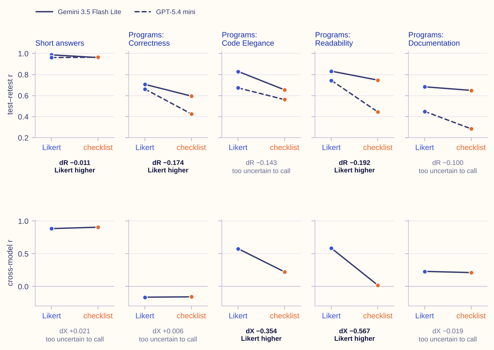
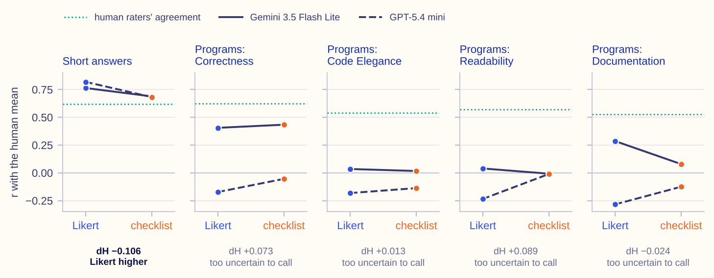
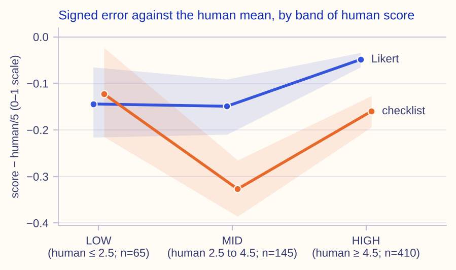
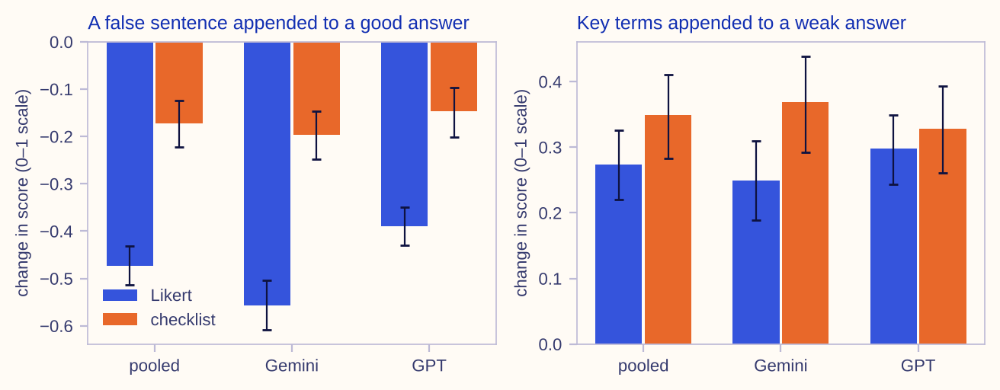
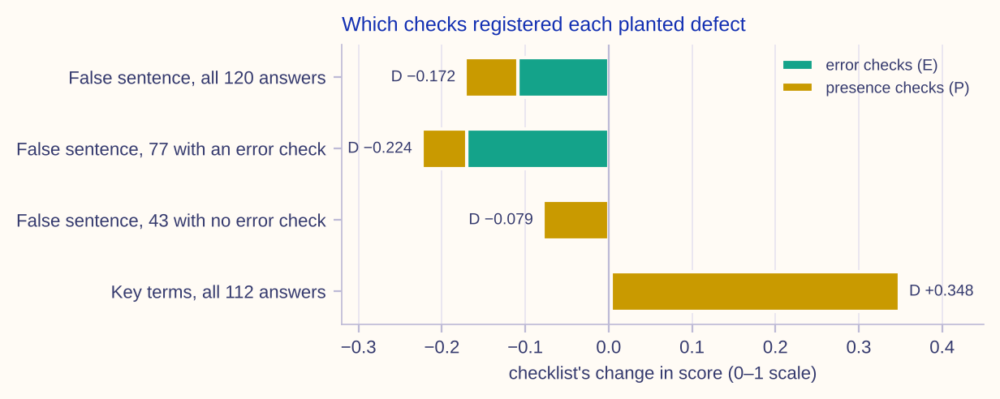

# Precise yes/no checklists and an AI grader: reliability, validity, and what a checklist cannot see

**David S. Porcaro**, Learning Design Alliance

*Research and writing carried out with Claude Code (Claude Opus 5.5, Anthropic). See [AI use](#ai-use).*

---

## Abstract

Researchers at Google recently proposed replacing each criterion of a rating-scale (Likert) rubric with
a list of precise yes/no questions, for evaluating AI answers to health questions. They reported that
raters then agreed with each other more often, in about half the time. Educators who use AI models to
grade student work could make the same change. This study asks three questions about it. Does a yes/no
checklist make an AI grader's scores more consistent? Do the scores still match human graders'
judgments? Does the checklist notice errors in a student's answer?

Two AI models (Gemini 3.5 Flash Lite and GPT-5.4 mini) graded the same student work twice in each
format. The rating-scale format used the original rubric. The checklist was written by a third AI model
from the same rubric, and its score was the share of questions answered yes. The work came from two
sources: 620 short answers from a university data-structures course, each scored by two human graders,
and 272 first-year Java programming assignments (226 usable), each scored by three or four human
graders. To test what each format notices, either a false sentence or a sentence that only lists the
right technical terms was added to real answers, and the score was compared with adding a neutral
sentence of the same length. The main analyses and their decision rules were fixed before any grading;
one follow-up analysis was added after the main results were in.

There was no evidence that the checklist made scores more consistent. On the short answers, each model
gave very consistent scores when it graded the same answers a second time, in both formats
(correlation 0.96–0.99), and the agreement between the two models did not clearly differ between
formats. On the programming assignments, the rating scale was the more consistent format in every
comparison where the difference was large enough to be clear.

The checklist matched the human graders less well. On the short answers its scores correlated 0.69 and
0.68 with the human graders' average for the two models, against 0.76 and 0.82 for the rating scale. It gave less credit
than the rating scale did to answers the human graders judged partly or fully correct.

The checklist registered errors much less than the rating scale did. A false sentence added to a good answer lowered the rating-scale
score by 47% of the scale, but the checklist score by only 17%. Most of what the checklist did catch
came from questions written specifically to look for mistakes. A sentence that merely named the right
terms raised the checklist score by 35% of the scale, against 27% for the rating scale.

On the programming assignments the models tracked the human graders weakly or not at all on three of
the four rubric dimensions, so the formats could not be compared there, and the comparison on the
fourth was too uncertain to call. For the two models tested, a
yes/no checklist did not make AI grading measurably more consistent, and a checklist built from a model
answer mostly checked whether the expected ideas were present, not whether the answer was correct.

## 1. Introduction

Rubrics are how a grader's judgment is made explicit, and a rubric's format decides what that
judgment can see. A Likert rubric asks for one rating per criterion on an ordered scale, often with a
descriptor for each level. A checklist asks a series of yes/no questions and counts the answers. The
choice between them is old in human assessment. It has become pressing again because large language
models now grade student work at scale, and the format of the rubric is one of the few things an
educator controls when a model does the grading.

The case for checklists is reliability. A yes/no question about one observable thing is easier to
answer the same way twice than a rating on a five-point scale, and a grader whose scores do not repeat
cannot be trusted with anything else. Mallinar et al. (2026) made this case for evaluating health
language models. They decomposed each Likert criterion into many precise yes/no questions ("Precise
Boolean rubrics"), and reported higher agreement between raters, including automated raters, in about
half the rating time. A framework from a large research organization, with a clear mechanism and a
reported gain, is the kind of evidence that changes practice. Educators building LLM grading for their
own courses can reasonably read it as a recommendation.

Reliability is necessary for a score's validity but is not sufficient for it. A score can repeat
perfectly and still measure the wrong thing. The question for an educator is therefore two-sided:
whether the checklist makes the grader more consistent, and whether the consistent score is still a
score of the student's understanding. The second half has particular force for checklists written
from a reference answer, because such a checklist asks whether the expected ideas are present. An
answer can contain every expected idea and also a false claim, or it can name every expected term
without understanding any of them.

This paper adds a direct test of that trade for LLM graders of student work. It compares the two
formats on identical inputs, with two models and repeated calls, against human raters, and with
defects planted into real answers so that what each format can see is known by construction. The
setting is deliberately the one educators face: short answers graded against a reference answer, and
programs graded against a published rubric.

## 2. Background

### 2.1 Checklists and global ratings in human assessment

Medical education has compared checklists with global rating scales for more than thirty years,
mostly in objective structured clinical examinations (OSCEs), where an examiner watches a student
perform a clinical task. A checklist lists specific actions, and the examiner marks each one as done
or not done (for example, "asked about allergies"). A global rating scale instead asks the examiner
for an overall judgment of the performance on one or a few ordered scales, such as overall competence
rated from 1 to 5, usually with a short description of each level. The checklist corresponds to this
study's yes/no checklist, and the global rating to its Likert format. Van der Vleuten, Norman and De Graaff (1991) argued that making a scoring
instrument more objective, by splitting judgment into many observable items, does not by itself make
scores more reliable. The companion paper (Norman, Van der Vleuten & De Graaff, 1991) took up the same
question for validity.

The comparative studies that followed mostly agree. Cunnington, Neville and Norman (1996) found global
ratings as reliable as checklists. Regehr, MacRae, Reznick and Szalay (1998) found global ratings more
reliable across stations and better at separating levels of training. Hodges, Regehr, McNaughton,
Tiberius and Hanson (1999) found that experienced clinicians scored lower than residents on
checklists while scoring higher on global ratings. A systematic review of simulation-based assessment
(Ilgen, Ma, Hatala & Cook, 2015) found similar inter-rater reliability for the two formats, higher
inter-station reliability for global ratings, and a pooled correlation of 0.76 between them. A recent high-stakes OSCE (Ibrahim et al., 2026) found the two formats correlated at 0.924,
yet the checklist failed no student at any station while the global rating found failures at four.

The opposing evidence comes from scoring rubrics in education. A holistic rubric gives the whole
piece of work one overall score. An analytic rubric scores each criterion separately, each on its own
scale, and then combines the scores. A topic-specific rubric is written for one task rather than for a
type of task. In this study the Likert format is holistic for the short answers (one score per answer)
and analytic for the programs (one score for each of four dimensions); the checklist splits each
criterion further, into yes/no checks. Jonsson and Svingby (2007) reviewed rubric studies and found
that analytic, topic-specific rubrics do raise the reliability of human scoring. Panadero and Jonsson (2020) reviewed 27 publications that criticize rubrics and grouped their
criticisms into six themes. With a few exceptions, they found the evidence behind the criticisms
neither direct nor strong: critics often relied on anecdote or personal experience, and often had a
narrow idea of rubrics in mind, such as their use only in high-stakes summative testing. They called
for the limitations of rubrics to be tested empirically. Their review weighs the evidence offered for
the criticisms; it does not show that the criticisms are wrong.
Barkaoui (2011) showed that the two kinds of reliability can part: in human essay raters, holistic
scoring gave higher agreement between raters while analytic scoring gave higher self-consistency.
Sadler (2009) gave the theoretical objection: a judgment of quality is not the sum of preset
criteria, so a decomposition can miss properties of the whole. Humphry and Heldsinger (2014) showed
that the structure of a rubric can itself threaten validity.

Two design traditions address what a checklist misses. Page and Bordage (1995) proposed scoring only
the key features of a case, the critical decisions on which success turns. Homer, Fuller, Hallam and
Pell (2020) showed that weighting checklist items changes the outcome for many borderline candidates.
Both point to items that decide a score rather than count toward it.

### 2.2 Checklists and decomposed rubrics for LLM judges

Work on LLMs as evaluators of generated text has moved in the same direction as Mallinar et al.
(2026). CheckEval (Lee et al., 2025) scores text with checklists of yes/no questions and reports
higher agreement across models. TICK (Cook et al., 2024) has a model generate an instruction-specific
checklist and reports higher agreement with humans. InFoBench (Qin et al., 2024) decomposes
instructions into requirements, and FLASK (Ye et al., 2024) decomposes evaluation into skills. Both
report more reliable evaluation. HealthBench (Arora et al., 2025) grades model responses against
physician-written rubric criteria with positive and negative weights. Likert-style scoring with an LLM
has its own baseline in G-Eval (Liu et al., 2023), and LLM-Rubric (Hashemi et al., 2024) calibrates
rubric answers to human judgments.

Most of these gains were measured where agreement started low. The evidence that decomposition can
weaken validity is thinner and recent. Furuhashi, Nakayama, Kodama and Sugawara (2025) gave LLM judges
generated checklists in two settings: pairwise comparison, where the judge picks the better of two
responses, and direct scoring, where it gives one response a score on a scale, as a grader does. The
checklists helped pairwise comparison, but their benefit was less consistent for direct scoring.
Zhang (2026) compared atomic and holistic LLM judges under matched prompts. Decomposing the candidate
answer did worse than a holistic judge where the label depends on completeness, while decomposing the
reference, checking whether each reference claim is covered, did better; what a judge decomposes should
follow what the label measures. Kucia, Chakraborty and Wróblewska (2026) found that longer rubric-style
prompts scored essays worse than short keyword prompts. Deng, Farber, Lee and Tang (2025) varied a different
property, the number of grade categories rather than any decomposition of a criterion. On a short-answer
benchmark, an LLM grader agreed well with experts when it chose between two labels (correct or
incorrect) and less well as the label set grew to three and five categories.

The nearest comparisons against an independent human reference were made on other material. DeLucia et
al. (2026) compared a general Likert judge, an analytic rubric and a dynamic checklist against
clinicians' completeness labels on health-chatbot responses, including HealthBench, and found all of
them near chance. On student programs, Pathak et al. (2025) found that grading one rubric point per
call agreed less with teaching assistants than grading against the whole rubric, and was harsher.
Sonkar et al. (2024) scored long chemistry answers as yes/no entailment of each rubric item and
reported it better than predicting a score. No study found here compares a yes/no checklist with a
Likert rubric on student short answers against independent human raters, or compares formats at
matched reliability.

### 2.3 Presence-based scoring and its vulnerabilities

A checklist written from a reference answer is a form of presence-based scoring: it asks whether
expected content appears. Automated short-answer scoring has used this design for two decades. c-rater
(Leacock & Chodorow, 2003) scored answers by the concepts they contain, and similarity-based graders,
including the one built on the Mohler corpus used here (Mohler, Bunescu & Mihalcea, 2011), score by
overlap with a reference.

Presence-based scorers are known to be gameable. Powers et al. (2002) found that experts could raise
e-rater's scores more easily than lower them. Ding et al. (2020) found that content-scoring systems
accepted many answers made of shuffled words. Filighera, Steuer and Rensing (2020) and Filighera,
Ochs, Steuer and Tregel (2024) found short-answer graders fooled by inserted words. Kabra et al.
(2020) found essay scorers overstable to added content. Yarmohammadtoosky et al. (2025) reported
defenses for short-answer graders. For LLM scorers, Walsh and Ivan (2026) tested robustness to
construct-irrelevant factors, and Doddapaneni et al. (2024) planted errors in text to find what LLM
evaluators miss, a behavioral-testing approach from Ribeiro et al. (2020).

In Messick's (1994, 1995) terms, a score that misses a false claim underrepresents the construct, and
a score raised by terms used without understanding carries construct-irrelevant variance. Kane's
(2013) validity argument frames both as failures of the scoring inference, the first step from a
performance to a score. Cook, Brydges, Ginsburg and Hatala (2015) give a practical guide to that
argument for assessment.

## 3. Research questions

- **RQ1.** When an LLM grader scores student work with a checklist of precise yes/no checks instead of a
  Likert rubric written from the same criterion, are its scores more reliable, across repeated calls
  and across two models?
- **RQ2.** Do the checklist scores track human raters as well as the Likert scores do, and if not,
  where on the human scale do the two formats part?
- **RQ3.** When a false sentence, or a sentence of key terms without understanding, is added to a real
  answer, does the checklist score change as the Likert score does, and which checks carry the change?

## 4. Method

### 4.1 Design

Every sampled item was graded in two formats, by two models, twice each, on identical inputs. The
grader in each format is the prompt plus the model, and the two formats differ only in what the model
is asked to return. The Likert grader returns one score per criterion on the corpus's own scale. The
checklist grader returns YES or NO to each check, and its score for a criterion is the share of YES,
unweighted, as in Mallinar et al. (2026). Each item is its own control.

The design, the thresholds, the predictions and the verdict strings were registered in the analysis
script before any model call. The instruments, the checklists and the planted sentences, were written,
hashed and frozen before any grading call. A detection floor was run first on synthetic graders shaped
like the data (§4.6, Appendix A.2). A second analysis (RQ2's comparison by band of human score and RQ3's per-check attribution) was chosen after
the primary results had been read, from the literature review, and registered before any of its own
estimates were computed. It is a follow-up, not part of the original registration, and it makes no
model call.

### 4.2 Data

**Short answers.** The Mohler corpus (Mohler, Bunescu & Mihalcea, 2011; released under CC BY 4.0) holds
answers by undergraduates to questions from a data-structures course. Each question has an
instructor's reference answer, and each answer was scored 0–5 by two raters independently. Exercises
11 and 12 were dropped because their per-rater scores are on another scale, which leaves 1,721 answers
to 62 questions. The main draw takes up to 10 answers per question in a fixed hashed order: 620
answers over 62 questions. The two raters' scores correlate at 0.621 on this draw (95%
interval 0.546 to 0.689, resampling questions).

**Programs.** The Menagerie corpus (Messer, Brown, Kolling & Shi, 2024; CC BY 4.0) holds first-year Java
coursework submissions re-graded by recruited raters on four dimensions (Correctness, Code Elegance,
Readability, Documentation). Each dimension uses a 14-level letter scale and the six-band rubric the
raters were given. Every submission with source code and at least three grades on every
dimension was used: 272 submissions. Their source files were concatenated and cut at 90,000
characters, which shortened 73 of them, identically for both formats. Neither format sees the
coursework specification, so Correctness cannot be judged against the assignment's requirements.

### 4.3 The two formats

**Likert.** For a short answer, the grader saw the question, the reference answer and the student's
answer, and returned a score from 0 to 5 in steps of 0.5. For a program, it saw each dimension's
definition and its six rubric bands, and returned one letter grade per dimension.

**Checklist.** A third model, GPT-5.5, wrote the checklists before any grading. For each Mohler question
it wrote three to eight checks from the question and the reference answer. For each Menagerie dimension
it wrote five to twelve checks from the dimension's definition and bands. The prompt asked for checks
about one thing each, answerable from the student's work, all YES for a fully correct answer, and
phrased so that YES is desirable. It neither asked for nor forbade checks that look for errors. The
result was 284 checks over 62 questions (three to seven each) and 10 to 12 checks per programming
dimension. The checklist grader saw everything the Likert grader saw except the scale and the band
descriptors, which the checks replaced.

Most checks ask whether something the reference answer expects is present, for example whether the
answer says that a stack removes the most recently added item first. These are *presence checks*. The
checklist author also wrote, unprompted, checks that ask whether the answer avoids a particular
mistake, for example whether it avoids describing a stack's removal order as first-in-first-out. These
are *error checks*. A word rule marks them: a check is an error check when its wording contains
"avoid", which is how the registration names them (its verdicts read AVOID-CHECKS-…). The rule was
fixed after the checklists were read and before any grading call. A second rule, registered before the
checklists were written, marks a *no-error check*: a check whose wording says the answer avoids, or
contains no, incorrect claim, error, mistake or misconception. The registration predicted that such checks would catch a false sentence added to an answer (§4.5),
and so narrow the gap between how much the checklist and the Likert format penalized it. Eight of the 284 checks match it, and all eight are also error checks, each
naming a mistake specific to its question, so the no-error checks are a subset of the error checks.

### 4.4 Models and calls

The two models were Gemini 3.5 Flash Lite, called directly through Google's API with its default
sampling, and GPT-5.4 mini, called directly through OpenAI's API with low reasoning effort. Each item
was graded twice per format per model, as independent calls. The model that served each call was
recorded, and every call was served by the model requested. In all, 10,976 gradings were made, and
none failed.

GPT-5.4 mini returned a wrong number of answers in 46 of its 544 checklist calls on programs (8.5%), on
45 submissions, for example 12 answers to Readability's 10 checks. One Gemini Likert call on a program
also did not parse. By the rule registered in advance, a submission with any unparseable call leaves
every programming table, which keeps 226 of 272 submissions. No short-answer
call failed to parse.

### 4.5 Planted defects

For RQ3, 120 short answers the raters scored highly (mean at least 4.5) and 120 they scored low (mean at
most 2.5) were drawn, at most three per question. For each answer GPT-5.5 wrote two sentences to append,
in the student's voice:

- **High answers.** A *false* sentence making a specific claim that contradicts the reference answer's
  key point.
- **Low answers.** A *key-terms* sentence naming the reference answer's technical terms without stating
  the correct relationship between them.
- **Both.** A *neutral* sentence that is true and adds no claim about the question's key ideas.

Each answer was graded twice in each format with the treatment appended and twice with the neutral
sentence appended, never in its original form. The contrast is therefore matched in position and,
closely, in length. Neutral sentences averaged 0.963 (false-sentence pairs) and 0.968 (key-terms pairs)
of the treatment's length, and every neutral sentence was within 0.75 to 1.33 times its own treatment's
length.

Gemini 3.1 Pro, as a manipulation checker, checked each pair. A model check is not a human one, and it is reported as such. All 120
false-sentence pairs passed; 112 of 120 key-terms pairs passed. The analysis uses the passing pairs.

### 4.6 Measures and analysis

Every score is put on a 0–1 scale: the Likert score over the scale maximum, and the checklist share of
YES. Each item's score is the mean of its two calls, except in test–retest reliability. Each measure is
described here in words; Appendix A gives its formula.

**Reliability and validity.** Reliability is a measure agreeing with itself. Test–retest reliability is
Pearson's correlation (*r*) between a model's two gradings of the same items, and cross-model
reliability is *r* between the two models' scores. Validity is not a single number here. It is the
case that a score means what it is taken to mean, and the study gathers three kinds of evidence for it
(Messick, 1995): whether the scores agree with the human raters, where in the range of answers they
part from them, and whether the scores respond to what the task is about and not to what it is not
(the planted defects). Agreement with the human raters, or *human agreement*, is *r* between a
format's scores and the mean human score, read beside the raters' agreement with each other, because
the human score is itself an unreliable reference.

**Differences between formats.** Each comparison is a difference between the formats, taken as
checklist minus Likert, so a positive difference favors the checklist. dR and dX are the differences
in test–retest and cross-model reliability and answer RQ1 (Table 1). dH is the difference in human
agreement and answers RQ2 (Table 2). The registration called this measure validity, so its verdicts
read LIKERT-MORE-VALID and BOOLEAN-MORE-VALID. dH and dR are averaged over the two models and also
reported for each model; dX compares the two models' scores directly.

**Planted defects.** D is how much a format's score changed when a planted sentence was added to an
answer, against the same answer with a neutral sentence of matched length. A negative D means the score
fell. C is the checklist's D minus the Likert D. For a false sentence, a positive C means the checklist
registered less of the error; for key terms without understanding, it means the checklist gave the
terms more credit. C answers RQ3 (Table 4). Because the checklist score is a share of YES answers, its D
splits exactly into the part that came from its error checks (E) and the part from its presence checks
(P). S is the error checks' share of the checklist's loss, and K is how much less the same answers
would have lost if they had been scored on their presence checks alone (Table 5).

**By band of human score.** In the short-answer assessments, a format's signed error on an answer is
its score minus the human mean on the same scale, so a positive error credits the answer more than the
raters did. G is the checklist's error minus the Likert format's within each band of human score. It
shows where in the range of answers the formats part, which a correlation cannot (RQ2, Table 3).

**Intervals and verdicts.** Intervals are 95% intervals from a bootstrap that resamples whole questions
for short answers, because answers to one question share a reference and a checklist, and whole
submissions for programs. The verdicts were registered with their margins. A difference is *clear*
when its 95% interval excludes zero: the data then show which format did better, and the verdict names
it. Otherwise it is EQUIVALENT if its 90% interval lies inside the margin (±0.05 for human agreement,
±0.03 for reliability), meaning any difference is too small to matter, and UNRESOLVED if not, meaning
the data are too uncertain to call either way.

**The detection floor.** Before any model call, the analysis was run on simulated graders built on the
real answers and human scores, with effects of known size planted in them, to check that it finds those
effects and does not invent others (Appendix A). It passed after one revision, and showed two limits
that bear on the results. First, a format with fewer possible scores looks less reliable even when its
judgments are equally consistent: two gradings near a boundary between scores round to different
values, and wider steps make each such jump larger. The checklist has fewer possible scores than the
Likert format, and in a simulation that gave the checklist seven possible scores (six checks) this alone
produced a spurious "Likert more reliable" verdict in 22.5% (short-answer assessments) and 23.5%
(assessments of software programs) of runs. The short-answer checklists actually used had four to eight
possible scores, close to the simulation. The program checklists had 11 to 13 against the Likert
format's 14, so on programs the grid can explain much less of the difference than 23.5% suggests. Second, with this many
programs a difference in human agreement of 0.10 is found only 56–58% of the time, so an UNRESOLVED
verdict on programs does not rule out differences up to about 0.15. In the short-answer assessments a
difference of 0.08 is found 95–97% of the time.

**Ethics and data.** Both corpora are public and released under CC BY 4.0. They were used under the
organization's protocol for open graded corpora. No student was contacted, and no human grade was sent
to a model. Student answers and programs were sent to the two models that graded them, and short
answers to the checklist author and the manipulation checker.

## 5. Results

### 5.1 Reliability (RQ1)

Table 1 and Figure 1 compare the formats' test–retest and cross-model reliability on the same items.
Agreement between the models was also computed in the unit the health framework used.

| corpus and dimension | test–retest, Likert / checklist (Gemini) | (GPT) | dR [95%] | verdict | cross-model, Likert / checklist | dX [95%] | verdict |
| --- | --- | --- | --- | --- | --- | --- | --- |
| Mohler short answers | 0.987 / 0.961 | 0.962 / 0.965 | −0.011 [−0.023, −0.001] | LIKERT-MORE-RELIABLE | 0.885 / 0.906 | +0.021 [−0.022, +0.067] | UNRESOLVED |
| Menagerie Correctness | 0.707 / 0.596 | 0.663 / 0.426 | −0.174 [−0.280, −0.063] | LIKERT-MORE-RELIABLE | −0.164 / −0.159 | +0.006 [−0.163, +0.143] | UNRESOLVED |
| Menagerie Code Elegance | 0.830 / 0.655 | 0.673 / 0.562 | −0.143 [−0.364, +0.016] | UNRESOLVED | 0.577 / 0.223 | −0.354 [−0.486, −0.200] | LIKERT-MORE-RELIABLE |
| Menagerie Readability | 0.832 / 0.747 | 0.745 / 0.445 | −0.192 [−0.429, −0.076] | LIKERT-MORE-RELIABLE | 0.586 / 0.019 | −0.567 [−0.675, −0.428] | LIKERT-MORE-RELIABLE |
| Menagerie Documentation | 0.684 / 0.650 | 0.451 / 0.285 | −0.100 [−0.224, +0.017] | UNRESOLVED | 0.231 / 0.212 | −0.019 [−0.187, +0.152] | UNRESOLVED |

*Table 1. Reliability at the response level. Test–retest is r between a model's two calls; cross-model is
r between the two models' mean scores. dR is the checklist-minus-Likert difference in test–retest,
averaged over the two models; dX is the difference in cross-model r. Intervals resample questions
(Mohler, n = 620) or submissions (Menagerie, n = 226).*

*Figure 1. Reliability from Table 1 as slope charts. In each panel a line runs from a model's r under the
Likert format (left) to its r under the checklist (right), so a falling line means the checklist was
less reliable. Top row: test–retest r for each model (solid Gemini 3.5 Flash Lite, dashed GPT-5.4 mini).
Bottom row: cross-model r, one line. Under each panel are the pooled difference and its verdict, in bold
where the data clearly show a difference. Source: `code/studies/measurement/grader-boolean-rubrics/out/results.json`.*

In the short-answer assessments both formats gave nearly the same scores on a second grading, at 0.96 to 0.99. The checklist was
lower by 0.011 in test–retest, a difference the floor shows the checklist's fewer possible scores can produce alone.
That difference is clear by the registered rule and also lies inside the ±0.03 margin. It came from
Gemini (−0.026, LIKERT-MORE-RELIABLE); GPT-5.4 mini's was EQUIVALENT (+0.003). Agreement between the
two models was 0.885 for Likert and 0.906 for the checklist, a difference of +0.021 too uncertain
to call.

In the assessments of software programs, every clear difference favored the Likert format, by 0.17 to 0.57. The two clear
test–retest differences came mainly from GPT-5.4 mini, whose own differences were −0.237 (Correctness)
and −0.300 (Readability). Part of the cross-model loss is one model's checklist not discriminating:
over all 272 submissions, in a block recorded after the results were read, Gemini's checklist answered
YES to nearly every check on Code Elegance and Readability (mean scores of 0.990 and 0.994, standard
deviations of 0.05 and 0.03). Two models' scores cannot agree when one of them barely varies.

The health framework computed agreement per (query, response, question) tuple. Recomputed that way on
the short-answer assessments, the two models agree at ICC(3,1) 0.803 per (answer, check) tuple, against 0.889 for the
checklist score and 0.865 for the Likert score per answer. ICC(3,1) is the intraclass correlation for
consistency between fixed raters, pooled over calls (Shrout & Fleiss, 1979). The tuple unit therefore
did not inflate agreement here. Of the 284 checks, 27% were answered YES at least 90% of the time and
5% at most 10% of the time.

**Answer to RQ1.** The checklist was not shown to make either model's scores more reliable. In the
short-answer assessments both formats were already near the ceiling of repeatability; in the
assessments of software programs the Likert format was more reliable wherever the data clearly showed a
difference.

### 5.2 Agreement with the human raters (RQ2)

Table 2 and Figure 2 compare each format's agreement with the mean human score, beside the raters'
agreement with each other, the ceiling against which any grader is read.

| corpus and dimension | n | Likert / checklist (Gemini) | Likert / checklist (GPT) | dH [95%] | verdict | human ceiling |
| --- | ---: | --- | --- | --- | --- | --- |
| Mohler short answers | 620 | 0.764 / 0.688 | 0.819 / 0.682 | **−0.106 [−0.165, −0.048]** | **LIKERT-MORE-VALID** | 0.621 (rater 1 vs rater 2) |
| Menagerie Correctness | 226 | 0.405 / 0.433 | −0.173 / −0.054 | +0.073 [−0.008, +0.150] | UNRESOLVED | 0.622 (one rater vs the rest) |
| Menagerie Code Elegance | 226 | 0.035 / 0.017 | −0.182 / −0.137 | +0.013 [−0.075, +0.092] | UNRESOLVED | 0.539 |
| Menagerie Readability | 226 | 0.039 / −0.007 | −0.235 / −0.011 | +0.089 [−0.043, +0.189] | UNRESOLVED | 0.571 |
| Menagerie Documentation | 226 | 0.286 / 0.079 | −0.284 / −0.125 | −0.024 [−0.109, +0.050] | UNRESOLVED | 0.525 |

*Table 2. Agreement with the human raters: r between each format's score (mean of two calls) and the
mean human score. dH is checklist minus Likert, averaged over the two models. Bold marks the one difference the data clearly show. The human
ceiling is the raters' agreement with each other on the same items: for Mohler, r between the two
raters; for Menagerie, r between one rater and the mean of the others, pooled.*

*Figure 2. Agreement with the human raters from Table 2 as slope charts: each model's r with the mean human score under the
Likert format (left) and the checklist (right), solid for Gemini 3.5 Flash Lite and dashed for GPT-5.4
mini. The dotted line is the human raters' agreement with each other on the same items. Under each panel
are the pooled difference and its verdict, in bold where the data clearly show a difference. Source:
`code/studies/measurement/grader-boolean-rubrics/out/results.json`.*

In the short-answer assessments the checklist agreed less with the raters for both models, by 0.075 for Gemini and
0.137 for GPT-5.4 mini. Against one rater at a time, the fair comparison with the raters' 0.621 with
each other, the Likert format reached 0.594 to 0.819, above the raters in two of four model-rater
pairs and level with them (0.620) in a third. The checklist reached 0.526 to 0.675. Both formats
gave nearly the same scores on a second grading (test–retest r 0.96 or above, §5.1), so the checklist's lower agreement is not explained by its
scores varying more from call to call.

The assessments of software programs cannot answer this question well. On Code Elegance, Readability and Documentation the
models tracked the raters weakly at best. Gemini reached −0.007 to 0.286; the 0.286, its Likert score on
Documentation, is the only interval that excludes zero (0.190 to 0.368). GPT-5.4 mini's correlations
were negative in both formats on every dimension, significantly so for its Likert scores on
Readability (−0.235, interval −0.408 to −0.004) and Documentation (−0.284, interval −0.453 to −0.045).
This is not a coding error: Gemini scored through the same pipeline and reached 0.405 and 0.433 on
Correctness. Per model, the formats also parted in opposite directions: GPT-5.4 mini's checklist agreed
better with the raters on Readability (+0.224, interval +0.078 to +0.340), and Gemini's Likert score
on Documentation (−0.207, interval −0.319 to −0.069). One pattern recorded after the results were read,
over all submissions each arm parsed, is that the raters gave longer submissions higher grades (*r*
0.40 to 0.53 with code length), while GPT-5.4 mini gave them lower ones (−0.14 to −0.50). A comparison
of formats is uninformative where neither format measures the construct well.

To see where the formats part in the short-answer assessments, the signed error of each format against the human mean
was compared by band of human score (Table 3, Figure 3).

| human band | n | Likert error | checklist error | checklist − Likert (G) | verdict |
| --- | ---: | --- | --- | --- | --- |
| LOW (human mean ≤ 2.5) | 65 | −0.144 [−0.216, −0.065] | −0.123 [−0.215, −0.023] | +0.022 [−0.071, +0.120] | UNRESOLVED |
| MID (2.5 to 4.5) | 145 | −0.149 [−0.210, −0.091] | −0.327 [−0.386, −0.265] | **−0.178 [−0.234, −0.120]** | **CHECKLIST-LOWER** |
| HIGH (≥ 4.5) | 410 | −0.049 [−0.065, −0.034] | −0.160 [−0.194, −0.127] | **−0.111 [−0.143, −0.081]** | **CHECKLIST-LOWER** |

*Table 3. Signed error (score minus human mean over 5, both on a 0–1 scale), pooled over models, by band
of human score, on the 620 short answers. Intervals resample questions. Bold marks differences
the data clearly show.*

*Figure 3. Mean signed error against the human mean by band of human score, for the Likert and checklist
formats, pooled over the two models. Points are means on a 0–1 scale, joined across the bands; shaded
regions are 95% intervals resampling questions. A point below zero credits answers less than the raters
did. Source: `code/studies/measurement/grader-checklist-defects/out/results.json`.*

The checklist was not shown to over-credit wrong answers: in the LOW band its difference from the
Likert format was +0.022, too uncertain to call, with an interval that does not rule out over-credit of up to
0.12. It under-credited answers the raters judged partly correct by 0.178 more than the Likert format in the MID
band, and fully correct ones by 0.111 more in the HIGH band. Because the shortfall is largest in the middle band, it narrows the distance
between partly correct and wrong answers, which is consistent with the lower correlation. Band means do
not decompose a correlation, and disagreement within bands was not measured.

**Answer to RQ2.** No. In the short-answer assessments the checklist agreed less with the human raters
than the Likert format, for both models. It under-credited partly and fully correct answers, which is
consistent with that loss, and it was not shown to over-credit wrong ones. In the assessments of software programs the
question could not be answered, because the models tracked the raters weakly or not at all on most
dimensions.

### 5.3 Planted defects (RQ3)

A false sentence and a key-terms sentence were each appended to real answers, against a neutral
sentence of closely matched length on the same answer. The change in score therefore measures what each
format registers about the added content alone (Table 4, Figure 4).

| planted defect | n | Likert change D | checklist change D | C (checklist − Likert) | verdict |
| --- | ---: | --- | --- | --- | --- |
| false sentence, appended to a good answer | 120 | −0.473 [−0.514, −0.431] | −0.172 [−0.223, −0.124] | **+0.302 [+0.255, +0.348]** | **CHECKLIST-BLIND-TO-CONTRADICTION** |
| key terms, appended to a weak answer | 112 | +0.273 [+0.220, +0.325] | +0.348 [+0.283, +0.410] | **+0.075 [+0.014, +0.136]** | **CHECKLIST-REWARDS-STUFFING** |

*Table 4. Mean change in score (0–1 scale) when the defect sentence replaces a length-matched neutral
sentence on the same answer, pooled over the two models. Intervals resample questions. Bold marks
differences the data clearly show.*

*Figure 4. Mean change in score under each planted defect, for each format, pooled and for each model.
Bars are means on a 0–1 scale; whiskers are 95% intervals resampling questions. Source:
`code/studies/measurement/grader-boolean-rubrics/out/results.json`.*

One false sentence lowered a good answer 0.473 on the Likert scale and 0.172 on the checklist score. Both
models showed the same direction: the checklist's loss was 0.361 smaller for Gemini and 0.243 smaller
for GPT-5.4 mini. Key terms without understanding raised both formats, by 0.273 (Likert) and 0.348
(checklist). The difference was clear when pooled and for Gemini, but not for GPT-5.4 mini (+0.031, 95%
interval −0.028 to +0.089). The registered split by no-error checks (§4.3) points the same way, though
those checks are a subset of the error checks and so not an independent test: on the 13 answers whose
checklist had one, the checklist lost 0.300 against the Likert format's 0.535; on the other 107 it lost
0.156 against 0.466.

The per-check answers show which checks carried these changes (Table 5, Figure 5).

| answers, and the sentence added to each | n | change in checklist score (D) | part from error checks (E) | part from presence checks (P) | verdicts |
| --- | ---: | --- | --- | --- | --- |
| Good answers given a false sentence: all of them | 120 | −0.172 [−0.220, −0.123] | −0.109 [−0.152, −0.072] | −0.063 [−0.090, −0.033] | PRESENCE-CHECKS-REGISTER-CONTRADICTION |
| Good answers given a false sentence: the 77 whose checklist has at least one error check | 77 | −0.224 [−0.288, −0.157] | −0.170 [−0.223, −0.122] | | error checks' share S 0.760 [0.639, 0.915]: AVOID-CHECKS-CARRY-THE-LOSS |
| Good answers given a false sentence: the 43 whose checklist has no error check | 43 | −0.079 [−0.125, −0.026] | | | |
| Weak answers given a key-terms sentence: all of them | 112 | +0.348 [+0.283, +0.411] | +0.003 [−0.010, +0.015] | +0.346 [+0.286, +0.404] | PRESENCE-CHECKS-REWARD-KEY-TERMS |

*Table 5. Which checks moved the checklist's score when a sentence was planted. Each row is a set of
answers that received the planted sentence (§4.5): the 120 good answers given a false sentence, split
in the middle two rows by whether the question's checklist had any error check, and the 112 weak
answers given a sentence of key terms. D is the change in the checklist score against the same answer
with a neutral sentence; E is the part of that change that came from the error checks (checks asking
whether the answer avoids a particular mistake, §4.3) and P the part from the presence checks, so
D = E + P. S is E divided by D. A blank cell is a value not reported for that row; the 43 answers have
no error checks, so all of their change is P. In plain words, the verdicts say that presence checks registered the
false sentence a little, that error checks carried most of the loss where they existed, and that the
key-terms gain came from presence checks. Pooled over the two models; intervals resample questions.
The two analyses draw separate bootstrap resamples, so an interval here can differ from Table 4's in
the third decimal for the same point estimate.*

*Figure 5. The checklist's change in score under each planted defect from Table 5, split into the change
on its error checks (E) and on its presence checks (P); the bar's full length is D. For the 77 answers
with an error check, P is D minus E, computed before rounding. The 43 answers with no error check have
only presence checks, so all of their change is P. The key-terms bar's error-check part (Table 5) is too small
to see. Source: `code/studies/measurement/grader-checklist-defects/out/results.json`.*

Where a checklist had error checks, those checks carried 76% of its loss to a false sentence. A second way to put it: re-scored on its
presence checks alone, the same 77 answers would have lost 0.095 instead of 0.224 (difference +0.129,
95% interval +0.084 to +0.177), 58% less (computed before rounding). The two shares differ because
removing the error checks also changes the denominator of the share of YES. Presence checks registered
the false sentence on their own at −0.063. A reversal is a change in a check's two-call majority
answer between the neutral and the treated form. Error checks reversed from YES to NO in 49.1% of
check-answer-model cases. Presence checks reversed from YES to NO in 10.5%, against a call-to-call disagreement of
4.0% on the neutral form.

The key-terms gain was entirely presence checks turning from NO to YES, in 45.9% of cases against a
call-to-call disagreement of 2.5%. The error checks did not move (+0.003). Whether those presence checks
asked only that an idea be mentioned, or that it be stated correctly and the models credited a mention,
cannot be told from the per-check answers.

**Answer to RQ3.** No. A checklist written from a reference answer lost 0.36 times what the Likert
score lost to a false claim (computed before rounding), and gained more from key terms used without
understanding (pooled and for Gemini; too uncertain to call for GPT-5.4 mini). It registered a false claim mainly
through checks written to look for errors; without them it lost 0.079 of its scale on the 43 answers
concerned, where the Likert format lost 0.442.

### 5.4 Registered predictions

Every prediction registered before its analysis is listed in Table 6 with its outcome. A prediction is
not a verdict: it records what the design expected, and a failed one is reported, not hidden.

| question | prediction, registered before the analysis | outcome | held |
| --- | --- | --- | --- |
| RQ1 | Short answers: the checklist is more reliable on a second grading (dR above zero) | Likert more reliable (Table 1) | no |
| RQ1 | Short answers: the checklist agrees more across models (dX above zero) | point estimate above zero, as predicted; too uncertain to call (Table 1) | yes, on the point estimate |
| RQ1 | Agreement per check, the health framework's unit, exceeds agreement per answer | lower per check (§5.1) | no |
| RQ2 | Short answers: the checklist's human agreement is no worse than the Likert format's by more than the margin | point estimate −0.106, beyond the margin; the 95% interval's upper end, −0.048, is just inside it (Table 2) | no |
| RQ2 | Programs, Documentation and Readability: no worse by more than the margin | as predicted, on the point estimates (Table 2) | yes |
| RQ2 | Programs, Code Elegance: the checklist agrees less | it agreed slightly more (Table 2) | no |
| RQ2 (follow-up) | Wrong answers (LOW band): the checklist credits them more | too uncertain to call (Table 3) | no |
| RQ2 (follow-up) | Fully correct answers (HIGH band): the checklist credits them less | CHECKLIST-LOWER (Table 3) | yes |
| RQ3 | A false sentence lowers the checklist score less (CHECKLIST-BLIND-TO-CONTRADICTION), less so with a no-error check | as predicted (Table 4, §5.3) | yes |
| RQ3 | Key terms raise the checklist more (CHECKLIST-REWARDS-STUFFING) | as predicted (Table 4) | yes |
| RQ3 (follow-up) | Presence checks register a false sentence a little | PRESENCE-CHECKS-REGISTER-CONTRADICTION (Table 5) | yes |
| RQ3 (follow-up) | Error checks carry a share or most of the loss, and dropping them would blunt the score | AVOID-CHECKS-CARRY-THE-LOSS (Table 5), AVOID-CHECKS-ADD-SENSITIVITY (§5.3) | yes |
| RQ3 (follow-up) | The key-term gain comes from presence checks | PRESENCE-CHECKS-REWARD-KEY-TERMS (Table 5) | yes |

*Table 6. Registered predictions and their outcomes. The margin is ±0.05 r for human agreement. The
primary study's predictions on reliability and human agreement were registered as conditions on point
estimates and are judged that way; the predictions named by a verdict, in RQ3 and the follow-up, are
judged by their verdicts. The follow-up's predictions
were registered after the primary results had been read and before its own estimates were computed
(§4.1).*

## 6. Discussion

### 6.1 Interpretation

The results fit the human literature more closely than the recent LLM-judge literature. Checklists were
not more reliable than global ratings for human examiners (Van der Vleuten et al., 1991; Regehr et al.,
1998; Ilgen et al., 2015), and they were not shown to be for these two models either. The reliability gains
reported for LLM checklists (Lee et al., 2025; Cook et al., 2024; Mallinar et al., 2026) were measured
where agreement started low. Here, in the short-answer assessments, both models already gave nearly the same scores on a second
grading with a Likert prompt, which left a checklist almost no room to improve consistency. In the
assessments of software programs, where
the models were not consistent, the checklist did not help either. This does not contradict Jonsson and
Svingby's (2007) finding for human raters, but it gives no support to the idea that decomposition helps
an inconsistent model grader.

The three kinds of validity evidence point the same way. The checklist agreed less with the human
raters, and not because its scores varied more from call to call. The band analysis shows where it
departed instead: it under-credited partial and complete answers, which parallels Hodges et al.'s (1999) finding for checklists scoring experts, and Sadler's
(2009) argument that quality is not the sum of preset criteria. An LLM grader of student programs that
checked one rubric point per call was likewise harsher than teaching assistants, because it withheld
partial credit (Pathak et al., 2025).

The planted defects show the other half. A checklist written from a reference answer decomposes the
reference, which suits a label about coverage (Zhang, 2026) but not one that also penalizes errors, as
the Mohler raters' scores do. Most of its checks ask whether expected content is present, so content
that is added, whether false or irrelevant, is outside what they ask about. In Messick's (1994) terms,
the missed false claim is construct underrepresentation and the key-term gain is construct-irrelevant
variance. The planted defects are the kind of empirical test of a rubric's limits that Panadero and
Jonsson (2020) asked for, here for a model-written checklist read by an AI grader. The same pattern has been seen when rubric-based LLM judges are used as rewards: gains
concentrated on presence-based criteria while factual correctness fell (Mahmoud et al., 2026).

The design implication is the one Page and Bordage (1995) drew for clinical cases, and LLM rubrics
already provide for it: HealthBench weights some criteria negatively (Arora et al., 2025), and Rubrics
as Rewards writes "pitfall" criteria for common errors, phrased so that meeting them is good, and marks
some criteria as invalidating a response if missed (Gunjal et al., 2025). Here the error checks carried
most of the loss, but as counted items, one vote among several, and they did not bring the checklist to
the Likert format's sensitivity.

The checklist format also brought failures of its own that a Likert prompt does not have. Gemini's
checklist answered YES to nearly every check on Code Elegance and Readability. That is not a general
tendency to say yes: LLMs answering yes/no questions lean toward *no* (Braun, 2025). Those checks did
not discriminate between submissions. GPT-5.4 mini returned the wrong number of answers in 8.5% of its
checklist calls on programs, where each call carried 44 checks across four dimensions. That fits the
finding that models lose track of instructions as their number grows (Jaroslawicz, Whiting, Shah &
Maamari, 2025). A longer checklist is a longer list of instructions to follow in one reply.

The comparison with Mallinar et al. (2026) has a limit that should be stated plainly. That study
measured agreement between raters, including human raters, on health-advice responses, and its
abstract makes no claim about agreement with an independent reference. This study measured LLM graders
on student work against human raters. The two results are not in conflict on reliability among human
raters, which this study did not test. They differ on what a checklist is evidence for. A gain in
agreement between raters is not a gain in validity, and the two should not be reported as one.

### 6.2 Implications for practice

A precise yes/no checklist should not be adopted for LLM grading on the expectation that it will make
scores more consistent. Both models tested were already consistent with a Likert prompt when grading
against a reference answer, and the checklist was not shown to improve on it (RQ1). In the assessments of
software programs it was less consistent wherever the data clearly showed a difference.

A checklist written from a reference answer mostly measures whether the expected content is present,
not whether the answer is right (RQ3). It can pass an answer that contains the right ideas and a false
claim, and it can credit an answer that names the right terms without understanding them. An educator
who uses one should write checks that look for the specific errors and misconceptions that matter,
because most of what a checklist registered of a mistake came through such checks (RQ3). They may work
better as items that decide or cap a score than as one vote among many, which remains to be tested.

A checklist score should not be read on the same scale as a holistic grade. It runs low for answers
that are partly or fully correct (RQ2), so a pass mark set for one format will not transfer to the
other.

Results reported for one population of raters, or for one kind of content, should not be carried to
another without a check. A framework validated on health-advice responses and human raters does not by
that fact apply to LLM graders of student work. The checks that matter are agreement with independent
human graders and a planted error the grader must catch.

### 6.3 Implications for research

Reliability and validity should be reported separately for any change of rubric format. Where a
format's reliability is compared, the unit (per response or per check) and the facet (repeated calls,
different models, different human raters) should be named. A coarser output scale loses repeatability
on its own (Bollen & Barb, 1981), and the detection floor showed that this is large enough to produce a
spurious verdict here, so formats with different scales need that control.

Planted defects are an established test of evaluators (Ribeiro et al., 2020; Doddapaneni et al., 2024).
With a size-matched neutral sentence on the same answer as the control, they are a cheap and direct
test of what a scoring rubric can see, and they need no new human grading. They should accompany any
proposal for a new rubric format.

Several questions are open. One is whether decisive error checks, items that cap or veto a score,
close the gap that counted error checks only narrowed; rubric-based rewards mark such criteria but
still aggregate them as weighted items (Gunjal et al., 2025). Another is whether learned weights over
the checks recover the human agreement the unweighted share loses. These can be tested on the per-check answers
this release publishes. Others need new data: whether the results hold for human raters using LLM-written
checklists, and for stronger models on judgment-laden work such as the software programs here. Neither model
graded the software programs well, so that question remains open.

## 7. Threats to validity

### 7.1 Construct validity

The checklists were written by one model, from one prompt, with no human review. A teacher writing
checks by hand, or a different prompt, might produce checklists with more error checks or better
coverage. The result is a result about model-written checklists of this kind, which is how such
checklists are likely to be produced at scale, and not about analytic rubrics in general (Panadero &
Jonsson, 2020).

The distinction between error checks and presence checks rests on a word rule over the checklist text.
The rule was fixed before any grading call, and the attribution in Table 5 follows exactly from it.
Checks that look for mistakes without the word "avoid" would be counted as presence checks, which would
make the presence checks look more sensitive to errors than they are.

The planted sentences were written by one model and checked by another. A model check is not a person
reading each pair. The false sentences are clear contradictions of the key point. Subtler errors, such
as a wrong detail inside a mostly correct sentence, may be registered less often by both formats.

The human reference is itself unreliable. In the short-answer assessments the two raters agree at 0.621, and in the
assessments of software programs the raters at 0.525 to 0.622. Agreement with the raters in Table 2 is
attenuated by that unreliability for both formats alike. Attenuation scales both correlations by the same factor, so it can shrink the difference
between the formats but not reverse its sign.

### 7.2 Internal validity

The two formats saw identical inputs except the scale and band descriptors, which the checks replaced.
A Likert prompt carrying the bands' language and a checklist carrying the checks' language differ in
more than format. That is inherent in the comparison, and it is the comparison an educator would make.

The 46 programs dropped for unparseable calls (45 of them for miscounted checklist answers) were not
dropped at random. Every Menagerie
estimate is on the remaining 226, and the format comparison there is uninformative for other reasons
(§5.2).

### 7.3 External validity

Two small, inexpensive models were tested. Larger models might follow long checklists better and might
grade the software programs. The short answers come from one course in one subject, with short reference answers;
longer or more open questions may favor or disfavor checklists differently. No human rater used either
format, so nothing here says how checklists affect human graders, the population Mallinar et al.
(2026) studied.

### 7.4 Statistical conclusion validity

The intervals resample questions or submissions, the units within which answers share a reference and a
checklist. The detection floor confirmed that the verdict rules find most of the planted effects it
tested (not differences of 0.10 in human agreement on programs; §4.6) and, when both formats share a scale, rarely find effects that are not there (§4.6 gives the
exception for different scales), but it was written and scored by the same session that ran the study. In the assessments of software programs, a difference in human agreement smaller than about 0.15
could go undetected. Several estimates were reported per corpus and dimension without correction for
multiplicity. The short-answer difference in human agreement and the false-sentence contrast have
intervals well away from zero. The key-terms contrast
(lower bound +0.014) and the test–retest difference (upper bound −0.001) do not, and could fail a
correction for multiplicity.

### 7.5 Conflict of interest

The Learning Design Alliance, my own organization, builds learning tools that grade student work with
LLMs, and its choice of rubric format could be informed by this study. The design, the instruments
and the analysis were all produced within it. No research team independent of this work has
reproduced it. Before publication, an AI agent with no part in the work reproduced every result from
the release files alone.
The corpora and the human grades were produced by other people. The work was carried out with Claude
Code, an Anthropic product; neither model under test is an Anthropic model, and the checklist author
and the manipulation checker were OpenAI and Google models.

## 8. Conclusion

For two LLM graders of short-answer assessments and assessments of software programs, replacing a Likert rubric with a checklist of
precise yes/no checks was not shown to make scores more reliable: in the short-answer assessments both formats were
already near the ceiling of repeatability, and in the assessments of software programs the checklist was less reliable
wherever the difference was large enough to be clear. In the short-answer assessments every kind of
validity evidence went against it. Its scores agreed less with the human raters, and it under-credited
partly and fully correct answers. Written from a reference answer, it mostly checked
whether the expected content was present: it barely registered a false claim unless it had checks
written to look for errors, and it rewarded key terms used without understanding.

The reliability gains reported for checklists elsewhere were measured on different raters and different
content, and a gain in agreement between raters is not a gain in validity. An educator choosing a rubric format for
LLM grading should test it against independent human grades and with planted errors before trusting it.

## 9. Data, code and provenance

**Data.** The study reads two public corpora: the Mohler short-answer corpus (Hugging Face mirror
nkazi/MohlerASAG, <https://huggingface.co/datasets/nkazi/MohlerASAG>) and Menagerie (OSF,
<https://osf.io/q8jbt>), both released under CC BY 4.0. The release file records each file's location
and SHA-256. The release publishes no student answer or program text, no short-answer checklist or
planted sentence, and no prompt text; the programming checklists, written from the corpus's public
rubric, are in the code package (`code/studies/measurement/grader-boolean-rubrics/out/checklists.json`).

**Per-case outputs.** `per-case-model-outputs.jsonl`, beside the release file, holds every grading:
ids, human scores, draw membership, each checklist's length and per-check type flags, the perturbation
flags, and each call's scores and per-check YES/NO. Every analysis in this paper runs from that file
alone.

**Code.** The release's `code/` package holds the two analysis scripts, their outputs, the figure
script and the shared helpers they import. `code/studies/measurement/grader-boolean-rubrics/boolean.py`
is the registered study; its docstring is the full record of the design, the floor and its revision.
`code/studies/measurement/grader-checklist-defects/defects.py` is the follow-up. The model calls cannot be
re-sent from the release, because the checklists and planted sentences paraphrase the corpus text,
which the release does not publish. Every number can be recomputed from the per-case file.

**Reproducing the results.** `reproduce.py`, beside the release file, reruns each analysis from the
per-case file and compares each output with the published one, byte for byte.

| result | study | `reproduce.py` step | notebook |
| --- | --- | --- | --- |
| Tables 1, 2 and 4 | `grader-boolean-rubrics` | `rq12-analyse` | `rq1-reliability`, `rq2-validity`, `rq3-defects` |
| The detection floor (§4.6, Appendix A.2) | `grader-boolean-rubrics` | `floor` | |
| Tables 3 and 5 | `grader-checklist-defects` | `rq23-mechanism` | `rq2-validity`, `rq3-defects` |
| The follow-up's floor | `grader-checklist-defects` | `mechanism-floor` | |
| Figures 1 to 5 | `grader-checklist-defects/figures.py` | `figures` | |

## AI use

I, David Porcaro, orchestrated the development of this report. I asked the questions that drove this
benchmark study, pointed the coding agent to methods, articles, and datasets and responded to
questions. I supervised errors and made decisions on fixes.

I did not write the methods or code, I did not write the report itself, nor did I review all the prior
research cited. I do not claim to have done anything I did not.

I did review every line of the final report to make sure I understood the background, methods and
results, and only signed off when I had successfully answered questions about the headline results and
findings from the agent.

## References

Aguinis, H., Pierce, C. A., & Culpepper, S. A. (2009). Scale coarseness as a methodological artifact: Correcting correlation coefficients attenuated from using coarse scales. *Organizational Research Methods*, 12(4), 623–652. <https://doi.org/10.1177/1094428108318065>

Arora, R. K., Wei, J., Soskin Hicks, R., Bowman, P., Quiñonero-Candela, J., Tsimpourlas, F., Sharman, M., Shah, M., et al. (2025). HealthBench: Evaluating large language models towards improved human health. *arXiv preprint* 2505.08775. <https://arxiv.org/abs/2505.08775>

Barkaoui, K. (2011). Effects of marking method and rater experience on ESL essay scores and rater performance. *Assessment in Education: Principles, Policy & Practice*, 18(3), 279–293. <https://doi.org/10.1080/0969594X.2010.526585>

Bollen, K. A., & Barb, K. H. (1981). Pearson's R and coarsely categorized measures. *American Sociological Review*, 46(2), 232. <https://doi.org/10.2307/2094981>

Braun, D. (2025). Acquiescence bias in large language models. *Findings of the Association for Computational Linguistics: EMNLP 2025*. <https://doi.org/10.18653/v1/2025.findings-emnlp.607>

Cook, D. A., Brydges, R., Ginsburg, S., & Hatala, R. (2015). A contemporary approach to validity arguments: A practical guide to Kane's framework. *Medical Education*, 49(6), 560–575. <https://doi.org/10.1111/medu.12678>

Cook, J., Rocktäschel, T., Foerster, J., Aumiller, D., & Wang, A. (2024). TICKing all the boxes: Generated checklists improve LLM evaluation and generation. *arXiv preprint* 2410.03608. <https://arxiv.org/abs/2410.03608>

Cunnington, J. P. W., Neville, A. J., & Norman, G. R. (1996). The risks of thoroughness: Reliability and validity of global ratings and checklists in an OSCE. *Advances in Health Sciences Education*, 1(3), 227–233. <https://doi.org/10.1007/BF00162920>

DeLucia, A., Huang, H., Joshi, S., Yarmohammadi, M., Hassoon, A., & Dredze, M. (2026). Same verdict, different reasons: LLM-as-a-judge and clinician disagreement on medical chatbot completeness. *arXiv preprint* 2604.16383. <https://arxiv.org/abs/2604.16383>

Deng, H., Farber, C., Lee, J., & Tang, D. (2025). Rubric-conditioned LLM grading: Alignment, uncertainty, and robustness. *arXiv preprint* 2601.08843. <https://arxiv.org/abs/2601.08843>

Ding, Y., Riordan, B., Horbach, A., Cahill, A., & Zesch, T. (2020). Don't take "nswvtnvakgxpm" for an answer: The surprising vulnerability of automatic content scoring systems to adversarial input. *Proceedings of COLING 2020*, 882–892. <https://doi.org/10.18653/v1/2020.coling-main.76>

Doddapaneni, S., Khan, M. S. U. R., Verma, S., & Khapra, M. M. (2024). Finding blind spots in evaluator LLMs with interpretable checklists. *Proceedings of EMNLP 2024*, 16279–16309. <https://doi.org/10.18653/v1/2024.emnlp-main.911>

Filighera, A., Ochs, S., Steuer, T., & Tregel, T. (2024). Cheating automatic short answer grading with the adversarial usage of adjectives and adverbs. *International Journal of Artificial Intelligence in Education*, 34(2), 616–646. <https://doi.org/10.1007/s40593-023-00361-2>

Filighera, A., Steuer, T., & Rensing, C. (2020). Fooling automatic short answer grading systems. In *Artificial Intelligence in Education (AIED 2020)*, 177–190. <https://doi.org/10.1007/978-3-030-52237-7_15>

Furuhashi, M., Nakayama, K., Kodama, T., & Sugawara, S. (2025). Are checklists really useful for automatic evaluation of generative tasks? *Proceedings of EMNLP 2025*. <https://doi.org/10.18653/v1/2025.emnlp-main.538>

Gunjal, A., Wang, A., Lau, E., Nath, V., He, Y., Liu, B., & Hendryx, S. (2025). Rubrics as rewards: Reinforcement learning beyond verifiable domains. *arXiv preprint* 2507.17746. <https://arxiv.org/abs/2507.17746>

Hashemi, H., Eisner, J., Rosset, C., Van Durme, B., & Kedzie, C. (2024). LLM-Rubric: A multidimensional, calibrated approach to automated evaluation of natural language texts. *Proceedings of ACL 2024*, 13806–13834. <https://doi.org/10.18653/v1/2024.acl-long.745>

Hodges, B., Regehr, G., McNaughton, N., Tiberius, R., & Hanson, M. (1999). OSCE checklists do not capture increasing levels of expertise. *Academic Medicine*, 74(10), 1129–1134. <https://doi.org/10.1097/00001888-199910000-00017>

Homer, M., Fuller, R., Hallam, J., & Pell, G. (2020). Shining a spotlight on scoring in the OSCE: Checklists and item weighting. *Medical Teacher*, 42(9), 1037–1042. <https://doi.org/10.1080/0142159X.2020.1781072>

Humphry, S. M., & Heldsinger, S. A. (2014). Common structural design features of rubrics may represent a threat to validity. *Educational Researcher*, 43(5), 253–263. <https://doi.org/10.3102/0013189X14542154>

Ibrahim, O. R., McCall, N., Bekele, A., et al. (2026). Agreement and reliability of global rating versus checklist scores in a high-stakes undergraduate OSCE in Rwanda. *BMC Medical Education*, 26(1), 460. <https://doi.org/10.1186/s12909-026-08809-4>

Ilgen, J. S., Ma, I. W. Y., Hatala, R., & Cook, D. A. (2015). A systematic review of validity evidence for checklists versus global rating scales in simulation-based assessment. *Medical Education*, 49(2), 161–173. <https://doi.org/10.1111/medu.12621>

Jaroslawicz, D., Whiting, B., Shah, P., & Maamari, K. (2025). How many instructions can LLMs follow at once? *arXiv preprint* 2507.11538. <https://arxiv.org/abs/2507.11538>

Jonsson, A., & Svingby, G. (2007). The use of scoring rubrics: Reliability, validity and educational consequences. *Educational Research Review*, 2(2), 130–144. <https://doi.org/10.1016/j.edurev.2007.05.002>

Kabra, A., Bhatia, M., Kumar, Y., Li, J. J., & Shah, R. R. (2020). Evaluation toolkit for robustness testing of automatic essay scoring systems. *arXiv preprint* 2007.06796. <https://arxiv.org/abs/2007.06796>

Kane, M. T. (2013). Validating the interpretations and uses of test scores. *Journal of Educational Measurement*, 50(1), 1–73. <https://doi.org/10.1111/jedm.12000>

Kucia, P., Chakraborty, S., & Wróblewska, A. (2026). LLM essay scoring under holistic and analytic rubrics: Prompt effects and bias. In *Computational Science – ICCS 2026*, LNCS 16789, 531–546. <https://doi.org/10.1007/978-3-032-29918-5_38>

Leacock, C., & Chodorow, M. (2003). C-rater: Automated scoring of short-answer questions. *Computers and the Humanities*, 37(4), 389–405. <https://doi.org/10.1023/A:1025779619903>

Lee, Y., Kim, J., Kim, J., Cho, H., Kang, J., Kang, P., & Kim, N. (2025). CheckEval: A reliable LLM-as-a-judge framework for evaluating text generation using checklists. *Proceedings of EMNLP 2025*. <https://doi.org/10.18653/v1/2025.emnlp-main.796>

Liu, Y., Iter, D., Xu, Y., Wang, S., Xu, R., & Zhu, C. (2023). G-Eval: NLG evaluation using GPT-4 with better human alignment. *Proceedings of EMNLP 2023*. <https://doi.org/10.18653/v1/2023.emnlp-main.153>

Mahmoud, A., Rezaei, M., Wang, Z., Gunjal, A., Liu, B., & He, Y. (2026). Reward hacking in rubric-based reinforcement learning. *arXiv preprint* 2605.12474. <https://arxiv.org/abs/2605.12474>

Mallinar, N., Heydari, A. A., Liu, X., Faranesh, A. Z., Winslow, B., Hammerquist, N., Graef, B., Speed, C., et al. (2026). A scalable framework for evaluating health language models. *npj Digital Medicine*, 9, 437. <https://doi.org/10.1038/s41746-026-02492-x>

Messer, M., Brown, N. C. C., Kölling, M., & Shi, M. (2024). How consistent are humans when grading programming assignments? *arXiv preprint* 2409.12967. <https://arxiv.org/abs/2409.12967>

Messick, S. (1994). The interplay of evidence and consequences in the validation of performance assessments. *Educational Researcher*, 23(2), 13–23. <https://doi.org/10.3102/0013189X023002013>

Messick, S. (1995). Validity of psychological assessment: Validation of inferences from persons' responses and performances as scientific inquiry into score meaning. *American Psychologist*, 50(9), 741–749. <https://doi.org/10.1037/0003-066X.50.9.741>

Mohler, M., Bunescu, R., & Mihalcea, R. (2011). Learning to grade short answer questions using semantic similarity measures and dependency graph alignments. *Proceedings of the 49th Annual Meeting of the ACL: Human Language Technologies*, 752–762. <https://aclanthology.org/P11-1076/>

Norman, G. R., Van der Vleuten, C. P. M., & De Graaff, E. (1991). Pitfalls in the pursuit of objectivity: Issues of validity, efficiency and acceptability. *Medical Education*, 25(2), 119–126. <https://doi.org/10.1111/j.1365-2923.1991.tb00037.x>

Page, G., & Bordage, G. (1995). The Medical Council of Canada's key features project: A more valid written examination of clinical decision-making skills. *Academic Medicine*, 70(2), 104–110. <https://doi.org/10.1097/00001888-199502000-00012>

Panadero, E., & Jonsson, A. (2020). A critical review of the arguments against the use of rubrics. *Educational Research Review*, 30, 100329. <https://doi.org/10.1016/j.edurev.2020.100329>

Pathak, A., Gandhi, R., Uttam, V., Ramamoorthy, A., Ghosh, P., Jindal, A. R., Verma, S., Mittal, A., et al. (2025). Rubric is all you need: Improving LLM-based code evaluation with question-specific rubrics. *Proceedings of the 2025 ACM Conference on International Computing Education Research (ICER 2025)*, Vol. 1, 181–195. <https://doi.org/10.1145/3702652.3744220>

Powers, D. E., Burstein, J. C., Chodorow, M., Fowles, M. E., & Kukich, K. (2002). Stumping e-rater: Challenging the validity of automated essay scoring. *Computers in Human Behavior*, 18(2), 103–134. <https://doi.org/10.1016/S0747-5632(01)00052-8>

Qin, Y., Song, K., Hu, Y., Yao, W., Cho, S., Wang, X., Wu, X., Liu, F., et al. (2024). InFoBench: Evaluating instruction following ability in large language models. *Findings of the Association for Computational Linguistics: ACL 2024*. <https://doi.org/10.18653/v1/2024.findings-acl.772>

Regehr, G., MacRae, H., Reznick, R. K., & Szalay, D. (1998). Comparing the psychometric properties of checklists and global rating scales for assessing performance on an OSCE-format examination. *Academic Medicine*, 73(9), 993–997. <https://doi.org/10.1097/00001888-199809000-00020>

Ribeiro, M. T., Wu, T., Guestrin, C., & Singh, S. (2020). Beyond accuracy: Behavioral testing of NLP models with CheckList. *Proceedings of ACL 2020*, 4902–4912. <https://doi.org/10.18653/v1/2020.acl-main.442>

Sadler, D. R. (2009). Indeterminacy in the use of preset criteria for assessment and grading. *Assessment & Evaluation in Higher Education*, 34(2), 159–179. <https://doi.org/10.1080/02602930801956059>

Shrout, P. E., & Fleiss, J. L. (1979). Intraclass correlations: Uses in assessing rater reliability. *Psychological Bulletin*, 86(2), 420–428. <https://doi.org/10.1037/0033-2909.86.2.420>

Sonkar, S., Ni, K., Tran Lu, L., Kincaid, K., Hutchinson, J. S., & Baraniuk, R. G. (2024). Automated long answer grading with RiceChem dataset. *arXiv preprint* 2404.14316. <https://arxiv.org/abs/2404.14316>

Van der Vleuten, C. P. M., Norman, G. R., & De Graaff, E. (1991). Pitfalls in the pursuit of objectivity: Issues of reliability. *Medical Education*, 25(2), 110–118. <https://doi.org/10.1111/j.1365-2923.1991.tb00036.x>

Walsh, C., & Ivan, R. (2026). Measuring what matters – or what's convenient?: Robustness of LLM-based scoring systems to construct-irrelevant factors. *arXiv preprint* 2603.25674. <https://arxiv.org/abs/2603.25674>

Yarmohammadtoosky, S., Zhou, Y., Yaneva, V., Baldwin, P., Rezayi, S., Clauser, B., & Harik, P. (2025). Enhancing security and strengthening defenses in automated short-answer grading systems. *Proceedings of the 20th Workshop on Innovative Use of NLP for Building Educational Applications (BEA 2025)*, 830–840. <https://doi.org/10.18653/v1/2025.bea-1.60>

Ye, S., Kim, D., Kim, S., Hwang, H., Kim, S., Jo, Y., Thorne, J., Kim, J., et al. (2024). FLASK: Fine-grained language model evaluation based on alignment skill sets. *ICLR 2024*. <https://arxiv.org/abs/2307.10928>

Zhang, X. (2026). Atomic and holistic LLM judges for reference-grounded support labels: A prompt-controlled comparison. *arXiv preprint* 2603.28005 (accepted at AACL-IJCNLP 2026, per the arXiv comment). <https://arxiv.org/abs/2603.28005>

## Appendix A. Definitions and the detection floor

### A.1 Notation and formulas

This appendix gives the formulas behind the measures in §4.6, for readers who want the exact
definitions. The notation is as follows:

- $s_{i,k}^{f,m}$ is the score that model $m$ gave item $i$ in format $f$ on call $k$ ($k = 1, 2$).
- $f$ is either $\mathrm{lik}$ (the Likert format) or $\mathrm{chk}$ (the checklist).
- $\bar s_{i}^{f,m}$ is the mean of the two calls.
- $h_i$ is the mean human score.
- $r(x, y)$ is Pearson's correlation between two lists of scores over the same items.

Pearson's *r* is unchanged when either list of scores is multiplied by a positive number or shifted by
a constant, so the formats' different score ranges do not affect it. A coarser scale is a different
matter: it rounds scores into fewer values, and that can lower *r* (A.2).

**Reliability and human agreement.** For each model and format:

$$
H^{f,m} = r\left(\bar s^{f,m},\, h\right), \qquad
R^{f,m} = r\left(s_{1}^{f,m},\, s_{2}^{f,m}\right), \qquad
X^{f} = r\left(\bar s^{f,\mathrm{Gemini}},\, \bar s^{f,\mathrm{GPT}}\right).
$$

**Differences between formats.** dH and dR are averaged over the two models; dX already uses both. The
same differences for a single model, without the average, give the per-model verdicts:

$$
\mathit{dH} = \frac{1}{2}\sum_{m}\left(H^{\mathrm{chk},m} - H^{\mathrm{lik},m}\right), \qquad
\mathit{dR} = \frac{1}{2}\sum_{m}\left(R^{\mathrm{chk},m} - R^{\mathrm{lik},m}\right), \qquad
\mathit{dX} = X^{\mathrm{chk}} - X^{\mathrm{lik}}.
$$

**Planted defects.** For each model, D is the mean over the $n$ answers in a set, and the two models are
then averaged:

$$
D^{f} = \frac{1}{2}\sum_{m}\frac{1}{n}\sum_{i}\left[\bar s_{i}^{f,m}(\text{planted}) - \bar s_{i}^{f,m}(\text{neutral})\right], \qquad
C = D^{\mathrm{chk}} - D^{\mathrm{lik}}.
$$

**Which checks registered the defect.** For check $j$ of answer $i$, let $y_{ij}$ be the share of the two calls that
answered YES, and $d_{ij} = y_{ij}(\text{planted}) - y_{ij}(\text{neutral})$ its change. For an answer
whose checklist has $n_i$ checks, the change in its score is the sum of the change on its error checks
(E) and on its presence checks (P):

$$
D_{i}^{\mathrm{chk}} = \frac{1}{n_i}\sum_{j} d_{ij} = E_i + P_i, \qquad
E_i = \frac{1}{n_i}\sum_{j \in \text{error}} d_{ij}, \qquad
P_i = \frac{1}{n_i}\sum_{j \notin \text{error}} d_{ij}.
$$

E and P are the means of $E_i$ and $P_i$ over answers, averaged over the two models, so $D = E + P$
exactly. On the answers whose checklist has at least one error check, two further measures say how much
the error checks mattered. $S = \bar{E} / \bar{D}$ is the error checks' share of the checklist's loss.
$K = \bar{D}^{\,\text{pres}} - \bar{D}$
re-scores the same answers on their presence checks alone, where $D_{i}^{\text{pres}}$ is the mean of
$d_{ij}$ over the presence checks only. A positive K means that dropping the error checks would have
hidden part of the error. E, P, S and K answer the follow-up's questions in §5.3 (Table 5).

**By band of human score.** The human mean is on 0–5 in the short-answer assessments, so it is divided by 5:

$$
\varepsilon_{i}^{f} = \frac{1}{2}\sum_{m}\bar s_{i}^{f,m} - \frac{h_i}{5}, \qquad
G_b = \frac{1}{|b|}\sum_{i \in b}\left(\varepsilon_{i}^{\mathrm{chk}} - \varepsilon_{i}^{\mathrm{lik}}\right).
$$

The human score cancels in G, so G is also the mean difference between the two formats' scores in that
band.

**Intervals and verdicts.** Estimates pooled over models are the mean of the two models' estimates on
the same bootstrap resample. Intervals are 95% percentile intervals from 4,000 bootstrap resamples. A difference
is clear when $0 \notin \mathrm{CI_{95}}$, and otherwise EQUIVALENT when
$\mathrm{CI_{90}} \subset (-\delta, \delta)$, with $\delta$ = 0.05 for human agreement and 0.03 for
reliability. The follow-up's verdicts on P and K follow the same pattern with a margin of ±0.02; E has a one-sided
test only (its 95% interval below zero), and
the verdict on S asks whether its 95% interval lies above or below one half.

### A.2 The detection floor

The detection floor planted known effects in synthetic graders built on the real draws, human
scores and question clusters, and it passed before any model call. Each *world* in the floor sets the
simulated graders' true properties, such as equal reliability or a difference in human agreement of 0.08, and is
simulated 200 times; each simulation is a *replicate*. A *gated check* is a pass mark set in advance:
for example, a world with no difference may produce a clear verdict in at most 10% of replicates, and
a world with a planted difference must produce the right verdict in at least 80%. The floor's first
version failed three of its gated checks.

One failure was informative about the formats. A format's *output grid* is the set of
scores it can give. The Likert format on a short answer can give 11 (0 to 5 in steps of 0.5), and a
checklist of six checks can give 7 (from none to all six answered YES). Two simulated graders with equal
true reliability but these two grids produced a spurious "Likert more reliable" test–retest verdict in
20.5% of replicates.

The cause is rounding. A grader's judgment of an answer can fall near the boundary between two
possible scores, landing on one side in one grading and on the other side in the next. The fewer the
possible scores, the wider the steps between them, and the larger each such jump. So a format with
fewer possible scores gives two gradings that agree less, even when the judgment behind them is just as
consistent. This is a known property of correlations computed from coarse categories, and it matters
most when the correlation would otherwise be high, because little other noise is left for the rounding
to hide in (Bollen & Barb, 1981; Aguinis, Pierce & Culpepper, 2009). The registered null world was
corrected to give both graders one grid, and the effect of the grid alone was measured in a separate
world. With a six-check checklist (seven possible scores) in both corpora, the grid alone gives that
spurious verdict in 22.5% (short-answer assessments) and 23.5% (assessments of software programs) of
replicates. The program checklists actually used had 10 to 12 checks (11 to 13 possible scores against the
Likert format's 14), so the program figure overstates what the grid can explain there.

The other two failures were of power in the assessments of software programs: a difference in human agreement of +0.10 and of −0.10 was
detected in 54.5% and 56% of replicates, against a bar of 80%. The revision added ±0.15 worlds, which
pass. In the revised floor a difference of ±0.10 is detected in 56–58% of replicates, against
83.5–87.5% for ±0.15. An UNRESOLVED verdict on human agreement in the assessments of software programs therefore does
not rule out differences up to about 0.15. In the short-answer assessments ±0.08 is detected in 95–97% of replicates.
