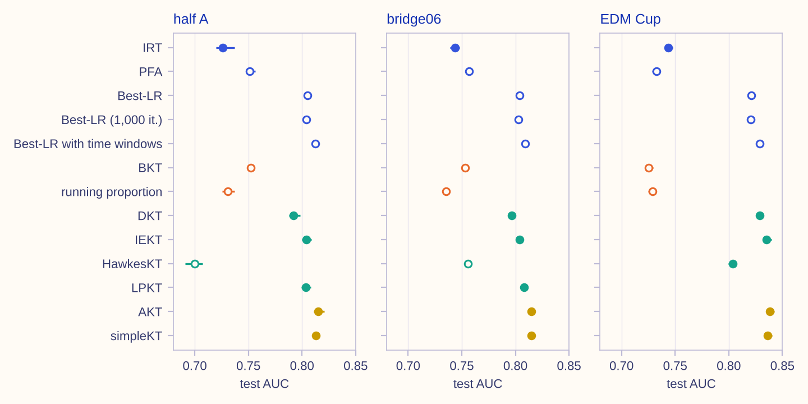
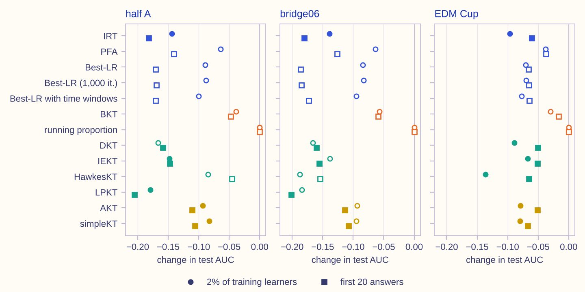

# Published knowledge-tracing models under one protocol on three tutor corpora

### Thirteen models and baselines, nine gated on a published number and six with a planted-effect floor that counts, predict the next answer on two Cognitive Tutor logs and on EDM Cup 2023; the attention models AKT and simpleKT have the highest mean AUC on all three, though on half A and EDM Cup their lead over IEKT, fitted there on a GPU, is device-sensitive; and with 2% of the training learners on the two Cognitive Tutor logs, the recurrent deep models lose more than the logistic and attention models, though most of these numbers have no floor at that size.

**David S. Porcaro**, Learning Design Alliance

*Research and writing carried out with Claude Code (Anthropic). See [AI use](#ai-use).*

---

## Abstract

Knowledge-tracing models predict a learner's next answer from the answers they have already given. They are
usually compared with numbers copied from different papers, each of which prepared its data differently. This study
scored thirteen published models and baselines under one protocol, with the same learners, the same test answers
and one scorer, on three tutor logs: two from the KDD Cup 2010 Cognitive Tutor data (half A, one half of the
learners of Algebra I 2006-07, and Bridge to Algebra 2006-07) and one from EDM Cup 2023. A model's numbers counted
only after it passed two checks. Nine models had to reproduce a result published for them, and all nine did, three
of them only after a correction. The six deep models also had to let the benchmark detect a practice effect planted
in synthetic data shaped like each log. HawkesKT failed this check on both KDD logs, and DKT failed it with 2% of
the training learners on half A. Numbers that did not pass both checks are reported but not read as results, except
those of item-response theory, the reference, which is exempt from the second check.

Accuracy is measured by AUC, the chance that a model ranks a correct answer above an incorrect one (0.5 is chance
and 1 is perfect). With all the training learners, the attention models AKT and simpleKT had the highest mean AUC on
every log: 0.8148 and 0.8128 on half A, 0.8149 and 0.8148 on Bridge to Algebra, and 0.8381 and 0.8364 on EDM Cup,
against 0.7261, 0.7438 and 0.7438 for item-response theory. On half A and EDM Cup their lead over IEKT, whose fits
there ran on a GPU, is smaller than twice the largest change that rerunning IEKT on other hardware produced, so under
the registered rule that order is not settled; no difference between two models was tested. The order changed when
data were scarce. With 2% of the training learners, the recurrent deep models lost 0.138 to 0.184 AUC on the two KDD
logs, against 0.063 to 0.100 for the logistic models and 0.083 to 0.095 for the attention models, and of the models
that fit anything BKT lost least on every log (0.030 to 0.057). Most of these numbers did not pass both checks at
that size. Which model to use therefore depends on how much data a course will have.

## 1. Introduction

A knowledge-tracing model estimates what a learner knows from the record of their answers and predicts their
next answer. The field has dozens of such models, from Bayesian knowledge tracing (Corbett & Anderson, 1995) and
logistic models of practice (Pavlik, Cen & Koedinger, 2009) to recurrent and attention-based neural networks
(Piech et al., 2015; Ghosh, Heffernan & Lan, 2020). Choosing among them for a course, or deciding whether a new
model is an improvement, needs comparisons that hold everything except the model fixed.

That condition is rarely met. Published comparisons differ in how rows are built from a tutor's log, whether a
step with several skills becomes one row or several, how learners are split into training and test sets, and
whether a model sees information from the future of the sequence it predicts. Liu et al. (2022) built a common
library and evaluation protocol for deep models so that such choices are made once, for every model. Gervet et al. (2020) compared logistic and deep models on nine corpora under one protocol
and found that which family wins depends on the size and shape of the data.

A benchmark is only as good as its instrument, and two checks are seldom made conditions of counting a result.
The first is whether each re-implemented model reproduces a published number before its new numbers are trusted.
Earlier comparisons have printed the best earlier published value beside their own where one existed (Gervet et al., 2020,
Tables 3 to 11), have reproduced a deep model and found that its first reported advantage depended on how the
data were formatted (Xiong et al., 2016), and have documented disagreements between reported results (Sarsa,
Leinonen & Hellas, 2022). None of those cited here sets a band that a re-implementation must meet before its
numbers are used. The second is whether
the benchmark can detect, through each model, an effect of known size: a model that loses a learning effect in
its input pipeline can still score a respectable AUC, and nothing in the AUC says so. Simulated learners have
been used to check single models against a known generating process. A recurrent model's predictions matched
those of an oracle on simulated students (Piech et al., 2015); the fitted parameters of Bayesian knowledge tracing
have been compared with the parameters that generated simulated data at several sample sizes (Slater & Baker,
2018); and simulated students exposed an implementation error in a tracing model that earlier evaluation had
missed (Zhang & MacLellan, 2021). This paper reports a
benchmark that makes both checks a condition of counting a number, and reads the published models and baselines
through it on three open tutor corpora, at full training data and as training data thins.

## 2. Background

**Comparisons under one protocol.** Gervet et al. (2020) scored item-response theory (IRT), performance factors
analysis (PFA), their "Best-LR" logistic regression and deep knowledge tracing (DKT) on nine corpora with the same
folds, and found that logistic models matched or beat deep ones on the smaller corpora, while DKT led on the
larger ones. The pyKT library (Liu et al., 2022) re-implemented many deep models with one preprocessing and
evaluation protocol and published their AUC on several corpora, including the KDD Cup 2010 files. Its authors'
simpleKT (Liu et al., 2023) is a deliberately simple attention model, proposed as a baseline that more complex
models find hard to beat under that protocol. Bai et al. (2025) report a further table of
the same models under pyKT's protocol, including the time-aware HawkesKT and LPKT.

**The models.** IRT, in the form Gervet et al. use, predicts from item difficulty alone. PFA adds counts of a
learner's earlier successes and failures on each skill (Pavlik, Cen & Koedinger, 2009), and Best-LR adds item and
skill difficulties and the counts of all earlier attempts (Gervet et al., 2020). Adding counts within time windows,
as DAS3H does (Choffin et al., 2019), gives the variant called Best-LR with time windows here. Gervet et al.
(2020, Table 13) fitted a similar addition and found that it added nothing to Best-LR (0.799 against 0.803 on
bridge06), and Schmucker et al. (2022) give the name Best-LR+ to a larger extension that also adds recency-weighted
and spacing features. Bayesian knowledge tracing (BKT)
models each skill as a hidden two-state variable with learning, guessing and slipping probabilities (Corbett &
Anderson, 1995). The deep models are DKT, a recurrent network over the answer sequence (Piech et al., 2015); AKT,
which attends over earlier answers with a decay in their distance (Ghosh, Heffernan & Lan, 2020); simpleKT (Liu
et al., 2023); IEKT, which estimates a learner's cognition and acquisition at each step (Long et al., 2021);
HawkesKT, which models the cross-effects of earlier answers as a temporal point process over clock time (Wang et
al., 2021); and LPKT, which models learning and forgetting from answer and interval times (Shen et al., 2021).
Pelánek (2017) reviews the non-deep families and the questions of evaluation they raise.

**What is not established.** The published comparisons report AUC. Gervet et al. (2020) print the best earlier
published value beside their own where one existed, but none of the comparisons cited here makes reproducing a published
number within a set band a condition of reporting a model. None checks, through every model it scores, whether a
planted effect of known size reaches the predictions; the simulation studies cited in the introduction check one
model at a time. How models degrade as training data thins has been measured for some of them. Gervet et al.
(2020, Figure 5) subsampled the training set of one corpus within fixed folds and found Best-LR ahead of DKT
below about one million interactions and behind it above. Slater and Baker (2018) measured how far the fitted
parameters of Bayesian knowledge tracing fall from those that generated simulated data as the number of students
shrinks. No study found here thins logistic, Bayesian and deep models together on the same nested subsets under
one protocol.

## 3. Research questions

- **RQ1.** Do the benchmark's implementations of the models reproduce the published numbers they are gated on?
- **RQ2.** Can the benchmark detect a planted practice effect through each model, with a quarter and with 2% of
  the training learners?
- **RQ3.** With all training learners, how well does each model predict the next answer on each corpus?
- **RQ4.** How does each model's prediction change as training data thins, in learners and in history length?

## 4. Method

### 4.1 Corpora, rows and folds

Three spent corpora were used: corpora whose outcomes earlier studies had already read, so that no held-out data
was consumed. **Bridge06** is the KDD Cup 2010 development training file of Carnegie Learning's Bridge to Algebra
2006-07 tutor (Stamper et al., 2010), built with Gervet et al.'s (2020) preprocessing: one row per learner and
step, a skill tag required, duplicate rows dropped, and learners with fewer than ten rows dropped, leaving 1,130
learners. **Half A** is one of two halves of the learners of the Algebra I 2006-07 file, split by learner with a
fixed seed before any outcome was read, with the same preprocessing (635 learners). The other half is reserved
for a separate study and was never read. **EDM Cup 2023** (Heffernan & Prihar, 2023) is a log of the ASSISTments
platform. Its rows are one per learner and problem log, scored on the first response, which counts as correct
only if the first action is a correct response; learners with fewer than ten rows were dropped (29,255 learners).
Actions are ordered within a problem log by time, with ties broken by file order. In 659,699 of the 5,245,859
problem logs (12.6%) the file order disagrees with the time order. No exact duplicate action line was found, so
none was dropped.

On the KDD files, the item is the problem and step, and the concept is the step's combination of knowledge
components (KCs): every model that takes one concept per row receives the combination, so no step is expanded
into one row per KC and no label of a sibling row can leak. Expanding a step into one row per KC repeats its
answer across the expanded rows. Xiong et al. (2016) found that sequences repeated once per skill in a public
dataset favored DKT, Liu et al. (2022) show that predicting expanded KC sequences one row at a time inflates AUC,
and Badran and Preisach (2025) show that a model can learn the correlation between the KCs of one item and so
leak its label. Treating each combination as one concept follows Gervet et al. (2020). The logistic models use Gervet et al.'s multi-hot KC
encoding. On EDM Cup the item is the problem and the concept its skill code. The rule was to use the sorted
combination where a problem carries several codes, but no problem does; the 1,185 problems that carry no code share
one "no skill code" concept.

Every corpus is split into five folds by learner (a seeded permutation of the learners cut into five equal
parts). In each fold, the test learners' rows are predicted from a model trained on the other learners. Ten
percent of the training learners form a selection split that no model trains, tunes or stops on, and the
logistic models choose their regularization on a fifth of the remaining training learners. Each learner's
first row is kept as history and not scored. The test rows are identical for every model: 850,601 on half A,
1,816,263 on bridge06 and 3,556,155 on EDM Cup, summed over the five folds. Every row is scored, including rows
after a learner asked for help; the registration also names unassisted and first-attempt row sets, which this
pass did not score.

### 4.2 Models

Table 1 lists the thirteen models and baselines this release reports. The logistic models choose the
regularization constant C from {0.1, 1, 10} on each fold's inner learners, with a solver limit of 5,000
iterations; "Best-LR (1,000 iterations)" is the same model at 1,000. The deep models are trained on windows of
200 rows and predict with sliding windows of 200 rows and stride 100, for at most 20 epochs with early stopping
on a validation set of 10% of the training learners (patience 2). Each fold screens a grid of four settings
(learning rate 10⁻³ or 10⁻⁴, dropout 0.1 or 0.3; on EDM Cup also embedding size 64 or 256, eight settings) for
three epochs on its own inner learners, then trains the chosen setting in full. The pyKT models run the pyKT
classes at a pinned commit through the benchmark's own training loop. Each deep model is also trained with a
second seed on fold 0. The running proportion fits nothing.

| model | family | implementation | concept unit |
|---|---|---|---|
| IRT | item response (reference) | Gervet et al.'s logistic encoding, item only | item |
| PFA | logistic | Gervet et al.'s PFA features | KC multi-hot |
| Best-LR | logistic | Gervet et al.'s Best-LR features | item and KC multi-hot |
| Best-LR (1,000 iterations) | logistic | as Best-LR, solver limit 1,000 | item and KC multi-hot |
| Best-LR with time windows | logistic | Best-LR with counts in windows of 1 hour, 1 day, 7 days and 30 days | item and KC multi-hot |
| BKT | Bayesian | expectation maximization, 25 iterations, no forgetting | KC combination |
| running proportion | count (baseline) | (successes + 0.5) / (attempts + 1) on the KC combination | KC combination |
| DKT | recurrent | Gervet et al.'s DKT class and loop | KC combination |
| AKT | attention | pyKT | item and KC combination |
| simpleKT | attention | pyKT | item and KC combination |
| IEKT | recurrent | pyKT | item and KC combination |
| HawkesKT | time-aware | pyKT | item and KC combination |
| LPKT | time-aware recurrent | pyKT (half A and bridge06 only) | item and KC combination |

*Table 1. The models and baselines this release reports. "KC multi-hot" is one indicator per knowledge component
of the step; "KC combination" is the step's set of components treated as one concept.*

The benchmark was registered with a larger roster; this release reports the models in Table 1, and the other
models scored under the same protocol are not part of it. DKT2, proposed for an amendment, failed its gate and has
no fits. LPKT was added by an amendment after the other stages had been planned and was run on the two KDD
corpora only.

### 4.3 Scoring

Every model writes one probability per test row, and one scorer computes every metric from those
probabilities: AUC over the fold's test rows, log loss in nats per answer (each probability clipped to
[10⁻¹², 1 − 10⁻¹²]), and the share of rows predicted within 10⁻¹² of 0 or 1. No model's own evaluation code
produced a reported number. Before any counted run, the benchmark's self-tests confirmed for every model that its
prediction for a row does not change when the labels of that row and of every later row are flipped (no future
label in the input), and that a deliberately leaking model trips both this test and the floor of section 4.5.
Per-row predictions stayed on the machines that made them and were deleted with them; the aggregates are the
record.

### 4.4 Gates

A gated model's numbers count only after it reproduces its published number (RQ1). IRT, PFA, Best-LR and DKT were gated on
Gervet et al.'s (2020) Table 4 for bridge06: the pooled AUC over five folds on Gervet's rows, first rows
included, within ±0.010 of the printed value. The pyKT models were gated in two parts on fold 0 of pyKT's own
split of bridge06, with pyKT's preprocessing. First, pyKT's own training loop, scored by pyKT's own evaluation, had
to reproduce the published bridge06 AUC within ±0.010 (simpleKT's Table 2 for AKT, simpleKT and IEKT; Bai et al.'s
Table 3, a third-party target, for HawkesKT and LPKT). Both tables print means over five folds; the gate reads
fold 0. Second, the benchmark's loop, with the same configuration and budget, had to come within ±0.005 of pyKT's
loop on the same fold. For this second part, pyKT's loop is scored by pyKT's question-level window AUC, which is
computed on the rows the benchmark scores, rather than by pyKT's own evaluation. The two parts therefore read two
different AUCs of pyKT's loop, and Table 3 prints both. Four models have no published target of their own on these
corpora: BKT, the running proportion, and Best-LR (1,000 iterations) and Best-LR with time windows, which are variants of the gated
Best-LR.

### 4.5 The prediction floor

A gate shows that an implementation can reproduce a number; it does not show that the benchmark can see a
learning effect through the model (RQ2). The floor, F1, plants one. In a synthetic world built on a corpus's own
structure (its learners, items, KC combinations and answer order), each answer is drawn with
logit p = α_learner − δ_item + b·log(1 + opportunities on the KC combination), α and δ drawn from a standard
normal. The rescaling of the opportunity count by log(1 + x) follows Choffin et al. (2019) and Gervet et al.
(2020). Its null twin has the same draws with b = 0. The effect size b was the smallest value in {0.3, 0.45, 0.6,
0.9} at which the oracle's gain over its own ability-and-difficulty part, O, was at least six times its standard
error over five twin pairs; b = 0.3 met this on all three corpora.

On fold 0's test rows, with the model trained on 25% (and, separately, 2%) of the training learners of each world,
G_E is the model's AUC minus the AUC of the world's ability-and-difficulty probabilities in the effect world, and
G_N is the model's AUC minus the oracle's in the null twin. Comparing a model's predictions with those of an
oracle in a simulated world follows Piech et al. (2015). A model passes when the 95% interval of G_N does not
lie above zero (it cannot beat the true probabilities of a world without practice) and when G_E − G_N has a 95%
interval above zero and a point estimate of at least O/2. Intervals come from a learner bootstrap with 2,000
resamples, the same learners resampled across the twin pairs. A model that misses the floor on a corpus reads
"not read (floor)" there; one with no floor run reads "no floor run"; and one whose floor was run outside the
registered stage lists reads "floor descriptive". IRT is the reference and is exempt.

The registered stage lists named floors for the deep models only: every deep model on every corpus it was fitted
on, at 25% and, on half A and EDM Cup, at 2%. The registration gave no other model a floor. Floors for PFA, BKT
and the running proportion on the two KDD corpora at 25% were added on the author's decision on 16 November 2026,
after the registered fits had run, outside the registered stage lists and under no amendment. They use the
registered generator, effect size, bar and pass rule. Their results are reported as descriptive only: Table 4
prints them, but they are not read as passes, so the numbers of these three models are descriptive, like those of a
model with no floor run. No floor was run for the Best-LR models.

### 4.6 Regimes

To see how each model behaves as data thins (RQ4), each model was also trained on 25%, 10% and 2% of each fold's
training learners, with the test learners unchanged. The 10% and 2% subsets were drawn five times, nested (each 2%
draw inside a 10% draw inside the 25% set) and seeded, with the same draws for every model. At 10% and 2%, each
model's tuning choices were frozen at its 25% choice for that fold. Separately, every training learner's history
was cut to its first 50 or first 20 answers, the test learners keeping theirs whole.

### 4.7 Design history and what this pass can say

The protocol was registered on 11 November 2026, before any counted run. The registration and its amendments are
not published yet, because they also govern models this release does not report. Their full text will be
published when those models are reported. Until then, the SHA-256 of each document, as it stood when it was last
changed, is given below, so that a reader can check later that the published text is the one this benchmark ran
under. This section states what they contain.

| Document | Last changed | SHA-256 |
|---|---|---|
| The registration | 11 November 2026 | `331b664230767f3947de0c50acf65c89297874a311fdf6aed0a198a0fafca455` |
| Amendment 1 | 12 November 2026 | `c57c73d75f698796d8aae18260d73ef6e01f92355ed6442c15549c3fa01669e8` |
| Amendment 2 | 13 November 2026 | `e531aa1fa48eebc61c68747ece649b0b2553519784e026be6321b4d3a280d659` |
| Amendment 3 | 15 November 2026 | `e36ac0d54c7dc726c9292a54c34fff77599e971b50bfce6a9888bd158d3ca5ed` |
| Amendment 4 | 15 November 2026 | `2383263a446efe298a6cd97f9e52e30272ffae2f8e795dc2ac7161b4c501a8a4` |

Four amendments were written while the benchmark ran, between 11 and 15 November 2026. Amendment 1 (11 and 12
November) read PFA against a corrected target (section 5.1). It also built the pyKT gate of section 4.4, which the
registration had left unbuilt, and ran pyKT's own loop for that gate on a GPU. Amendment 2 (12 and 13 November)
added LPKT. Amendment 3 (13 to 15 November) moved the rented jobs onto machines that each ran several, and recorded
the move of some fits to GPUs described below. Amendment 4 (13 to 15 November) rebuilt HawkesKT as pyKT sets it up,
after its first gate failed, and was put in force for HawkesKT on 13 November. Amendments 1 to 3 were drafts while
the fits ran: each was written under a decision of the author and states that it is not in force until accepted.
The author confirmed on 20 November 2026, after the fits, that they are the amendments the benchmark ran under.
LPKT's first gate also failed, and its architecture was then tuned on the gate's split before the gate was passed
(section 5.1).

The registration pinned every fit to a CPU. Under deviations recorded in Amendment 3, AKT, simpleKT and IEKT on EDM
Cup, IEKT on half A and LPKT on both KDD corpora ran on GPUs; every other fit ran on a CPU. The device each fit ran
on is recorded in the per-case outputs, and the device control registered for the GPU fits is reported in section
7.2.

The registration also states readings that compare pairs of models with a paired learner bootstrap on the
selection split. No comparison job was built for this pass: per-row predictions were not kept, so no paired
interval can be computed. Every AUC in this paper is therefore descriptive, and no difference between two models
was tested. The registration's questions about named learning-science constructs, read on simulated learners,
are outside this release.

Several other registered reports were not made in this pass, and they are listed here so that their absence is not
read as a null result. The share of deep fits that stopped at the 20-epoch cap was to be reported per model and
corpus, and a model that stopped at the cap on more than half its folds was to be reported as a floor, not a
result. The benchmark's committed aggregates do not record each fit's stopping epoch, so neither the shares nor
that rule could be applied, and any deep model's status could change under it. For EDM Cup, the registration asked
for a sensitivity run that drops the problem logs whose file order disagrees with the time order; it was not made,
because it needs new fits. The strata the registration names (rows on items with little training support, a
learner's first five answers on a skill, rows with several skills, and rows after help) and the unassisted and
first-attempt row sets need per-row predictions, which were not kept. The t interval over the five twin pairs that
the registration places beside each floor interval needs each pair's statistic, which the floor's aggregate does
not record. The counts of EDM Cup's preprocessing that the registration asks for are given in section 4.1.

## 5. Results

The results answer the four questions in order. Each number is computed from the per-case outputs, one record per
scored fit, floor or gate; Tables 2 to 6 print them rounded once from the unrounded values.

### 5.1 RQ1: reproductions of published numbers

Each gated model was run as its gate specifies before any of its benchmark fits counted. Table 2 gives the
reproductions against Gervet et al.'s Table 4, and Table 3 those against pyKT's published numbers.

| model | published target | benchmark (pooled AUC) | difference | reading |
|---|---|---|---|---|
| IRT | 0.749 | 0.7432 | −0.0058 | PASS |
| PFA (Table 4) | 0.741 | 0.7571 | +0.0161 | HARNESS FAIL |
| PFA (Table 13, Amendment 1) | 0.761 | 0.7571 | −0.0039 | PASS |
| Best-LR | 0.803 | 0.8046 | +0.0016 | PASS |
| DKT | 0.790 | 0.7980 | +0.0080 | PASS |

*Table 2. Gervet et al. (2020) gate on bridge06: the benchmark's AUC over Gervet's 1,817,393 rows and 1,130
learners (five folds) against the printed value, band ±0.010. Under Amendment 1, PFA is read as the mean of the
five fold AUCs, the statistic of Gervet et al.'s Table 13.*

PFA read 0.7571 against Table 4's 0.741, a difference of +0.0161 outside the band, above the target rather than
below it. Gervet et al.'s Table 13, an ablation table that averages the five fold AUCs, prints 0.761 for PFA on
the same corpus, and for every other corpus their PFA entries in Tables 3 to 11 equal the corresponding Table 13
entries; bridge06 is the only one that differs. Amendment 1 (11 and 12 November) therefore read PFA against 0.761
with Table 13's statistic, and it passed (−0.0039). The gate record published here is a re-score made on 16
November, after the counted fits; Amendment 1 had computed the same statistic for the benchmark's PFA on 11
November. Beside their own value, Gervet et al.'s Table 4
prints an earlier published value of 0.739 for PFA on bridge06, the same value that Choffin et al. (2019, Table 4)
report for PFA without latent dimensions, averaged over five folds. That independent value agrees with Table 4
rather than Table 13, and the benchmark's PFA reads above both. Amendment 1 rests on a reading of the source paper
that favors a misprint in Table 4 without establishing one, and the value of Choffin et al. weighs against that
reading.

| model | published target | pyKT's loop, pyKT's evaluation | reproduction difference | pyKT's loop, window AUC | benchmark loop | benchmark loop − pyKT's loop (window AUC) | reading |
|---|---|---|---|---|---|---|---|
| AKT | 0.8208 | 0.8136 | −0.0072 | 0.8180 | 0.8210 | +0.0030 | PASS |
| simpleKT | 0.8160 | 0.8111 | −0.0049 | 0.8137 | 0.8164 | +0.0026 | PASS |
| IEKT | 0.8125 | 0.8052 | −0.0073 | 0.8075 | 0.8042 | −0.0033 | PASS |
| HawkesKT | 0.8068 | 0.8028 | −0.0040 | 0.8048 | 0.8010 | −0.0038 | PASS |
| LPKT | 0.8056 | 0.7980 | −0.0076 | 0.8048 | 0.8064 | +0.0016 | PASS |

*Table 3. pyKT gate on bridge06, fold 0 of pyKT's own split (229 test learners, 354,033 rows). The reproduction
compares pyKT's loop, scored by pyKT's own evaluation, with the published value (band ±0.010). Loop equivalence
compares the benchmark's loop with pyKT's loop scored by pyKT's question-level window AUC, which is computed on the
rows the benchmark scores (band ±0.005). Targets, each a published mean over five folds: simpleKT's Table 2 (Liu et
al., 2023) for AKT, simpleKT and IEKT; Bai et al. (2025), Table 3, for HawkesKT and LPKT.*

All five pyKT models passed, every reproduction falling below its target by 0.0040 to 0.0076. Two passed only on
a second attempt. HawkesKT's first gate read the benchmark's loop 0.157 below pyKT's, because the benchmark built
and trained it differently from pyKT; Amendment 4 rebuilt it as pyKT does (pyKT's initialization, weight decay,
batch size and raw times), and every HawkesKT number in this paper comes from the rebuilt model. LPKT's first gate
failed on reproduction (−0.0156), and its architecture was tuned on the gate's own split before it passed, so its gate
reading is not independent of that tuning.

**Answer to RQ1.** Yes, for all nine gated models: each reproduced its published target within the band, PFA only
against the target of a second table of the source paper, and HawkesKT and LPKT only after changes made in
response to a first failure.

### 5.2 RQ2: the prediction floor

The floor asks whether the benchmark, through each model, recovers at least half of a practice effect planted in
a world shaped like the corpus. The planted effect's oracle gain O was 0.0127 on half A, 0.0171 on bridge06 and
0.0130 on EDM Cup, 33, 34 and 54 times its standard error, so the bar O/2 was 0.0063, 0.0085 and 0.0065.

| model | half A, 25% | bridge06, 25% | EDM Cup, 25% | half A, 2% | EDM Cup, 2% |
|---|---|---|---|---|---|
| PFA (descriptive) | +0.0172 [+0.0149, +0.0204] | +0.0281 [+0.0252, +0.0315] | not run | not run | not run |
| BKT (descriptive) | +0.0207 [+0.0182, +0.0237] | +0.0311 [+0.0284, +0.0344] | not run | not run | not run |
| running proportion (descriptive) | +0.0182 [+0.0163, +0.0204] | +0.0265 [+0.0244, +0.0291] | not run | not run | not run |
| DKT | +0.0110 [+0.0092, +0.0132] | +0.0168 [+0.0148, +0.0189] | +0.0102 [+0.0095, +0.0109] | **−0.0008 [−0.0068, +0.0062]** | +0.0156 [+0.0144, +0.0168] |
| AKT | +0.0152 [+0.0132, +0.0182] | +0.0199 [+0.0182, +0.0221] | +0.0099 [+0.0094, +0.0105] | +0.0121 [+0.0102, +0.0145] | +0.0124 [+0.0114, +0.0133] |
| simpleKT | +0.0161 [+0.0131, +0.0206] | +0.0141 [+0.0126, +0.0157] | +0.0099 [+0.0093, +0.0104] | +0.0138 [+0.0116, +0.0167] | +0.0117 [+0.0108, +0.0126] |
| IEKT | +0.0125 [+0.0111, +0.0145] | +0.0174 [+0.0158, +0.0190] | +0.0117 [+0.0111, +0.0123] | +0.0079 [+0.0046, +0.0115] | +0.0217 [+0.0205, +0.0228] |
| HawkesKT | **−0.0481 [−0.0566, −0.0370]** | **−0.0460 [−0.0537, −0.0370]** | +0.0080 [+0.0069, +0.0090] | +0.0224 [+0.0185, +0.0267] | +0.0179 [+0.0146, +0.0212] |
| LPKT | +0.0242 [+0.0227, +0.0258] | +0.0191 [+0.0178, +0.0207] | not fitted | +0.0218 [+0.0173, +0.0268] | not fitted |

*Table 4. The prediction floor F1: G_E − G_N with its 95% interval (learner bootstrap, 2,000 resamples, five twin
pairs), with the model trained on 25% or 2% of the training learners. Bars O/2: 0.0063 (half A), 0.0085
(bridge06), 0.0065 (EDM Cup). Bold marks the three misses; every other cell of the six deep models passes. The
rows of PFA, BKT and the running proportion, whose floors were run outside the registered stage lists (section 4.5),
are descriptive only and are not read as passes. In every cell G_N's interval lies below zero. The 2% floor was not
run on bridge06.*

Every deep model passed the floor at 25% except HawkesKT on the two KDD corpora, where its G_E − G_N was negative
(−0.0481 on half A and −0.0460 on bridge06): in the effect world it predicted worse, relative to the world's own
probabilities, than in the null world. HawkesKT passed on EDM Cup at both sizes and on half A at 2%. At 2%, DKT
missed on half A (−0.0008, its interval covering zero) and passed on EDM Cup; the other deep models passed at 2%
wherever the floor was run. The floor statistics of PFA, BKT and the running proportion lay above the bar on both
KDD corpora, but those floors were run outside the registered stage lists and are reported as descriptive only, not
as passes. No model read above zero in a null world, so none showed a sign of reading labels it
should not have.

**Answer to RQ2.** For five of the six deep models given the floor, yes: the benchmark
recovered at least half of the planted effect through them at 25% of the training learners on every corpus where
the floor was run. Through HawkesKT it did not on either KDD corpus, so HawkesKT's KDD numbers are not read, and
through DKT it did not at 2% on half A. The floors of PFA, BKT and the running proportion, run on the KDD corpora
outside the registered plan, are descriptive only, and so are those three models' numbers. The three Best-LR models
had no floor run, and their numbers are also reported as descriptive only.

### 5.3 RQ3: prediction with all training learners

Each model was fitted on each fold's training learners and scored on that fold's test learners; Table 5 gives the
mean test AUC over the five folds, with the lowest and highest fold. The folds are the same learners for every
model, so a fold's range shows how much the score moves between test sets, not an interval for the mean.

| model | half A | bridge06 | EDM Cup | floor status (half A; bridge06; EDM Cup) |
|---|---|---|---|---|
| IRT | 0.7261 [0.7198, 0.7371] | 0.7438 [0.7392, 0.7477] | 0.7438 [0.7402, 0.7478] | reference |
| PFA | 0.7514 [0.7478, 0.7563] | 0.7569 [0.7546, 0.7593] | 0.7327 [0.7283, 0.7365] | floor descriptive; floor descriptive; no floor run |
| Best-LR | 0.8053 [0.8022, 0.8086] | 0.8040 [0.8014, 0.8052] | 0.8211 [0.8173, 0.8244] | no floor run |
| Best-LR (1,000 iterations) | 0.8040 [0.8005, 0.8074] | 0.8030 [0.8002, 0.8047] | 0.8204 [0.8166, 0.8236] | no floor run |
| Best-LR with time windows | 0.8122 [0.8092, 0.8163] | 0.8090 [0.8069, 0.8103] | 0.8287 [0.8256, 0.8325] | no floor run |
| BKT | 0.7520 [0.7485, 0.7554] | 0.7534 [0.7501, 0.7555] | 0.7254 [0.7215, 0.7295] | floor descriptive; floor descriptive; no floor run |
| running proportion | 0.7306 [0.7258, 0.7373] | 0.7356 [0.7330, 0.7374] | 0.7288 [0.7250, 0.7326] | floor descriptive; floor descriptive; no floor run |
| DKT | 0.7920 [0.7880, 0.7981] | 0.7966 [0.7937, 0.7992] | 0.8291 [0.8260, 0.8327] | pass |
| AKT | **0.8148** [0.8111, 0.8207] | **0.8149** [0.8133, 0.8165] | **0.8381** [0.8354, 0.8423] | pass |
| simpleKT | 0.8128 [0.8092, 0.8166] | 0.8148 [0.8122, 0.8165] | 0.8364 [0.8336, 0.8405] | pass |
| IEKT | 0.8040 [0.7997, 0.8085] | 0.8036 [0.8014, 0.8054] | 0.8353 [0.8320, 0.8399] | pass |
| HawkesKT | 0.6999 [0.6910, 0.7075] | 0.7559 [0.7535, 0.7582] | 0.8035 [0.7997, 0.8074] | not read; not read; pass |
| LPKT | 0.8035 [0.7991, 0.8080] | 0.8080 [0.8055, 0.8098] | not fitted | pass; pass |

*Table 5. Test AUC with all training learners: the mean over five folds, with the lowest and highest fold in
brackets. Bold marks the highest mean on each corpus. Floor status from Table 4 at 25%; numbers marked "not read",
"floor descriptive" or "no floor run" are descriptive only under the registered rule. All rows scored (half A 850,601, bridge06
1,816,263, EDM Cup 3,556,155).*

AKT had the highest mean AUC on all three corpora and simpleKT the second highest: 0.8148 and 0.8128 on half A,
0.8149 and 0.8148 on bridge06, and 0.8381 and 0.8364 on EDM Cup. Their fold ranges overlap on every corpus, and
AKT's AUC was above simpleKT's on four of the five folds of half A, two of bridge06 and five of EDM Cup. On EDM
Cup, AKT, simpleKT and IEKT were all fitted on GPUs, and the margins among their means (AKT above simpleKT by
0.0018 and above IEKT by 0.0028, simpleKT above IEKT by 0.0010, computed before rounding; the table's values give
0.0017 for the first and 0.0011 for the third) lie within twice the device bands of section 7.2, so under the registered rule their order on
EDM Cup is device-sensitive. On half A
the third highest mean was that of Best-LR with time windows (0.8122), whose range overlaps both.
IEKT's half A fits also ran on a GPU, and the leads of AKT, simpleKT and Best-LR with time windows over IEKT there (0.0108, 0.0088 and 0.0082) lie within twice IEKT's
band (0.034), so under the same rule they too are device-sensitive. On bridge06 and EDM Cup, AKT's AUC was
above that of Best-LR with time windows on all five folds. Apart from IRT, the reference, and HawkesKT, whose KDD
numbers are not read, the lowest means on both KDD corpora were the running proportion's (0.7306 and 0.7356), which
are descriptive only; IRT read 0.7261, 0.7438 and 0.7438.

*Figure 1. Test AUC with all training learners, per model and corpus: the mean over five folds (dot) and the lowest
to highest fold (line). Hollow dots mark numbers that are descriptive only (floor not run, floor descriptive, or
not read). Source:
the per-case outputs (Table 5).*

The deep recurrent models did not lead (device-sensitive for IEKT on half A and EDM Cup, section 7.2). DKT's mean (0.7920 on half A, 0.7966 on bridge06) was below Best-LR's
(0.8053 and 0.8040) on both KDD corpora and above it on EDM Cup (0.8291 against 0.8211). IEKT read 0.8040 and
0.8036 on the KDD corpora and 0.8353 on EDM Cup. HawkesKT, whose KDD numbers are not read, read 0.8035 on EDM Cup,
below every other deep model there (device-sensitive for IEKT, section 7.2).

| model | log loss, half A | log loss, bridge06 | log loss, EDM Cup |
|---|---|---|---|
| IRT | 0.459 | 0.396 | 0.536 |
| PFA | 0.452 | 0.389 | 0.542 |
| Best-LR | 0.412 | 0.361 | 0.467 |
| Best-LR (1,000 iterations) | 0.414 | 0.362 | 0.468 |
| Best-LR with time windows | 0.407 | 0.358 | 0.458 |
| BKT | 0.452 | 0.389 | 0.546 |
| running proportion | 0.487 | 0.428 | 0.555 |
| DKT | 0.426 | 0.368 | 0.457 |
| AKT | 0.408 | 0.354 | 0.446 |
| simpleKT | 0.414 | 0.354 | 0.449 |
| IEKT | 0.415 | 0.362 | 0.450 |
| HawkesKT | 0.664 | 0.457 | 0.491 |
| LPKT | 0.416 | 0.359 | not fitted |

*Table 6. Log loss in nats per answer with all training learners, the mean over five folds (lower is better).*

Log loss orders the models much as AUC does, with exceptions; these are the main ones. On half A, Best-LR with time windows had the
lowest log loss (0.407), below AKT's (0.408), and Best-LR's log loss was below simpleKT's (0.412 against 0.414)
although its AUC was lower (0.8053 against 0.8128). On bridge06, HawkesKT's AUC (0.7559) was above those of BKT,
IRT and the running proportion, but its log loss (0.457) was the highest of any model there. On EDM Cup, the running
proportion's AUC was above BKT's (0.7288 against 0.7254) and so was its log loss (0.555 against 0.546). HawkesKT's
log loss on half A (0.664) reflects saturated predictions: on its worst fold, 4.0% of its half A rows were
predicted within 10⁻¹² of 0 or 1, and on bridge06 between 1.7% and 2.3% of each fold's rows were. No other model
saturated any row. For the
deep models, the second training seed moved fold 0's AUC by at most 0.0034 (DKT on bridge06).

**Answer to RQ3.** The two attention models, AKT and then simpleKT, predicted best on average on all three
corpora, by margins small enough that their fold ranges overlap; on half A the logistic model
Best-LR with time windows was within 0.0026 of AKT. On EDM Cup the order of AKT, simpleKT and IEKT is device-sensitive, and on half A so is the lead of AKT,
simpleKT and Best-LR with time windows over IEKT. Recurrent
DKT trailed the logistic Best-LR on the KDD corpora and led it on EDM Cup. These
are descriptions of means: no difference between two models was tested.

### 5.4 RQ4: thinning the training data

Each model was refitted on 25%, 10% and 2% of the training learners, and on training histories cut to their first
50 and 20 answers; Table 7 gives the change in mean test AUC from the fits with all training learners (Table 5),
computed before rounding.

| model / corpus | 25% | 10% | 2% | first 50 answers | first 20 answers |
|---|---|---|---|---|---|
| IRT / half A | −0.036 | −0.069 | −0.144 | −0.151 | −0.182 |
| IRT / bridge06 | −0.037 | −0.071 | −0.139 | −0.146 | −0.180 |
| IRT / EDM Cup | −0.014 | −0.034 | −0.096 | −0.029 | −0.060 |
| PFA / half A | −0.007 | −0.017 | −0.064 | −0.080 | −0.141 |
| PFA / bridge06 | −0.005 | −0.013 | −0.063 | −0.099 | −0.126 |
| PFA / EDM Cup | −0.002 | −0.006 | −0.038 | −0.016 | −0.037 |
| Best-LR / half A | −0.017 | −0.034 | −0.089 | −0.113 | −0.171 |
| Best-LR / bridge06 | −0.017 | −0.033 | −0.084 | −0.134 | −0.186 |
| Best-LR / EDM Cup | −0.010 | −0.025 | −0.071 | −0.029 | −0.066 |
| Best-LR (1,000 iterations) / half A | −0.015 | −0.033 | −0.088 | −0.111 | −0.170 |
| Best-LR (1,000 iterations) / bridge06 | −0.017 | −0.032 | −0.083 | −0.133 | −0.185 |
| Best-LR (1,000 iterations) / EDM Cup | −0.010 | −0.024 | −0.070 | −0.028 | −0.065 |
| Best-LR with time windows / half A | −0.018 | −0.037 | −0.100 | −0.132 | −0.171 |
| Best-LR with time windows / bridge06 | −0.018 | −0.036 | −0.095 | −0.136 | −0.173 |
| Best-LR with time windows / EDM Cup | −0.011 | −0.026 | −0.077 | −0.027 | −0.065 |
| BKT / half A | −0.010 | −0.023 | −0.039 | −0.035 | −0.047 |
| BKT / bridge06 | −0.009 | −0.020 | −0.057 | −0.051 | −0.059 |
| BKT / EDM Cup | −0.002 | −0.008 | −0.030 | −0.009 | −0.017 |
| running proportion / half A | 0.000 | 0.000 | 0.000 | 0.000 | 0.000 |
| running proportion / bridge06 | 0.000 | 0.000 | 0.000 | 0.000 | 0.000 |
| running proportion / EDM Cup | 0.000 | 0.000 | 0.000 | 0.000 | 0.000 |
| DKT / half A | −0.042 | −0.072 | −0.167, not read (floor) | −0.132 | −0.158 |
| DKT / bridge06 | −0.038 | −0.074 | −0.166 | −0.135 | −0.160 |
| DKT / EDM Cup | −0.030 | −0.055 | −0.089 | −0.027 | −0.051 |
| AKT / half A | −0.026 | −0.050 | −0.093 | −0.091 | −0.110 |
| AKT / bridge06 | −0.024 | −0.048 | −0.093 | −0.088 | −0.114 |
| AKT / EDM Cup | −0.015 | −0.042 | −0.079 | −0.025 | −0.051 |
| simpleKT / half A | −0.027 | −0.047 | −0.083 | −0.089 | −0.106 |
| simpleKT / bridge06 | −0.021 | −0.046 | −0.095 | −0.087 | −0.107 |
| simpleKT / EDM Cup | −0.017 | −0.047 | −0.080 | −0.040 | −0.067 |
| IEKT / half A | −0.038 | −0.067 | −0.148 | −0.117 | −0.148 |
| IEKT / bridge06 | −0.029 | −0.055 | −0.138 | −0.116 | −0.156 |
| IEKT / EDM Cup | −0.014 | −0.030 | −0.067 | −0.023 | −0.051 |
| HawkesKT / half A (not read) | −0.006 | −0.018 | −0.085 | −0.046 | −0.046 |
| HawkesKT / bridge06 (not read) | −0.112 | −0.135 | −0.187 | −0.159 | −0.154 |
| HawkesKT / EDM Cup | −0.031 | −0.050 | −0.136 | −0.035 | −0.065 |
| LPKT / half A | −0.168 | −0.175 | −0.179 | −0.192 | −0.205 |
| LPKT / bridge06 | −0.023 | −0.058 | −0.184 | −0.197 | −0.202 |

*Table 7. Change in mean test AUC from the fits with all training learners, by training regime: 25%, 10% and 2% of
the training learners (the 10% and 2% means over five draws and five folds, the others over five folds), and every
training learner's history cut to its first 50 or 20 answers (test learners whole). Rows marked "not read" are
descriptive only, and so are the rows of the logistic models, BKT and the running proportion, which have no floor
that counts (Table 5). At 2%, only the deep models on half A and on EDM Cup had a floor at that size, and DKT missed it on
half A ("not read (floor)"); so the 2% cells of AKT, simpleKT, IEKT and LPKT on half A and of DKT, AKT, simpleKT,
IEKT and HawkesKT on EDM Cup count, and every other 2% cell is descriptive. The running proportion fits nothing, so
it does not change.*

*Figure 2. Change in mean test AUC from the fits with all training learners, with 2% of the training learners
(circles) and with training histories cut to the first 20 answers (squares), per model and corpus. Hollow marks are
descriptive only (for 2%, no floor passed at that size; for 20 answers, the model's floor status in Table 5); IRT,
the reference, is drawn filled. Source: the per-case
outputs (Table 7).*

With 2% of the training learners, the deep models lost between 0.067 (IEKT on EDM Cup) and 0.184 (LPKT on
bridge06), leaving out HawkesKT's two KDD rows, which are not read. The logistic models (PFA and the three Best-LR
models) lost between 0.038 (PFA on EDM Cup) and 0.100 (Best-LR with time windows on half A), IRT between 0.096 and 0.144, and BKT
least, between 0.030 and 0.057; the running proportion, which fits nothing, did not change. The deep models did not
all lose more than the logistic models. On the KDD corpora, the recurrent deep models (DKT, IEKT and LPKT) lost 0.138
to 0.184, more than any logistic model there (0.063 to 0.100), while the attention models AKT and simpleKT lost
0.083 to 0.095, about as much as the three Best-LR models (0.083 to 0.100). On EDM Cup, the deep models lost 0.067 to
0.136 and the logistic models 0.038 to 0.077, and IEKT lost less than the three Best-LR models (0.067 against 0.070
to 0.077); IEKT's fits there ran on a GPU, and those margins lie within twice its device band (section 7.2). IRT,
the reference, lost more than AKT and simpleKT on every corpus. Of all these 2% numbers, only the deep models' on
half A (except DKT's, which missed the floor at that size) and on EDM Cup have a floor at that size; the rest are
descriptive. LPKT on half A behaved differently from every other model: it lost 0.168 already at 25% and little more
after that.

Cutting the training histories ordered the models differently. With each training learner's first 20 answers, the
logistic models lost 0.126 to 0.186 on the KDD corpora, the recurrent deep models 0.148 to 0.205 and IRT 0.180 and
0.182, while the attention models lost 0.106 to 0.114 and BKT 0.047 and 0.059; the logistic models' and BKT's numbers are descriptive only. On EDM
Cup, every model fitted there that learns, except HawkesKT, lost less from the cut than on either KDD corpus, and the eleven models fitted there lost 0.017
to 0.067. That is consistent with EDM Cup's shorter histories per learner and skill, though that was not measured
here. HawkesKT, whose KDD numbers are not read, lost 0.065 on EDM Cup and 0.046 on half A.

**Answer to RQ4.** Every model that learns from the training learners lost accuracy as they thinned. With 2% of
them, the recurrent deep models lost more than the logistic models on the KDD corpora, the attention models about as
much as the Best-LR models, and, of the models that fit anything, BKT least on every corpus; on EDM Cup the ranges of the deep and the logistic models
overlapped. With histories cut to twenty answers, the logistic models lost more than the attention models and BKT
on the KDD corpora; the logistic models' and BKT's numbers are descriptive only. The recurrent deep models' losses there (0.148 to 0.205) overlapped the logistic models' (0.126
to 0.186): LPKT lost more than any logistic model, and DKT and IEKT lost less than the three Best-LR models (0.170 to
0.186) but more than PFA. On half A, where IEKT's fits ran on a GPU, IEKT's place between PFA and the Best-LR
models is device-sensitive: its loss there was 0.0067 larger than PFA's and 0.0220 to 0.0234 smaller than the
Best-LR models', all within twice IEKT's device band (section 7.2). The rankings of Table 5 are
therefore specific to the amount of training data, and none of these changes was compared between models with an
interval.

## 6. Discussion

The benchmark's two checks did work that the AUC could not. The gates caught a model that would otherwise have
entered with a training loop 0.157 AUC below its reference implementation (HawkesKT), a published target whose two printed
values disagree, the earlier published value agreeing with the one the benchmark failed (PFA), and a model that needed tuning before it reproduced its source (LPKT). The floor then
showed that, even after HawkesKT's gate passed, the benchmark could not recover a planted practice effect through
it on the KDD corpora at 25% of the training learners, while it could through every other deep model. A benchmark
without a floor would have printed HawkesKT's KDD numbers beside the others with nothing to mark them.
Simulated students have exposed an implementation error in a tracing model that its authors' earlier evaluation had
not found (Zhang & MacLellan, 2021); the floor makes that check a condition of counting any model's numbers.

The ordering at full data agrees in its main lines with published tables. Under pyKT's protocol, AKT has the
highest AUC of the baselines on the two KDD Cup 2010 files of Bai et al.'s (2025) Table 3 (Algebra 2005-06 and
Bridge to Algebra 2006-07), and in Gervet et al.'s (2020)
Table 4 Best-LR (0.803) is above DKT (0.790) on bridge06, as it is here. Other comparisons found logistic,
IRT-based or extended Bayesian models matching or beating recurrent ones (Wilson et al., 2016; Khajah, Lindsey &
Mozer, 2016; Mandalapu, Gong & Chen, 2021). pyKT's authors found that most later deep models did not beat DKT but
that AKT outperformed almost all of them (Liu et al., 2022), as it does here, though on half A and EDM Cup its
lead over IEKT is device-sensitive (section 7.2); simpleKT, which they proposed later, is
close behind it here. Under this protocol the margins at the top
are small: the three highest means on half A (AKT, simpleKT and Best-LR with time windows) lie within 0.0026 of one another, and their lead
over IEKT there is device-sensitive (section 7.2). Here Best-LR with time windows read above Best-LR on every corpus, which
Gervet et al. (2020, Table 13) did not find for a similar addition; these numbers have no floor. The order changes with the amount of training data, and the two kinds of thinning act differently: fewer
learners hurt the recurrent deep models more than the logistic models, the attention models and BKT on the KDD
corpora, as Gervet et al. (2020, Figure 5) found for DKT against Best-LR when they subsampled one corpus, while the
attention models lost about as much as the Best-LR models. Shorter training histories hurt the logistic models, which count earlier attempts, and the recurrent
deep models more than the attention models and BKT on the KDD corpora. The logistic models' and BKT's numbers are
descriptive only, and most of the 2% numbers have no floor at that size.

### Implications for practice

A model chosen for a course should be chosen for the amount of data the course will have (RQ4). With all the
training learners of these corpora (hundreds to tens of thousands of learners), the attention models AKT and
simpleKT predicted best, with a time-windowed logistic model close behind on one corpus (RQ3). Where training
learners are few, BKT lost the least accuracy of the models that fit anything and, on the two Cognitive Tutor corpora, the recurrent deep models
lost more than the logistic models, the attention models and BKT, while the attention models and the Best-LR models lost about as much as each other (RQ4); most of those
small-data numbers had no floor. A re-implemented model's numbers deserve trust only after it has reproduced a published result and shown
that it can recover a known effect in data shaped like the course's (RQ1, RQ2).

### Implications for research

Benchmarks of knowledge tracing should report, for each model, a reproduction of a published number and a floor
that plants a known effect in data with the corpus's structure, with evidence that the planted world resembles
the corpus (Käser & Alexandron, 2024), and should keep per-row predictions so that
differences between models can be given paired intervals. Seeds and hardware alone move the results of deep
models (Sarsa, Leinonen & Hellas, 2022), so a benchmark should also report them. This pass did not keep them, and that is its main
limit. Three questions are open: why the benchmark could not recover the planted effect through HawkesKT on the
KDD corpora when it could on EDM Cup; why LPKT on half A lost most of its accuracy at 25% of the training learners;
and why the benchmark's PFA reads above both of Gervet et al.'s values and above the 0.739 of Choffin et al.
(2019), which only a comparison of the feature construction, or the source paper's authors, can settle. The comparisons on unassisted
and first-attempt rows, and the paired comparisons the registration names, need a pass that keeps predictions.

## 7. Threats to validity

### 7.1 Construct validity

AUC over all rows rewards a model for ranking every answer, including answers given after a learner asked for
help, which a tutor log records differently from unassisted answers. The registration names unassisted and
first-attempt row sets as well; this pass scored all rows only, so its rankings may differ from those on
unassisted or first answers.

AUC over all rows also mixes a learner's first attempts on a skill, where models differ most, with later attempts,
where they differ much less (Zhang et al., 2021).

The floor plants one form of practice effect, logarithmic in the opportunities on a KC combination. A model that
represents practice in another form can miss it while predicting real data well, and a model that passes it has
shown only that this form reaches the prediction through it. Bayesian knowledge tracing fitted to data generated
by other models of learning can return parameters that contradict its own assumptions (Doroudi & Brunskill,
2017), so a floor in one generating form says little about others.

### 7.2 Internal validity

The deep models' configurations were chosen from small grids on each fold's inner learners, starting from pyKT's
published configuration for the nearest pyKT corpus (Algebra I 2005-06 for half A, Bridge to Algebra 2006-07 for
bridge06 and ASSISTments 2009 for EDM Cup). A larger search could change any deep model's numbers, and the logistic
models had a three-value grid. LPKT's architecture was tuned on bridge06's gate split, a fold whose learners also
appear in the benchmark's bridge06 folds, so its bridge06 numbers are not independent of that tuning.

Several deep fits ran on GPUs and the rest on CPUs, and a deep model's fit can differ between devices (Sarsa,
Leinonen & Hellas, 2022, measured how much random seeding and hardware alone move such results). The device is
recorded per fit, and a device control was registered before the GPU fits counted. For IEKT, AKT and simpleKT, a
fixed sample of fits already scored on a CPU was run again once on the GPU type that ran the model's counted fits;
for LPKT, two counted GPU fits were run again on a CPU. The samples were not all drawn from the corpora of the
counted GPU fits. IEKT's eight are bridge06 fits (three with all training learners, two at 25% and three with
histories cut to twenty answers), while its counted GPU fits are on half A and EDM Cup; AKT's and simpleKT's nine
each are fits with all training learners on half A (four) and bridge06 (five), while their counted GPU fits are on
EDM Cup; LPKT's two are its own counted fits, one on each KDD corpus. The per-case outputs record each fit's device
as CPU or GPU, not the GPU type. A model's band is the largest absolute difference in AUC
between the two devices over its sample: 0.0169 for IEKT (eight fits, on an NVIDIA RTX A5000), 0.0035 for AKT and
0.0021 for simpleKT (nine fits each, on an NVIDIA A40), and 0.0003 for LPKT (two fits, on an A40). IEKT's band is
set by two fits with training histories cut to twenty answers; its other six differences were at most 0.0011.
LPKT's band rests on two fits with all training learners, so it may understate the difference in the small-data
regimes.

Under the registered rule, a comparison involving one of these models whose margin lies within twice the model's
band is reported as device-sensitive. That covers the order of AKT, simpleKT and IEKT on EDM Cup (section 5.3), every
comparison in Table 5 between IEKT and a model within 0.034 of it on half A or EDM Cup (among them the lead of AKT,
simpleKT and Best-LR with time windows over IEKT on half A), IEKT's 2% loss on EDM Cup
against the Best-LR models' (section 5.4), IEKT's 20-answer loss on half A against PFA's and the Best-LR models'
(section 5.4), and, on half A, the difference between LPKT and Best-LR (1,000 iterations)
(0.0005). The rule marks a comparison; it does not change the numbers.

### 7.3 External validity

Two of the three corpora are halves of one competition's Cognitive Tutor logs from 2006-07, and the third is one
platform's log. They are spent corpora that earlier studies had read, chosen so that no held-out data was used.
The results are about these three corpora and this protocol; on other tutors, other row definitions or other
splits the order may change. LPKT was not fitted on EDM Cup.

### 7.4 Statistical conclusion validity

No difference between two models was tested, because no per-row predictions were kept. The fold ranges in Table 5
are not confidence intervals, and the fold counts in section 5.3 are descriptions. A difference of 0.002 between two
means here may or may not exceed the paired uncertainty, which is unknown.

The floors for the three Best-LR models were not run, and for PFA, BKT and the running proportion they were
not run on EDM Cup; those run for these three on the KDD corpora were added after the registered fits, outside the
registered stage lists (section 4.5), and are reported as descriptive only. Under the registered rule every number
of the three Best-LR models, PFA, BKT and the running proportion is therefore descriptive only. The 2% floor was not run on
bridge06, so no 2% number on bridge06 has a floor.

### 7.5 Conflict of interest

The benchmark was built to establish how well published knowledge-tracing models perform under one protocol, as a
baseline for a new, publicly available model that the author's program is developing. That model is not reported in
this release, nor are other models the author's program scored for its own reference, some of which it develops. The
author works with the Learning Design Alliance (LDA), which, besides this research, builds learning authoring
software. The protocol was registered before any counted run, though the registration is not published (section
4.7), and the per-fit aggregates are published with this release.

## 8. Conclusion

Under one protocol, thirteen published knowledge-tracing models and baselines were scored on three tutor corpora;
nine were gated on a published number, and the six deep models were given a planted-effect floor. All nine gated models reproduced a published number, three of them
only after a correction, and the floor showed that the benchmark could not read a practice effect through HawkesKT
on the two KDD corpora, or through DKT with 2% of the training learners on half A. With all training learners the attention models AKT and simpleKT had the highest mean AUC
on every corpus, closely followed on one corpus by a time-windowed logistic model. On half A and EDM Cup their
lead over IEKT, whose fits there ran on a GPU, lies within twice IEKT's device band, so under the registered rule it
is device-sensitive.

The order is not fixed. With 2% of the training learners the recurrent deep models lost more than the logistic
models, the attention models and BKT on the two Cognitive Tutor corpora, and of the models that fit anything BKT lost
least on every corpus, while the attention models lost about as much as the Best-LR models; most of these numbers have no floor at that
size. With short histories the logistic models lost more than the attention models and BKT on the two Cognitive
Tutor corpora; the logistic models' and BKT's numbers are descriptive only. The model to use therefore depends on the data a
course will have. A benchmark that wants to say more
than this needs to keep its predictions, so that differences can be given intervals.

## 9. Data, code and provenance

**Data.** No corpus is redistributed. The KDD Cup 2010 files are obtained from the PSLC DataShop
(<https://pslcdatashop.web.cmu.edu/KDDCup/>) under DataShop's terms, and EDM Cup 2023 from OSF
(<https://doi.org/10.17605/OSF.IO/YRWUH>) under the ASSISTments Data Terms of Use. The release file records each
file read with its SHA-256 hash. In the per-case outputs, the summary tables and the code, the model identifier
`Best-LR+` (`Best-LRplus` in job identifiers) denotes Best-LR with time windows, and `Best-LR-iter1000` denotes
Best-LR (1,000 iterations).

This is version 1.0.1 of the release. It corrects the abstract and the conflict-of-interest statement of version
1.0.0 (<https://doi.org/10.5281/zenodo.24481646>), which stays as published; no analysis, number or verdict changed.

| what | where |
|---|---|
| Release file (datasets with hashes, analyses with invocations) | `1.0.1.yaml` |
| Per-case outputs: one record per scored fit, floor, gate and floor sizing, with EDM Cup's preprocessing report and the device control's bands (2,731 records) | `per-case-outputs.jsonl`, with its data dictionary `per-case-outputs.README.md` |
| Summary tables computed from the per-case outputs | `code/studies/models/state-estimator-benchmark/rivals/out/tables.json` |
| Figures | `code/research/article/figures/knowledge-tracing-benchmark-2026/` |
| Code | `code/` (`code-manifest.txt` lists it) |

**Reproducing the results.** `reproduce.py` beside the release file reruns every analysis from the per-case
outputs and compares each output with the published one; `REPRODUCE.md` explains it.

| result | study | `reproduce.py` step | notebook |
|---|---|---|---|
| Tables 2 and 3 (RQ1) | `studies/models/state-estimator-benchmark/rivals/` | `tables` | `rq1-gates` |
| Table 4 (RQ2) | as above | `tables` | `rq2-floor` |
| Tables 5 and 6, Figure 1 (RQ3) | as above | `tables`, `figures` | `rq3-prediction` |
| Table 7, Figure 2 (RQ4) | as above | `tables`, `figures` | `rq4-thinning` |

**What is not published, and why.** The benchmark's fitting harness (the model adapters, the rented-machine
runner and the stage lists) is not in the code package, because it also carries models this release does not
report; the per-fit aggregates it produced are published, and every number in this paper can be recomputed from
them, but the fits themselves cannot be rerun from the package. The per-row predictions were never kept. The
registration (11 November 2026) and its four amendments (written from 11 to 15 November 2026) are not published
yet, because they also govern models this release does not report; their SHA-256 fingerprints are in section 4.7,
and their full text will be published when those models are reported. Section 4 states every rule this release
applies, and section 4.7 the departures from them.

## AI use

I, David Porcaro, conducted this study with a Claude Code process that included reviewing past research, writing
the code, splitting the data, commissioning and managing externally rented CPUs and GPUs, analyzing the results
and writing up the report. I do not take claim for work I did not do.

I did select the research study, the questions, the models, and the datasets. I reviewed and approved all proposed
plans, reviewing results as they came in, managed the prioritization of available computer resources, reviewed all
interim results as they came in, and reviewed and approved all amendments. I reviewed the final report, provided
suggested edits, and conducted a tell-back quiz to ensure I understood the headline changes. I am ultimately
responsible for the research process.

## References

Badran, Y., & Preisach, C. (2025). Addressing label leakage in knowledge tracing models. In *Proceedings of the
17th International Conference on Computer Supported Education (CSEDU 2025)*, Vol. 2, 85–95.
<https://doi.org/10.5220/0013275200003932>

Bai, Y., Li, X., Liu, Z., Huang, Y., Tian, M., & Luo, W. (2025). Rethinking and improving student learning and
forgetting processes for attention based knowledge tracing models. *Proceedings of the AAAI Conference on
Artificial Intelligence, 39*(27), 27822–27830. <https://doi.org/10.1609/aaai.v39i27.34998>

Choffin, B., Popineau, F., Bourda, Y., & Vie, J.-J. (2019). DAS3H: Modeling student learning and forgetting for
optimally scheduling distributed practice of skills. In *Proceedings of the 12th International Conference on
Educational Data Mining (EDM 2019)*, 29–38. <https://drive.google.com/open?id=1cqzopJzoBK6z4fgB7XbndP8k6KblVzNs>

Corbett, A. T., & Anderson, J. R. (1995). Knowledge tracing: Modeling the acquisition of procedural knowledge.
*User Modeling and User-Adapted Interaction, 4*, 253–278. <https://doi.org/10.1007/BF01099821>

Doroudi, S., & Brunskill, E. (2017). The misidentified identifiability problem of Bayesian knowledge tracing. In
*Proceedings of the 10th International Conference on Educational Data Mining*, 143–149.
<http://educationaldatamining.org/EDM2017/proc_files/papers/paper_138.pdf>

Gervet, T., Koedinger, K., Schneider, J., & Mitchell, T. (2020). When is deep learning the best approach to
knowledge tracing? *Journal of Educational Data Mining, 12*(3), 31–54. <https://doi.org/10.5281/zenodo.4143614>

Ghosh, A., Heffernan, N., & Lan, A. S. (2020). Context-aware attentive knowledge tracing. *Proceedings of the 26th
ACM SIGKDD International Conference on Knowledge Discovery & Data Mining*, 2330–2339.
<https://doi.org/10.1145/3394486.3403282>

Heffernan, N., & Prihar, E. (2023). *EDM Cup 2023* [Data set]. OSF. <https://doi.org/10.17605/OSF.IO/YRWUH>

Käser, T., & Alexandron, G. (2024). Simulated learners in educational technology: A systematic literature review
and a Turing-like test. *International Journal of Artificial Intelligence in Education, 34*(2), 545–585.
<https://doi.org/10.1007/s40593-023-00337-2>

Khajah, M., Lindsey, R. V., & Mozer, M. C. (2016). How deep is knowledge tracing? In *Proceedings of the 9th
International Conference on Educational Data Mining*, 94–101.
<https://www.educationaldatamining.org/EDM2016/proceedings/paper_144.pdf>

Liu, Z., Liu, Q., Chen, J., Huang, S., Tang, J., & Luo, W. (2022). pyKT: A Python library to benchmark deep
learning based knowledge tracing models. In *Advances in Neural Information Processing Systems 35* (Datasets and
Benchmarks Track), 18542–18555. <https://doi.org/10.52202/068431-1347>

Liu, Z., Liu, Q., Chen, J., Huang, S., & Luo, W. (2023). simpleKT: A simple but tough-to-beat baseline for
knowledge tracing. In *The Eleventh International Conference on Learning Representations (ICLR 2023)*.
<https://openreview.net/forum?id=9HiGqC9C-KA>

Long, T., Liu, Y., Shen, J., Zhang, W., & Yu, Y. (2021). Tracing knowledge state with individual cognition and
acquisition estimation. *Proceedings of the 44th International ACM SIGIR Conference on Research and Development in
Information Retrieval*, 173–182. <https://doi.org/10.1145/3404835.3462827>

Mandalapu, V., Gong, J., & Chen, L. (2021). Do we need to go deep? Knowledge tracing with big data. *arXiv*.
<https://doi.org/10.48550/arXiv.2101.08349>

Pavlik, P. I., Cen, H., & Koedinger, K. R. (2009). Performance factors analysis: A new alternative to knowledge
tracing. In *Artificial Intelligence in Education* (Frontiers in Artificial Intelligence and Applications, pp.
531–538). IOS Press. <https://doi.org/10.3233/978-1-60750-028-5-531>

Pelánek, R. (2017). Bayesian knowledge tracing, logistic models, and beyond: An overview of learner modeling
techniques. *User Modeling and User-Adapted Interaction, 27*, 313–350. <https://doi.org/10.1007/s11257-017-9193-2>

Piech, C., Bassen, J., Huang, J., Ganguli, S., Sahami, M., Guibas, L., & Sohl-Dickstein, J. (2015). Deep knowledge
tracing. In *Advances in Neural Information Processing Systems 28*, 505–513.
<https://papers.neurips.cc/paper/2015/hash/bac9162b47c56fc8a4d2a519803d51b3-Abstract.html>

Sarsa, S., Leinonen, J., & Hellas, A. (2022). Empirical evaluation of deep learning models for knowledge tracing:
Of hyperparameters and metrics on performance and replicability. *Journal of Educational Data Mining, 14*(2),
1–71. <https://doi.org/10.5281/zenodo.7086179>

Schmucker, R., Wang, J., Hu, S., & Mitchell, T. M. (2022). Assessing the performance of online students: New
data, new approaches, improved accuracy. *Journal of Educational Data Mining, 14*(1), 1–45.
<https://doi.org/10.5281/zenodo.6450190>

Shen, S., Liu, Q., Chen, E., Huang, Z., Huang, W., Yin, Y., Su, Y., & Wang, S. (2021). Learning process-consistent
knowledge tracing. *Proceedings of the 27th ACM SIGKDD Conference on Knowledge Discovery & Data Mining*, 1452–1460.
<https://doi.org/10.1145/3447548.3467237>

Slater, S., & Baker, R. S. (2018). Degree of error in Bayesian knowledge tracing estimates from differences in
sample sizes. *Behaviormetrika, 45*(2), 475–493. <https://doi.org/10.1007/s41237-018-0072-x>

Stamper, J., Niculescu-Mizil, A., Ritter, S., Gordon, G. J., & Koedinger, K. R. (2010). *Algebra I 2006-2007 and
Bridge to Algebra 2006-2007* [Challenge data sets]. KDD Cup 2010 Educational Data Mining Challenge.
<https://pslcdatashop.web.cmu.edu/KDDCup/>

Wang, C., Ma, W., Zhang, M., Lv, C., Wan, F., Lin, H., Tang, T., Liu, Y., & Ma, S. (2021). Temporal cross-effects in
knowledge tracing. *Proceedings of the 14th ACM International Conference on Web Search and Data Mining*, 517–525.
<https://doi.org/10.1145/3437963.3441802>

Wilson, K. H., Karklin, Y., Han, B., & Ekanadham, C. (2016). Back to the basics: Bayesian extensions of IRT
outperform neural networks for proficiency estimation. In *Proceedings of the 9th International Conference on
Educational Data Mining*, 539–544. <https://www.educationaldatamining.org/EDM2016/proceedings/paper_145.pdf>

Xiong, X., Zhao, S., Van Inwegen, E. G., & Beck, J. E. (2016). Going deeper with deep knowledge tracing. In
*Proceedings of the 9th International Conference on Educational Data Mining*, 545–550.
<https://www.educationaldatamining.org/EDM2016/proceedings/paper_133.pdf>

Zhang, J., Das, R., Baker, R. S., & Scruggs, R. (2021). Knowledge tracing models' predictive performance when a
student starts a skill. In *Proceedings of the 14th International Conference on Educational Data Mining*.
<https://educationaldatamining.org/EDM2021/virtual/static/pdf/EDM21_paper_126.pdf>

Zhang, Q., & MacLellan, C. J. (2021). Going online: A simulated student approach for evaluating knowledge tracing
in the context of mastery learning. In *Proceedings of the 14th International Conference on Educational Data
Mining*. <https://educationaldatamining.org/EDM2021/virtual/static/pdf/EDM21_paper_144.pdf>
