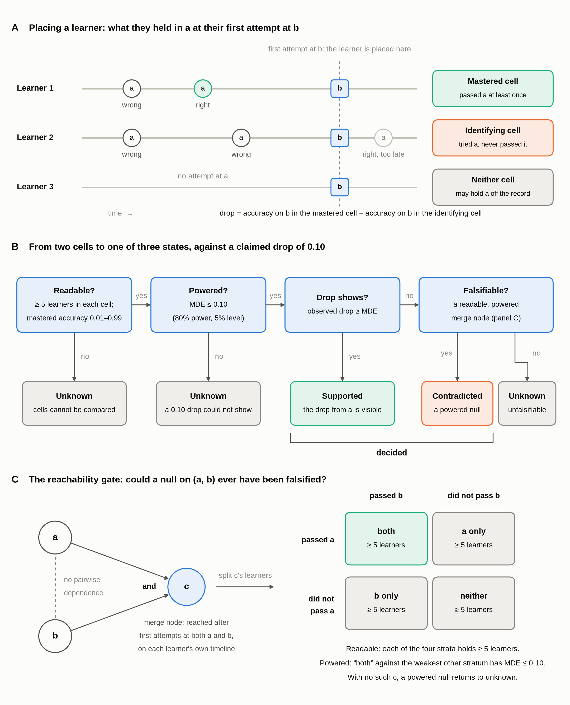
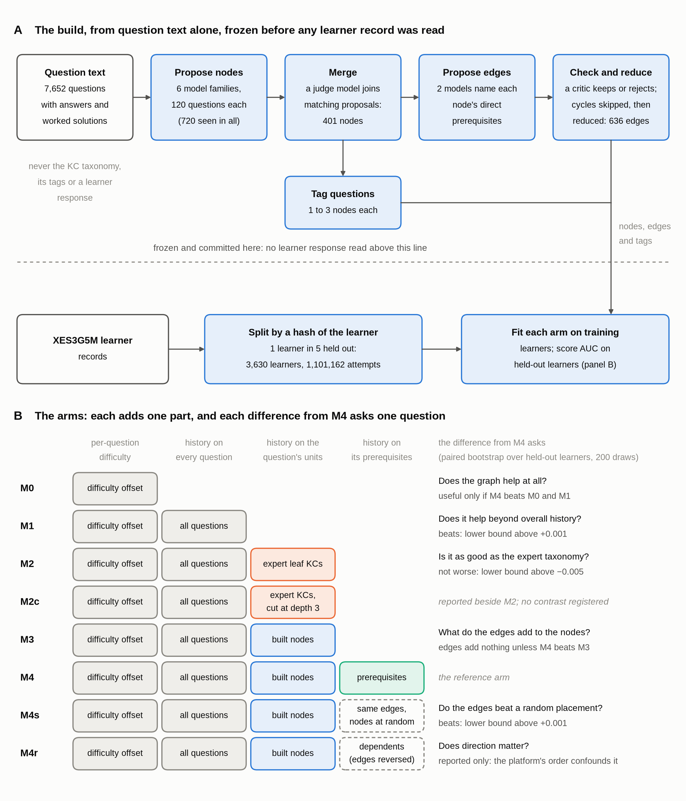
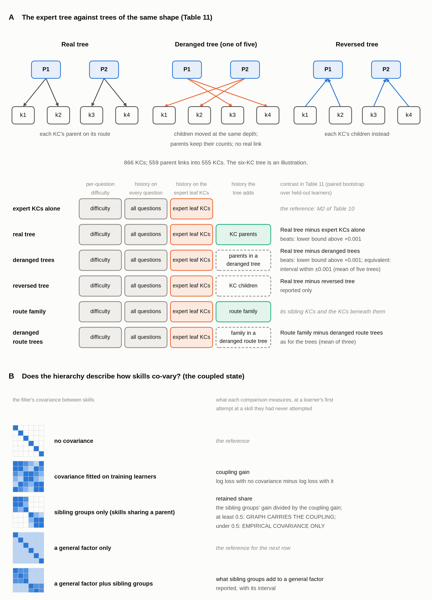

# What learner records can say about a prerequisite edge

### PLACEHOLDER 1 (subtitle): one sentence stating the answer.

**David S. Porcaro**, Learning Design Alliance

*Research and writing carried out with Claude Code (Claude Opus 5.5, Anthropic). See [AI use](#ai-use).*

---

## Abstract

Adaptive platforms and curriculum designers use prerequisite graphs to decide what a learner meets
next, and learner records are the tempting source from which to infer them. This paper asks whether
such records contain the comparison that identifies an edge, whether the edges they give repeat and
agree with an independent order, whether edges improve prediction of next attempts, and what
dependence between skills the records do identify. Archival records from practice platforms, tutors
and online courses were read with instruments that, for nearly every verdict, were first checked on
synthetic learners with planted effects, and most readings were set beside a control that removes the
dependence they read. An edge from
skill *a* to skill *b* is identified by comparing learners who met *b* after attempting *a* without
passing it with learners who met *b* after passing *a*, and a prerequisite is taken to lower first-attempt accuracy on *b* by 0.10. That
comparison was rarely large enough to test. Most pairs of skills are attempted by few of the same
learners: the median pair had no learner in common on EDM Cup and only 4 on ASSISTments. Where enough
learners met both skills, a test of a 0.10 drop needed between 277 and 379 learners in each group, and
only Eedi, with 118,971 learners, could run one on more than a quarter of its pairs. Most of the
edges that were supported could be general ability instead: learners who have not passed one skill
tend to score lower on others, and in the four corpora with enough supported edges to check, at most
27.6% survived an adjustment for it. The
statistic used to orient an edge is identically a sort from the easier skill to the harder. No ranking
of pairs by the drop reached a split-half reliability of 0.80 on real data, and in simulation a ranking above 0.80
had only 0.075 of its asserted edges true. On one platform, Common Core grade order, as assigned to its
skills by a name-matching rule that no person checked, was not recovered: the excess over a deranged control was +0.0117, against a bar of 0.02. Edges built by
language models raised the area under the curve (AUC) for learners' next attempts by +0.000161
[+0.000115, +0.000207] over the same model without edges, below the pre-registered bar. The dataset's
own expert tree was equivalent to deranged copies of itself, within the pre-registered margin of 0.001
AUC. What the records identify is dependence
between skills. In 8 of 15 sets of skills, some pairs stayed related after a one-trait model had
accounted for each learner's general ability. Across four national curricula, part of the dependence was shared between
countries' platforms, +0.125 [+0.091, +0.158], and a larger part followed local teaching, +0.363
[+0.326, +0.401], on a map of units to Common Core clusters coded by a model and checked by one person. Observational records can rarely show that an edge exists: they
would need hundreds of learners per pair who met *b* without *a*, and verdicts that survive an
adjustment for ability. Randomized release of an edge creates that comparison group by design and
ensures that a difference between groups is not general ability, though a trial still needs hundreds of
learners for each edge it tests.

## 1. Introduction

A prerequisite graph states which skills must be learned before which others. The idea is old in
instructional design. Learning hierarchies claimed that intellectual skills are learned in an order
that can be validated (White 1974), knowledge space theory defined a prerequisite as an implication
among the states a learner can occupy (Doignon & Falmagne 1985, 1999), and mastery learning holds a
learner on one unit until it is mastered (Kulik et al. 1990).

In adaptive platforms the graph is a rule, not only a description. ALEKS sequences topics from a
knowledge structure (Fang et al. 2019), with mastery thresholds that decide when a topic counts as
learned (Matayoshi et al. 2025), and the Cognitive Tutor holds a student on a section until a mastery
rule is met or the student is promoted (Sales & Pane 2019). A platform that obeys a graph does not
offer a skill until its prerequisites are mastered, so each edge decides who may proceed and how long
a learner practices first.

Errors in the graph have costs in both directions. An edge that does not exist holds learners back:
in ASSISTments experiments, stricter mastery requirements kept students from completing their
assignments (Prihar et al. 2022), and self-paced mastery programs often reduced completion in college
classes (Kulik et al. 1990). An edge that is missing sends learners to tasks for which they
are not ready. Authoring the graph by hand does not remove these risks, because human judgments of
alignment between content and standards agree only moderately. When 20 raters matched the items of a
state mathematics test to 57 specific topics, their agreement, measured by Fleiss' kappa, was 0.55 to
0.58 (Herman et al. 2007). On another state's mathematics test, two thirds of nine reviewers agreed on
an item's specific objective for only 15 of 43 items (Webb et al. 2007).

Learner records are the tempting source of a better graph. Platforms accumulate millions of attempts,
and a long line of work infers prerequisite structure from them, by item tree analysis (Schrepp 2003),
by conditional success and failure (Desmarais et al. 2006), by causal-discovery search over knowledge
components (Scheines et al. 2014), jointly with a student model (Chen et al. 2016), and at the scale of
whole platforms (Morales-Alvarez et al. 2021; Yu et al. 2024; Gong et al. 2022). Knowledge-tracing
models now take a prerequisite graph as input (Chen et al. 2018a; Nakagawa et al. 2021), and language
models are used to build both skill tags and edges (Moore et al. 2024; Fu et al. 2024). If records
could identify edges, a graph could be learned from use and corrected as learners used it.

Whether records can do this is a question of identification before it is a question of method. An edge
from *a* to *b* is a claim about what happens at *b* to learners who have not mastered *a*, and a
platform that obeys its graph is built to keep such learners from appearing. The causal-inference
literature calls the missing condition positivity: every kind of unit must have some chance of
receiving each level of the treatment (Rosenbaum & Rubin 1983; Petersen et al. 2012). In simulation, a
prerequisite could not be discovered when exercises on the dependent skill were recommended only after
its prerequisite (Annabi & Nguyen 2023). In cognitive diagnosis, when every item respects a hierarchy,
the share of learners who hold the dependent skill alone cannot be told apart from the share who hold
neither skill (Gu & Xu 2023).

Direction and form raise further problems. From conditional independences alone, a causal model cannot
be told from some of its reversals (Verma & Pearl 1990), so a method that orients a single edge rests
on further assumptions. In simulated benchmarks, quantities that accumulate along the causal order,
such as variance, let simple baselines match structure-learning algorithms (Reisach et al. 2021,
2023). Where prerequisites are easier than the skills that depend on them, difficulty could play the
same part. A dependence between two skills may also be a second trait the two share (Ip 2010;
Chandrasekaran et al. 2012), or a trace of what learners were taught together (Muthén et al. 1991).

The usual evaluations cannot separate these readings. Discovered structures are often validated
against the curriculum's own order or against raters who know it, so agreement may reflect the
curriculum rather than dependence (Morales-Alvarez et al. 2021). In psychometrics, networks estimated
from two large samples of the same population agreed when described as a whole, by how strongly the
symptoms were associated overall, but the individual edges, the links estimated between particular
pairs of symptoms, often did not: only 13% to 21% of edges were estimated consistently (Forbes et al.
2017). Whether that reflects the method or the data has been disputed (Borsboom et al. 2017; Forbes et
al. 2021). In knowledge tracing, graphs are usually
compared with no graph, and a dense graph joining every concept to every other already gave most of
one reported gain (Nakagawa et al. 2019). Under standardized benchmarks, most recent deep
knowledge-tracing models do not beat the original one (Liu et al. 2022), and even a random knowledge
component can improve a model that lacks an item-difficulty term (Effenberger et al. 2020). A graph can
therefore appear valid, reliable and useful without its edges carrying information about learners.

This paper asks what learner records, as platforms collect them, can say about an edge at all, rather
than proposing another method of discovery. It asks whether the records contain the comparison that
identifies an edge and can tell its direction, whether the edges they give are the same twice, whether
those edges agree with an order known independently of the records, whether edges improve the
prediction of learners' next attempts, and, where edges are not identified, what dependence between
skills is. The questions are asked of platforms that differ in how learners come to meet skills, because
whether the identifying comparison can occur depends on which learners meet which skills, and when.

## 2. Background

### 2.1 Prerequisite structure and how it has been inferred from learner data

Knowledge space theory gives the oldest formal account of a prerequisite. A knowledge structure is the
family of states that learners can occupy, each state being the set of items a learner has mastered.
A prerequisite relation is an implication over those states: any learner who has mastered item *b* has
also mastered item *a* (Doignon & Falmagne 1985, 1999). On this account a prerequisite shows itself in
data as an absence. States that hold *b* without *a* should not occur, apart from careless errors and
lucky guesses. Like the cognitive diagnosis models below, the theory treats an item as mastered or not.
It has been generalized to graded levels of mastery (Stefanutti et al. 2020), and the loss of mastery
over time is taken up in Section 2.3.

Item tree analysis turns that account into a procedure. For every ordered pair of items it counts the
learners whose responses contradict the implication, and it keeps the implications whose
counterexamples are few enough to be attributed to response error. The inductive variant, inductive
item tree analysis (IITA), chooses among candidate quasi-orders by a fit measure (Schrepp 2003; Sargin
& Ünlü 2009), and the DAKS package implements these methods in R (Ünlü & Sargin 2010).

Two later results bound what item tree analysis can show. Ünlü and Schrepp (2015) found that earlier
simulations comparing the IITA algorithms had drawn quasi-orders that were not representative, which
biased the conclusions about how well the algorithms performed. A statement about the power of IITA
therefore holds only for the class of structures that was simulated. Steiner et al. (2026) report that
every implementation of IITA needs a complete table of right and wrong answers, one for every learner
on every item. They built variants that tolerate answers missing completely at random, that is,
missing for reasons unrelated to what the learner knows. As the share of missing answers was raised,
these variants still recovered the true structure until, on average, 28.47% of answers were missing in
simulations without response errors, 19.93% in simulations with them, and 15.41% on a subset of the
2003 PISA assessment. Records from learning platforms meet neither condition: most learners never
attempt most items, and which items they attempt depends on the curriculum and on what they have
already mastered. When missingness depends on the knowledge state in this way, only a correctly
specified model of the missingness gives an adequate fit (de Chiusole et al. 2015).

Cognitive diagnosis approaches the same object through latent skills, called attributes, rather than
through items. A Q-matrix records which attributes each item requires. In the DINA model, an item is
answered correctly, apart from slips and guesses, only by learners who hold all of its attributes
(Junker & Sijtsma 2001). The generalized DINA framework contains conjunctive, disjunctive and additive
forms as special cases and compares them item by item (de la Torre 2011). The attribute hierarchy
method added a prerequisite hierarchy among the attributes, but the hierarchy was authored and imposed
rather than estimated (Leighton et al. 2004).

Later work made the attribute hierarchy something to test or to estimate. The hierarchical diagnostic
classification model (HDCM) tests a hypothesized hierarchy against a crossed, nonhierarchical
structure; on an English grammar test, the hierarchical structure fitted better (Templin & Bradshaw
2014). Bayesian estimation of the hierarchy recovered, in simulation, the full structure or at least a
subgraph of it (Chen & Wang 2023). A penalized-likelihood method learns the number of attributes, the
Q-matrix and the hierarchy jointly (Ma et al. 2023). Heller et al. (2015) proved that the
multiple-strategy DINA model is equivalent to the competence-based extension of the basic local
independence model used in knowledge space theory. Identifiability results from either tradition
therefore apply to the other.

Models of learning over time extend these ideas. Hidden Markov models over attribute profiles
describe each learner's movement from nonmastery to mastery, and can include covariates such as the
type of instruction the learner received (Wang et al. 2018). In such a model a prerequisite becomes a
constraint on transitions: an attribute can be acquired only from states that already hold its
prerequisites. Liu, Culpepper and Chen (2023) note that the usual conditions under which such a
model's parameters can be recovered from data are stricter than practical test designs meet. They
give weaker conditions under which the parameters can be recovered for almost all of their possible
values, for a restricted class of these models.

A separate line of work, in educational data mining, infers structure from the logs of tutoring
systems. Part of it revises the nodes of a structure, that is, which skill each item measures.
Learning factors analysis refines a knowledge-component model by its fit to learning curves (Cen et
al. 2006), within a framework that treats knowledge components as the units of instruction and
assessment (Koedinger et al. 2012). Empirical Q-matrix validation identifies misspecified entries of a
Q-matrix and replaces them (de la Torre & Chiu 2016).

Other methods in the same line estimate the edges. POKS orients relations between items from
conditional success and failure (Desmarais et al. 2006). Vuong et al. (2011) compared learners who had
and had not completed a candidate prerequisite unit in a curriculum. Scheines et al. (2014) applied
causal-discovery search to knowledge components, and Chen et al. (2016) discovered a skill
prerequisite graph jointly with a student model. Chang et al. (2015) modeled relationships between
exercises on Junyi Academy and collected human ratings of exercise pairs.

Recent discovery methods work at larger scale. VISL learns topic-level structure from Eedi responses
with missing values (Morales-Alvarez et al. 2021). Yu et al. (2024) first estimate a covariance among
skills from performance data, then use conditional-independence tests and standardized partial
variance to orient the edges. The NeurIPS 2022 challenge co-hosted by Eedi asked entrants to recover
causal relations among 1,855 constructs from the responses of 6,468 students (Gong et al. 2022). One
entry learned a causal order and a structure matrix inside a recurrent knowledge-tracing network
(Ashok Kumar et al. 2023). Knowledge-tracing models for structured domains estimate relations among
skills as part of prediction (Zhou et al. 2024; Mai et al. 2025). In massive open online courses
(MOOCs), Pan et al. (2017) learned prerequisite relations between concepts from representation-learning
features, and improved F1 (the harmonic mean of precision and recall) by 5.9% to 48.0% over earlier
methods on three datasets.

The same questions have been asked at the grain of courses and of examinations. Kaur et al. (2019)
estimated pairwise effects between university courses by matching students on credits, grade point
average and prior courses. On examination data, Pradhan Newar et al. (2025) applied the conviction
measure from association-rule mining to five programming skills, using four examinations with more
than 600 participants. Tracing code came out as a prerequisite of writing code. Whether writing code
was a prerequisite of explaining code depended on whether the mastery threshold was set at the mean or
at the median. How these structures have been evaluated is the subject of Section 2.4.

### 2.2 When observational learner records can identify a dependency

Estimating the effect of a treatment from observational data requires that every group of units
sharing the same characteristics, for example learners with the same history, has some chance of
receiving each level of the treatment. This is the positivity, or overlap, assumption (Rosenbaum & Rubin 1983; Petersen et
al. 2012). Where a pattern of covariates always receives the same treatment, the data hold no
comparison for that pattern, and an estimate for it is an extrapolation from other patterns. Petersen
et al. (2012) describe how such violations are diagnosed and what responses to them are available.

Conditioning on more of a unit's history does not repair overlap. D'Amour et al. (2021) show that
adding covariates, which makes the assumption of no unmeasured confounding more plausible, makes
overlap harder to satisfy. Strict overlap bounds the average imbalance in covariate means between
treated and control units, and the bounds become more restrictive as the number of covariates grows.

For a prerequisite edge from *a* to *b*, the comparison that bears most directly on existence is
between learners who met *b* after learning *a* and learners who met *b* without it. Adaptive
platforms are built to keep the second group from forming. A scheduler that obeys a prerequisite graph
does not offer *b* until *a* is mastered, so the order in which learners meet skills is a function of
the structure under test. Annabi and Nguyen (2023) learned a knowledge structure as a parameter of a
knowledge-tracing model from the trajectories of simulated learners. They observed that a prerequisite
relation cannot be discovered when exercises on the dependent skill are recommended only after
exercises on its prerequisite.

The latent-variable literature states the same condition formally. Gu and Xu (2020) defined partial
identifiability for restricted latent class models. Gu and Xu (2023) showed that the existence of an
attribute hierarchy "leads to degenerate parameter space". They gave conditions under which the
model's parameters can be recovered, and these conditions can be checked from the Q-matrix alone,
before any responses are collected. Recovering an arbitrary hierarchy requires the Q-matrix to
contain, for each attribute, an item that measures that attribute alone (their Proposition 1). In their
two-attribute example, attribute 1 is a prerequisite of attribute 2 and every item respects the
hierarchy. The data then determine only the sum of two shares: the learners who hold attribute 2
without attribute 1, and the learners who hold neither. Splitting that sum requires an assumption made
outside the data, such as setting the first share to zero, and that assumption decides whether the
edge exists.

Testing a hierarchy raises a further problem. Ma and Xu (2021) defined the testability of hierarchical
structures in cognitive diagnosis models. They showed that the likelihood-ratio statistic for a
hierarchy has a nonstandard asymptotic distribution that behaves poorly in finite samples, and that a
parametric bootstrap outperformed both the nonparametric bootstrap and the naive chi-squared test. In a
preprint, Zhang, Wang and Gu (2026) proved that the graph linking items to discrete latent skills and
the causal graph among those skills are identifiable under stated conditions. One condition is that
every latent skill profile has positive probability, which is positivity at the latent level. The
latent graph is identified only up to its Markov equivalence class (Section 2.3).

Selection by an adaptive system does not by itself make a model-based estimate undefined. Mislevy and
Chang (2000) examined an apparent paradox in adaptive testing, in which the usual definition of local
independence seemed to give incorrect probabilities for response patterns. They resolved it by adding
notation for the mechanism that selects items. When selection depends only on observed responses, it
is ignorable for likelihood inference given the item response model. A parametric estimate for a cell
that holds no learners then exists, but it rests on the model's extrapolation into that cell rather
than on learners observed in it.

Fixed order is also less fixed in practice than in design. In the Cognitive Tutor Algebra I
effectiveness trial, students who could not master a section after many problems were promoted to the
next section anyway (Sales & Pane 2019). Students frequently progressed without demonstrating mastery
and worked units out of order, and teachers reassigned some of them before mastery (Israni et al.
2018). These departures create learners who met later content without the earlier content, but the
departures are not random, and they vary between classrooms.

Where overlap is created by redefining the treatment, the comparison changes. Kaur et al. (2019) noted
that where course *X* is a hard prerequisite, no student takes course *Y* without it. They therefore
defined the treatment as taking *X* and scoring above a C, with a control group that pooled students
who did not take *X* and those who scored C or below. That contrast compares achievement in *X*, which
is confounded with general ability even after matching on grade point average. Krause-Levy et al.
(2020) found, in an advanced data-structures course, that grades in the prerequisite courses correlated
0.53 with the course grade, while grade point average outside computer science correlated 0.51. At
that grain, the predictive value of a prerequisite was nearly matched by general academic performance.

### 2.3 Direction and form

Direction is a separate question from existence. Verma and Pearl (1990) defined two causal models as
equivalent when no experiment could distinguish one from the other, and gave a graphical criterion for
deciding equivalence. From conditional independences alone, a chain *a* → *b* → *c* cannot be told from
its reversal; only colliders, in which two arrows point into one variable, are oriented. A method that
orients a single edge between two variables from observational data therefore relies on assumptions
beyond conditional independence, about the functional form of the relation or about the noise.

Simulation benchmarks show how such assumptions can do the work unnoticed. Reisach et al. (2021) found
that in commonly simulated additive-noise data, marginal variance tends to increase along the causal
order, a property they called varsortability. High varsortability explained the strong performance of
some continuous structure-learning algorithms, which a simple baseline that sorts variables by
variance matched. On standardized data, the same algorithms failed to identify the true graph or its
Markov equivalence class.

Standardizing the variables does not remove every such pattern. Reisach et al. (2023) showed that the
fraction of a variable's variance explained by the other variables, its coefficient of determination
(R²), also tends to increase along the causal order, and that a baseline which sorts by R² can match
or exceed established causal-discovery algorithms. They recommend stating this property as an
assumption about the process that generated the data, because how common it is in real data is
unknown.

The education analogue of varsortability is difficulty that rises with depth. In a curriculum in which
prerequisites are easier than the skills that depend on them, a statistic that orients each pair from
the easier skill to the harder one will appear to recover the structure, whatever the dependence
between the two skills. Asymmetric statistics built from conditional success and failure (Desmarais et
al. 2006) and orientation by partial variance (Yu et al. 2024) are open to this reading unless
difficulty is held fixed.

Temporal order is the usual remedy for an unoriented edge. Bang and Didelez (2023) characterized how
tiered background knowledge, in which variables are grouped into tiers by time, restricts the Markov
equivalence class, and when one tiered ordering is more informative than another. The remedy assumes
that the order in which the variables occur is not itself set by the hypothesis under test. Where
every learner meets skills in the order a curriculum prescribes, the only tiering available is that
order.

Prerequisites also differ in form, and the word "conjunctive" has two meanings in this literature. In
cognitive diagnosis it usually describes an item. Under the DINA model an item needs all the
attributes it loads on, under the disjunctive (DINO) form any one of them suffices, and the generalized
DINA framework tests these forms against each other item by item (Junker & Sijtsma 2001; de la Torre
2011). On ASSISTments data from 441 eighth-grade students, a composition function learned for
two-skill questions came close to the conjunctive form. Knowing the harder skill alone did not help
significantly over knowing only the weaker skill, and the compensatory effect was small (Pardos et al.
2008).

A conjunctive prerequisite is a different claim: that a skill can be acquired only after two or more
others. Conjunctive Bayesian networks model the accumulation of events whose order of occurrence is
constrained, where an event may depend on more than one predecessor (Beerenwinkel et al. 2007). The
latent conjunctive Bayesian network carries this model to skills. It keeps the hard constraint that an
attribute can be held only when all its parent attributes are held, and gives each arrow a reading in
terms of conditional independence (Lee & Gu 2024). The hierarchy models of Section 2.1 express the same
constraint on attribute profiles (Leighton et al. 2004; Templin & Bradshaw 2014).

A prerequisite can also be necessary or only facilitative. Baroody et al. (2022) reviewed ten
experiments on hypothetical learning trajectories. In the experiments with significant effects, some
control children succeeded on the target level without instruction on the precursor levels, and the
authors read those precursors as strong facilitators rather than prerequisites. Only one experiment,
on cardinality, showed what they called a necessary relation. Of 8 children who lacked the prerequisite
concept, 7 had no success on the target concept and one had negligible success, while 6 of the 7
children who had it had some success. The authors called this "the lack of a messy middle". A
facilitative relation leaves learners who succeed without the prerequisite, and a necessary relation
leaves none.

The effect of a prerequisite may change with time. The interval between practicing *a* and first
meeting *b* is also a spacing interval for *a*. In a study of more than 1,350 learners who studied
facts, reviewed them after a gap of up to 3.5 months and were tested up to a year later, lengthening
the gap first increased and then gradually reduced final performance (Cepeda et al. 2008). The gap
that gave the best final score, the optimal gap, grew with the time from review to test but shrank as a
share of it. For a test one week after review, the best gap was about 20% to 40% of that week, or
1.4 to 2.8 days; for a test one year after review, it was about 5% to 10% of that year, or 18
to 37 days. Spacing research thus predicts that the benefit of earlier practice depends both on the gap and on
when the outcome is measured.

Evidence on decay between courses is weak. Among 305 students who passed an algebra and trigonometry
course and attempted a follow-on calculus course, marks did not differ between gaps of 0 and 3 months
(t(111) = −0.25, p = .807), and more than 90% took the follow-on course within 6 months (Webby et al.
2015). In an advanced data-structures course, the delay since the prerequisite course did not
meaningfully affect performance (Krause-Levy et al. 2020). Students choose these gaps themselves, so
comparisons between gaps select on who waits.

Mastery learning is the instructional form of a prerequisite. Across 108 controlled evaluations,
mastery programs had positive effects on examination performance (Kulik et al. 1990). The effects
appeared stronger for the weaker students in a class, and self-paced versions often reduced
completion rates in college classes.

Promotion without mastery offers a contrast inside a tutor, but not a clean one. Sales and Pane (2019)
analyzed the Cognitive Tutor promotions with a continuous principal-stratification model and found that
the tutor may be more effective for students who are promoted more often. Because those students differ
in other ways, it remained unclear whether the difference could be attributed to mastery learning. In a
preprint on the same trial, Israni et al. (2018) estimated that being reassigned by a teacher before
mastery at least once was associated with posttest scores lower by 0.15 ± 0.07, in posttest units in
which the trial's effect was about 0.2. Allowing an omitted confounder as strong as the pretest widened
the interval to ±0.14.

A randomized comparison of mastery thresholds now exists. Matayoshi et al. (2025) randomly assigned 5%
of topic starts in the ALEKS system to a high mastery threshold and 5% to a low one. Students who
learned under the higher threshold were less likely to forget, but the difference decreased over time,
to less than 0.02 after several weeks against an average retention of about 0.6. The randomized result
agreed with the authors' earlier regression discontinuity at the system's probability cutoff.

A mastery rule's decision is itself an inference about the learner. In simulation, knowledge tracing
can be inequitable when it relies on an inaccurate model of learning, because it is fitted to
aggregate populations of students; both Bayesian knowledge tracing and the rule of N consecutive
correct answers are susceptible (Doroudi & Brunskill 2019). Who is released without mastery therefore
depends on how well the rule fits each group of learners, not only on their ability.

### 2.4 Reliability and validity of derived structures

Reliability bounds validity. A measure cannot correlate with any other more strongly than the square
root of its own reliability allows (Spearman 1904; Lord & Novick 1968). The guidance most often cited
for a reliability of 0.80 comes from Nunnally (1978). When a measurement feeds a binary decision, the
relevant quantity is decision consistency: the probability that two parallel administrations lead to
the same decision (Swaminathan et al. 1974). Cui et al. (2012) defined classification-consistency and
classification-accuracy indices, with their sampling distributions, for cognitive diagnostic
assessments.

Psychometric network research has argued over the reliability of estimated graphs. Forbes et al.
(2017) estimated symptom networks in two similar epidemiological samples (n = 9,282 and n = 8,841).
Networks of marginal associations were stable, but the three kinds of conditional-independence network
replicated poorly between and within samples. Only 13% to 21% of edges were estimated consistently
across six conditional-independence networks.

The reply to Forbes et al. located part of the problem in how the data were collected. Borsboom et al.
(2017) reanalyzed the same data and found that all the network models replicated well across samples
and split halves. They attributed the earlier result to differences in implementation, to an
interview skip structure that distorted the correlations, and to the assumption that different network
models should agree. A skip structure is a design feature of data collection that manufactures
dependence among the variables.

The argument then moved from aggregate to edge-level stability. Forbes et al. (2021) estimated Gaussian
graphical models of depression and anxiety over two waves (n = 403) and four networks of posttraumatic
stress disorder (PTSD). The standard tools indicated stable and consistent edges, but direct measures
of the presence, absence, sign and strength of each edge showed 39% to 49% of edges unreplicated across
pairwise comparisons. Global summary statistics overlooked the instability of the very characteristics
that were interpreted. Jones et al. (2021) replied that nonreplication across empirical datasets cannot
evaluate a method, which is possible only in simulation with a known generating model, and a Bayesian
test of each edge found substantial evidence for replication.

How much cross-sample agreement counts as replication is itself a convention. Fried et al. (2018)
estimated networks of 16 PTSD symptoms in four clinical samples (N = 2,782). The networks correlated
0.62 to 0.74 in structure and 0.63 to 0.75 in centrality, which the authors read as considerable
similarity. Epskamp et al. (2018) introduced bootstrap routines for the accuracy of edge weights and
for the stability of centrality when cases are dropped, summarized by a correlation-stability (CS)
coefficient. They recommend that the CS coefficient not be below 0.25 and preferably be above 0.5, and
note that these cutoffs come from simulation and are not definitive.

The estimator also shapes what is found. Observing a sparse network while assuming sparsity does not
show that the true structure is sparse (Epskamp et al. 2017a). A simulation over 564,000 datasets and
60 metrics found an unavoidable exchange between discovery (sensitivity) and caution (specificity and
precision), so that the estimator should be chosen for the research question (Isvoranu & Epskamp
2023). An estimator tuned for caution, such as a regularized method that keeps an edge only when the
evidence for it is strong, returns a sparse network with few false edges and misses weak true ones; an
estimator tuned for discovery returns more true edges and more false ones. For a graph of knowledge,
the number of edges reported, and whether a given edge appears, therefore reflects the estimator and
its tuning as well as the learners, and a graph is interpretable only with its estimator's error rates
at the sample size used.

Structure learning has its own tools for edge-level confidence. Friedman et al. (1999) used the
bootstrap to attach confidence to features of learned Bayesian networks, including the existence of an
edge and the order of variables, when the data cannot identify a single best network. Stability
selection combines subsampling with a selection algorithm and gives finite-sample control of the
expected number of falsely selected edges (Meinshausen & Bühlmann 2010). Scutari and Nagarajan (2013)
estimated the threshold on bootstrap edge confidence from the data rather than fixing it, and found
that sensitivity rose linearly with the logarithm of sample size while specificity stayed close to 1.
For the reliability of a ranking, the ordinary bootstrap can be inconsistent, and an m-out-of-n
bootstrap restores consistency (Hall & Miller 2009).

Validating a structure against an external reference is an old question. White (1974) set out nine
stages for validating a learning hierarchy, and reported that they gave strong evidence for Gagné's
postulate that intellectual skills are learned hierarchically while verbalized knowledge is not.
Thompson and Nash (2022) observed that most validity evidence for learning maps is procedural,
resting on literature and expert review. They proposed three empirical methods of decreasing model
dependence: comparing a full log-linear diagnostic model with a hierarchical one, examining mastery
attribute by attribute, and comparing patterns of attribute difficulty across cohorts. Applied to the
Dynamic Learning Maps alternate assessment, each method had limits, but together they gave
complementary evidence.

Experimental validation has succeeded for the nodes of a structure. Liu and Koedinger (2017) took an
improvement to a cognitive model found automatically by learning factors analysis, validated it on new
data, and used it to redesign a classroom tutor; the redesigned tutor produced significant learning
gains over a control condition. For the edges, the Eedi challenge scored submissions only against
edges validated by randomized tests, in which a treatment group received a lesson on a related
construct and a control group a lesson on an unrelated one (Gong et al. 2022). That set of edges was
not released. One entry reported a best leaderboard F1 of 0.43 against it (Ashok Kumar et al.
2023).

Many discovery studies are validated against a reference drawn from the curriculum itself, a
difficulty that can be called the catalogue problem. When the reference is the platform's own structure, or ratings by people who
know the curriculum's order, agreement with it is not independent evidence of dependence. In VISL's
evaluation on Eedi, two teachers rated each learned edge from 1 to 5 (Morales-Alvarez et al. 2021) on
two questions: adjacency, whether the two topics should be linked at all, and orientation, whether the
arrow points from the topic that should come first. As a baseline, the same teachers rated random
edges, pairs of topics drawn at random. On adjacency, the learned edges averaged 3.60 and 3.70 from the
two teachers, against 2.04 and 2.08 for the random edges. On orientation, they averaged 2.76 and 2.60,
against 1.44 and 1.40. Agreement between the teachers was Cohen's κ 0.72 and 0.76. The learned edges
thus beat chance in the teachers' eyes. But 36% of them joined two topics within the same level-2 topic
of Eedi's own curriculum taxonomy, against 6% of the random edges. Topics that share a curriculum unit
look related to a teacher whether or not one depends on the other, so part of the rating advantage may
come from the curriculum's grouping rather than from dependence. The stakes are not hypothetical: the
authors report that a national secondary curriculum's topic order was revised using the learned
structure, a structure validated only against ratings that can follow the curriculum.

Other evaluations share the problem. Yu et al. (2024) reported F1 for adjacency and orientation near
80% and 60% on FrcSub (535 examinees, 20 items, 8 skills), and 70% and 45% on KDD Cup Algebra I 2005–06
(438 students, 185 exercises, 12 skills). The text names no source for either reference structure and
no random or shuffled-graph baseline. Kaur et al. (2019) validated their course effects against the
existing prerequisite structure and by cross-validation, and some catalogue prerequisites changed sign
between cohorts, which the authors attributed to changes in the syllabus. A uniformly random pair of
skills is usually farther apart in the curriculum than a learned edge, so a gap over random pairs is
consistent with learned edges that track curricular proximity.

### 2.5 Experimental evidence on order

The learning-trajectory program of Clements, Sarama and Baroody has tested order directly. Baroody
et al. (2022) summarized 10 experiments. Seven tested whether teaching one level above the child's
current level beats skipping to the target level, and three tested whether the same activities in
trajectory order beat the same activities unordered. Five of the 10 were significant. The three order
tests were small or mixed. In a patterning pilot (n = 16) the effect size (ES) was 0.238 (p = 0.48). In
a patterning experiment (n = 48) the difference was not significant, and the unordered arm scored
higher on some measures. In a length-measurement experiment (n = 189), the comparison of trajectory
order with reverse order gave ES = 0.32.

The individual trials give more detail. The length-measurement trial with kindergartners is reported
by Sarama et al. (2021). The patterning randomized controlled trial (RCT) with 16 preschoolers gave both
arms the same activities and ordered them by the trajectory in only one arm. Both arms gained
significantly, a small effect size favored the trajectory order for identifying the core of a pattern
but not for extending patterns, and age mattered more than order (Baroody et al. 2021).

The skip-level trials ask a different question. In them the comparison arm is taught at the target
level without the intermediate levels, rather than in a different order. Preschoolers at least two
levels below the target who received trajectory instruction learned significantly more, mainly on
near-transfer items, than those given an equal dose of target-level instruction (Clements et al. 2019;
ES = 0.55, p = 0.016 as reported by Baroody et al. 2022). Among 291 kindergartners, instruction one
level above the child's current level produced significantly greater learning than story problems
three levels above, particularly for children with low entry knowledge (Clements et al. 2021).

Topic order has also been randomized in classrooms. Among 138 sixth graders learning algebraic
simplification, introducing multiplication of terms first, or both operations contrasted, produced
substantially stronger gains and better retention than the usual order of addition first (Ziegler et
al. 2019). In two experiments with sixth graders (N = 77 and 26) on a tutoring system for decimals,
iterating between lessons on concepts and procedures beat concepts first on procedural knowledge and
transfer, with comparable conceptual knowledge (Rittle-Johnson & Koedinger 2009). In a preprint,
Dringoli et al. (2019) report a two-year study of more than 1,000 students in a first-year university
electromagnetism course, in which students who met conceptual content first performed significantly
better than those who met theoretical content first.

Online platforms make order experiments cheaper, and their results are mixed. Prihar et al. (2022)
pooled 50,752 instances of 30,408 students in 50 ASSISTments experiments, several of which randomized
the mastery requirement between 2 and 5 correct answers in a row. Requiring fewer correct answers gave
higher normalized learning, but mostly because stricter requirements kept students from completing the
assignment; among students who completed it there were no statistically significant effects. The
authors warn that only effects above 0.1 with p values near 10⁻³ can likely be trusted when many
similar experiments are pooled. In an online linear-algebra course, 1,987 enrollees were randomized to
a reinforcement-learning scheduler (95%), a fixed linear order (2.5%) or self-navigation (2.5%), which
left 1,830, 91 and 66 learners. The scheduled and self-directed learners gained more than those on the
linear order (p < .05), and self-navigation had higher dropout (Bassen et al. 2020).

Adaptive sequencing designs have also been proposed. Multi-armed bandit algorithms sequenced activities
by estimated learning progress, using expert knowledge only as coarse guidance, and were evaluated in
simulation and with 400 schoolchildren aged 7 to 8 (Clement et al. 2015). The sequential randomized
trial re-randomizes learners at successive decision points, to inform how interventions are sequenced,
timed and personalized (NeCamp et al. 2019).

A reanalysis of one fractions experiment shows how wide such estimates are. MacLellan (2025) analyzed
DataShop dataset 1190, which compared a blocked order of fraction tasks with full interleaving, after
removing corrupted cases (78 students with tutor data, 71 with posttest data). Students in the
interleaved arm did worse in the tutor (odds ratio (OR) 0.50, interval 0.28 to 0.89) and better on
the posttest (OR 2.35, 1.0 to 5.52). Simulated learners showed the same signs, with much larger
posttest odds (OR 7.75, 4.06 to 14.78).

The power of educational trials sets the prior for any single result. Across 141 large-scale
randomized trials in kindergarten to grade 12 (1,222,024 students), the mean effect was 0.06 standard
deviations (SD), the mean width of the confidence interval was 0.30 SD, and the median Bayes factor was
0.56 (Lortie-Forgues & Inglis 2019). Intraclass correlations of achievement for planning
group-randomized trials have been compiled by Hedges and Hedberg (2007). On ASSISTments, adjusting
A/B comparisons with predictions trained on the logs of students outside the experiment was roughly
equivalent to increasing the sample size by 20% on average, and by 50% to 80% in some cases (Sales et
al. 2023).

Practice order is a different manipulation from prerequisite order. A meta-analysis of interleaved
learning covering 59 studies, 238 effect sizes and 158 samples found an overall effect of g = 0.42,
g = 0.34 for mathematics, and g = −0.39 for words, where blocking was better (Brunmair & Richter 2019).
The effect was larger when categories were similar to each other, when items within a category were
dissimilar, and when the material was complex. Randomized trials of interleaved mathematics practice
include Rohrer et al. (2020) and, in Nigeria, Kremer et al. (2023). The
moderators concern similarity between topics, not dependence between them, so these effects say
nothing for or against a particular prerequisite edge.

Meeting the dependent task first can even help. A meta-analysis of 53 studies and 166 comparisons
favored problem solving followed by instruction over instruction followed by problem solving, with
g = 0.36 (interval 0.20 to 0.51), and g = 0.37 to 0.58 at high fidelity to the design (Sinha &
Kapur 2021). The direction reversed for grades 2 to 5 and for domain-general skills.

### 2.6 Whether structure improves learner models

Knowledge tracing is the task of predicting whether a learner will succeed on the next attempt, given
the learner's past attempts. Bayesian knowledge tracing models each skill as a hidden binary state (Corbett & Anderson 1994),
and deep knowledge tracing (DKT) replaces the per-skill model with a recurrent neural network over all
skills (Piech et al. 2015). Khajah et al. (2016) traced DKT's advantage to recency, the context of the
trial sequence, similarity between skills, and individual variation in ability. Bayesian knowledge
tracing extended with these sources performed indistinguishably from DKT. Ding and Larson (2021), in a
preprint, report that DKT is more likely to learn an ability model than to track each skill through
time, and that an untrained recurrent network can achieve results similar to a trained DKT.

Several knowledge-tracing architectures inject a prerequisite or concept graph. Prerequisite-driven
deep knowledge tracing uses prerequisite concept pairs as ordering constraints, and reports
significant improvement over three knowledge-tracing baselines on five datasets (Chen et al. 2018a).
Graph-based knowledge tracing (GKT) recasts the task as node classification over time on a concept
graph and, because the graph is not given in most datasets, proposes several ways of constructing it
(Nakagawa et al. 2021). Its workshop version compared those constructions with a dense graph that
joins every concept to every other with equal weight (Nakagawa et al. 2019). On ASSISTments 2009 the
dense graph gave an AUC of 0.722, against 0.709 for deep knowledge tracing and at most 0.723 for a
constructed graph; on Bridge to Algebra it gave 0.762, against 0.751 and at most 0.769. No variance
was reported. The authors read the margin as showing that sparse relations help, and called for
experiments on more datasets. Structure-based knowledge tracing propagates influence in both directions along
similarity relations and in one direction along prerequisite relations (Tong et al. 2020). The
abstracts of prerequisite-driven and structure-based knowledge tracing compare them with models that
lack the structure, and mention no run of the same architecture with a reversed or shuffled graph.

Much of what is called graph-based knowledge tracing uses the graph between questions and skills,
which is the Q-matrix, rather than a graph among skills. In GIKT, raising the number of graph
convolution layers from 0 to 3 moved the area under the receiver operating characteristic curve (AUC)
from 0.7843 to 0.7896 on ASSISTments 2009, from 0.7738 to 0.7754 on ASSISTments 2012, and from 0.7438
to 0.7523 on EdNet (Yang et al. 2021). PEBG pre-trains question embeddings from question difficulty
and from relations in the question-skill graph. With DKT it reached AUC 0.8287, 0.7665 and 0.7765 on
the same three datasets, and removing the explicit question-skill relations lowered these to 0.8144,
0.7584 and 0.7652 (Liu et al. 2020).

Standardized benchmarks give a less favorable picture. Under common preprocessing and five-fold
cross-validation, pyKT found that most recently proposed deep knowledge-tracing models cannot beat the
original DKT (Liu et al. 2022). At the question level, GKT scored AUC 0.7424, 0.8110, 0.8046 and 0.7689
on four datasets against DKT's 0.7541, 0.8149, 0.8015 and 0.7689. On XES3G5M, GKT scored 0.7727 ±
0.0006 against DKT's 0.7852 ± 0.0006 (Liu et al. 2023a). Reported AUCs for DKT on ASSISTments 2009 range
from 0.721 to 0.821 across papers, and a baseline that adds only question-specific variation inspired
by the Rasch model always ranked at the top against more complex models in the authors' comparisons (Liu et al. 2023b).

XES3G5M also supplies an expert hierarchy, which its authors tested. The dataset's knowledge-component
routes form a tree that, in the authors' words, "explicitly introduces the prerequisite relations"
among knowledge components (Liu et al. 2023a). Adding the routes to question and knowledge-component
content did not help. With early fusion, simpleKT scored AUC 0.8277 with content and 0.8262 with
content and routes, and AKT scored 0.8292 and 0.8290. The text content, not the hierarchy, gave the
gains.

Few studies compare a real graph with a random one of the same kind. Kim et al. (2023) had experts
label skill-to-skill relations for ASSISTments 2009 and fed them to a Transformer knowledge-tracing
model through a projection loss. AUC (%) was 80.81 without the loss, 80.90 with a random skill-to-skill
graph and 81.10 with the expert graph, on one dataset, with no standard deviations reported. SINKT has
GPT-4 generate concept-to-concept edges (Fu et al. 2024). Replacing the GPT-4 graph with the
transition graph observed in the data lowered AUC by 0.0011 to 0.0031 across four datasets, with no
random, shuffled or empty graph and no variance reported.

Predictive gain has also been read as evidence of direction. Hong et al. (2025) pruned DKT's influence
graphs to directed acyclic graphs on three ASSISTments datasets and retrained DKT on the exercises that
kept at least one edge. These causal subsets beat random subsets of the same size: AUC 0.905 against
0.859 ± 0.013 (z = 3.50), 0.727 against 0.721 ± 0.004 (z = 1.50) and 0.718 against 0.704 ± 0.011
(z = 1.02). The authors conclude that DKT's strength lies in its implicit ability to model prerequisite
relationships as a causal structure. Their control changes which exercises are kept, not which edges
the model is given, and the authors concede that the subsets may differ in ways beyond causal
structure.

Skill tags can help prediction for reasons unrelated to skills. In the additive factors model, items
with identical Q-matrix rows receive the same difficulty, so "even the addition of a purely random
knowledge component can sometimes improve model predictions" (Effenberger et al. 2020). Once a term for
each item was added, the gap in root mean squared error between the finest and a coarser Q-matrix fell
from 0.011 to 0.002. A tag can thus improve prediction without naming a skill: it may stand in for a variable that is
already known, such as item difficulty, or split a coarse skill into finer groups by accident. A
comparison of tagged and untagged models is therefore interpretable only when both carry an
item-difficulty term.

Tags built by language models now improve knowledge tracing. Ozyurt et al. (2024), in a preprint, had a
language model annotate solution steps with knowledge components and used the resulting embeddings in
15 knowledge-tracing models on XES3G5M and Eedi. Relative improvements were 1% to 7%, and the best AUC on
XES3G5M rose from 82.24 to 83.04. On two programming datasets, AUC was 0.816 ± 0.012 with
knowledge components generated by a language model against 0.797 ± 0.016 with human-written ones, and
0.771 ± 0.011 against 0.752 ± 0.005 (Duan et al. 2026). GPT-4's knowledge components matched human ones
for 56% of chemistry and 35% of e-learning questions, and where they differed, experts preferred
GPT-4's about two-thirds of the time (Moore et al. 2024). These studies concern nodes, the units a
domain is divided into, and they judge tags by prediction or by expert preference. They do not show that
a language model finds the skills learners actually have, nor do they test edges between skills, and the
exact-match figures show how far model and human carvings still part. They matter here for a narrower
reason: if built tags raise prediction, a gain from a model-built graph must be split into what its
nodes add and what its edges add before it can be credited to prerequisite structure.

Equal predictive fit does not settle structure. A pipeline is underspecified when it can return many
predictors with equally strong held-out performance in the training domain, and such predictors can
behave very differently in deployment (D'Amour et al. 2022). In educational data mining, Rashomon sets
of tree-based models improved predictive accuracy by 2% to 6%, and the importance of key demographic
variables varied across courses (Kuzilek & Çavuş 2024). That work concerns the importance of variables
in outcome prediction, not the carving of a domain into skills.

### 2.7 Local dependence and what holds across curricula

Item response theory assumes local independence: given the latent trait, responses to different items
are independent. Yen (1984) introduced the Q2 and Q3 indexes to detect departures from it. Both work on residuals: a
learner's score on an item minus the score the model predicts from that learner's estimated trait. Q3,
the more widely used, is the correlation of two items' residuals across learners. Near zero, the trait
accounts for what the two items share; well above zero, the items share something more, such as a
common passage, a common skill, or one item's answer helping with the other. That extra shared variance
is where a prerequisite between two items would appear, which is why these indexes bear on this
paper. In Grade 3 and Grade 6 mathematics tests, they identified locally dependent
subsets of items with similar content. Such sets tended to be difficult and discriminating if the items
involved an accumulation of the skills in the easier items. Yen (1993) compiled the causes of local
item dependence in performance assessments.

Later indexes and tests refined the detection of local dependence. Chen and Thissen (1997) proposed the X²
and G² indexes, which compare, for a pair of items, how often each combination of right and wrong
answers occurs with how often the model expects it. When the items are locally independent, these
indexes follow a known reference distribution, the χ² distribution with one degree of freedom, so a
value can be converted into a p-value directly. Q3 lacks a fixed reference of this kind, and in their
simulations the X² and G² indexes kept closer to their nominal false-alarm rate when no dependence was
present. No single critical value of Q3 suits every situation, because its
null percentiles depend on the number of items, the sample size and the number of response categories;
Christensen et al. (2017) recommend a parametric bootstrap in each dataset. Quasi-exact Q3 tests, of the
fixed-margins family (Ponocny 2001), hold their alpha level under the Rasch model and have higher power
than several alternatives (Debelak & Koller 2020). Edwards et al. (2018) proposed a jackknife diagnostic
based on the stability of item parameters when one item is dropped.

Knowledge space theory supplies a source of local dependence. Noventa et al. (2019) generalized local
independence to allow prerequisite relations between items, so that item response models become a
subset of knowledge space models, and showed that local dependence and dimensionality are only
partially disentangled. Noventa et al. (2026) reviewed approaches to local dependence and systematized
its deterministic and probabilistic mechanisms.

A second trait and a dependence between items can be the same model. Ip (2010) proved that a
multidimensional item response model is empirically indistinguishable from a locally dependent
unidimensional model whose single dimension is the construct of interest. The Ising model of pairwise
interactions among binary variables is broadly equivalent to item response theory (Marsman et al.
2018), and three representations of the Ising model, each with a different causal account of the
associations, are mathematically equivalent (Kruis & Maris 2016). On the mutualism account, the
positive correlation among cognitive abilities can arise purely from beneficial interactions between
processes during development, with no single underlying factor (van der Maas et al. 2006).

Joint models of a trait and a sparse residual graph exist. The residual network model treats the
residual covariance of indicators as a network, and identifiable models can be obtained in which local
independence is structurally violated (Epskamp et al. 2017b). The fused latent and graphical model adds
a sparse graph to a multidimensional item response model to absorb unknown local dependence (Chen et
al. 2018b). Chandrasekaran et al. (2012) gave the condition under which a sparse graph and a low-rank
latent component can be separated: the graph must be sparse and the latent effect spread over most
variables. A latent effect confined to two variables is not spread out, and cannot be told from an
edge between them.

Shared units of content are the classical alternative to a pairwise edge. Items that share a stimulus
are not conditionally independent; a testlet random effect absorbs this dependence, and ignoring it
overstates precision (Bradlow et al. 1999). Bifactor models add group factors for clusters of items to
a general factor (Reise 2012), so that dependence within a cluster is carried by its group factor.

What learners were taught shapes item dependence. In United States data from the Second International
Mathematics Study, the same test was taken by students in typical classes and in algebra classes, and
opportunity-to-learn variables affected item performance directly, beyond the latent trait (Muthén et
al. 1991). A longitudinal multilevel model of differential item functioning separates global from
classroom-level instructional sensitivity (Naumann et al. 2014). In PISA 2012, opportunity to learn was
related to mathematics performance at the country, school and student levels (Schmidt et al. 2014).
In PISA 2006 science, differential curriculum coverage was the most serious cause of differential item
functioning between pairs of countries, with content familiarity also contributing (Huang et al.
2016).

Cross-national comparisons of skill structure are few. Wu et al. (2020) fitted a cognitive diagnosis
model to 12 PISA 2012 mathematics items with 11 attributes, for 24,512 students in 10 countries, and
read prerequisite relations and learning trajectories from the ranking of knowledge-state
frequencies. Australia, Canada, the United Kingdom and Russia shared main trajectories, the United
States and China shared a primary trajectory, and Singapore's was the most complicated. The order in
which young children identify clusters of number symbols varied only slightly across eight countries
and six languages of instruction (Copping et al. 2024). Both results concern an order of difficulty or
of knowledge states, which is not the same as a dependence estimated beyond a single trait.

International assessment has settled on a model with shared and local parts. In PIRLS data from 40
countries, international calibration left large numbers of misfitting items, more than 25% in some
countries, and a partially invariant scale with country-specific parameters for those items fitted
better (Oliveri & von Davier 2014). In PISA 2006 reading, Kreiner and Christensen (2014) found strong
evidence of misfit and differential item functioning, and concluded that the country rankings were not
robust.

Which part counts as shared depends on how groups are linked. Robitzsch and Lüdtke (2023) argue that
full, partial or approximate invariance is not a prerequisite for valid group comparisons, and that
when invariance is violated there is unavoidable ambiguity in how comparisons are defined. Partial
invariance has no special claim over alignment, robust linking or Bayesian approximate invariance.
Rutkowski and Svetina (2014) show that the usual multiple-group fit criteria are unsuitable or need
adjustment when the number of groups is large.

Linking content across curricula usually goes through standards, and alignment judgments are noisy.
Twenty raters coded the 42 items of California's Golden State Examination in mathematics against 57
specific topics and 10 content categories (Herman et al. 2007). Fleiss' kappa was 0.55 for faculty and
0.58 for teachers at the level of topics, and 0.71 and 0.74 at the level of categories. On Michigan's
mathematics test, two-thirds of nine reviewers agreed on the specific objective for only 15 of 43 items
(35%) (Webb et al. 2007). Porter (2002) described content matrices and an alignment index for the
content of instruction. Across 138 pairs of standards and assessments, roughly half of the standards'
content was tested, and 17% to 27% of test content covered topics not in the standards (Polikoff et al.
2011).

Alignment labels and procedures are themselves uncertain. Fourth-grade textbooks marketed as aligned to
the Common Core State Standards (National Governors Association Center for Best Practices & Council of
Chief State School Officers 2010) showed substantial areas of misalignment (Polikoff 2015). Alignment
inferences may be heavily influenced by features of the procedure, including the size of the
framework, the number of raters and their agreement (Polikoff & Fulmer 2013).

Language models have been tested on the same task. When GPT-4 tagged 9.9 thousand problems with 385
standards from Achieve the Core by traversing domains, clusters and standards, its exact set accuracy was 0.048
and its accuracy by overlap 0.502; 80.5% of predicted standards fell in the correct domain (Li et al.
2024). Annotators who identified as United States teachers agreed with each other on whether a generated problem aligned with a
state standard 75.3% ± 1.6% of the time (Christ et al. 2026). Fine-tuned encoders trained on 1,385
items from a large-scale assessment's item bank reached a weighted F1 of 0.950 for 4 domains and 0.869
for 19 skills, against labels from the item bank, with no human agreement reported (Xu et al. 2026).

## 3. Research questions

- **RQ1. Existence and direction.** Do learner records contain the contrast that identifies a
  prerequisite edge (learners who met the dependent skill without the prerequisite), and when they
  do, can they tell which way the edge points?
- **RQ2. Reliability.** Does the same kind of data give the same edges twice?
- **RQ3. Validity.** Do edges derived from learner records agree with an independent order?
- **RQ4. Usefulness.** Do prerequisite edges, whether built by language models or authored by experts,
  improve the prediction of learners' next attempts?
- **RQ5. What is identified.** If edges are not identified, what dependence between skills is?

## 4. Method

The study is a secondary analysis of archival learner records, supported by simulation. No learner
was recruited, contacted or assigned to a condition, and no new data were collected. Every analysis
reads records that others collected before this work began, and every instrument that returns a
verdict, with two exceptions named in Section 4.3, was first run on synthetic learners shaped like the records it would read. This section describes the corpora
(Section 4.1), the measure that decides whether a corpus can speak to an edge at all (Section 4.2),
the synthetic checks and the controls that most readings carry (Sections 4.3 and 4.4), how the
analyses were registered (Section 4.5), the graph built by language models for RQ4 (Section 4.6), the
constructs that a person, a rule set or a model coded (Section 4.7), how the design was arrived at
(Section 4.8), and ethics and data handling (Section 4.9).

### 4.1 Corpora

The learner records come from the corpora in the table below. They span practice platforms,
intelligent tutors, a language-learning application, a test-preparation application and online
courses. Between them they set the order in which learners meet skills in different ways. The column on order
states what each corpus documents, not what was verified independently; Section 5.1 measures instead
how many learners met each pair of skills, and in which order.

*The corpora of learner records. Learners and units are the counts the analyses read, which for
EdNet KT1 and MOOCCubeX are subsets of the full release. Units are the skills, knowledge components
(KCs), codes or courses at which pairs are formed. License or terms: as recorded in the release's
data sources; "no redistribution" means the terms forbid passing the data on. Sources of the counts:
`studies/identifiability/overlap/out/atlas.json`, `atlas-slam.json` and `lag_bands.json`,
`studies/identifiability/core-vs-culture/out/unit-map.json` (Junyi 2020) and
`studies/measurement/reliability/out/course_order_derangement.json` (MOOCCubeX). A dash: no count
in the committed outputs.*

| Corpus | Learners | Skills or units | How order is set | License or terms | How read |
| --- | ---: | --- | --- | --- | --- |
| XES3G5M | 18,066 | 865 KCs of the dataset's KC-route tree, on 7,652 questions | practice platform; assignment rule not documented | no data license stated (the code repository is MIT-licensed); treated as research use without redistribution | every learner; question text read only for the build of Section 4.6 |
| ASSISTments 2012–13 skill builders | 29,018 | 265 skills | teacher-assigned problem sets; mastery-gated skill builders | ASSISTments terms of use, treated as non-commercial research use without redistribution; problem text is not shared | every learner, at the grain of skills |
| EDM Cup 2023 | 34,580 | 351 Common Core codes on problems | teacher-assigned problem sets on the same platform | ASSISTments Data Terms of Use: no commercial use, no redistribution, no de-anonymization | every learner, from the official release |
| EdNet KT1 | 6,000; 60,000 for one reliability curve | 141 tags, the first expert tag on each question | learner chooses which test part to study | CC BY-NC 4.0: no commercial use, no model training | the first learners in the archive's file order, read inside the archive |
| Eedi (NeurIPS 2020 Education Challenge) | 118,971 | 308 leaves of the subject tree | teacher-assigned quizzes; last answers only | research use, confirmed with the provider; no redistribution | every learner in the challenge's tasks 1 and 2 |
| Duolingo SLAM 2018 | 1,213 to 2,643 in each of three courses | 204 to 358 constructs, or 2,093 to 2,866 words | fixed skill tree | CC BY-NC 4.0 | the released first 30 days of each learner |
| Junyi Academy, DataShop dataset 1275 | 2,063 | 631 exercises (8 areas in the export's first KC model) | authored prerequisite map | DataShop terms: research use, not commercial, no redistribution | DataShop's "All Data" export |
| Seven other DataShop datasets (580, 649, 671, 1190, 1530, 1531, 1706) | 74 to 431 per dataset | 16 to 107 KCs | set by each tutor or course | DataShop terms, as above | "All Data" export, under the first KC model in each |
| Junyi Academy 2020 | — | 1,330 units | practice platform; not documented here | CC BY-NC-SA 4.0 | only for the cross-curricular comparison of Section 5.5 |
| MOOCCubeX | 541,452, enrolled in 60 courses | 60 courses; small item sets for item tree analysis | learners enroll in courses; each course's videos have a fixed order | research use, no redistribution | the learner files are streamed and never stored |

**Three further sources are not logs of practice.** The Examination for the Certificate of
Proficiency in English (ECPE) grammar responses hold 2,922 examinees on 28 items with a published
Q-matrix over three skills (Templin & Bradshaw 2014), read from the copy distributed with the CDM
package for R. No data license is stated for them, so they are held under the strictest of the terms
above: research use, no redistribution and aggregates only. They serve as the one real dataset on
which a published attribute hierarchy could act as a positive control (Section 5.5). Junyi Academy's
2015 exercise table, its authored prerequisite map and its ratings of exercise pairs by crowdsourced
raters (Chang et al. 2015) are held for research use. The randomized experiments of Section 5.3 are
the kindergarten length-measurement trial of Sarama et al. (2021), 187 children in its deposited
analysis file, under the open-data terms of its archive (statistical analysis only, no
re-identification); ASSISTments experiment PSABANRN, 1,192 students, from the release of Prihar et al.
(2022) under the ASSISTments Data Terms of Use; and an order swap inside DataShop dataset 1190, 30
learners per arm, under the DataShop terms.

**Each corpus was read at a grain fixed before its pairs were scored, with one exception.** A pair of skills is a pair of
the units in the table. On XES3G5M the unit is the leaf KC of the dataset's own KC routes; on EDM Cup
it is the Common Core code the release attaches to each problem; on Eedi it is the third-level leaf
of its subject tree, with a question tagged to several leaves counted on each; on EdNet it is the
first expert tag on each question; on the DataShop datasets it is the first KC model in each export. The exception is
Junyi (ds1275), whose first KC model is 8 subject areas: Table 1 reads it at its 631 exercises, the
units its learners chose among, a grain chosen after the reading at the area grain had been seen
(Section 4.5).
Correctness is the first attempt at each unit, as each release records it. Eedi's release keeps only
each learner's last answer to each question, so on Eedi a first attempt is first in the order of
last answers, and every result that depends on order or lag says so.

**The data were checked for misreadings before any result was read.** The fields the studies read
are documented in the release's data sources, in full for most corpora and in part for some, with
each meaning quoted from the provider's own documentation, its direction or unit, and the invariants
that catch a misreading. Three checks
changed what was read. The copy of EDM Cup 2023 first used came from a competitor's mirror, which
replaces the assignment start and end times with a text placeholder on exactly the 53,615 unit-test
rows; the official release was fetched, every file was checked against the provider's content
hashes, and the derived table rebuilt from the official file is byte-identical to the one in use.
DataShop exports that come from DataShop's quality-assurance server are not public, so no reported
result rests on them, and every export is read at its "All Data" sample rather than at whichever file
sorts first. Junyi's authored map lists some prerequisites twice, and each edge is counted once.

**Raw records never enter the repository, and only aggregates are released.** Each corpus stays in
the analysis environment under its provider's terms. The release records where each corpus can be
obtained, how, under what terms, and the content hash of the bytes read, so that a reader with the
same access can reproduce every input (Section 9). The committed outputs released with this paper hold counts, rates and coefficients over pairs, units and arms; they hold
no learner rows, item text or learner identifiers.

### 4.2 The positivity atlas and the reachability gate

The positivity atlas asks, for every ordered pair of units in a corpus, whether the corpus holds the
comparison that identifies a prerequisite edge from *a* to *b*. Each learner who attempted *b* is
placed by what they held in *a* at the moment of their first attempt at *b* (Figure 1). A learner is in the
*mastered cell* when they answered *a* correctly at least once before that moment, and in the
*identifying cell* when they attempted *a* before it without ever answering it correctly. A learner
who had not attempted *a* at all is in neither cell, because such a learner may hold *a* from
instruction the record does not see. The outcome is the correctness of the first attempt at *b*, and
the *drop* is first-attempt accuracy on *b* in the mastered cell minus that in the identifying cell.
A positive drop means that learners who had passed *a* did better on *b*. The comparison is a check
of positivity, the condition that every level of the cause occurs in the data (Petersen et al. 2012):
if no learner meets *b* without having passed *a*, no estimator can say what *a* does for *b*.

**A pair is readable when both cells can be compared at all.** The cell floor is 5 learners in each
of the two cells. A pair whose mastered cell has a first-attempt accuracy at or below 0.01, or at or
above 0.99, is also unreadable, because a comparison against a cell at its ceiling or floor has no
room to show a drop. For a readable pair the atlas computes the minimum detectable effect (MDE): the
smallest drop that a two-sided test of two proportions at the 5% level would detect with 80% power,
given the two cells' sizes and the mastered cell's accuracy. The MDE is solved numerically rather
than from the usual closed form, because the variance in the identifying cell depends on the drop
being solved for, and the closed form understates the MDE on the small cells at issue.

**Each pair receives one of three states, judged against a claimed effect of 0.10.** The claimed
effect is a drop of 0.10 in first-attempt accuracy on *b*, the size of effect a prerequisite edge is
usually claimed to have. It is fixed in the program's shared code and used unchanged in every corpus;
it was not estimated from any corpus. A pair is *unknown* when it is unreadable or when its MDE
exceeds 0.10, since a real edge of the claimed size would then not show. A pair whose MDE is 0.10 or
less is *supported* when its observed drop reaches the MDE. It is *contradicted* when its observed
drop falls short of the MDE and the pair also passes the reachability gate below; otherwise it is
unknown. A pair is *decided* when it is supported or contradicted. The three states are kept apart
rather than collapsed into an adjacency matrix, because a zero in such a matrix would stand both for
"tested and absent" and for "could not be tested". A supported state says that a gate from *a* alone is visible; when *b* needs several
prerequisites at once, the pairwise drop is diluted (Section 5.1), so the absence of support says
even less about an edge than the state implies.

**The reachability gate asks whether a powered null could ever have been falsified.** Two skills can
be independent of each other until a third skill that needs both, a conjunctive gate (*a* and *b*)
→ *c*. The pairwise null between *a* and *b* is then correct, and the dependence appears only at *c*.
A corpus whose learners never reach such a *c* after meeting both *a* and *b* holds no evidence about
whether the two are related, and its pairwise null is a fact about the corpus rather than about the
domain. A pair therefore needs at least one merge node, a unit that learners reached after their
first attempts at both *a* and *b*. Its learners are split four ways by whether they passed *a* and
whether they passed *b* before reaching it. The merge node is readable when each of the four strata
holds at least 5 learners, and powered when the comparison between the stratum that passed both and
the weakest other stratum has an MDE of 0.10 or less. Downstream is read from each learner's own
timeline, not from a published curriculum, because what matters is that learners actually held states
on *a* and *b* before they met *c*. A pair with no readable and powered merge node is unfalsifiable,
and a powered null on it is returned to unknown. The gate bears on the negative state only: a pair
that shows the drop stays supported whether or not a merge node exists.

**Figure 1.** How the positivity atlas gives an ordered pair (*a*, *b*) its state. (A) Each learner who attempted *b* is placed by what they held in *a* at their first attempt at *b*: in the mastered cell if they had answered *a* correctly at least once, in the identifying cell if they had attempted *a* without ever answering it correctly, and in neither cell if they had not attempted *a*. Attempts at *a* after that moment are not counted. (B) The pair's state. A pair is unknown when its cells cannot be compared or when a drop of 0.10 would not show; a powered pair is supported when its drop reaches the MDE, and contradicted when it does not only if it passes the reachability gate. Supported and contradicted pairs are decided. (C) The reachability gate. A merge node *c* is a unit learners reached after their first attempts at both *a* and *b*; its learners are split by whether they passed *a* and *b* before reaching it. The rules drawn are read from the code that applies them; drawn by `studies/identifiability/overlap/figure_atlas.py`.

**Each corpus contributes every ordered pair, or a random sample of them.** Where a corpus has more
ordered pairs than 20,000, the atlas scores a random sample of 20,000 (40,000 on ASSISTments), drawn
with a seed keyed to the corpus's own name, so that adding a corpus does not change another corpus's
sample. Table 1 reports, for each corpus, how many of the pairs scored meet each condition of a
verdict, the counts of supported and contradicted pairs and the share decided. It also reports the
background drop, the median drop over readable pairs. Because learners who pass one skill tend to be
abler and pass others, an arbitrary ordered pair already shows a positive drop, and the background
drop says how much of the claimed effect that alone supplies.

**Where a pair goes undecided is measured condition by condition.** A study registered after the
atlas follows every pair scored through the five points at which it can fail to be decided
(`studies/identifiability/empty-cell/`). Too few learners may have attempted both of its skills
(coverage); its identifying cell may hold fewer than 5 learners; its cells may be unreadable, because
the control arm is within 0.01 of 0 or 1; its test may lack the power to see a drop of 0.10; or, if
powered and null, the reachability gate may withdraw it. For each corpus the study reports how many
pairs pass each condition, and, among readable pairs, the median identifying cell beside the number
of learners per group that a powered test needs at the corpus's median accuracy.

**An empty identifying cell is split into its causes by an identity.** Among the learners who attempted
both *a* and *b*, let *N* be their number, *O* the share who attempted *a* first, *P*₁ the share of those
whose first attempt at *a* was wrong, and *P*₂ the share of those who still had not answered *a*
correctly when they reached *b*. The identifying cell is exactly *N* × *O* × *P*₁ × *P*₂. An empty cell is
attributed to coverage when *N* is below 5; to order when fewer than 5 learners met *a* first and an
exact one-sided binomial test rejects an even split at *p* < 0.05; to ease when fewer than 5 missed
*a* on their first attempt and the same test rejects a miss rate of 1 in 5; and to retry when enough
missed *a* but answered it correctly before reaching *b*, as under mastery gating. A shortfall the
binomial test does not reject is attributed to coverage, read as too few learners to tell. Each pair is
read in two directions: forward, the order in which most of its learners met it, and backward. Where
everyone meets skills in one order, every backward cell is empty by order alone, while a forward cell
can still fill with learners who failed *a* and moved on. A corpus's label in a direction is the cause
of at least half of its empty pairs, or CELL FILLS when fewer than half are empty.

**Supported verdicts are checked against general ability.** For each supported pair the drop is
recomputed on residuals: a learner's first-attempt outcome on *b* minus their mean first-attempt
correctness over every other skill they attempted, *a* and *b* excluded. A pair survives if the
adjusted drop still reaches its minimum detectable effect. The pre-registered verdict is VERDICTS
SURVIVE ABILITY ADJUSTMENT when at least half of a corpus's supported pairs survive, and VERDICTS ARE
MOSTLY ABILITY otherwise; a corpus with fewer than 20 supported pairs is not tested.

**The study's floor plants each cause in its own world.** Ten synthetic worlds, of 3,000 learners and
40 skills or, for the ability check, 5,000 learners and 20 skills, each plant one cause: one global
order, mastery gating, the two together, sparse coverage, coverage at the margin, easy skills, free
order, and, for the ability check, planted prerequisites without differences in ability, and
differences in ability without prerequisites. Every label had to come out as planted, and the
identity had to hold on every pair, before any corpus was read. The two worlds for the ability check
were added after the labels had been read on the corpora, and both ability verdicts had to come out as
planted before the check was run on them. The floor passed on its final run. Of three earlier runs that
failed, one exposed a weakness in the rule for ease, which was changed together with one of the
worlds, and two exposed errors in the construction of the world with planted prerequisites. The
failed runs are kept with the study; a repeat of an earlier passing run, made by mistake under
unchanged code, was not kept (Section 4.5). The same script defines and scores these worlds, so the floor
shows that the code reads planted causes correctly, not that it is independently validated (Section 4.3).

### 4.3 Synthetic detection floors

With two exceptions, every instrument in this paper that returns a verdict was run on synthetic data
with a known answer before its real reading was taken. The two readings that had no planted floor are the correlation of the Junyi
raters with the learner order effect, and the reanalysis of the length-measurement trial, whose check
was a reproduction of the authors' model rather than a planted effect. A detection floor plants a known effect in synthetic learners shaped like the real corpus
and asks whether the instrument, with its verdict rule unchanged, recovers it. A null from an
instrument that cannot see a planted effect of the size in question is not a finding: it says
nothing about whether the effect is there. The floor is therefore the condition under which a real
null may be read as evidence at all.

**Synthetic worlds are shaped like the data they stand in for.** Each floor matches the real data on
the quantities that set an instrument's power: the numbers of learners, units and pairs, the cell
sizes, the coverage of units by learners, and where possible the corpus's own response matrices. The
floors of the item-level tests of Section 5.5 plant an effect into XES3G5M's own matrices. The floor
of the lag-forgetting re-registration is sized to each corpus's real number of usable pairs and
learners, with 40 seeds per planted world. The reliability and stability-selection floors simulate
learners shaped like XES3G5M, with general ability confounding every pair. Each floor has at least
two kinds of world: one with the planted effect, which the instrument must detect, and one without
it, in which the instrument must stay silent at about its nominal rate. Several floors add worlds
that carry the confound an instrument is most likely to mistake for the effect, such as ability
alone, a short-run state on each learner's sequence, curriculum order, or a second trait shared by
two skills.

**The pass rule is written before the floor runs, and under a failed floor a null is not read as
one.** Each study states in advance what counts as recovery, for example detection in at
least 80% of placements, or a planted contrast found in at least 4 of 5 planted worlds and in at most
1 of 10 null worlds. When the floor fails, a null is not read as one: the verdict is UNANSWERABLE or
UNDERPOWERED, as each registration states, a positive reading under a failed floor establishes only
its sign, and the real estimate, if computed, is reported as a description. A floor is not loosened
to let a verdict through. Where a floor was rerun at a larger size after the real result had been
seen, to learn whether the failure was a matter of sample size, the rerun is labeled post hoc in the
results and does not restore the registered verdict.

**A floor has limits, and the results state them where they bind.** A floor shows that the instrument
can see the mechanism that was planted; it does not show that the real data contain that mechanism,
or that a mechanism the floor did not plant would be seen. Several floors simulate random order of
attempts, which real platforms do not have, so passing them does not guarantee that a real corpus of
the same size can decide its pairs. Where the same script both defines and scores its floor, the
floor is a smoke check of the code rather than an independent validation, and it is reported as one.
Where a real positive control exists, it is used as well: on the ECPE grammar data, which carry a
published attribute hierarchy, each of the program's cross-sectional
instruments was required to recover a planted copy of that hierarchy in at least 0.8 of replicates
before its real reading was taken (Section 5.5).

### 4.4 Controls

Most readings in this paper are reported beside a control arm that keeps everything about the data
except the dependence the reading is about. The control is a derangement: a permutation in which no
unit keeps its own value. An ordinary random permutation leaves, on average, one unit in place, so
that about 1/*n* of the real evidence survives in the control. That remainder was enough, in the program's own earlier work, to make a control look as if it carried structure. A
derangement leaves none.

**What is deranged, and what is kept, depends on the reading.** In the reliability analyses of
Section 5.2, each learner's history on the prerequisite side of a pair is replaced by that of another
learner, and the dependent side is left as it was. This keeps each item's difficulty and timing and
destroys every dependence that runs through the individual learner. In the directional contrast of
Section 5.3, the pass and fail labels are deranged within each pair and direction, which preserves
the marginal pass rate and the distribution of outcomes exactly. In the course-order analysis on
MOOCCubeX, the derangement keeps each course's distribution of enrollment times and destroys each
learner's own sequence. The graph controls of Section 5.4 keep a graph's shape and destroy its
meaning: the shuffled edge set assigns the skills an edge list joins at random, and a deranged KC tree
moves every child to another parent at the same depth, keeps every parent's number of children, and
lets no real link survive either as it was or reversed. In the cross-curricular analysis, recorded
co-assignment is deranged within deciles of local proximity, which keeps its distribution and most
of its tie to proximity.

**Controls are family-matched.** A derangement is drawn within the family of observations that the
comparison is about, such as one pair and direction, one half of a split, or one level of depth in a
tree, never across the whole corpus. Deranging across families would change the marginal rates the
reading conditions on, and the control would then differ from the real arm in more than the
dependence it is meant to remove. Every such reading is reported as its excess over the deranged arm,
not as a raw figure. A derangement removes more than a prerequisite, however. It also removes the
confounding by general ability through which learners who pass *a* do better on *b*, so an excess
over a deranged arm shows how repeatable the learner-level signal is, not that the signal is
prerequisite structure.

**A control has to be the size of the thing it controls for.** A control that perturbs the data far
less than the treatment shows only that a small change is harmless. Each study therefore compares the
size of its control with the size of its treatment in the unit the study perturbs, such as learners
per cell, coverage of earlier history or encounters per pair, and treats a control below half the
median treatment as too small. Where a control fails this check, the result says so (Section 5.2
gives one case). Where cell size itself
could explain a difference, a size-matched arm is added: in the lag-band reliability of Section 5.2,
encounters at all lags are thinned at random within each pair to the band's share, so that the
difference between a band and its size-matched arm is what the lag does, not what the smaller cells
do.

**Permutation and resampling act on the unit that was assigned.** When a treatment or a status is
assigned to a learner, a class or a run, shuffling individual rows instead hands the same unit both
statuses at once, narrows the null distribution and makes almost any difference look significant.
Every permutation test here therefore permutes the assigned unit: arm labels within class for the
length-measurement trial, students for the four-order experiment, and flags within sets for the
taxonomy test of Section 5.5. Bootstrap intervals resample the unit that carries the dependence: held-out learners for
the forecasting comparisons, classes or the cohorts that stand in for them for the directional
contrast, and dependent skills for pair-level estimates. Where pairs share prerequisite skills that
the bootstrap does not resample, the interval may be too narrow, and the results say so.

**Every verdict is signed.** Each estimate is defined with its direction (for example, the drop is the
mastered cell minus the identifying cell, and D is the long-lag drop minus the short-lag drop), and
each verdict rule tests the signed estimate against its bar. No verdict is decided on an absolute
value.

### 4.5 Pre-registration

Each study's pre-registration is the docstring at the top of its script, written and committed to the
program's repository before the script read any real data. The docstring states the question, the
estimand, the data and the unit of analysis, the thresholds, the verdict strings that each outcome
returns, the detection floor and its pass rule, and the controls. The verdict strings printed in
capitals throughout Section 5 are those strings, written before the run. Where a verdict combines
corpora, the program rule that combines them was registered with it: the lag-forgetting rule, for
example, needs two corpora with the same directional verdict.

**Changes after registration are recorded, with when they were made.** A CHANGES entry in the same
docstring records every amendment, whether it was made before or after any real data were read, and
whether it changed the design. Most entries are operational, such as a reply limit raised, a failed
request retried or a step run in parallel. Some are substitutions forced before real data were read,
such as the model that replaced one that could not return an edge list (Section 4.6). One analysis was first scored under a rule other than its registered
one and is reported under the registered rule, with the earlier reading named (Section 5.2). One control was changed after its result had been seen, at the
maintainer's decision: the random grouping of Section 5.2 depended on the order in which the program
read its group labels, so a single draw was replaced by the mean of 50 drawn from a generator of their own. That also redrew
seven of the eight learner splits, so the taxonomy and single-pair readings moved as well; the verdict
rule and the verdicts are unchanged.

**Readings added after a result had been seen are labeled post hoc.** A follow-up registered after
the result it follows had been read is labeled as such where it appears, as for the two analyses
that located the gain of the built nodes (Section 5.4) and the split of the cross-curricular result
by prior accuracy (Section 5.5). A diagnostic rerun added after a result is labeled post hoc and
carries no verdict. A refit whose point estimate was already known, as when one corpus was dropped
from the cross-curricular analysis, says that its point estimate was not blind and that only its
interval, null and verdict were new.

**A re-registration made after estimates were seen is disclosed as one.** The first lag-forgetting
study's floor failed, so all its verdicts were unanswerable, after its real estimates had been
computed and read. The second study (`studies/identifiability/lag-forgetting-v2/`) keeps the first
study's estimand, verdict strings, thresholds and program rule, all registered before any real
corpus was read, and replaces only the floor with one sized to each corpus. It was registered after
the first study's estimates had been seen, and it re-reads the same numbers with the same code, pairs
and bootstrap seed. It therefore certifies that the instrument can be read at each corpus's size; it
is not an independent replication, and the results report it that way.

**Not every analysis was pre-registered.** The program began as adaptive simulation and secondary
analysis, and its earliest analyses had no registration. The release file records, for each analysis
it declares, whether it was pre-specified. The positivity atlas itself, the item tree analysis of
MOOCCubeX, the comparison of surmise relations with the atlas, the reanalysis of the trajectory-order
trial and the mastery-release contrast are recorded there as not pre-specified, and they are read
with that status. Several later studies that test their readings, such as the lag-band split and the
check of item design in Section 5.1, were registered.

**The study that locates where pairs go undecided was revised before each of its readings.** Its
labels were registered before any corpus was read and revised after two floor runs, before the real
reading: attributing order and ease only on binomial evidence, and judging ease against a fixed miss
rate of 1 in 5 (`studies/identifiability/empty-cell/`, CHANGES 1 to 4). The verdict funnel and the
ability check were added after the labels' real reading had been seen, and before either was run on
real data (CHANGES 6). Reading Junyi at its exercises rather than its subject areas was added last
(CHANGES 7). A repeat of an earlier passing floor run, made by mistake under unchanged code, was not
kept.

### 4.6 The graph built by language models for RQ4

RQ4 was answered on a graph that language models built from the text of XES3G5M's questions alone
(`studies/end-to-end/xes3g5m-build/`; Figure 2). The build was registered before any model call and before any
statistic of this design was computed on XES3G5M. The builders saw a short scope record describing
the course and random samples of question text with answers and worked solutions. They never saw the
dataset's KC taxonomy, its KC tags or any learner response, and the scope record names no KC or
module. The analyst was not blind: earlier studies in the program had read the taxonomy and the
learner data, and the scope record was written by someone who had seen the taxonomy. All model calls
went through one routing service, with a spending cap fixed in advance.

**Nodes were proposed by six model families and merged by a judge model.** The six proposers were
`google/gemini-3.8-flash`, `openai/gpt-6-sol`, `anthropic/claude-sonnet-5`, `deepseek/deepseek-v4-pro`,
`moonshotai/kimi-k2.6` and `mistralai/mistral-medium-3-5`. The last was a reserve: the family registered
in its place, `z-ai/glm-5.3`, returned no parseable list, and the reserve registered for that case took
its place. Each family proposed the capabilities the course requires from its own sample of 120
questions. The samples were drawn without replacement and did not overlap, so the six together saw 720
of the 7,652 questions. Each family also answered a probe for tacit skills and flagged terminal
capabilities.

A judge model from a seventh family, `minimax/minimax-m3`, then compared every pair of proposal lists
and joined the items it judged to name the same capability. Each resulting cluster became one node.
Before the build, the judge had been checked on 2,811 pairs of capability statements written for
another topic, the subtraction of whole numbers. Each pair had been labelled the same, overlapping or
different by Anthropic models, not by people. Against those labels the judge agreed at a Cohen's κ of
0.856, missed 6 of the 30 pairs labelled the same, and joined none of the 2,731 pairs labelled
different. Its errors therefore lean toward keeping two names for one capability apart rather than
joining two capabilities into one. The merge gave 401 nodes. Two further models described each node's performance levels, type of knowledge,
cognitive load and expected time; those attributes enter none of the analyses reported here.

**Edges were proposed by two models and checked by a critic from a third family.** The two proposers
were `openai/gpt-6-sol` and `mistralai/mistral-medium-3-5`. Each was shown all 401 nodes and asked to
name the direct prerequisites of each node from among the others. A critic, `moonshotai/kimi-k2.6`,
then kept or rejected each proposed edge. Kept edges were added in order of how many proposers named them,
skipping any edge that would close a cycle, and the graph was then transitively reduced, leaving 636
edges. The second proposer was registered as `z-ai/glm-5.3`; before any learner data were read, it was
found to run to its reply limit on almost every request without returning an edge list, and it was
replaced by `mistralai/mistral-medium-3-5` under the same reserve rule. A tagger,
`deepseek/deepseek-v4.1-flash`, tagged every question with one to three nodes, the first being its
primary node.

**The build was frozen before any learner response was read.** The nodes, attributes, edges and tags
were committed before the analysis step opened the learner records, and the analysis refuses to run
while the committed build has uncommitted changes. Replaying the finished build reproduced every build
file byte for byte, and that state is the build of record. No build file holds question text.

**Learners were split by a hash of their identifier, and every quantity was estimated on the
training learners.** A learner is held out when the first eight hexadecimal digits of the SHA-256
hash of their identifier, taken modulo 5, are 0, which holds out about one learner in five: 3,630
learners and 1,101,162 attempts. Question difficulty, model coefficients and every rate used as a
baseline come from the training learners; every verdict is scored on the held-out learners.

**The forecasting model is a logistic regression, and every arm carries a per-question difficulty
offset.** For each attempt, the features come from the same learner's earlier attempts only. The
offset is the logit of the question's success rate among training learners, shrunk toward the global
training rate *g* as (*c* + 5*g*)/(*n* + 5), where *c* is the question's number of successes and *n*
its number of attempts. Without this term, a set of tags could improve the fit merely by grouping
questions of similar difficulty, which is how even random knowledge components can appear to help
(Effenberger et al. 2020). On top of the offset, each history feature is the logarithm of one plus a
count of the learner's earlier successes or earlier failures. For all questions the counts are taken
once. For a tagging, the logarithms are taken on each of the question's nodes and averaged over them,
with an indicator for a question that has no node. For an edge set, the same is done over the direct
prerequisites of the question's nodes, excluding its own nodes. The arms, M0 to M4r, add these features in the order
Table 10 gives. M4s keeps the built edge list and assigns the nodes it joins at random, with a fixed
seed. M4r reverses every edge. The models are fitted by iteratively reweighted least squares on the
training learners.

**Arms are compared by the area under the curve on held-out attempts, with a pre-registered bar.**
The statistic is the area under the receiver operating characteristic curve (AUC) on held-out
attempts. Every difference between two arms comes with a 95% interval from a paired bootstrap of 200
draws that resamples held-out learners, the unit the split assigned. One arm beats another when the
lower bound of that interval exceeds +0.001. The graph is judged useful and not worse than the expert
taxonomy when M4 beats M0 and M1 and the lower bound of M4 minus M2 exceeds −0.005. The edges add
nothing when M4 does not beat M3. The comparison of M4 with M4r is reported and decides no verdict,
because the platform presents prerequisites earlier, so that history on a node's prerequisites is
more often present than history on its dependents.

**The floor planted an edge effect in simulated learners.** In 30 nodes joined by a random acyclic
graph, 3,000 simulated learners visited nodes in a noisy order consistent with the graph, and their
probability of success depended on their ability, the question's difficulty, their mastery of the
node and, in planted worlds, their mean mastery of the node's prerequisites. The floor passes when M4
beats M4s in at least 4 of 5 planted worlds and in at most 1 of 10 worlds without the effect, and M3
beats M1 in every planted world. If it failed, the edge verdicts would be unanswerable.

**Later studies reuse the split, the offset, the bootstrap and the bar.** The two follow-ups that
located the gain of the built nodes (one tag per question, and the tagger's multi-skill tags on the
expert's 866 KCs) and the test of the dataset's expert KC-route tree against deranged trees each
import these choices unchanged. The tree study first reproduced the AUCs of M1 and M2 exactly before
scoring any tree arm.

### 4.7 Coded constructs and their references

Several analyses rest on a construct that someone or something coded: a map from units to a
standard, a grouping of questions into skills, or a prerequisite judgment. The program's rule is that
every coded construct names its coder, a person, a rule set, or a model with its prompt version, and
states its agreement with an independent reference: a second coder blind to the first, at least one
of the two a person. A construct without a reference sample is a descriptive count, and may not be
used as a predictor, target or gate until it has one. This subsection lists the coded constructs this
paper uses and whether each has a human reference.

**The map from units to Common Core clusters has a blind human reference.** For the cross-curricular
comparison of Section 5.5, `openai/gpt-6-sol` mapped every unit of XES3G5M, ASSISTments 2012–13, Eedi
and Junyi 2020, from its name alone, to one of 92 Common Core clusters for kindergarten to grade 8 or to
none, under the mapping prompt in the study's code. A second model, `deepseek/deepseek-v4-pro`, made
an independent second map. The author, coding as `human:david-porcaro`, coded a random sample of 25
units per corpus, blind to both maps, with Chinese unit names shown beside a literal English
translation by `google/gemini-3.8-flash`, a third model family used only to translate. The verdict
rule was registered before the coding: the map is validated when Cohen's kappa between the person
and the primary map is at least 0.60 with a lower 95% bound of at least 0.40, with items left blank
excluded and counted. The agreement reached is reported in Section 5.5. No second person has coded
the sample, so the human-to-human ceiling for this map is not known.

**The Common Core grade of each ASSISTments skill was coded by a rule set and has no human
reference.** ASSISTments 2012–13 publishes no order for its skills. For the directional test of
Section 5.3, each skill's grade was reached by matching its name against the Common Core codes and
descriptions that EDM Cup 2023 publishes for problems on the same platform: an exact match of names,
or an overlap of name tokens with a Jaccard index of at least one half. No person checked the map.
The test therefore treats it as an unvalidated reference, and runs the exact-name tier as a second
structure so that a result driven by the approximate matches would show as a disagreement between the
two. The same map gives the depth against which Section 5.1 places ASSISTments and the grade comparison
of Section 6.2, so those readings carry the same qualification.

**The model-built nodes, edges and tags on XES3G5M have no human reference, by design.** The graph of
Section 4.6, and the tags the same tagger model gave the expert's 866 KCs in a follow-up, are the
object under test. They are judged only by what they add to the prediction of held-out learners, and
none of them serves as a reference for anything else.

**The concept maps of MOOCCubeX were coded by a model and have no human reference.** MOOCCubeX's
release links concepts to problems and to courses through concepts extracted by named-entity
recognition from course captions, not authored per problem. The concept-level item tree analysis of
Section 5.5 forms its concept sets through that map. It is therefore descriptive, and no verdict in
this paper uses it as a gate.

**Structures authored by a provider are used as their providers made them.** The XES3G5M KC-route
tree, Eedi's subject tree, EdNet's question tags, the DataShop KC models, the Common Core codes on EDM
Cup problems, the publisher's module and lesson order on EDM Cup, and Junyi's exercise taxonomy and
prerequisite map were each coded by their provider; the EDM Cup release does not state who assigned
its codes. None was recoded here, and none has a reliability that this work could measure. The Junyi
prerequisite ratings were made by several crowdsourced raters for each pair (Chang et al. 2015), and
their reliability as a panel, estimated by splitting each pair's raters at random, is reported with
them in Section 5.3.

### 4.8 How the design was arrived at

The design described above was not fixed at the start. The program began as adaptive simulation and
secondary analysis inside a product's research program, and its analyses changed as early results
showed what the data could and could not support. Readings made along the way were audited claim by
claim against the committed outputs, and several were corrected or narrowed. The corrections are
recorded here as design history. They are not evidence for the results of Section 5, and no number
from those earlier readings is used there.

**Negative verdicts first rested on power alone.** In the first version of the atlas, a pair with a
powered null was recorded as contradicted. A later readjudication found that a share of those verdicts
had been granted on pairs that no learner in the corpus could have falsified, because no unit was ever
reached after both skills. The reachability gate of Section 4.2 was added in response. Its first form
asked only whether a merge node's four strata were readable; that form repeated, one level up, the
error that the three states exist to prevent, treating "the cells could be read" as "the effect could
have been seen". The gate was then made a power test.

**The headline on item tree analysis was narrowed, and the instrument then failed its floor.** An
earlier reading took item tree analysis on 20 MOOCCubeX item sets as showing that the method sees no
dependency beyond ability and difficulty. The audit found that this stated a property of the data as a
property of the method: the program's own simulation had shown the method recovering small planted
structures, the null distribution was degenerate in many of the small sets, and the concept-level
reading had been scored on the upper tail, the wrong tail for dependency. The claim was narrowed to a
property of those item sets. A detection floor on denser XES3G5M sets then found that the
implication count could not detect a planted prerequisite, so the paper reports the MOOCCubeX reading
as one from an instrument that could not have seen a dependency (Section 5.5).

**The mastery-release contrast was relabeled from a regression discontinuity.** The comparison of
skill-builder runs that ended with three correct answers in a row against runs that did not was first
designed and named as a regression discontinuity, and its directory still carries that name. Release
has no running variable and no cutoff, so the label was withdrawn; the contrast rests instead on
strata of prior accuracy removing the difference between the two groups. The audit also found that
"released" is an operational category that includes learners who quit or were stopped, that the
outcome is every skill attempted later rather than a skill's dependents, and that the lag buckets are
not matched on which skills follow. The paper reports the contrast with those limits and gives
intervals only where they resample learners or hold the pair fixed (Section 5.1).

**A permutation of rows would have made the null too narrow.** In a concentration test of the
mastery-release contrast, which asks whether the penalty of release falls on some later skills more
than others, a learner leaves a skill builder once and carries that status into every later skill.
Shuffling exit status row by row gave the same learner both statuses and made the null distribution
far too narrow, so the test permutes whole runs. The rule of Section 4.4, that a permutation acts on
the unit that was assigned, is the lesson the program drew from it.

**Other readings were narrowed by the audit of scope.** The share of pairs decided where a platform
sets the order was restated with its scope, the corpora it covers; after a second audit found the
documented ways of setting order inconsistent with the corpora's own records, the grouping by order
was replaced by the measured account of Section 5.1. The count of powered nulls returned
to unknown by the gate was restated for the corpora it covers. The attenuation of a conjunctive gate
was restated as the planted arms in which it occurs, not as a general property. The reading of
Duolingo SLAM's empty cells as a consequence of its fixed skill tree was labeled post hoc, and the
measured account later attributed most of them to coverage. The
comparison of surmise relations with the atlas lost its readings on small complete-case samples, which
were too small for its floor, and kept only the reading over every ASSISTments learner, where a floor
rerun after the result passed.

**A step log was read as if every step were an answer.** In the fraction-order experiment of
DataShop dataset 1190 (Section 5.3), each test problem is logged as eight steps: five that restate
the problem as posed, each logged as correct with no time taken, the numerator and the denominator of
the learner's answer, and a confidence rating that is not graded and is logged as incorrect every
time. The first analysis of that experiment (`studies/outcomes/interleaving/ds1190_order.py`) scored
every logged step, so about two thirds of what it averaged were given steps, in a different share in
each arm, and its estimate was withdrawn. The pre-registered re-analysis
(`studies/outcomes/order-trials-reanalysis/patel_order.py`) read the same steps and could not
reproduce the authors' printed accuracies. A diagnostic written afterward, which computes no contrast
between the arms, established what the steps are, and the scoring of answers alone reported in
Section 5.3 was then registered.

**Faults in reading the data were found and corrected.** Three readers were corrected in the course
of the program: the EDM Cup mirror's placeholder times (Section 4.1), a DataShop reader that picked
the first file in sorted order rather than the "All Data" sample, and an atlas sampler that drew every
corpus's pairs from one random stream, so that adding a corpus moved the sample of every corpus found
after it. The studies these faults touched were rerun with the corrected readers or, for the EDM Cup
mirror, shown to be unaffected, and the reruns are recorded in the studies that needed them.

### 4.9 Ethics and data handling

No participant was recruited, contacted or assigned to a condition by this study. The units of
analysis are attempts, answers and enrollments recorded by platforms, tutors and trials before this
work began, and the simulated learners of the detection floors. The only new data are the codes the
author gave to 100 unit names for the check of Section 4.7, which concern curriculum labels and no
person.

**Every corpus is public or licensed.** Each is held under the terms the table of Section 4.1
summarizes, and each was released by its provider without learners' names, with the one exception
below. Several forbid redistribution, several forbid commercial
use, and EdNet's license also forbids training models on it. Use of every dataset here is
non-commercial: they are analyzed only to produce research published openly. No dataset, extract or
model trained on one is used commercially. Some corpora carry fields about learners that no analysis
here reads, and those are excluded at the point of reading: the name, gender, year of birth and school
in MOOCCubeX's user file, the exception, are discarded at ingest; the country field of Duolingo SLAM is never kept;
the race, language-proficiency and assessor columns of the length-measurement trial are never read;
and Eedi's student metadata are read only into a separate file that the loaders used here do not open.

**Some text was sent to model providers.** The build of Section 4.6 and its follow-up tagging sent
question text, answers and worked solutions from XES3G5M to the model providers named there, through one routing service under
its terms. The map of Section 4.7 sent the names of units from four corpora, not their problems, and
the translation sent the Chinese unit names in the human coding sample. No learner response, learner
identifier or field about a learner was sent to any model.

**No institutional review board reviewed this study.** The release file records the determination
that review was not required: there was no intervention and no contact with any person, no record was
re-identified, and the floors' learners are simulated. This determination is the program's own, and no board has made it.
What the original collections told their participants about later secondary analysis is not
established by anything this work used.

**Only aggregates leave the analysis environment.** Raw records stay in the analysis environment and
never enter the repository or the release (Section 4.1). The release carries each corpus's location
and the hash of the bytes read instead, and its outputs hold only counts, rates and
coefficients over pairs, units and arms.

**One study ran on a rented machine with graphics processors.** The test of the routes in the dataset
authors' deep models (Section 5.4) needed graphics processors that the analysis environment does not
have. It ran on private machines rented from a cloud provider for the purpose. XES3G5M was downloaded
there directly from its distributor's link and checked against its recorded hash, it was held only on
those machines' own disks, and the machines were deleted when the runs ended. Only aggregates came
back. The route names were embedded by a public language model running on the same machines, so no
text was sent to a model provider. The learners' records were read there, but because both detection
floors failed, no model was trained on them.

## 5. Results

### 5.1 RQ1: existence and direction

RQ1 has two parts. The first asks whether learner records contain the comparison that identifies a
prerequisite edge from *a* to *b*: learners who met *b* after attempting *a* without passing it, set
beside learners who met *b* after passing *a* (Section 2.2). The first group is the identifying cell.
The positivity atlas (Section 4.2) counts it for every ordered pair of skills in each corpus and gives
each pair one of three states, judged against the effect a prerequisite is usually claimed to have: a
drop of 0.10 in first-attempt accuracy on *b*. A pair is supported when the identifying cell and its
complement are large enough to read, the test's minimum detectable effect is at most 0.10, and the
observed drop reaches that minimum detectable effect.
A pair is contradicted when a test with that power finds no such drop and the corpus also holds a
merge node for the pair, a later skill reached after both, that is readable and powered to show a
conjunctive gate (the reachability gate, Section 4.2). Every other pair is unknown, which is not the
same as having no edge. A pair is decided when it is supported or contradicted.

The second part asks whether, where the contrast exists, the records can tell which way an edge
points. It is answered from the orientation sweep in simulation and from the placement of one real
corpus on the axis the sweep turns out to measure. Between the two parts, this subsection reports
what the contrast shows where it does exist: how it changes with the time between the two skills,
and what a pairwise drop can and cannot see.

**Random ordering on ASSISTments randomizes problems, not skills.** The only configuration in these
corpora in which order might have been randomized is the random-order problem set of ASSISTments
2012–13. Across its 17,502 units of one problem set and one student, 3,838 combinations of a problem set and a
pair of skills were seen together by at least one student
(`studies/identifiability/overlap/out/random_order.json`). Within no problem set did more than 15
students meet a pair of skills in the less common order, with students who met both skills at the same point counted
with the second skill of the pair, which can only raise the smaller count.
The two combinations seen by the most students split 0 against 490 and 4 against 475. The configuration shuffles problems within a
skill; the order of skills stays fixed.

**Few corpora decide more than a small share of their pairs.** Table 1 follows the pairs scored in each
corpus through the conditions of a verdict (Section 4.2), after the reachability gate. ASSISTments
2012–13, EDM Cup 2023, Junyi and Duolingo SLAM decide at most 0.22% of their pairs, EdNet 0.65%,
XES3G5M 4.03% and Eedi 25.36%. The remaining DataShop sets, each read under the first knowledge-component
model in its export, decide between 0.00% and 0.13% of their pairs. Junyi is read at its 631 exercises,
the units its learners chose among, rather than at the eight subject areas its export lists first.

*Table 1. Where each corpus's pairs go undecided. Pairs scored: the ordered pairs of skills the atlas
reads (all of them, or a sample of 20,000; 40,000 on ASSISTments). Learners in common: the median, over
pairs scored, of learners who attempted both skills. Cell ≥ 5: pairs whose identifying cell holds at
least 5 learners. Readable: pairs whose identifying cell and its complement both hold at least 5
learners, with a control arm not within 0.01 of 0 or 1. Powered: readable pairs whose test has a
minimum detectable effect of at most 0.10. Supported / contradicted: after the reachability gate.
Decided: their sum as a share of pairs scored (EDM Cup's share is printed to three decimals, because two
would hide it). Background drop: the median drop over readable pairs, which is what an arbitrary
ordered pair shows (not computed in the ASSISTments run). Surviving ability: supported pairs whose drop
still reaches its minimum detectable effect once each learner's accuracy on other skills is taken out,
not tested below 20 supported pairs. Sources: `studies/identifiability/overlap/out/atlas.json`,
`positivity-assist.json` and `atlas-slam.json`; `studies/identifiability/empty-cell/out/result.json`
and `junyi-exercise.json`.*

| Corpus | Learners | Pairs scored | Learners in common | Cell ≥ 5 | Readable | Powered | Supported / contradicted | Decided | Background drop | Surviving ability |
| --- | ---: | ---: | ---: | ---: | ---: | ---: | ---: | ---: | ---: | ---: |
| ASSISTments 2012–13 | 29,018 | 40,000 | 4 | 9,940 | 9,350 | 133 | 87 / 0 | 0.22% | — | 24 of 87 |
| EDM Cup 2023 | 34,580 | 20,000 | 0 | 648 | 509 | 6 | 3 / 0 | 0.015% | +0.167 | too few |
| Junyi (DataShop ds1275), exercises | 2,063 | 20,000 | 1 | 38 | 18 | 0 | 0 / 0 | 0.00% | +0.204 | too few |
| Duolingo SLAM 2018, en_es constructs | 2,593 | 20,000 | 25 | 5,253 | 5,000 | 125 | 19 / 0 | 0.10% | +0.052 | too few |
| EdNet KT1 | 6,000 | 19,740 | 415 | 16,202 | 16,201 | 236 | 119 / 9 | 0.65% | +0.048 | 11 of 119 |
| XES3G5M | 18,066 | 20,000 | 12 | 5,073 | 4,851 | 1,148 | 736 / 69 | 4.03% | +0.087 | 99 of 736 |
| Eedi | 118,971 | 20,000 | 420 | 13,243 | 13,120 | 5,797 | 4,935 / 138 | 25.36% | +0.125 | 684 of 4,935 |

**Most pairs of skills share too few learners to compare.** Before order or outcome can matter, a pair
needs learners who attempted both of its skills. The median pair scored had no learner in common on
EDM Cup, 1 on Junyi and 4 on ASSISTments, and fewer than half of the pairs scored had 5 or more learners
in common on ASSISTments (49.2%), Junyi (14.5%) and EDM Cup (10.2%). This is why the number of learners
did not predict the decided share. EDM Cup has the second largest number of learners in the atlas,
34,580, and decides 0.015% of its pairs; XES3G5M, with 18,066 learners, decides 4.03%. Under the
decomposition of Section 4.2, coverage is the cause of most empty identifying cells on EDM Cup, Junyi and
SLAM in both directions, and on ASSISTments and XES3G5M in the backward direction.

**Where a pair is covered, a uniform order hides only the reverse direction.** Among pairs with 5 to
99 learners in common, the backward direction, against the order in which most learners met the pair,
reads ORDER-LIMITED on ASSISTments, EDM Cup, SLAM's en_es course and XES3G5M: fewer learners met the
pair's later skill first than an even split would give. On SLAM and XES3G5M it does so among pairs with
100 or more learners in common as well, and on the DataShop tutors ds649, ds671, ds1530, ds1531 and
ds1706 over all their pairs. The forward direction, the order of the curriculum, fills among pairs with
100 or more learners in common on all four of those corpora. On ASSISTments, pairs with 20 to 99
learners in common read RETRY-LIMITED forward: learners who missed *a* kept answering it until they got
it right before reaching *b*, as its mastery-gated skill builders require. A uniform order therefore
stops the test of an edge against the curriculum's direction, not the test of the curriculum's own
edges.

**How a platform documents its order did not predict which corpora could decide pairs.** Of the 19
labels predicted from the corpora's documentation before the reading, 13 were not observed (12 with
Junyi read at its exercises), and the pre-registered verdict is DOCUMENTATION DISAGREES. A measured share of pairs met in both orders by at least 5 learners does not
separate the corpora that decide many pairs from those that decide few, and the pre-registered verdict
is ORDER VARIATION DOES NOT SEPARATE THE CORPORA. On XES3G5M, only 0.2% of the learners on its median pair met the two
skills in the less common order, and it decides the second largest share.

**A comparison that exists is almost never large enough to test.** An identifying cell of 5 learners
makes a pair readable; it does not make it testable. Among readable pairs the median identifying cell
held 21 learners on ASSISTments, 19 on EDM Cup and SLAM's en_es course, 43 on EdNet, 50 on XES3G5M and
178 on Eedi, while a test with 80% power to see a drop of 0.10 at each corpus's median accuracy needs
between 277 and 379 learners in each group. Of the readable pairs, at most 2.5% are powered on
ASSISTments, EDM Cup, SLAM and EdNet, against 23.7% on XES3G5M and 44.2% on Eedi, the only corpus with a
powered test for more than a quarter of the pairs scored. Power is the condition with the lowest pass
rate in every one of these corpora. On the DataShop tutors ds1530 and ds1531 no pair is readable,
because the learners who had passed *a* answered *b* correctly almost every time.

**Most of the supported verdicts do not survive an adjustment for general ability.** A learner who has not passed one skill tends to
score lower on others, so an arbitrary ordered pair already shows a positive drop: +0.125 on Eedi, more
than the 0.10 the verdict tests for, and +0.087 on XES3G5M (Table 1). With each learner's accuracy on
their other skills taken out (Section 4.2), 13.9% of the supported pairs survived on Eedi (684 of 4,935),
13.5% on XES3G5M (99 of 736), 9.2% on EdNet (11 of 119) and 27.6% on ASSISTments (24 of 87). The
pre-registered verdict on all four is VERDICTS ARE MOSTLY ABILITY. A pair that fails the check is not
shown to have no edge: the adjustment can remove real dependence along with ability (Section 7.1), and
the floor did not test a world that mixes the two. In the floor, the same check kept 40
of 55 supported pairs in a world of planted prerequisites without differences in ability, and 16 of 380
in a world of differences in ability without prerequisites. Accuracy on other skills measures ability
with error, so these shares estimate, rather than count, how many verdicts rest on something beyond it
(Section 7.1). Eedi's release keeps only each learner's last answer to each question, so its order and
its first attempts are read from last answers.

**Most negative verdicts fail on power, not on positivity.** Across the atlas file's corpora (EDM Cup,
EdNet, XES3G5M, Eedi and the DataShop sets), 1,399 pairs showed a powered pairwise null, and the
reachability gate returned 1,183 of them to unknown. In 1,155 of those (97.6%), a merge node existed
and was readable but was not powered to show a conjunctive gate. On ASSISTments, all 46 powered
pairwise nulls returned to unknown. A merge node that is readable but underpowered is a limit of
sample size: more learners reaching it would decide it.

**What empties the identifying cell is which learners met which skills, and when, not the design of the items.** Gu and Xu
(2023) show that the cell "*b* mastered without *a*" is unidentified by design when no item measures
*b* without *a* (Section 2.2). A pre-registered study crossed that condition, read from each corpus's
own Q-matrix, with the atlas state of the same pairs (`studies/identifiability/qmatrix-positivity/`).
On XES3G5M, 2 of the 19,195 undecided pairs lack an item measuring *b* without *a*, a share of 0.010%
[0%, 0.038%] (95% intervals throughout). On Eedi, 3 of 14,927 do, 0.020% [0%, 0.059%]. Each interval is the
wider of a Wilson interval, which resamples pairs, and a cluster bootstrap over dependent skills;
neither resamples learners. On ASSISTments the share is 0%, but vacuously, because each problem
carries exactly one skill. The pre-registered verdict is LEARNER-ORDER-LIMITED on all three corpora:
the items that could separate *b* from *a* exist, and the learners who would answer them in the
identifying order do not. A stricter reading requires an item that measures *b* alone. Under it the
design does bind on part of the undecided set, 16.7% [14.3%, 19.1%] on XES3G5M and 8.2% [4.8%,
12.0%] on Eedi, and the verdict there is MIXED. On XES3G5M, 40 of the 736 supported pairs point into
skills that no item measures alone.

**Pairs that share an item are decided more often, and matching on coverage closes the gap.** Pairs
of skills tagged on a common item were decided far more often than other pairs. On Eedi the shares
were 63.2% and 24.5%, a gap of +38.7 percentage points [+34.8, +42.0]; on XES3G5M they were 24.2%
and 4.0%, a gap of +20.2 [+16.7, +23.6] (`studies/identifiability/shared-item-edges/`; intervals
from a cluster bootstrap over dependent skills). Excluding the responses to shared items left most of
the gap in place: +37.8 on Eedi and +17.4 on XES3G5M. Excluding them and also matching each co-tagged
pair to pairs into the same dependent skill with similar coverage and difficulty closed it, to +0.4
[−1.2, +1.9] on Eedi and +2.4 [+0.2, +4.7] on XES3G5M. The pre-registered verdicts are MECHANICAL
on Eedi and MIXED on XES3G5M, where a small remainder of the same sign survives. The supported counts
in Table 1 do not rest on shared items: without the shared responses, 1,216 of 1,243 supported
co-tagged pairs on Eedi (97.8%) and 303 of 349 on XES3G5M (86.8%) stay supported. That pattern suggests
coverage: co-tagged skills are attempted by more of the same learners. A synthetic world in which
co-tagged pairs differ only in that way was built afterward to test the reading, with its check
registered before it ran. It failed the check. In that world, excluding the shared responses closed
the gap as well, from +22.1 and +23.0 percentage points to +2.1 and +3.5 in its two runs, so it did
not reproduce the real pattern, in which exclusion leaves the gap in place. Attributing the gap to
coverage therefore remains a reading of the decomposition, not a tested verdict.

**An inferred surmise relation asserts edges where the contrast is missing.** Item tree analysis
asserts that *a* precedes *b* when few learners solved *b* without *a*, which is the cell the atlas
needs to be large. On ASSISTments, over all 29,018 learners, an IITA surmise relation fitted to two
sets of 16 skills asserted 237 ordered pairs. Of these, 214 (90.3%) fell on pairs the atlas could not
decide, 23 were supported and none was contradicted (`studies/identifiability/surmise-vs-positivity/`).
The study's registered detection floor failed at its registered 3,000 synthetic learners once the
reachability gate was in place, so its registered verdict is withheld. A rerun of the floor at 10,000
learners, made after the result and labeled post hoc, passed every check this reading depends on.

**The contrast that exists shrinks with the time between the two skills.** The atlas reads the drop at
whatever lag separates a learner's first attempt at *a* from the first at *b*. A pre-registered split
compared, within each pair readable in both bands, the drop when *b* came less than a day after *a*
with the drop when it came 7 days or more after (`studies/identifiability/overlap/LAG-BANDS.md`). D is
the second drop minus the first, so a negative D means a smaller drop at long lags. Ten thousand pairs
were sampled per corpus, and the intervals come from a cluster bootstrap over dependent skills. In the
synthetic floor, a planted gate that decays with lag returned DECAYS in each of its worlds, and a
constant gate never did. Table 2 gives the result.

*Table 2. The drop by lag band. D: drop at 7 days or more minus drop within a day, over pairs readable
in both bands, with its 95% interval (cluster bootstrap over dependent skills). The last column
repeats the test on supported pairs only. Source: `studies/identifiability/overlap/out/lag_bands.json`.*

| Corpus | Pairs readable in both bands | Drop, under 1 day | Drop, 7 days or more | D [95% interval] | Verdict | Supported pairs only |
| --- | ---: | ---: | ---: | --- | --- | --- |
| ASSISTments 2012–13 | 644 | +0.158 | +0.096 | −0.062 [−0.080, −0.043] | DECAYS | UNANSWERABLE (14 pairs) |
| XES3G5M | 175 | +0.153 | +0.120 | −0.033 [−0.060, −0.007] | DECAYS | DECAYS (83 pairs) |
| EdNet KT1 | 6,170 | +0.058 | +0.043 | −0.015 [−0.022, −0.007] | DECAYS | UNRESOLVED (72 pairs) |
| Eedi | 4,643 | +0.166 | +0.118 | −0.048 [−0.052, −0.043] | DECAYS | DECAYS (2,504 pairs) |
| EDM Cup 2023 | 0 | — | — | — | UNANSWERABLE | — |

**The drop is smaller at long lags in all four corpora that can be read.** It is smaller after a week
by between 21.7% (XES3G5M) and 39.0% (ASSISTments) of its size within a day, and the pre-registered
program verdict is LAG-DEPENDENT. EDM Cup has no pair readable within a day, because its learners
meet one skill per assignment. Where the supported pairs are numerous enough to test, they decay too:
D is −0.049 [−0.076, −0.022] on XES3G5M and −0.037 [−0.041, −0.033] on Eedi. The two bands hold
different learners, since those who meet *b* on the same day are not those who return weeks later.
D therefore shows that the estimand moves with lag; it is not a curve for any single edge. Pairs also
share prerequisite skills, which the bootstrap does not resample, so the intervals may be too narrow.
Eedi's lags run between last answers.

**The decay is not confined to one domain.** Split by the domain labels each corpus carries
(pre-registered; `studies/identifiability/domain-mechanism/`), D was negative with an interval that
excluded zero in 12 of 13 domains: six of the seven XES3G5M modules, all four Eedi strands and both
EdNet sections. In the seventh XES3G5M module, travel problems, D was −0.025 [−0.114, +0.043],
unresolved. The spread of D between a corpus's domains did not reach the pre-registered material
difference of 0.03 in any corpus, and none was narrow enough to call the domains invariant, so every
corpus reads UNRESOLVED and the program verdict is MIXED. On Eedi the spread, 0.025 [0.012,
0.039], exceeds the 97.5th percentile of its permutation null, 0.020, but stays below 0.03. These
intervals resample dependent skills within each domain.

**Why the drop shrinks is not resolved.** Two readings fit the decay (Section 2.3). The dependence of
*b* on *a* may weaken with time, or the two groups' current command of *a* may converge, so that the
comparison carries less at long lags. A first study (`studies/identifiability/lag-forgetting/`)
separated them by restricting to learners who attempted *a* again within a day of first meeting *b*,
and dividing the drop by the two groups' gap in accuracy on those recent attempts at *a*. Its
synthetic floor failed, so all of its verdicts are unanswerable. A second study
(`studies/identifiability/lag-forgetting-v2/`) kept the estimand, the verdict strings and the
thresholds, and replaced the floor with one sized to each corpus's real pairs, with 40 seeds per
planted world. It was registered after the first study's estimates had been seen, and it re-reads the
same numbers. It therefore certifies the instrument for those numbers; it is not new evidence. Its
floor passed on EdNet and Eedi and failed on ASSISTments for lack of power. XES3G5M had 17 usable
pairs, too few to read.

**On Eedi, the drop shrinks with lag because learners who had not passed the prerequisite catch up on it.** Over
2,692 pairs, the drop on this subset fell from +0.163 within a day to +0.124 after a week or more, a
change of −0.038 [−0.047, −0.029]. The drop per unit of the groups' gap in current accuracy on *a*
did not move (0.686 and 0.694), and with the gap held at its value within a day the change is +0.002
[−0.008, +0.013]. The gap narrows because learners who had not passed *a* answer it better at long
lags: their current accuracy on *a* rose by +0.064 [+0.056, +0.071], while that of learners who had
passed it changed by +0.006 [−0.000, +0.012]. On Eedi, then, the shrinking drop tracks the non-masters'
rising accuracy on the prerequisite. It is not explained by those who had passed *a* losing it, and it
does not show the edge weakening. This design cannot tell whether the catching up is learning of *a*
elsewhere during the gap or selection of who comes back to it. A third reading is that working on *b*
exercises *a*: material that builds on a skill can reinforce it (Cosyn et al. 2021), and learning a
later concept can change reasoning about an earlier one (Hohensee et al. 2025). A pre-registered study
on Eedi (`studies/identifiability/reverse-reinforcement/`), observational, compared learners who had
not yet passed *a* and met *b* between two attempts at it with matched learners who met a skill of
similar difficulty from another strand instead. Meeting *b* changed the next answer on *a* by −0.012
[−0.016, −0.007], and by −0.007 [−0.014, −0.002] beyond a copy in which *b* was replaced by another
pair's dependent skill, with intervals resampling learners. Both lie inside the registered margin of
0.02, and the verdict is NO REVERSE EFFECT, from a floor that detected a planted reverse effect, and
read a world in which ability drove both meeting *b* and accuracy on *a* as no effect, in 40 of 40
seeds each. The pairs are the corpus's sampled pairs of subjects, not curated prerequisites, and fewer
than a third share *a*'s strand. A follow-up registered after this result
(`studies/identifiability/reverse-reinforcement-related/`) ran the same design on pairs within one
strand and on pairs that Common Core progressions link, with Eedi's subjects placed in clusters by the
model-coded map of Section 5.5. Its derangement was changed before any floor or outcome was read,
because the registered one was too small to control the treatment. On neither set did meeting *b*
raise the next answer on *a*. On pairs within one strand the change was −0.013 [−0.023, −0.006], and a
copy with *b* deranged showed the same dip, so the verdict is NOT B-SPECIFIC. On the pairs that the
progressions link, the part specific to *b* was +0.010 [−0.004, +0.018], and the verdict is NO REVERSE
EFFECT. Working on *b* does not, then, account for the catching up; learning elsewhere and selection
remain. On EdNet, over 632 pairs, there was no
decay on this subset to split: −0.005 [−0.025, +0.014], NO-DECAY-TO-SPLIT. The pre-registered
program rule needs two corpora with the same directional verdict, so the program verdict is
UNRESOLVED. These intervals come from 2,000 bootstrap draws over dependent skills.

**Release without mastery gives a second contrast inside a tutor, and it also shrinks with lag.**
ASSISTments skill builders end a run when a learner answers three problems in a row correctly, or
otherwise when the learner stops or is stopped. Of 134,701 runs of at least five problems on one
skill, 28,608 ended without three correct in a row; the study calls these runs released
(`studies/identifiability/rdd/`, a directory named before the design was relabeled). It compares
released and mastered runs on first-attempt accuracy at each skill attempted later, over 1,283,084
pairs of a run and a later skill, weighted across ten strata of prior first-attempt accuracy. This is
not a regression discontinuity: release has no running variable or cutoff, and the contrast rests on
the ability strata removing the difference between the two groups. The gap, mastered minus released,
is +0.044 when the later skill comes within 13.9 days, falls to +0.013 at 41.4 to 80.9 days, and is
+0.024 at 137.0 to 363.1 days. The lag buckets are not matched on which skills follow, and the
intervals the study reports for them resample observations rather than learners, so they are not
given here. The one comparison that holds the pair fixed, over 114 pairs, is −0.018 [−0.048,
+0.013], resampling pairs, undecided. Among learners who answered the later skill correctly at first,
later accuracy was lower after a released run: the gap, mastered minus released, was +0.031 [+0.028,
+0.034], resampling learners over 626,850 later attempts. This contrast asks whether mastery of *a* matters at the margin of a mastery
rule. It does not establish that an edge exists.

**A pairwise drop attenuates a conjunctive gate.** In planted data with 4,000 learners and 20
replications per arm (`studies/identifiability/conjunctive/STAGE1.md`), a gate in which a skill *c*
requires both *a* and *b* leaves the pairwise drop for *a* diluted by learners who hold *a* but not
*b*. In 4 of the 12 conjunctive arms, the pairwise drop, +0.041 to +0.086, fell below a background of
0.10, while the interaction of *a* and *b* on *c* exceeded the 97.5th percentile of its
learner-deranged null. In all four, 40% of learners or fewer held the co-parent. The hardest case, a
gate that makes *c* unreachable without both parents with a co-parent held by 20% of learners, gave a
pairwise drop of +0.083 and an interaction of +0.395 against a null percentile of +0.047. The
interaction fired on none of the 12 arms with two independent single-parent gates and none of the 4
arms in which neither parent mattered. The drop is attenuated, not removed; this is the case the
merge-node rule guards against. The interaction test has no positive control on real data: on the ECPE
grammar responses, where a latent test did not reject a published hierarchy, it failed its floor
(Section 5.5). On real data, the share of skill triples with a significant interaction
of at least 0.10 was 0.108 [0.062, 0.170] on XES3G5M and 0.054 [0.022, 0.096] on EdNet, each above a
deranged-pipeline null near zero (`studies/identifiability/conjunctive/relative_bar.py`; intervals
from a multiway bootstrap over skills). On XES3G5M, stratifying learners by ability kept part of that
structure (pre-registered verdict PARTIAL).

**The orientation statistic is a difficulty sort.** The statistic the orientation sweep evaluates
orients a pair from asymmetric conditional failure. With *f*ₐ and *f*ᵦ the failure rates on *a* and *b*
and *j* the rate of failing both, it is s(*a*, *b*) = *j*/*f*ₐ − *j*/*f*ᵦ, which equals
*j*(*f*ᵦ − *f*ₐ)/(*f*ₐ*f*ᵦ). Whenever *j* is positive, the sign of s is the sign of *f*ᵦ − *f*ₐ: the
statistic orients every pair from the easier skill to the harder one
(`studies/simulation/orientation-sortability/`). In all 30 cells of the sweep it oriented every scored
edge exactly as a difficulty sort did. The sweep's accuracies are therefore a map of how far observed
difficulty rises along the true edges, the property Reisach et al. [2021, 2023] call sortability
(Section 2.3).

**How far difficulty rises along the edges depends on the mechanism and on the difficulty regime.**
The sweep simulated 15 worlds of 30 skills and 3,000 learners in each cell. Hardness ran from 1.0, at
which a missing prerequisite blocks the dependent skill apart from slips and guesses, to 0.0, at which
it only raises the dependent's difficulty. Under conjunctive prerequisites, where latent difficulty
rises with depth, the statistic oriented 0.998 to 1.000 of edges at every hardness. Where latent
difficulty is independent of depth, it oriented 0.883 [0.854, 0.910] of edges at hardness 1.0 and
0.773 [0.736, 0.809] at 0.0. Where latent difficulty falls with depth, it oriented 0.772 [0.721,
0.814] and 0.520 [0.462, 0.580]. These intervals resample worlds. Accuracy stays well above 0.5 where
latent difficulty is independent of depth because a skill's observed failure rate has two sources:
its latent difficulty, the difficulty the simulation assigns it, and the failures of learners who
reach it without having mastered its prerequisites. The second source grows with a skill's depth
(the longest chain of prerequisites above it), so deeper skills fail more often even when their
latent difficulty is no higher. In the independent regime the Spearman correlation of depth with
observed failure rate was +0.47 to +0.64, against −0.05 for depth with latent difficulty.

**Under disjunctive prerequisites the statistic points the wrong way wherever difficulty falls with
depth.** A disjunctive prerequisite, any one of whose parents suffices, hardly raises the dependent's
failure rate. The statistic then oriented 0.969 to 0.975 of edges where difficulty rises with depth,
0.551 to 0.558 where it is independent, and 0.069 to 0.098 where it falls. For edges into skills with
two or more prerequisites in that last regime, it was right on only 0.009 to 0.020 of them.

**Matching on difficulty removes the signal along with the confound.** Restricting the sweep to pairs
of similar difficulty (failure rates within 0.05) lowered accuracy where difficulty is independent of
depth from 0.883 to 0.665 at hardness 1.0, and from 0.773 to 0.568 at hardness 0.0
(`studies/simulation/learner-sim/orientation-soft-result.json`). A prerequisite's effect is itself a
difference in failure rate, so a control that removes the difference also removes the part the
prerequisite causes.

**On the real corpora that could be placed, difficulty rises weakly with depth.** No authored
prerequisite graph is held for ASSISTments 2012–13, so depth was read as the Common Core grade of each
skill matched by name, a map that no person checked (Section 4.7). Across 131 skills in 8 grades, forming 6,871 pairs from different grades, the
skill from the higher grade was harder in 0.576 [0.503, 0.647] of pairs, and the Spearman
correlation of grade with difficulty was +0.187 [+0.001, +0.364]. These intervals resample skills,
and the floor passed. Because the orientation statistic is a difficulty sort, it would agree with grade order
on ASSISTments about as often as difficulty order does, and no more often. On a stricter tier of 66
skills matched by exact name, the floor failed and the reading is underpowered. Eedi has no authored
prerequisite graph.

**On Junyi's authored graph, the dependent is harder than its prerequisite in 0.579 of edges.** The
public sample of Junyi's 2015 log could not place the graph: 2 of its 238 exercises reached 20
learners. DataShop dataset 1275, a sample of Junyi's users rather than the full log, could. All 631
exercises in it carry a name in the authored exercise table, 236 reached 20 learners, and 233 of the
981 authored edges had both ends eligible, over 48 depths. The dependent was harder in 0.579 [0.515,
0.639] of those edges, and the Spearman correlation of depth with difficulty was +0.476 [+0.388,
+0.551], with both intervals resampling edges; resampling exercises instead gave +0.335 [+0.207,
+0.447]. The pre-registered verdict is DIFFICULTY RISES WITH DEPTH (ALIGNED SIDE). The study's floor
failed on power: a latent correlation of 0.3 planted along the graph was placed with the right sign in
0.01 of replicates, while a wrong sign at zero occurred in 0.01. Only the sign of the alignment is
established, not its size. In the simulated cell nearest to Junyi, the orientation statistic agreed
with the true direction no more often than a sort by difficulty, so on Junyi it would agree with the
authored direction about as often as difficulty does, in 0.579 of edges. The loader that reads this
export was changed, with a dated record, before any of its rows were read
(`studies/simulation/orientation-sortability/`).

**An estimator that reads variation in order is fooled when ability chooses the order.** That reduction to a difficulty sort
covers one statistic. A pre-registered study (`studies/identifiability/order-variation-estimator/`)
built an estimator of another kind: for each pair, it compares the learners who met one skill first
with those who met the other first, on early accuracy at both, adjusts for ability measured before
either skill, and orients the edge by the sign of the difference. In the simulated worlds of the study
above, with order assigned at random, it beat the difficulty sort where prerequisites are disjunctive
and difficulty falls with depth, orienting 0.942 of true edges against the sort's 0.721, a difference
of +0.221 [+0.188, +0.251] with the interval resampling worlds. It did not beat the sort under
conjunctive prerequisites. When abler learners met the harder skill first, it oriented edges that had
no effect from the harder skill to the easier, the order those learners chose, despite the adjustment
for ability: it agreed with the direction of depth on 0.054 [0.025, 0.086] of such edges where
difficulty rises with depth, and on 0.956 [0.936, 0.976] where it falls. The study's floor failed, so
its readings of real corpora are unanswerable. In these worlds, an order that runs against difficulty,
the pattern Doroudi et al. (2016) reported, is also what ability-driven order produces on an edge with
no effect.

**Answer to RQ1.** Learner records rarely contain the contrast that identifies a prerequisite edge in
a form large enough to test. Most pairs of skills are attempted by few of the same learners, and where
a pair is covered, its identifying cell holds tens of learners on most corpora where a test of a 0.10 drop needs
between 277 and 379 in each group; only Eedi, with 118,971 learners, could test more than a quarter of
its pairs. A uniform order of skills hides only the reverse direction of a pair, and how a platform
documents its order did not predict which corpora could decide pairs. Most of the supported verdicts
did not survive an adjustment for general ability: in the four corpora with enough
supported edges to check, at most 27.6% survived an adjustment for each learner's accuracy on other
skills. What empties the identifying
cell is which learners met which skills, and when, not the design of the items. Where the
contrast exists, the drop is smaller after a week than within a day in all four corpora that can be
read. On Eedi, that shrinking is accounted for by learners who had not passed the prerequisite catching
up on it, a reading from one corpus, re-registered after its estimates were seen. The orientation statistic read from these records cannot tell
which way an edge points beyond what difficulty already says: it is identically a sort from the easier
skill to the harder, so it is right only as far as difficulty rises along the true edges. In a simulated
world where a skill needs any one of its prerequisites rather than all of them, and later skills are
easier than earlier ones, it points most edges the wrong way. On the real
corpora that could be placed, difficulty rises only weakly with depth: with grade on ASSISTments, as assigned by the unchecked name-matching rule, and
along 0.579 of Junyi's authored edges, a sign established by a floor that failed on power. The
equivalence with a difficulty sort is a property of this statistic, not of every estimator. An
estimator that uses variation in the order in which learners met the skills, together with their later
accuracy, is not tied to difficulty when that order is assigned at random. In simulation, however, it
was fooled when abler learners chose the order, even after an adjustment for ability.

### 5.2 RQ2: reliability

RQ2 asks whether the same kind of data gives the same edges twice. It was answered by splitting a
corpus's learners at random into two halves, scoring every ordered pair of skills on each half
separately, and comparing the halves. The score is the drop of Section 5.1: first-attempt accuracy on
*b* among learners who passed *a* before first meeting *b*, minus the same accuracy among learners who
attempted *a* without passing it. A pair enters a comparison only when both of its cells reach the
cell floor on both halves. Most of this subsection reads XES3G5M and EdNet KT1, two corpora in which
thousands of pairs are readable (Table 1).

Two kinds of agreement were measured. The first is the split-half reliability of the ranking of
pairs: the Spearman correlation of the pair scores between the halves, averaged over random splits and
stepped up to the full sample with the Spearman–Brown formula (Spearman 1910; Brown 1910). The second is decision consistency
(Section 2.4): Cohen's κ (Cohen 1960) between the halves on whether each pair is asserted as an edge, where κ is 0
for chance agreement and 1 for perfect agreement. A pair is asserted under the rule this work adopted
when its drop minus one standard error exceeds 0.10, the effect that Section 5.1 tests for.

The bar for the ranking is a Spearman–Brown coefficient of 0.80, fixed before any run as the
program's reliability criterion, which the code package and some verdict strings call A5. It is the
conventional reliability discussed in Section 2.4. It was adopted without being sized against the use
a graph is put to, and the attempt to size it is reported below.

Every reliability is reported beside a deranged arm of the same corpus (Section 4.4). Within each
half, each learner's history on the prerequisite side is replaced by that of another learner, under a
derangement in which no learner keeps their own, and the dependent side is left as it was. This keeps
each item's difficulty and timing and destroys every dependence that runs through the individual
learner. Agreement that survives in the deranged arm is agreement about the items alone, and the
excess of the real arm over it is the part owed to learners. The derangement removes two things at
once, however: a prerequisite dependence, and the confounding by general ability through which
learners who pass *a* also do better on *b* because they are abler. The excess over the deranged arm
therefore measures how repeatable the learner-level signal is, not whether that signal is
prerequisite structure (`studies/measurement/reliability/RAISE-KAPPA.md`).

**The ranking of pairs did not reach 0.80 on either corpus.** Table 3 gives the split-half
reliability on XES3G5M and EdNet at three cell floors, over 12 random splits
(`studies/measurement/reliability/out/split_half.json`). XES3G5M reached 0.643 at a cell floor of 20,
the best of the three floors, and EdNet reached 0.136. Part of the reliability was bought by discarding pairs: on
XES3G5M, raising the floor from 5 to 20 raised the coefficient from 0.510 to 0.643 while the number of
pairs fell from 1,261 to 812. The ranking is not a ranking of how many learners reach each pair,
because partialling out that number changed the coefficient by at most 0.009. The last column gives
the square root of the reliability, the highest correlation that any other measure could have with
the ranking (Section 2.4).

*Table 3. Split-half reliability of the ranking of pairs by the drop. Pairs: the median number of
pairs readable on both halves. Split-half correlation: the mean Spearman correlation between halves
over 12 random splits of the learners. Spearman–Brown: that correlation stepped up to the full sample.
Reach-partialled: the same after partialling out how many learners reach each pair. Ceiling: the
square root of the Spearman–Brown coefficient. No row reaches 0.80. Source:
`studies/measurement/reliability/out/split_half.json`.*

| Corpus and cell floor | Pairs | Split-half correlation | Spearman–Brown | Reach-partialled Spearman–Brown | Ceiling on any correlation |
| --- | ---: | ---: | ---: | ---: | ---: |
| XES3G5M, floor 5 | 1,261 | 0.342 | 0.510 | 0.507 | 0.714 |
| XES3G5M, floor 10 | 1,036 | 0.392 | 0.563 | 0.560 | 0.750 |
| XES3G5M, floor 20 | 812 | 0.474 | 0.643 | 0.640 | 0.802 |
| EdNet KT1, floor 5 | 4,382 | 0.051 | 0.098 | 0.096 | 0.313 |
| EdNet KT1, floor 10 | 3,569 | 0.067 | 0.125 | 0.122 | 0.354 |
| EdNet KT1, floor 20 | 2,343 | 0.073 | 0.136 | 0.127 | 0.369 |

**The corpus that can read the most pairs ranks them the least reliably.** EdNet has 82.1% of its
pairs readable and XES3G5M 24.3% (Table 1), yet EdNet's coefficient is at most 0.136. Readability
depends on the size of the cells; reliability depends on whether pairs differ from one another by more
than the noise within each. On EdNet an arbitrary ordered pair already shows a drop of +0.048, among
the smallest in Table 1, so its pairs differ little.

**Restricting the ranking to the pairs a graph would assert made it less reliable on XES3G5M.** For
this reading the learners were split three ways: one third selected the pairs whose drop cleared 0.10,
and the other two thirds measured them, so that no pair was measured on the learners who selected it
(`studies/measurement/reliability/out/tail.json`; the 90 best-covered skills, 12 splits). On XES3G5M
the selected pairs had Spearman–Brown coefficients of 0.607, 0.622 and 0.654 at cell floors 5, 10 and
20. All pairs gave 0.689, 0.712 and 0.743, and random subsets of the same size gave 0.689, 0.711 and
0.744, so the fall is not a matter of the number of pairs. The pre-registered verdict is TAIL IS LESS
RELIABLE at each floor. Of the pairs the selecting third asserted, 76.2%, 77.5% and 78.3% still cleared
0.10 in the other two thirds, against 55.9%, 56.3% and 56.0% of all readable pairs. On EdNet every
coefficient was 0.218 or less; the verdict was TAIL IS LESS RELIABLE at floor 5 and TAIL IS MORE
RELIABLE at floors 10 and 20, and between 32.6% and 33.8% of the asserted pairs cleared the bar again.

**Scoring groups of skills instead of pairs did not reach 0.80, though the taxonomy did better than
chance at two of its three levels.** Averaging several pairs into one group pair raises reliability
mechanically, so each grouping by XES3G5M's own taxonomy was run beside a random grouping with the same
number and sizes of groups, on the same splits (`studies/measurement/reliability/out/coarse.json`;
8 splits, cell floor 5). A single random grouping proved sensitive to which draw was taken, so the
control is the mean over 50 random groupings, a change made after the first result had been seen
that also redrew seven of the eight learner splits (Section 4.5). Single pairs gave 0.478. The taxonomy's three levels, from the coarsest (53 groups) to
the finest (425 groups), gave 0.455, 0.530 and 0.564, and the matched random groupings gave means of
0.436, 0.442 and 0.477, with the 2.5th and 97.5th percentiles of the 50 draws at 0.393 and 0.484, 0.406 and 0.467, and 0.412 and
0.554. The pre-registered prediction was that the taxonomy would do no better than random. It held at
the coarsest level, a gap of +0.020 (verdict AGGREGATION ONLY), and failed at the two finer levels, where
the taxonomy exceeded the random mean by +0.089 and +0.088 (TAXONOMY BEATS RANDOM) and exceeded 100% and
98% of the draws. The gaps have no interval over learner splits. The taxonomic grouping also scored
more group pairs than the random ones at those levels (547 against 454, and 153 against 79), so it may
have sampled a wider spread of values.

**Reading the outcome at later attempts lowered reliability.** The retention estimand replaces
first-attempt accuracy on *b* with accuracy at later attempts on *b*, among learners who answered *b*
correctly the first time (`studies/measurement/reliability/out/retention.json`; 8 splits, cell floor
5). It was pre-registered to raise reliability without reaching the bar (IMPROVED BUT STILL SHORT). On
the same pairs, splits and learners it lowered it instead: on XES3G5M from 0.641 to 0.336, a change of
−0.305 over 532 pairs, and on EdNet from 0.154 to 0.080, a change of −0.074 over 3,252 pairs.

**Reliability within a band of lags also stayed below 0.80.** Section 5.1 showed that the drop is
smaller at long lags, so a reliability pooled over lags pools different estimands. A pre-registered
study scored the drop within three lag bands (under a day, one to seven days, and a week or more) on XES3G5M's 200 best-covered skills and
all 18,066 learners, over 20 splits (`studies/measurement/reliability/out/lag_band_reliability.json`).
A band has smaller cells than all lags together, and a smaller cell is less reliable whatever its lag,
so each band was compared with a size-matched arm: encounters at all lags, thinned at random within
each pair to the band's share of that pair's encounters. The difference between a band and its
size-matched arm is what the lag itself does to reliability. Its synthetic floor, in which a planted
gate either decays with lag or does not, passed. Table 4 gives the result at the primary cell floor
of 10.

*Table 4. Reliability of the drop within lag bands, XES3G5M, cell floor 10. Lag: from a learner's first
attempt at a to their first attempt at b. κ: decision consistency under the adopted rule. Deranged:
the same coefficients on the deranged arm. Size-matched: all-lag encounters thinned to the band's
expected cell size. Band minus size-matched: the mean over 20 splits, with the central 95% of the
splits in square brackets, which resample which learners fall in which half. Source:
`studies/measurement/reliability/out/lag_band_reliability.json`.*

| Lag band | Pairs | Spearman–Brown | κ | Deranged Spearman–Brown | Deranged κ | Size-matched Spearman–Brown | Band minus size-matched | Verdict |
| --- | ---: | ---: | ---: | ---: | ---: | ---: | --- | --- |
| Under 1 day | 3,289 | +0.610 | +0.364 | +0.034 | +0.042 | +0.520 | +0.089 [+0.062, +0.114] | LAG RAISES RELIABILITY |
| 1 to 7 days | 4,642 | +0.549 | +0.315 | +0.018 | +0.023 | +0.484 | +0.065 [+0.038, +0.081] | LAG RAISES RELIABILITY |
| 7 days or more | 28,654 | +0.675 | +0.415 | +0.055 | +0.014 | +0.683 | −0.008 [−0.012, −0.003] | LAG LOWERS RELIABILITY |
| All lags | 30,266 | +0.699 | +0.442 | +0.059 | +0.016 | — | — | — |

**No band reached the bar, and the same-day band carried more signal than its size.** The best band at
the primary floor was a week or more, at +0.675, and the best reading at any floor was all lags at a
cell floor of 20, at +0.736. The pre-registered verdict for the study as a whole is LAG BANDING DOES NOT RESCUE A5.
Against its size-matched arm, the same-day band was +0.089 [+0.062, +0.114] more reliable and the
band of one to seven days +0.065 [+0.038, +0.081]. The band of a week or more was −0.008 [−0.012,
−0.003] less reliable than its size-matched arm. The pooled figure is
mostly the long-lag band: 28,654 of the 30,266 pairs readable at all lags are readable at a week or
more. The bands hold different learners, as in Section 5.1, and the size-matched arm removes the
difference in cell size, not the difference in population. On EdNet's 6,000-learner prefix (141 items),
the coefficients at floor 10 were +0.120 within a day, +0.020 at one to seven days, +0.093 at a week or
more and +0.146 at all lags. At every floor the difference between each EdNet band and its
size-matched arm was SIZE ONLY or UNRESOLVED.

**Agreement on which pairs to assert rose with the number of learners.** On XES3G5M's 90 best-covered
skills at a cell floor of 10, the halves agreed at κ +0.494 under the adopted rule, against +0.008 on
the deranged arm, an excess of +0.486, with 34.6% of pairs asserted
(`studies/measurement/reliability/out/raise_kappa.json`; 8 splits). Table 5 gives the excess at
increasing numbers of learners, on XES3G5M and on the first 60,000 learners of EdNet. On both corpora
the pre-registered verdict is SAMPLE IS THE CEILING: the excess rose by more than the registered
minimum between the smallest and the largest sample, with the two intervals disjoint. It rose by +0.272 on XES3G5M and by
+0.348 on EdNet, and the deranged arm stayed between −0.004 and +0.030 at every size, so the rise is
not agreement about the items.

*Table 5. Decision consistency against the number of learners, under the adopted rule, 90 best-covered
skills, cell floor 10. Excess: κ minus deranged κ, with a 95% interval over combinations of real and
deranged splits of the learners. Sources: `studies/measurement/reliability/out/raise_kappa_curve_xes3g5m.json`
and `raise_kappa_curve_ednet.json`.*

| Corpus and learners per half | κ | Deranged κ | Excess [95% interval] |
| --- | ---: | ---: | --- |
| XES3G5M, 1,354 | +0.210 | +0.009 | +0.202 [+0.163, +0.231] |
| XES3G5M, 2,709 | +0.306 | +0.014 | +0.291 [+0.226, +0.338] |
| XES3G5M, 4,516 | +0.376 | +0.009 | +0.367 [+0.309, +0.403] |
| XES3G5M, 6,774 | +0.456 | +0.005 | +0.451 [+0.396, +0.473] |
| XES3G5M, 9,033 | +0.504 | +0.030 | +0.474 [+0.437, +0.508] |
| EdNet KT1, 4,500 | +0.071 | +0.016 | +0.055 [+0.028, +0.086] |
| EdNet KT1, 9,000 | +0.154 | +0.013 | +0.140 [+0.096, +0.175] |
| EdNet KT1, 15,000 | +0.234 | +0.013 | +0.220 [+0.157, +0.284] |
| EdNet KT1, 22,500 | +0.325 | +0.015 | +0.310 [+0.241, +0.355] |
| EdNet KT1, 30,000 | +0.400 | −0.004 | +0.403 [+0.383, +0.414] |

**On XES3G5M the rise levels off below 0.80.** A saturating curve, κ(*n*) = *k*ₘₐₓ*n*/(*n* + *n*½) for
*n* learners per half, was fitted to XES3G5M's excess. Its ceiling *k*ₘₐₓ is +0.644 [+0.584, +0.722],
with the interval from refitting over draws of the splits. An excess κ of 0.80 lies above that
interval and cannot be reached by adding learners alone. An excess of 0.60 would need 43,466 learners
per half, with a lower bound of 19,894 and no finite upper bound. EdNet's excess rose almost linearly
up to 30,000 learners per half, so the fit could not locate a ceiling there.

**No change to the decision rule raised the agreement owed to learners.** The same XES3G5M run tried
four changes to the rule: a wider or narrower margin of standard errors, a higher or lower bar,
shrinking each drop toward the corpus mean, and abstaining on pairs near the bar. The rule registered
before the run counts a change as manufacturing agreement when its deranged κ exceeds 0.05, and as
real only when it adds at least 0.05 to the excess while still deciding at least half the pairs
(`studies/measurement/reliability/out/raise_kappa_rescored.json`). Under that rule no change was real,
and the verdict is NO LEVER IS REAL UNDER THE REGISTERED RULE; KEEP LCB z = 1.0, where LCB z = 1.0 is
the adopted rule. Abstaining on pairs within half a standard error of the bar raised the excess to
+0.606 while deciding 63.9% of the pairs, but its deranged κ reached +0.088, so the added agreement is
about the items (MANUFACTURED). The run as first scored applied a relative rule in place of the
registered one and read this change as real; under the registered rule it is not. Narrowing the margin
to a quarter or a half of a standard error raised the deranged κ to +0.081 and +0.068 (MANUFACTURED).
Shrinkage raised κ from +0.543 to +0.614 across its settings, but on the deranged arm every pair shrank
to the same decision, so its deranged κ is undefined (DEGENERATE).

**A ranking can clear 0.80 while almost all of its edges are false.** A study set out to size the bar
by the practice a graph saves when it sequences learners (`studies/measurement/reliability/kappa_bar.py`).
It planted prerequisite gates in simulated learners shaped like XES3G5M, estimated a graph with the
adopted rule, and used the graph as a hard rule: a learner is not ready for *b* while an asserted
prerequisite *a* has been attempted and not passed. Its registered floor required the planted graph
itself, used this way, to save practice. It did not: at a matched rate of premature advance, the true
graph cost −4.2 [−5.5, −3.0] items of practice per 1,000 attempts, with the interval resampling
learners (`studies/measurement/reliability/out/kappa_bar_floor.json`). The floor failed, so by the
registered rule no break-even κ was computed and the calibration of the bar is unanswerable. The study
records the floor world on its registered scale as NO BAR JUSTIFIES A HARD GATE; that reading rests on
the floor world alone. A diagnostic added after the result, and labeled post hoc, gave the planted
gates more force and added a rule that blocks exactly the attempts at which the learner truly lacks a
prerequisite. That rule saved +39.0 [+36.5, +41.3] items per 1,000 attempts, while the observable rule
with the true graph still cost −4.8 [−5.7, −3.9]
(`studies/measurement/reliability/out/kappa_bar_diagnostic.json`). The simulation can register a
gate's value; what fails is the observable rule.

**The same floor run shows reliability without validity.** With 32,000 training learners, the
estimated graph reached a Spearman–Brown coefficient of +0.899 and a κ of +0.646, all of it excess
over the deranged arm (+0.646). It asserted 2,507 edges, of which a share of 0.075 were among the 194
planted gates. The false edges come from ability, which the deranged arm removes together with the
dependence, so the excess over that arm does not flag them. This is one simulated world; the error
curve below replaces it with 20.

**More learners do not make the adopted rule more precise.** A pre-registered study
(`studies/measurement/stability-selection/`) reran the same simulation in 20 replicate worlds at the
same density of planted gates, 0.10, each with a new graph, new item difficulties and new learners.
It first reproduced the floor world exactly (2,507 edges at precision 0.075). Table 6 gives the
adopted rule's sensitivity (the share of planted gates asserted), specificity (the share of other
ordered pairs not asserted) and precision (the share of asserted edges that are planted) from 500 to
32,000 learners. Precision was 0.085 [0.067, 0.110] at 500 learners and 0.074 [0.066, 0.082] at
32,000, and the registered reading is PRECISION FLAT. Sensitivity rose from 0.372 to 0.949 and
specificity fell from 0.784 to 0.365: more learners let the rule assert more of the planted gates and
more of the ability-driven non-edges at once. This is the exchange between sensitivity and
specificity described in Section 2.4. In the worlds where learners met items in curriculum order,
precision fell with learners, from 0.166 [0.135, 0.193] at 500 to 0.100 [0.087, 0.108] at 32,000
(registered reading PRECISION FALLS WITH LEARNERS).

*Table 6. Error curve of the adopted rule, and of stability selection at τ = 0.75, in simulated worlds
shaped like XES3G5M with planted gates at density 0.10, ability confounding and random order of
attempts (world I0 of Table 7). Means over 20 worlds; square brackets give the central 95% of the 20 worlds, so they describe the spread between worlds rather than the uncertainty of the mean.
Edges asserted: the mean number per world. Stability-selected precision is averaged over the worlds in
which anything was selected (12, 16 and 19 of 20 at 500, 1,000 and 2,000 learners; all 20 from 4,000).
Source: `studies/measurement/stability-selection/out/sim.json`.*

| Learners | Sensitivity | Specificity | Precision | Edges asserted | Stability selection: sensitivity | Stability selection: precision | Edges selected |
| ---: | --- | --- | --- | ---: | ---: | ---: | ---: |
| 500 | 0.372 [0.257, 0.456] | 0.784 [0.723, 0.833] | 0.085 [0.067, 0.110] | 792 | 0.003 | 0.583 | 0.85 |
| 1,000 | 0.562 [0.466, 0.650] | 0.710 [0.626, 0.783] | 0.095 [0.082, 0.116] | 1,076 | 0.008 | 0.844 | 1.65 |
| 2,000 | 0.696 [0.605, 0.802] | 0.633 [0.542, 0.699] | 0.093 [0.081, 0.105] | 1,359 | 0.017 | 0.921 | 3.50 |
| 4,000 | 0.803 [0.712, 0.871] | 0.556 [0.443, 0.639] | 0.089 [0.080, 0.099] | 1,635 | 0.040 | 0.928 | 7.80 |
| 8,000 | 0.873 [0.818, 0.911] | 0.488 [0.367, 0.564] | 0.084 [0.078, 0.092] | 1,876 | 0.072 | 0.953 | 13.60 |
| 16,000 | 0.921 [0.880, 0.953] | 0.418 [0.311, 0.489] | 0.078 [0.071, 0.085] | 2,122 | 0.114 | 0.958 | 21.40 |
| 32,000 | 0.949 [0.912, 0.974] | 0.365 [0.262, 0.447] | 0.074 [0.066, 0.082] | 2,304 | 0.150 | 0.956 | 28.10 |

**Stability selection gives a small set of edges that is mostly true in simulation.** Stability
selection (Section 2.4; Meinshausen & Bühlmann 2010) was applied to the same drop. The learners were
split at random into halves 50 times and both halves of each split were used, giving 100
half-samples. In each half-sample the *q* pairs with the largest drops were selected, and a pair's
selection probability π is the share of half-samples that selected it. A pair is stably selected when
π reaches a threshold τ; τ = 0.75 was primary, and 0.60 and 0.90 were reported. With *p* candidate
pairs, the expected number of falsely selected pairs *V* is bounded by *q*²/((2τ − 1)*p*), and *q* was
set so that this bound is about 1 at τ = 0.75 (*q* = 42 for the 3,540 candidate pairs of a simulated
world). Two synthetic floors passed. In a sparse world without ability confounding, the selected set
had a precision of 0.971 and a recall of 0.273, and *V* averaged 0.7 against a bound of 0.997. In the
same world with decoy pairs that share a learner factor but carry no gate, *V* averaged 4.8 [3.1, 6.3]
against the same bound, so a violation of the bound is visible. In Table 6, the stability-selected set
had a precision of 0.953 or more from 8,000 learners upward, at a sensitivity of 0.150 at 32,000.

**Curriculum order makes the bound optimistic at a lenient threshold; at the primary threshold the
bound held.** In Meinshausen and Bühlmann's form, the bound assumes that the false pairs are
exchangeable, and the literature review predicted that curriculum order would break that assumption.
Using both halves of each split makes the procedure complementary-pairs stability selection, under
which the same bound holds with no exchangeability assumption, but only for pairs whose probability
of selection in a half-sample is low (Shah & Samworth 2013). A false pair that curriculum order makes
likely to be selected falls outside that guarantee. The comparison below therefore shows how many such
pairs reached each threshold in these worlds, not that the bound covers them. The study compared four kinds of
simulated world (Table 7). In I0, the world above, noise comes from ability alone. I adds a short-run
state on each learner's sequence of attempts, such as fatigue, with attempts in random order, so that
its noise is independent of any curriculum order. C has the same state with every learner attempting
items in curriculum order, so the noise lands on the same pairs for every learner. C0 has curriculum
order without the state. The pre-registered verdict needed I to hold the bound and C to break it. C
held it at τ = 0.75, so the verdict is NOT SUPPORTED: THE BOUND HOLDS UNDER CURRICULUM ORDER. Every
world sat within 0.3 false edges of its bound at τ = 0.75; I0 exceeded it by +0.20, marginally. At
τ = 0.60, C broke the bound decisively, 3.45 [2.85, 4.05] false edges against a bound of 2.46, while I
(1.60 [0.90, 2.35] against 2.49) and C0 (2.00 against 2.47) held it. Curriculum order also made false
edges more stable and true edges less so: the ten most stable false edges had a mean π of 0.548 in C
against 0.339 in I, and a planted gate had a mean π of 0.106 in C against 0.208 in I.

*Table 7. Whether the stability-selection bound holds, at 32,000 learners and gate density 0.10. Mean V:
false edges with π at or above τ, averaged over 20 worlds, with a 95% bootstrap interval that
resamples worlds. V minus bound is signed: positive means the bound was exceeded. Marginal: the
interval overlaps the bound; decisive: it does not. The primary τ is 0.75 and the lenient τ is 0.60. Source:
`studies/measurement/stability-selection/out/sim.json`.*

| World | Attempt order | Short-run state | Mean V, primary τ | Bound | V minus bound | Verdict, primary τ | Mean V, lenient τ | Bound | Verdict, lenient τ |
| --- | --- | --- | --- | ---: | ---: | --- | --- | ---: | --- |
| I0 | random | none | 1.20 [0.70, 1.75] | 0.997 | +0.20 | VIOLATED (marginal) | 2.25 [1.55, 2.95] | 2.49 | HONEST (marginal) |
| I | random | present | 0.90 [0.45, 1.45] | 0.997 | −0.10 | HONEST (marginal) | 1.60 [0.90, 2.35] | 2.49 | HONEST (decisive) |
| C | curriculum | present | 0.95 [0.55, 1.35] | 0.986 | −0.04 | HONEST (marginal) | 3.45 [2.85, 4.05] | 2.46 | VIOLATED (decisive) |
| C0 | curriculum | none | 0.70 [0.35, 1.10] | 0.986 | −0.29 | HONEST (marginal) | 2.00 [1.55, 2.50] | 2.47 | HONEST (marginal) |

**On real data stability selection keeps a handful of edges on XES3G5M and none on EdNet, under a
weak check.** On XES3G5M's 200 best-covered skills and all 18,066 learners, 32,362 of the 39,800
ordered pairs were readable, *q* was 127 and the bound at τ = 0.75 was 0.997
(`studies/measurement/stability-selection/out/real.json`). Run twice with different splits, 10 and 9
pairs were stably selected at τ = 0.75, 24 and 25 at τ = 0.60, and 3 and 2 at τ = 0.90. No selected
pair had its reverse selected. Almost all of the pairs selected in one half-sample were not selected in
the next: 32,037 of the 32,362 candidates had π below one tenth, and of the 127 pairs selected in each
half-sample, 10 (7.9%) reached τ = 0.75 in the first run. On EdNet's 6,000-learner prefix, 15,138 of
19,740 ordered pairs were readable, *q* was 87 and the bound was 1.000; no pair was selected at
τ = 0.75 in either run, and 1 and 2 were selected at τ = 0.60.

**The real-data check cannot see the mechanisms that produce false edges.** No corpus has a known
graph, so the bound was checked against a deranged arm, in which every selection is false. The
deranged arm selected nothing on either corpus, and the pre-registered verdict on both is BOUND HONEST
UNDER THE DERANGED NULL. That check is weak. In the simulation the deranged arm also selected nothing
in every kind of world, while the real arm's false selections in the same worlds averaged 0.2 to 1.2,
so the check detects false edges due to exposure but not those due to ability or a short-run state.
On EdNet the deranged arm's median cell was 0.43 times the real arm's, below the size the control
check requires, so EdNet's control is smaller than what it controls for; on XES3G5M the ratio was 1.04.
The 10 edges selected on XES3G5M are not certified as prerequisites.

**Where reliability is high, it measures the curriculum.** Section 2.4 describes the catalogue
problem: agreement with a curriculum's order is not evidence of dependence. The same holds for
agreement with oneself. On MOOCCubeX, an order statistic at the grain of courses, the share of
learners enrolled in both courses who enrolled in *a* first, was computed for 541,452 learners and 60
courses (`studies/measurement/reliability/out/course_order_derangement.json`; 8 splits, cell floor 30).
Its Spearman–Brown coefficient was 0.992, and on a derangement that keeps each course's distribution
of enrollment times but destroys each learner's own sequence it was 0.982, an excess of +0.010. Its κ
was 0.857 against 0.800 deranged, an excess of +0.057. The pre-registered verdict is EXPOSURE: the
statistic agrees with itself about when each course is generally taken, not about an order the
learners impose. On XES3G5M, with the drop and an order statistic computed on the same 60 skills,
pairs, learners and splits and compared at matched rates of assertion
(`studies/measurement/reliability/out/estimand_kappa.json`), the order statistic reached κ of 0.966
to 0.984 on real data and 0.961 to 0.975 on deranged data. The drop reached 0.387 to 0.494 on real
data and 0.036 to 0.103 on deranged data. The pre-registered verdict is ORDER IS CONFOUNDED: the order
statistic's agreement survives the removal of every learner-level dependence. The drop is the less
reliable statistic and the one whose agreement depends on learners.

**Answer to RQ2.** The same kind of data does not give the same edges twice to the standard this work
set. The split-half reliability of the ranking of pairs reached 0.643 on XES3G5M over the skills of Table 3,
at most 0.743 on its 90 best-covered skills, and 0.136 on EdNet, against a bar of 0.80, and restricting the ranking to asserted pairs, grouping skills, reading
later attempts or banding by lag did not lift it to that bar. Agreement on which pairs to assert rose
with the number of learners on both corpora, but on XES3G5M it levels off at an excess κ of +0.644
[+0.584, +0.722], below 0.80. Where reliability is high, as for course order on MOOCCubeX or an order
statistic on XES3G5M, it is nearly as high on deranged data and measures the curriculum. Repeatability
also does not certify edges, for split-half reliability or for the adopted rule: in a simulated world
shaped like XES3G5M a ranking exceeded 0.80 while 0.075 of its asserted edges were true, and across 20
such worlds the rule's precision stayed between 0.074 and 0.095 from 500 to 32,000 learners. Stability selection gave
a small set with a precision of 0.956 at a sensitivity of 0.150 in those worlds, and its bound held at
the primary threshold even when noise followed curriculum order; curriculum order made the bound
optimistic only at the lenient threshold of 0.60. On real data it selected 10 of 32,362 candidate
pairs on XES3G5M and none on EdNet, checked only against a null that cannot see ability or short-run
effects.

### 5.3 RQ3: validity

RQ3 asks whether edges derived from learner records agree with an order known independently of those
records. Two kinds of evidence were examined. The first is observational: the direction the records
give a pair of skills was compared with an external order, which was either the grade of each skill in
the Common Core State Standards for mathematics (National Governors Association Center for Best
Practices & Council of Chief State School Officers 2010), a publisher's sequence of modules and
lessons, or the judgments of human raters. The second is experimental: trials in which the order of
instruction was itself assigned at random, so that a difference between arms cannot come from who
chose which order. Every observational reference here is exposed to the catalogue problem described in
Section 2.4, and the experimental literature on order is summarized in Section 2.5.

The observational test cannot rest on the drop of Section 5.1 alone, because an arbitrary ordered pair
already shows a positive drop: learners who pass one skill are abler, and pass others. It uses instead
a contrast within each pair that learners met in both orders. For skills *a* and *b*, with *a* earlier
in the external order, δ(*a*, *b*) is the drop from *a* to *b* minus the drop from *b* to *a*. The
difficulty of the pair cancels in this difference, and general ability cancels to the extent that it
acts equally in both orders. Each outcome is first residualized against the learner's mean accuracy on
their other skills, and δ is reported as its excess over a deranged arm, in which the pass and fail
labels are deranged within each pair and direction, averaged over 25 derangements
(`studies/measurement/assist2012-direction/`, `studies/measurement/edmcup-direction/`). The verdict rule
was written before the run. The external order is recovered when the excess exceeds 0.02 and its 95%
interval, from a bootstrap that resamples whole classes (or, on ASSISTments, the cohorts that stand in
for them), excludes zero. A pair needs at least 10
learners in each of its four cells, and fewer than 20 surviving pairs make the test unanswerable. A
null where the bar of 0.02 lies below the instrument's own noise is recorded as UNDERPOWERED AT THE
BAR, not as NOT RECOVERED. The noise is twice the standard deviation of the excess over 25 synthetic
draws in which no gate was planted. The detection floor planted a gate of +0.150 on the forward
direction of synthetic learners shaped like each corpus.

**The reference on ASSISTments is a map coded by a rule set and not validated by a person.** ASSISTments
2012–13 publishes no order for its own skills, so each skill's Common Core grade was reached by matching
its name against the 541 Common Core codes, each with a description, that EDM Cup 2023 publishes for
problems on the same platform. The coder is a rule set: an exact match of names, or an overlap of name
tokens (Jaccard index) of at least one half. It mapped 135 of the 245 named skills, 67 by exact name and 68
by overlap, and 132 of them carry a grade, from grade 1 to grade 8. No person checked the map, and its
agreement with a human coder was not measured, so the reference is itself unvalidated. A shared name
does not guarantee a shared construct, so the exact-name tier was run as a second structure: if the
approximate matches drove the result, the two structures would disagree. The export carries no class
identifier, so each learner was assigned to a cohort, the assignment on which the learner was first
seen, as a proxy for the class.

**Common Core grade order was not recovered on ASSISTments, and the instrument could have seen it.**
Table 8 gives the result. The planted gate was recovered at +0.1502 over all mapped skills and at
+0.1495 over exact names, and the noise, 0.0033 and 0.0069, lay well below the bar. Over all mapped
skills, 1,426 pairs met the cell floor, and the excess was +0.0117 [+0.0054, +0.0181]. The interval
excludes zero, but the estimate falls short of the bar of 0.02, so the pre-registered verdict is NOT
RECOVERED. Over exact names, 472 pairs gave −0.0022 [−0.0099, +0.0094], also NOT RECOVERED; the
estimate runs against grade order and is not shown to differ from zero. The noise falls as 0.134
divided by the square root of the number of pairs, so 45 pairs would resolve the bar, against 1,754 in
hand at the lowest cell floor. The null on this corpus is therefore not a matter of power.

*Table 8. Recovery of an external order by the contrast within pairs met in both orders, at a cell floor
of 10 learners. Excess: the residualized contrast minus its deranged arm, with a 95% interval from a
cluster bootstrap that resamples cohorts on ASSISTments and classes on EDM Cup. Noise: twice the
standard deviation of the excess on synthetic data with no planted gate. Planted gate recovered: the
estimate when the detection floor's gate is planted. The pre-registered bar is an excess above 0.02. Sources:
`studies/measurement/assist2012-direction/out/direction.json` and
`studies/measurement/edmcup-direction/out/direction.json`.*

| Corpus and external order | Pairs | Excess [95% interval] | Noise | Planted gate recovered | Verdict |
| --- | ---: | --- | ---: | ---: | --- |
| ASSISTments 2012–13, Common Core grade, all mapped skills | 1,426 | +0.0117 [+0.0054, +0.0181] | 0.0033 | +0.1502 | NOT RECOVERED |
| ASSISTments 2012–13, Common Core grade, exact names only | 472 | −0.0022 [−0.0099, +0.0094] | 0.0069 | +0.1495 | NOT RECOVERED |
| EDM Cup 2023, Common Core grade | 5 | — | — | — | UNANSWERABLE |
| EDM Cup 2023, module order | 54 | −0.0291 [−0.0781, +0.0164] | 0.0305 | +0.1558 | UNDERPOWERED AT THE BAR |
| EDM Cup 2023, lesson order | 71 | +0.0103 [−0.0334, +0.0491] | 0.0251 | +0.1487 | UNDERPOWERED AT THE BAR |

**The positive excess over all mapped skills lies in the approximate matches.** The pairs over exact
names are a subset of the pairs over all mapped skills. The subset gives an excess not shown to differ
from zero, and the whole gives +0.0117, so the pairs reached through approximate matches must carry more
than +0.0117 on their own. The split held at every cell floor tried. From 5 to 30 learners per cell, the
excess ranged from +0.0117 to +0.0137 over all mapped skills and from −0.0049 to +0.0007 over exact
names. The design cannot tell whether this reflects mislabeled skills or a grade order that the exact-name
subset is too small to show. Over all mapped skills, the excess rose with the gap between
the two skills' grades up to three grades: +0.0085 at one grade (581 pairs), +0.0160 at two (470), +0.0293 at three (216)
and +0.0266 at four or more (159). These strata were computed without intervals.

**A prior study on the same platform compared learner data with a different reference.** Adjei, Botelho
and Heffernan (2016) estimated the strength of prerequisite relationships from ASSISTments data and
compared it with a survey of teachers on the strength of the same relationships, which largely
confirmed it. Their relationships were drawn from the platform's existing prerequisite graph, which
also shapes the order in which the platform's learners meet skills, and their reference was teachers'
judgment of those relationships. The reference here is Common Core grade order across 132 skills. The
two results therefore answer different questions, and agreement with a structure that also set the
learners' order is the catalogue problem of Section 2.4. Testing a standards-based structure against
learner data is not new either (Templin & Bradshaw 2014; Thompson & Nash 2022). The test here asks
whether the logs of a platform that sets the order can recover such a structure.

**On EDM Cup the test was unanswerable for grade order and underpowered for the publisher's order.**
EDM Cup 2023 comes from the same platform. Its problems carry Common Core codes and a publisher's scope
and sequence, which was read at two grains: the order of modules within a course, and the order of
lessons within a module. Of its 1,250 skill pairs met in both orders, 5 survived the filters for
direction and cell size under grade order, so that test is UNANSWERABLE. Module order kept 54 pairs,
with an excess of −0.0291 [−0.0781, +0.0164] against noise of 0.0305. Lesson order kept 71 pairs, with
+0.0103 [−0.0334, +0.0491] against noise of 0.0251. The two grains differ in sign, and both verdicts
are UNDERPOWERED AT THE BAR. The planted gate was recovered at +0.1558 and +0.1487, so the instrument
works, but the bar lies below its noise. Of the other cell floors tried, one reads NOT RECOVERED: module
order at a floor of 5, with 96 pairs and an excess of −0.0326 against noise of 0.0244. Here the noise
falls as 0.224 divided by the square root of the number of pairs. With 128 pairs in hand at the best
setting, the fit puts 126 pairs at the bar, although the noise measured at that setting, 0.0270, still
exceeds it; 504 pairs would resolve half the bar. The scarce pairs are those that learners met in both
orders, and cohorts that follow one publisher's sequence supply few of them.

**On Junyi, raters' judgments of prerequisite strength lean toward the learner order effect without
establishing it.** Junyi Academy released ratings of exercise pairs collected by Chang et al. (2015):
1,954 ordered pairs (1,638 unordered), each rated from 1 to 9 for prerequisite strength by 3 to 15
raters. The raters were crowdsourced workers who passed a mathematics qualification, with workers
filtered for implausible response times and variances and ratings filtered against the crowd
consensus; the pairs they rated were chosen from the platform's knowledge tree and a student model
(Chang et al. 2015, section 2.1). The release gives no rater identities. Their mean
ratings are reliable as a panel: the correlation between random halves of each pair's raters was
0.783, and 0.879 when stepped up to the full panel
(`studies/identifiability/junyi/junyi-expert-vs-data.json`). The learner data, DataShop dataset 1275,
hold 2,063 learners who chose their own order. For each rated pair, learners who met the prerequisite
first were compared with learners who met the dependent exercise first, on first-attempt accuracy at
the dependent, adjusted for each learner's overall accuracy. Only 47 rated pairs had at least 15
learners in each order, because the pairs were chosen for rating rather than for coverage. Over those
47, the Spearman correlation between the mean rating and this order effect was +0.299 [−0.017,
+0.571], with the interval resampling pairs. It lies in the pre-registered direction and is not shown
to differ from zero. Swapping each pair's prerequisite and dependent gave −0.059, so the correlation
depends on the rated direction.

**The raters follow taxonomy distance, and distance alone reproduces most of their agreement with
learners.** Junyi's exercise table places each exercise in a topic and an area, which defines a
distance of 0 for the same topic, 1 for the same area and 2 for different areas. Over all 1,954 rated
rows, the Spearman correlation between rating and distance was −0.740 [−0.759, −0.720], with the
interval resampling unordered pairs: raters rated nearer pairs as stronger prerequisites. The mean
rating was 5.96 within a topic, 3.71 within an area and 2.32 across areas
(`studies/identifiability/junyi-taxonomy-control/`). If the learner order effect also shrinks with
distance, distance alone could produce the correlation of +0.299. A pre-registered study conditions
that correlation on distance, reading the learner side from DataShop dataset 1275, a sample of the 2015 log's users.
It first reproduced the committed result exactly, 47 pairs at +0.299. Among those pairs, both
quantities fall with distance: the rating at −0.635 and the learner order effect at −0.322, the
configuration in which distance can produce a positive correlation. With ties averaged, the
correlation was +0.297, and given distance it fell to +0.127. A control matched each rated pair to an
unrated pair at the same distance, drawn from 1,394 unrated pairs, and gave a mean correlation of
+0.231 over 2,000 assignments. The difference between the rated pairs and their controls was +0.066
[−0.308, +0.434], with the interval resampling rated pairs and redrawing the control each time. The
verdict is EXPLAINED BY TAXONOMY DISTANCE, marked UNDERPOWERED because the study's synthetic floor failed
its power check. With a pair-specific effect planted at the observed size, 0.30, the test reached its
positive verdict in 31.4% of synthetic datasets, and its 80% minimum detectable effect is 0.50. By the
pre-registration, the verdict is therefore not a finding about the raters: it shows that most of the
association is reproduced by distance, not that the raters carry no signal about the pair. The same
script defines and scores that floor, so it is a smoke check rather than an independent validation.

**Randomized evidence on order comes from three trials, none of which tests an edge derived from
learner records.** Table 9 sets them side by side. In each, the order of instruction was assigned at
random, so a difference between arms is an effect of order. None randomized the release of an edge
estimated from records, so they bear on whether order can matter, not on whether a derived edge is
valid.

*Table 9. Randomized tests of order. Each estimate is a difference between two arms in the units the
outcome column names; the next column says what its interval resamples. The four-order experiment is
reported with its pre-registered 90% intervals, labeled as such; the other intervals are 95%. Sources:
`studies/outcomes/lt-trials/out/length_order.json`,
`studies/identifiability/core-vs-culture/out/order-swap-result.json`,
`studies/outcomes/order-swap-remnant/out/remnant-result.json` and
`studies/outcomes/order-trials-reanalysis/out/patel_answers.json`.*

| Trial | What was randomized | Learners | Outcome and contrast | Estimate [interval] | Interval resamples | Verdict |
| --- | --- | --- | --- | --- | --- | --- |
| Length measurement, kindergarten | trajectory order against reverse order of the same activities, within class | 187 in 16 classes | posttest ability in logits, trajectory minus reverse | +0.317 [+0.067, +0.566] | no resampling (mixed-model interval) | ORDER MATTERS, FRAGILELY |
| Four orders of mean, median, range and mode | four orders of topics with no dependency between them | 1,192 | problems to mastery among completers, Treatment 1 minus Treatment 3 | −1.49 [90%: −2.24, −0.77] | students within arm | ORDER MATTERS |
| Four orders of mean, median, range and mode, remnant-adjusted | as above | 1,192 | as above, with a covariate fitted on non-participants | −1.47 [90%: −2.16, −0.81] | students within arm | ORDER MATTERS, VERDICT UNCHANGED |
| Fraction addition and multiplication, DataShop dataset 1190, answers only | which operation is practiced first | 55 (26 and 29 scored) | share of trained problems answered correctly on the delayed posttest, about four days after practice, multiplication first minus addition first | +0.089 [−0.025, +0.203] | learners within arm | UNINFORMATIVE (BELOW FLOOR) |

**In the one trajectory-order trial with deposited data, trajectory order beat reverse order.** Baroody
et al. (2022) summarize three tests of whether the same activities in trajectory order beat the same
activities out of order (Section 2.5). The length-measurement trial with kindergartners (Sarama et al.
2021) is the only one of the three that was significant and the only one whose data are deposited;
Baroody et al. (2022) report its comparison of trajectory order with reverse order as ES = 0.32. The
deposited analysis file holds 187 children in 16 classrooms, randomized within class to trajectory
order (71), the same ten 12-minute activities in reverse order (59), or business as usual (57); the
published summary reports 189 children. The authors' own model regresses posttest ability, a Rasch
estimate in logits, on condition, the scaled pretest, gender and whether the school is private, with a
random intercept for class. In it, trajectory order exceeded reverse order by +0.317 logits [+0.067,
+0.566] (`studies/outcomes/lt-trials/out/length_order.json`). With class fixed effects in place of the
random intercept, the difference was +0.301 logits, which is 0.28 of the pooled posttest standard
deviation. That ratio is this analysis's effect in standard-deviation units, and it is not the same
quantity as the authors' ES. Re-randomizing the arm labels within each class, the way the design
assigned them, gave p = 0.0315. The study's verdict is ORDER MATTERS, FRAGILELY; this re-analysis was
not pre-registered (Section 4.5).

**The trajectory-order effect rests on a few children and is not shown to hold when classes are
resampled.** The trajectory arm's posttest standard deviation was 1.239 logits, against 0.752 in the
reverse arm and 0.724 under business as usual. A bootstrap that resamples whole classes gave an interval
of [−0.009, +0.508], which includes zero. The seven highest posttests, the top 5%, were all in the
trajectory arm, and without them the difference fell to +0.191. Median regression, which limits the
leverage of the tail, gave +0.395. No delayed test was analyzed.

**Sixteen classes cannot show whether the order effect varies between classes.** Because children were
randomized within class, how widely an interval that resamples classes spreads depends on how much the
effect itself differs from class to class. A pre-registered study (`studies/outcomes/lt-trials/effect_variation.py`)
estimated that between-class standard deviation of the trajectory-minus-reverse effect at 0.418 logits
[0, 1.141], an interval that inverts Cochran's Q against its chi-squared reference and resamples
nothing. Permuting the arm labels within class under a common effect gave p = 0.445. In 11 of the 15
classes with both arms, the effect was positive. Its synthetic floor, built on the trial's own classes,
detected a between-class standard deviation of 0.4 logits in 0.144 of simulated trials when one arm
had a heavy tail like the trajectory arm's, so the verdict is CANNOT ESTIMATE. The data are consistent
both with one effect common to every class and with an effect that changes sign between classes. A
common effect of this size, with no variation between classes, gave a class-resampled interval that
reached zero in 0.58 of the floor's simulated trials with that tail, and in 0.296 at the trial's own
residual noise, a check added after the run. The interval above is therefore what this design
produces for a common effect, and it is not evidence that the effect depends on the class.

**Classes in that trial differed widely.** A pre-registered study (`studies/outcomes/lt-trials/icc.py`)
estimated the share of posttest variance that lies between classes, after removing each arm's mean.
Over the 16 classes, of 4 to 18 children each, the intraclass correlation was 0.395 [90% interval
0.226, 0.582], with the interval resampling whole classes. Because children were randomized within
class, the class component also carries differences between the trial's six schools. The registered
interval method passed its synthetic floor, but a check added after the estimate was seen found that
near this value its coverage was between 0.777 and 0.853, below the nominal 0.90. The interval is
wider than the 0.20 the study registered for replacing published planning values, so the verdict is
TOO IMPRECISE TO REPLACE. The two other deposits could not add an estimate: one holds the same 187
children, and in the other each of the two classes is one arm.

**Four orders of topics with no dependency between them differed in the practice they needed, not in
completion.** ASSISTments experiment PSABANRN randomized 1,192 students to four orders of mean, median,
range and mode within one skill builder (`studies/identifiability/core-vs-culture/`). None of the four
topics needs another, so the trial asks whether order matters among topics with no prerequisite
relation; it does not test an edge. The release does not say which treatment is which order. Prior
correctness was balanced across arms, from 0.59 to 0.62. The pre-registered rule called ORDER MATTERS
if an omnibus test, a permutation test of the variance between arm means over 10,000 relabelings of
students, gave p below 0.05 for completion or for problems to mastery. Completion was not shown to
depend on order (p = 0.82). The 90% intervals of its pairwise differences reached −0.085, beyond the
pre-registered equivalence margin of 0.08, so completion was not shown to be equivalent across orders
either. Problems to mastery, counted among students who completed, did depend on order (p = 0.0035).
The arm means were 6.51, 7.16, 8.00 and 6.93 problems, and Treatment 1 needed fewer problems than
Treatment 3, −1.49 [90%: −2.24, −0.77]. The correct rate was not shown to depend on order (p = 0.29).
The verdict is ORDER MATTERS.

**A covariate built only from students outside the experiment left that result in place and made it
more precise.** A pre-registered re-estimate (`studies/outcomes/order-swap-remnant/`) fitted a ridge
regression to records made before each experiment, for students in the release's other 87 experiments
who never took part in this one, and used its prediction as a covariate, an approach of the kind Sales
et al. (2023) evaluated on the same platform. Its synthetic floor passed. Adjusted, Treatment 1 needed
fewer problems than Treatment 3 by −1.47 [90%: −2.16, −0.81], and the omnibus p was 0.0013. The
variance of the adjusted estimate was 0.828 times that of the unadjusted one, equivalent to about 21%
more students. A deranged copy of the covariate gave a variance ratio of 0.984, so the gain is not a
property of the estimator alone. The verdicts are ORDER MATTERS, VERDICT UNCHANGED and T1-T3
CONFIRMED. Two limits apply to both estimates. Problems to mastery is counted among completers, so the
comparison conditions on an outcome of the assignment. And it measures how efficiently students reached
mastery within the assignment, not what they could do at a later test.

**A swap of two fraction operations was too small to read.** DataShop dataset 1190 includes an
experiment in which two blocked arms practiced fraction addition and fraction multiplication in
opposite orders, 30 learners per arm. By the log's timestamps the delayed posttest came a median of
3.98 days after a learner's last practice. It is a different contrast from the comparison of blocked
with interleaved practice that MacLellan (2025) reanalyzed in the same dataset. The analysis reported
here (`studies/outcomes/order-trials-reanalysis/patel_answers.py`) scores a problem as correct when
both the numerator and the denominator of the answer are right at the first attempt. The log also
records the problem as posed and an ungraded confidence rating as steps, and the two earlier analyses
that scored those steps are not used (Section 4.8). The answers-only scoring was registered before
its contrast between the arms was computed, but not blind, since the earlier results had been seen.
On the delayed posttest's trained items, the multiplication-first arm answered 0.772 of problems
correctly and the addition-first arm 0.683, a difference of +0.089 [−0.025, +0.203], with the interval
resampling learners within arm; re-randomizing the arm labels gave p = 0.144. These accuracies match
the authors' printed 0.70 and 0.78 within the registered tolerance of 0.02, on the one of four
combinations of test and items searched that matched, though their printed p of 0.04 was not
reproduced at the level of learners. The registered floor detected an effect of this size with the
right sign in 0.304 of simulated experiments, so the verdict is UNINFORMATIVE (BELOW FLOOR): with 30
learners per arm, the experiment could not reliably have shown an order effect of the size its
authors reported. A secondary contrast on the immediate posttest, registered as underpowered and
likely to overstate any effect, gave +0.136 [+0.033, +0.241].

**A trial that randomizes learners one by one to test one prerequisite edge needs 291 to 385 learners
per arm to detect a drop of 0.10 in accuracy, and 1,570 to detect 0.10 standard deviations; the
four-order experiment and the length-measurement trial supply the adjustments for a covariate, for
randomizing classes and for randomizing encounters.** The per-learner values follow from the formula alone; the adjustments use the
two studies' estimates (`studies/outcomes/order-swap-remnant/`, including `planning_abs.py`;
`studies/outcomes/lt-trials/icc.py`). All are computed at a two-sided 5% level with 80% power under the normal
approximation 2(*z*₀.₉₇₅ + *z*₀.₈₀)²/*d*² per arm. The absolute drop of 0.10 that the atlas tests for is
*d* = 0.20 to 0.23 standard deviations evaluated at accuracies of 0.5 and 0.8, which gives 385 and 291
learners per arm. The requirement is the same one the atlas solves for two equal groups (Section 4.2);
it differs from the 277 to 379 per group of Section 5.1 only because the atlas evaluates it at each
corpus's own median accuracy. *d* = 0.10 standard deviations, near the mean effect of large educational trials (Section 2.5), gives
1,570. The covariate fitted outside the experiment, which reduced the variance of the four-order
estimate to 0.828 of its unadjusted value, lowers these to 241 to 319 and 1,301. In the four-order
experiment the intraclass correlation of problems to mastery between classes was 0.096 [90% interval
0.057, 0.136, resampling 65 classes], and at that value a trial that randomizes classes of 13 learners
needs 49 to 64 or 260 classes per arm, and classes of 20 need 42 to 55 or 222. At the
length-measurement trial's intraclass correlation of 0.395, classes of 13 need 129 to 170 or 693
classes per arm, the latter 448 to 965 across its interval; that estimate is too imprecise to replace
the school-level planning values of Hedges and Hedberg (2007), which give 339 to 484 at 0.10 standard
deviations. Randomizing learners within classes avoids that inflation. Randomizing each eligible
encounter between a prerequisite and a dependent, at the four-order experiment's correlation of 0.149
between a learner's encounters, needs 495 to 655 or 2,673 encounters over both arms,
or 99 to 131 or 535 learners who contribute 5 each, provided that the effect is read at the level of
encounters and that releasing one edge does not change what happens at the next encounter. The covariate's variance ratio
and the class intraclass correlation of 0.096 were measured on problems to mastery, and the 0.395 on a
posttest ability score in logits, so applying them to accuracy assumes that accuracy clusters within
classes and responds to the covariate in the same way.
These are planning values from two experiments, each with one outcome.

**Answer to RQ3.** No independent order confirmed the edges derived from learner records, and none
contradicted them, so their validity is untested rather than shown or refuted. Common Core grade order,
as assigned to ASSISTments skills by a name-matching rule that no person checked, was NOT RECOVERED
from its records by an instrument that recovered a planted gate: the excess over a deranged control was
positive but below the registered bar, and came only through the approximately matched skills, and on EDM
Cup the same test was unanswerable or underpowered. On Junyi, crowdsourced ratings of prerequisite
strength correlated with the learner order effect at +0.299 [−0.017, +0.571], not shown to differ from
zero, and the ratings mostly follow how close two skills sit in the taxonomy (−0.740). Randomized
trials show that order can matter, by +0.317 logits in the one trajectory-order trial with deposited
data, but none randomized the order of two skills whose edge the records had decided. Because grade
order and expert ratings largely restate how a curriculum groups its topics (Section 2.4), an edge
derived from learner records should be treated as unvalidated until such a trial is run (Section 6.5).

### 5.4 RQ4: usefulness

RQ4 asks whether prerequisite edges improve the prediction of learners' next attempts. It was answered
on XES3G5M, the one corpus here that holds the text of every question, an expert hierarchy of
knowledge components (KCs) and timed responses. A graph can therefore be built from the questions
alone and then scored on the learners. Two edge sets were tested. The first was built by language
models from the text of the questions, without access to the expert hierarchy or to any learner
response, and was frozen before the learner data were read (Section 4.6). The second is the
dataset's own tree of KC routes, which its authors describe as introducing the prerequisite relations
among KCs (Section 2.6). Neither edge set was estimated from learner responses: in this subsection the
records are the test, not the source, and no edge set estimated from learner records was entered in
these comparisons. A third analysis asked whether the expert hierarchy describes the dependence
between skills that a forecast can use at a skill the learner has not yet attempted.

**Every construct in the built graph was coded by a model, and no person checked any of them.** Six
model families each proposed the capabilities a course of this kind requires, each from a different
sample of 120 questions: `google/gemini-3.8-flash`, `openai/gpt-6-sol`, `anthropic/claude-sonnet-5`,
`deepseek/deepseek-v4-pro`, `moonshotai/kimi-k2.6` and `mistralai/mistral-medium-3-5`, the last of
which replaced `z-ai/glm-5.3` when that model returned no list that could be parsed. A judge model,
`minimax/minimax-m3`, merged the proposals into 401 nodes. Two proposer models, `openai/gpt-6-sol`
and `mistralai/mistral-medium-3-5`, named the direct prerequisites of each node, and a critic model,
`moonshotai/kimi-k2.6`, kept or rejected each proposed edge. After cycles were broken and the graph
was transitively reduced, 636 edges remained. A tagger model, `deepseek/deepseek-v4.1-flash`, tagged
every question with one to three nodes. The same judge found an equivalent built node for 0.139 of
the expert taxonomy's nodes at depth 3, so the built nodes divide the domain differently from the
experts. The edges are the object under test: the question is whether they carry information about
learners, not whether they agree with a person. The nodes and tags are likewise judged here only by
what they add to prediction, and none of them serves as a reference.

**Each arm is a logistic regression statistical model, and every arm carries a per-question
difficulty term.** Learners were split by a hash of their identifier, about four in five to training
and the rest held out; the held-out set has 3,630 learners and 1,101,162 attempts. Every arm, including
the simplest, includes the logit of the question's success rate among training learners, shrunk toward
the overall rate. A tag therefore cannot improve the fit by standing in for the difficulty of the
items it groups, which is how Effenberger et al. (2020) showed that even a random knowledge component
can help (Section 2.6). On top of that term, M1 adds the learner's counts of earlier successes and
failures on all questions. M2 adds the same counts on the question's expert leaf KCs, M3 adds them on
the question's built nodes, and M4 adds them, as well, on the direct prerequisites of those nodes
under the built edges. Two controls change only the edges. M4s keeps the same edge list but assigns
the skills it joins at random, which keeps the graph's shape and destroys its meaning; the questions'
tags are unchanged. M4r reverses every edge,
so that a node draws on the history of its dependents instead of its prerequisites. The statistic is
the area under the receiver operating characteristic curve (AUC) on held-out attempts, and every
difference comes from a paired bootstrap that resamples held-out learners, the unit the split
assigned. The pre-registered rule says that one arm beats another when the lower bound of the 95%
interval of their difference exceeds +0.001, and it returns EDGES ADD NOTHING when M4 does not beat
M3. The reversed arm was registered as reported only, because the platform presents prerequisites
earlier, so that history on a node's prerequisites is more often present than history on its
dependents.

**The instrument could see an edge effect of the kind it tests.** In simulated learners whose accuracy
depended on their mastery of a node's prerequisites, M4 beat M4s in all 5 planted worlds, by +0.0072
to +0.0101, and in none of the 10 worlds without a planted effect. The floor therefore passed, and the
edge verdict is answerable.

**Figure 2.** The graph built by language models for RQ4, and the arms that test it. (A) The build saw only question text, with answers and worked solutions; it never saw the KC taxonomy, its tags or a learner response. Six model families each proposed nodes from 120 questions, a judge model merged them into 401 nodes, two models proposed each node's direct prerequisites, a critic kept or rejected each edge, and the graph was reduced to 636 edges; a tagger gave every question one to three nodes. The build was frozen and committed before the learner records were opened, and learners were then split by a hash of their identifier. (B) The arms of Table 10, in its order. Each is a logistic regression with a per-question difficulty term and adds one part to the arm above it; M2c replaces M2's leaf KCs with the expert KCs cut at depth 3, and M4s and M4r replace the prerequisites with the same edge list placed at random and with every edge reversed. Each difference from M4 answers one question, with the rule registered for it. The quantities drawn are read from the committed build and result files; drawn by `studies/end-to-end/xes3g5m-build/figure_build.py`.

*Table 10. Prediction of held-out learners' next attempts on XES3G5M, by arm. Every arm is a logistic
regression statistical model with a per-question difficulty term; the second column says what each
arm adds to that term. AUC is computed on the 1,101,162 held-out attempts. Difference: AUC of M4 minus
AUC of the arm, with a 95% interval from a paired bootstrap that resamples the 3,630 held-out learners
(200 draws). The pre-registered bar for one arm to beat another is a lower bound above +0.001. Source:
`studies/end-to-end/xes3g5m-build/out/result.json`.*

| Arm | Adds to the per-question difficulty term | AUC | Contrast | Difference [95% interval] |
| --- | --- | ---: | --- | --- |
| M0 difficulty only | nothing | 0.7298 | M4 − M0 | +0.069243 [+0.065999, +0.071845] |
| M1 no graph | counts of earlier successes and failures on all questions | 0.7919 | M4 − M1 | +0.007209 [+0.006772, +0.007602] |
| M2 expert taxonomy, leaf KCs | M1, and the same counts on the question's expert leaf KCs | 0.7965 | M4 − M2 | +0.002566 [+0.002306, +0.002789] |
| M2c expert taxonomy, depth 3 | M1, and the same counts on the question's expert KCs cut at depth 3 | 0.7976 | — | — |
| M3 built nodes | M1, and the same counts on the question's built nodes | 0.7989 | M4 − M3 | +0.000161 [+0.000115, +0.000207] |
| M4 built nodes and edges | M3, and the same counts on the direct prerequisites of those nodes | 0.7991 | — | — |
| M4s built nodes, shuffled edges | M3, and the counts on prerequisites under the same edge list with its skills assigned at random | 0.7989 | M4 − M4s | +0.000151 [+0.000107, +0.000196] |
| M4r built nodes, reversed edges | M3, and the counts on the direct dependents of those nodes | 0.7991 | M4 − M4r | −0.000046 [−0.000114, +0.000021] |

**The built graph improved prediction, and its edges added nothing that cleared the bar.** Table 10
gives the result. The full built graph, M4, exceeded difficulty alone by +0.069243, overall history by
+0.007209, and the expert taxonomy by +0.002566 [+0.002306, +0.002789], so the pre-registered verdict
on the graph as a whole is USEFUL, NOT WORSE THAN THE EXPERT TAXONOMY. Adding the edges to the built
nodes gained +0.000161 [+0.000115, +0.000207], and the edges beat their shuffled copy by +0.000151
[+0.000107, +0.000196]. Both intervals exclude zero, but both upper bounds lie far below the bar of
+0.001, and below the smallest planted effect the floor detected, +0.0072. The pre-registered verdict
is EDGES ADD NOTHING.

**Reversing the edges made no difference that could be shown.** M4 minus M4r was −0.000046 [−0.000114,
+0.000021]: the reversed graph scored slightly higher, and the interval includes zero, so the claimed
and the reversed direction are not shown to differ. The records do not say which way the built edges
point, which is what Section 5.1 found for the orientation statistic. As a descriptive check, for each
built edge with both ends tagged, the share of held-out learners who attempted both and met the
prerequisite first had a median of 0.523 over 494 edges, against 0.631 over 451 edges of the shuffled
graph. The built edges follow the platform's order less often than shuffled ones do, and agreement
with a platform's order would in any case be agreement with a curriculum, not evidence of a
prerequisite.

**The usefulness of the built graph lies in its nodes, and mostly in how completely they tag each
question.** The built nodes alone, M3, beat the expert taxonomy by +0.002405 [+0.002152, +0.002663].
Two follow-up analyses, registered after this result had been read, located that gain. With one tag
per question, the built primary node minus the expert's first KC was +0.000812 [+0.000609, +0.001027],
below the bar, and the verdict is NO DIFFERENCE AT ONE TAG. When the same tagger model named one to
three of the 866 expert KCs for each question, adding its extra KCs to the original expert tags gained
+0.001881 [+0.001694, +0.002060], and the verdict is TAGGING ADDS CONTENT TO EXPERT NODES. That arm
trailed the built graph by −0.000524 [−0.000701, −0.000337], inside the pre-set margin, and the verdict
is EXPERT NODES WITH MULTI-SKILL TAGS MATCH THE BUILT GRAPH. Tagging each question with every skill it
draws on, a construct coded by a model, accounts for most of what the built nodes add, in line with the
gains reported for tags built by language models (Section 2.6).

**The dataset's own expert tree was tested in the same statistical model against trees of the same
shape.** The KC routes of XES3G5M place each of its 866 KCs on a path through a tree. Linking each KC
to the nearest KC above it on its route gives 559 parent links into 555 child KCs, which the authors
read as prerequisite relations. A pre-registered study (`studies/end-to-end/xes3g5m-kc-tree-control/`; Figure 3)
added, to M2 of Table 10, the counts of earlier successes and failures on the KC parents of each
question's KCs (the real tree), on their parents under each of five deranged trees, and on their KC
children (the reversed tree). In a deranged tree every child is moved to another parent at the same
route depth, every parent keeps its number of children, and no real link survives, either as it was or
reversed. A secondary arm pooled history over each KC's route family, the KCs under its parent route
node outside its own subtree, against three route trees deranged in the same way. Before any tree arm
was scored, the study reproduced the AUCs of M1 and M2 in Table 10 exactly; it uses the same split,
difficulty term, bootstrap and bar. Its synthetic floor passed. The real tree beat its derangements in
all 5 worlds with a planted parent effect, by +0.0098 to +0.0137, and in none of the 10 worlds without
one, and the route family beat its derangements in all 5 worlds with a planted family effect.

**Figure 3.** The two tests of the expert hierarchy in Section 5.4; Figure 2 draws the arms of the built graph. (A) The expert tree against trees of the same shape, with the arms and contrasts named as Table 11 names them. The six-KC tree illustrates the controls: a deranged tree moves every child to another parent at the same depth, keeps every parent's number of children and keeps no real link, and the reversed tree uses each KC's children instead of its parent. Every arm holds the three parts of M2 in Table 10 (the per-question difficulty term and history on every question and on the expert leaf KCs) and adds the history in its fourth box; a dashed box is a control. Each contrast is shown with the rule registered for it. (B) The coupled state, in the terms of the text below. Its arms differ only in the covariance between skills, each shown as an illustrative matrix. The retained share decides whether the hierarchy describes how skills co-vary. The quantities drawn are read from the committed results and code; drawn by `studies/end-to-end/xes3g5m-kc-tree-control/figure_usefulness.py`.

*Table 11. XES3G5M's expert KC-route tree against controls of the same shape. Each arm adds, to M2 of
Table 10, counts of earlier successes and failures on the KCs that the tree relates to the question's
KCs. Each entry is a difference in AUC on held-out attempts, with a 95% interval from a paired
bootstrap that resamples the 3,630 held-out learners. Deranged trees: the mean of five; deranged route
trees: the mean of three. Cold start: the 408,283 held-out attempts with no earlier attempt on any of
the question's KCs, a split registered as descriptive. Source:
`studies/end-to-end/xes3g5m-kc-tree-control/out/result.json`.*

| Contrast | All held-out attempts | Cold start | Verdict |
| --- | --- | --- | --- |
| Real tree minus deranged trees | +0.000037 [+0.000010, +0.000063] | +0.000084 [+0.000049, +0.000120] | TREE EQUIVALENT TO ITS DERANGEMENT |
| Real tree minus expert KCs alone | +0.000051 [+0.000025, +0.000080] | +0.000096 [+0.000062, +0.000135] | TREE ADDS NOTHING |
| Real tree minus reversed tree | +0.000021 [−0.000005, +0.000055] | — | reported only |
| Route family minus deranged route trees | +0.000724 [+0.000638, +0.000816] | +0.001245 [+0.001118, +0.001372] | FAMILY EQUIVALENT TO ITS DERANGEMENT |

**The expert tree predicted as well as its derangements, within the pre-registered margin.** Table 11
gives the result. The real tree exceeded the mean of its derangements by +0.000037 [+0.000010,
+0.000063]. The interval lies above zero but wholly within 0.001 of it, so the pre-registered verdict is TREE EQUIVALENT TO ITS DERANGEMENT, a
controlled null. Against the expert KCs alone the tree gained +0.000051 [+0.000025, +0.000080], and
under the rule of Table 10 the verdict is TREE ADDS NOTHING. The real tree minus the reversed tree was
+0.000021 [−0.000005, +0.000055], not shown to differ from zero. Used in this statistical model, and
like the built edges, the experts' edges did not beat a control of the same shape by the pre-registered
bar.

**Grouping by route family carried a small signal specific to the real tree, largest at cold start.**
Each KC in XES3G5M sits at the end of a route, a path through the dataset's tree of topics from a broad
topic down to that KC. A KC's route family is the set of KCs that share the topic directly above it on
its route but sit on other branches below that topic: its sibling KCs and the KCs beneath them. The
route-family arm adds a learner's earlier history on those KCs, so it asks whether a KC's neighbors in
the topic tree, rather than its parent, say something about it. In a deranged route tree the topics are
reattached to other parents at the same depth, so each KC gets a family of the same kind that is not
its real one. Pooling history over the real route families gained +0.000724 [+0.000638, +0.000816] over the deranged
route trees. That interval also lies within 0.001 of zero, so the pre-registered verdict is
FAMILY EQUIVALENT TO ITS DERANGEMENT, but it excludes zero. At cold start the gain was +0.001245 [+0.001118,
+0.001372], a descriptive result that carries no verdict. The real families had earlier history
available for 0.519 of held-out attempts, against 0.272 to 0.316 for the deranged families, because the
platform presents sibling KCs close together. Each deranged arm reached at least half the real arm's
coverage, the pre-registered size check, but part of the route family's advantage may still be the
order of the curriculum rather than the structure of the tree, and the design cannot separate the two.

**In the authors' own deep models, the same control could not answer, because its detection floor
failed.** The XES3G5M authors added text embeddings of the routes to two deep knowledge-tracing models,
simpleKT and AKT, which also embed the text of each question and KC, and found no gain once the content
was in (Section 2.6). Their comparison had no control. A pre-registered study
(`studies/end-to-end/xes3g5m-dkt-routes/`) set one up. It was designed to train both models with
the authors' settings, folds and test set, and to add to each KC's released content embedding an embedding of its
route text, the names of the topics from the root of the tree down to the KC. The real routes were
compared with routes read off the three deranged route trees used for the route families above. In a
deranged route, each KC keeps its own name and its route length, and the topics above it come from
another branch. The authors' fusion code and route embeddings are not public, so the study rebuilt
both, embedding every route with one public Chinese language model. Before any route contrast could be
read, the content-only arm had to reproduce the authors' published AUC to within 0.003. Because the
detection floor below failed first, neither that check nor any contrast on the real responses was
reached.

**The floor asked whether the two models could use the routes at all, before any real response was
read.** In a synthetic world built on the real route tree, a learner's chance of success rose with
their mastery of the KC's route family; in a second world, it did not. The floor passed only if the
interval for the real routes minus the mean of the deranged routes lay above +0.001 in the first world
and not in the second. Neither model passed. In the world with the planted effect, the real routes
exceeded the deranged routes by +0.000103 [+0.000058, +0.000148] in simpleKT and by +0.000381
[+0.000321, +0.000446] in AKT, and both read ROUTES EQUIVALENT TO THEIR DERANGEMENT. The content-only
arm came within 0.0004 of every route arm in both models and both worlds. The intervals are 95%
percentile intervals over 1,000 bootstrap draws of the 3,613 synthetic test learners. The pre-registered
verdict for both models is UNANSWERABLE (floor fails), and neither model was trained on the real
responses. The deranged route vectors differed from the real ones by 0.58 of the distance between two
random KCs' real route vectors, above the program's size check of one half, so the controls were not
too small to matter.

**The failed floor leaves the authors' null without a working control.** Added in this way, the route
text did not let either model use a family effect planted in the data, so a null on the real responses
could not have counted against the routes. A second reading fits the same result, and the floor cannot
separate the two. The synthetic learners worked through a route family in blocks of ten attempts, so a
learner's recent history already marked the family, and a sequence model can learn the effect from
that history without the tree. The content-only arm doing as well as every route arm fits this
reading. A third consideration applies at any data size like this one. The floor's training folds held
5,343,400 attempts, 6,177 per KC on average, and with that much data each model's own learned
embedding of a KC can absorb any fixed relation between KCs from the responses alone. Route text could
then add something only for KCs with little data of their own, and a floor that kept this data size
would probably fail in the same way however the families were visited. Under any of these readings, whether the routes help these architectures remains open, as does
whether an architecture built to use direction could use the tree in a way the logistic regression
above does not.

**The expert hierarchy carries a minority of the dependence between skills that forecasts a first
attempt at a new skill.** The analyses above enter edges as extra history. A separate pre-registered
study (`studies/measurement/graph-state/`; Figure 3) asked instead whether the hierarchy describes how skills
co-vary across learners. Its statistical model, the coupled state, is a Gaussian latent state over all
skills, with a covariance fitted on training learners, updated after every response. The coupling gain
is the reduction in log loss, in nats per attempt, that the covariance gives over the same filter with
the covariance removed, scored at a learner's first attempt at a skill they had never attempted
(excluding their first attempt overall). That gain was +0.0456 [+0.0420, +0.0487] on XES3G5M and
+0.0656 [+0.0617, +0.0698] on Eedi. Restricting the covariance to sibling groups, the skills that
share a parent in the expert hierarchy (the KC-route tree of XES3G5M and the subject tree of Eedi),
kept 0.141 [0.132, 0.151] of the coupling gain on XES3G5M and 0.348 [0.328, 0.365] on Eedi. The
pre-registered rule credits the hierarchy when it keeps at least half the gain, so the verdict on both
corpora is EMPIRICAL COVARIANCE ONLY. The intervals are 95% percentile intervals over 200 bootstrap
draws of held-out learners, 1,796 on XES3G5M and 3,967 on Eedi, from subsamples of one learner in two
and one in six.

**The hierarchy's share held under the detection floor and under a different update step.** In the
floor, a simulated world with coupling planted within sibling groups returned GRAPH CARRIES THE
COUPLING, and a world with a general factor only gave a retained share of 0.330, under one half. Most
of the coupling in the real corpora is one general level: with a single general factor in place,
adding the sibling groups gained +0.0010 [+0.0008, +0.0013] nats on XES3G5M and +0.0020 [+0.0014,
+0.0025] on Eedi. A re-check (`studies/measurement/filter-recheck/`) replaced the filter's update step,
a single Laplace step, with moment matching, which tracked an exact filter more closely in simulation,
and changed nothing else. The retained shares became 0.143 [0.134, 0.152] and 0.352 [0.333, 0.370],
each within the half-width of its original interval, the pre-stated rule for a change, and the verdict
held. Sibling groups are undirected, so this analysis tests the grouping the hierarchy provides, not
the direction of its edges. Eedi keeps only each learner's last answer to each question, so its first
attempts are first in the order of last answers.

**These results agree with the benchmark record of Section 2.6 and supply the control it lacks.** In
that record, graph-based knowledge tracing does not beat models without the graph under standardized
benchmarks, and the routes of XES3G5M add nothing once question content is in. Those comparisons set a
model with a graph beside one without, and leave open whether a graph of the same shape with its
meaning destroyed would have done as well. Here the questions, the learners, the split and the
per-question difficulty term were held fixed and only the edges changed. Neither the model-built edges
nor the dataset's expert edges beat a shuffled, deranged or reversed copy by the pre-registered bar,
and the differences carry intervals over learners, which the one earlier comparison of a real graph
with a random one does not report (Kim et al. 2023). The random-subset contrast of Hong et al. (2025)
changes which exercises are modeled; these controls keep the exercises and change only the edges.
The null is not specific to edges built by models, since the platform's own expert tree, used the same
way, did no better by the pre-registered bar. All of these analyses use additive logistic regression or a coupled latent state,
not architectures built to use direction, and they measure the prediction of the next attempt, which
is not learning.

**Answer to RQ4.** Edges improved the prediction of learners' next attempts, beyond what the nodes
already gave, by less than the pre-registered bar. On XES3G5M, edges that language models built from question text added +0.000161
[+0.000115, +0.000207] AUC over the same nodes without edges, and +0.000151 [+0.000107, +0.000196] over
the same edge list joining skills assigned at random. Both fall below the pre-registered bar, so the
verdict is EDGES ADD NOTHING, from an instrument that detected every planted prerequisite effect, the
smallest +0.0072. Reversing the edges made no difference that could be shown. The dataset's own expert
tree was equivalent to deranged trees of the same shape within the margin of 0.001, +0.000037
[+0.000010, +0.000063], and the verdict is TREE EQUIVALENT TO ITS DERANGEMENT. What predicted was the nodes. The built nodes beat the
expert taxonomy by +0.002405, mostly because each question was tagged with every skill it draws on, and
grouping KCs by the expert route families added +0.000724, or +0.001245 at cold start, a gain that the
order of the curriculum may partly explain. At a first attempt on a new skill, the expert hierarchy's
sibling groups kept 0.141 of the coupling gain on XES3G5M and 0.348 on Eedi, so most of the dependence
a forecast can use there comes from how skills co-vary across learners, not from the hierarchy. No edge
set estimated from learner records was tested in this way, and a control in the dataset authors' deep
knowledge-tracing models could not settle the question. In both simpleKT and AKT, the
detection floor of the route control failed, so the verdict there is UNANSWERABLE.

### 5.5 RQ5: what is identified

RQ5 asks what dependence between skills learner records do identify, given that Sections 5.1 to 5.4
found that they rarely identify an edge, do not give the same edges twice, agreed with an
independent order only by less than the bar, and that edges improved prediction beyond the nodes by
less than the bar. Four analyses answer
it. They ask whether the pairwise gap the positivity atlas reads holds anything beyond the effects of
single skills; whether item tree analysis, and two other instruments, could see a dependency at all;
which pairs of skills stay related after a one-trait item response model has accounted for each
learner's general ability (local dependence); and which part of the
dependence carries across national curricula. Each instrument was checked against a detection floor or
a positive control before its real reading was taken, and a reading from an instrument whose floor
failed is unanswerable.

**The pairwise gap was decomposed into effects of single skills and a residual.** For each ordered pair
of skills, the gap M[*a*, *b*] is the accuracy on *b* of learners who passed *a* minus that of learners
who failed it, the quantity the positivity atlas reads (Section 5.1). Much of such a matrix can come
from single skills, through an additive margin (some skills predict others, and some are hard) and a
multiplicative one. A pre-registered study (`studies/identifiability/latent-edge/`) removed the
additive margins, then the leading *k* singular components, and measured how well what remained
replicated between two random halves of the learners, as a Spearman correlation averaged over eight
halvings. Its null keeps each halving's margins and permutes the residual among the observed cells. The
pre-registered verdict is PAIRWISE STRUCTURE when the residual at *k* of 1 or more replicates above its
null, and MARGINS ONLY otherwise. Only what survives *k* = 1 can be called pairwise, because a rank-one
term is itself a product of two single-skill effects.

*Table 12. Split-half replication of the pairwise gap matrix and of its parts. Each entry is a
Spearman correlation between the matrices of two random halves of the learners, averaged over eight
halvings; the margin-matched null is in parentheses. k: singular components removed after the
additive margins. Cells: median number of skill pairs observed in both halves. No interval was
computed. Source: `studies/identifiability/latent-edge/out/lowrank.json`.*

| Corpus | Cells | Raw gaps | Additive margins | Residual, k = 0 | Residual, k = 1 | Residual, k = 2 | Residual, k = 3 |
| --- | ---: | ---: | ---: | ---: | ---: | ---: | ---: |
| XES3G5M | 21,601 | +0.522 | +0.849 | +0.376 (+0.002) | +0.318 (−0.001) | +0.293 (+0.002) | +0.265 (+0.002) |
| EdNet KT1 | 12,956 | +0.061 | +0.276 | +0.026 (−0.002) | +0.022 (−0.001) | +0.020 (+0.002) | +0.016 (−0.002) |

**Most of what replicates is node effects, and a pairwise residual remains.** Table 12 gives the
result. The additive margins alone replicate at +0.849 on XES3G5M and +0.276 on EdNet, more than the
raw gaps do. After both kinds of margin are removed, the residual still replicates at +0.318 on XES3G5M
against a null of −0.001, and it falls only to +0.265 as two more components are removed, rather than
collapsing once the multiplicative margin is gone, as an artifact of the margins would. On EdNet the
residual is +0.022 against −0.001, above its null but small. All 6 arms with *k* of 1 or more beat
their null, and the verdict is PAIRWISE STRUCTURE.

**The residual has a directional part, which the study cannot attribute to prerequisites.** A second
study split the residual left after the additive margins and the leading multiplicative component
into its symmetric part, (R + Rᵀ)/2, which carries relatedness, and its antisymmetric part,
(R − Rᵀ)/2, the only place a directed relation can live. In its floor of 30 replications, a planted
sparse acyclic graph was recovered in the antisymmetric part at +0.822 against a null of +0.002, and
planted relatedness left −0.004 there, so relatedness does not manufacture antisymmetry. On XES3G5M,
over 8,892 pairs, the symmetric part replicated at +0.295 (null −0.006) and the antisymmetric part at
+0.266 (null −0.0001). On EdNet, over 6,077 pairs, they replicated at +0.027 (null −0.001) and +0.030
(null +0.002). The verdict is BOTH on each corpus. The floor also showed what the antisymmetric part
cannot contain: a prerequisite that acts as a pure difference in skill level, *s*ₐ − *s*ᵦ, is an
additive margin and is removed before the decomposition sees it, so what survives is order among
pairs that a single ranking does not fix. The gap on *b* is read from learners who reached *b* after
attempting *a*, so an asymmetry can come from the order in which a platform presents skills as well as
from a prerequisite, and the design does not separate the two.

**Item tree analysis sees no dependency on MOOCCubeX, and could not have seen one.** IITA was run on
20 MOOCCubeX item sets of 3 to 6 items, using only learners who attempted every item in a set, 77 to
700 per set (`studies/identifiability/learning-structure/`). Against a null that resamples each item
at its own solve rate, 6 of the 20 sets carried more implications than chance, but that null also
removes learner ability, which alone produces the pattern IITA reads as implication. Against a null
that holds fixed both the items each learner solved and the learners who solved each item, 1 of the
20 sets survived; the probability of at least one survivor among 20 at the 5% level is 0.64. On the
lower tail, where a real prerequisite pushes the count, 1 set fell below the null's 5th percentile
against 1.0 expected. At the concept level, 9 of 11 sets survived the first null under at least one
mastery rule, and 0 of 11 survived the second.

**The implication count failed its detection floor.** On 15 dense XES3G5M sets of 15 skills, with a
floor measured on the corpus's own matrices, a single planted prerequisite moved the count beyond the
null in 0.07 of placements, a conjunctive gate in 0.27 and a chain in 0.20, against a pass mark of
80%. The pre-registered verdict is UNANSWERABLE, and the study fixed in advance that a null from this
statistic, MOOCCubeX's included, is not evidence of absence. The MOOCCubeX reading is therefore that
the count statistic sees no dependency there and could not have seen one, not that the items have
none. The fixed-margins null is also exact only under the Rasch model, in which every item
discriminates equally (Christensen et al. 2017; Debelak & Koller 2020; Section 2.7). In the design
runs, a pair-level scan against it fired on 20 of 20 simulated worlds without dependency.

**A latent test did not reject the published ECPE hierarchy, and none of this program's three
cross-sectional instruments could have seen it.** The Examination for the Certificate of Proficiency in
English (ECPE) grammar data hold 2,922 examinees, 28 items and a Q-matrix over three skills, and
Templin and Bradshaw (2014) reported that an attribute hierarchy fits them better than a crossed
structure (`studies/identifiability/ecpe-positive-control/`). The study tested the order that Chen et
al. (2018) and Ma and Xu (2021) report for that result: lexical skill before cohesive skill, and
cohesive skill before morphosyntactic skill. The test is a parametric bootstrap likelihood-ratio test against the
saturated diagnostic classification model (Ma & Xu 2021), with 500 bootstrap samples. On ECPE-shaped
synthetic data it rejected the true hierarchy in none of 60 replicates and rejected every world with
forbidden profiles, down to a forbidden mass of 0.05. On the real responses it did not reject the
published chain, with a likelihood ratio of 25.51 and p 0.068, which is within Monte Carlo error of the
5% level, and it rejected each of the other five orders at p 0.002, the smallest value the bootstrap
can give. The published chain is a boundary case, not a clear positive. Zhang et al. (2025) report
the same likelihood ratio on these data, 25.509, with p 0.020 against the chi-squared reference, and
Ma and Xu (2021), fitting the same chain against the saturated model with 1,000 parametric bootstrap
samples, report p 0.041. Both reject the chain at the 5% level and neither at the 1% level, and both
conclude that a hierarchy is present. The three tests therefore agree on the statistic and differ in
its reference distribution and its Monte Carlo error. The detection floors below do not depend on
that reading, because each planted world was generated from the fitted hierarchy, not inferred from
the test. Each program instrument needed to recover a planted copy in at least 0.8 of replicates. IITA
did so in 0.02, the pair-level scan below in 0.25, and the conjunctive interaction test of Section 5.1
in 0.245, and in 0.24 of the mirror-image world, so that test is not specific to direction. Their
readings on ECPE are unanswerable, and the conjunctive result of Section 5.1 rests on its planted floor
alone.

**A pair-level test against a fitted one-trait model finds dependence in 8 of 15 XES3G5M sets.** The
pre-registered test (`studies/identifiability/learning-structure/`) fits each 15-skill set with a
two-parameter logistic item response model, with difficulty and discrimination free and a shared
guessing and slipping rate. For each ordered pair it counts the learners who passed the second skill
and failed the first, and standardizes the count against 500 parametric bootstrap draws from the
fitted model, refitted on each draw; a negative z means fewer counterexamples than one latent trait
implies. A set fires when its most negative z passes the maximum-statistic critical value at 0.025
and the pair is isolated, that is, not part of a triangle of dependent pairs, which is the signature
of a second trait over several skills. On the corpus's own matrices, a planted prerequisite of
strength 0.9 was flagged in a median of 1.00 of placements per set, a conjunctive gate in 1.00 and a
chain in 0.90, and data simulated from the fitted models never fired. ASSISTments 2012–13 yielded
only 2 sets of 15 skills, and its floor failed (0.70 for a single prerequisite), so it is
UNANSWERABLE.

*Table 13. The pair-level scan on the 15 XES3G5M sets. Most negative z: the smallest standardized
counterexample count among the set's ordered pairs; critical value: the 0.025 level of its
maximum-statistic distribution over 500 refitted bootstrap draws. Pairs: unordered pairs flagged as
isolated. Set 14 shows only clustered dependence. Sources:
`studies/identifiability/learning-structure/out/iita-pairscan.json` and, for pairs,
`pairscan-curriculum.json`.*

| Set | Learners | Most negative z | Critical value | Max-statistic p | Isolated pair | Pairs |
| --- | ---: | ---: | ---: | ---: | --- | ---: |
| 0 | 3,000 | −4.46 | −3.73 | 0.002 | yes | 2 |
| 1 | 1,344 | −4.73 | −3.79 | 0.002 | yes | 1 |
| 2 | 1,544 | −5.01 | −3.73 | 0.004 | yes | 3 |
| 3 | 605 | −2.71 | −3.78 | 0.473 | no | 0 |
| 4 | 1,165 | −4.98 | −3.90 | 0.002 | yes | 1 |
| 5 | 782 | −3.66 | −3.90 | 0.044 | no | 0 |
| 6 | 705 | −3.68 | −3.69 | 0.026 | no | 0 |
| 7 | 1,256 | −5.08 | −3.80 | 0.002 | yes | 1 |
| 8 | 1,136 | −5.01 | −3.77 | 0.002 | yes | 2 |
| 9 | 461 | −3.35 | −4.11 | 0.108 | no | 0 |
| 10 | 737 | −4.01 | −3.93 | 0.024 | yes | 1 |
| 11 | 354 | −3.21 | −4.85 | 0.321 | no | 0 |
| 12 | 467 | −4.25 | −4.18 | 0.018 | yes | 1 |
| 13 | 604 | −2.54 | −4.04 | 0.695 | no | 0 |
| 14 | 278 | −6.01 | −5.20 | 0.008 | no | 0 |

**Eight sets fire, far more than chance, on 12 pairs of skills.** Against a chance rate of 0.05 per
set, 8 firing sets of 15 have a binomial p of 1.8 × 10⁻⁷, and the pre-registered verdict is
PAIRWISE LOCAL DEPENDENCE BEYOND ONE TRAIT. The test cannot orient a pair: once both margins of a
pair's two-by-two table are fitted, one cell is free, so a deficit of counterexamples in one direction
is the same deficit in the other. Nor can it tell a prerequisite from a second trait shared by exactly
two skills. In the design runs, a world with such a two-skill trait and no prerequisite fired in 8 of
20 sets, as a prerequisite does. Ip (2010) proved that a multidimensional model and a locally dependent
one-dimensional model are empirically indistinguishable, and a latent effect confined to two variables
cannot be separated from an edge between them (Chandrasekaran et al. 2012; Section 2.7). Which way a
dependence runs, and whether it is an edge or a shared trait, can come only from order, lag or
intervention.

**The flagged pairs are curriculum-linked.** A pre-registered study compared the 12 pairs with the
other pairs of their sets in XES3G5M's expert taxonomy, permuting flags within sets, with a control
that also stratifies by difficulty gap and by the number of learners who attempted both skills. Three
of the 12 pairs are adjacent in the taxonomy (the same KC, siblings, or parent and child), a rate of
0.250 against 0.024 expected (p 0.0013), and 0.063 expected under the control (p 0.0275). Their median
distance in the tree, as a rank within the set, is 0.201 against 0.499 expected (p 0.0002), and 0.443
under the control (p 0.0007). Both relations survive the Holm correction and the control, and the
verdict is CURRICULUM-LINKED. Order cannot be asked, because no flagged pair is an ancestor and a
descendant. That locally dependent items share content was observed by Yen (1984) in mathematics tests
(Section 2.7); this result replicates it at the grain of skills, with a detection floor shown on the
same matrices. Taxonomy closeness is also what a second trait shared by two neighboring skills would
produce, so this result makes a link between unrelated skills unlikely but does not separate a
prerequisite from a shared topical ability.

**A standard index reproduces the set-level result, and Yen's Q3 cannot be read.** A pre-registered
study (`studies/identifiability/local-dependence-checks/`) ran the X² and G² indexes of Chen and
Thissen (1997) and a mean-centered Q3 (Christensen et al. 2017) under the same refitted bootstrap,
maximum-statistic level and isolation rule. It first replayed the scan and recovered its 12 pairs. G²
passed its floor (median detection of a planted prerequisite 1.00 per set) and fired in 8 of 15 sets,
though not in exactly the same sets as the scan. Ten of its 12 flagged pairs are the scan's, a pooled
Jaccard index of 0.71 [0.43, 1.00], and the per-set verdicts agree with a kappa of 0.73. Three of its
12 pairs are adjacent in the taxonomy (p 0.0013). Its interval resamples sets. Q3's floor failed, with
a median detection of 0.60, so its reading is UNANSWERABLE and is not cited as corroboration.

**Module-level factors absorb much of the dependence, and a module factor is not ruled out.** The same
study fitted a bifactor model, with one group factor for each module of the XES3G5M taxonomy that holds
three or more of a set's skills and a single loading per group (Section 2.7), and reran the scan on
what it left. Both arms were fitted by pairwise (limited-information) likelihood, the comparison arm
without group factors. With module factors, the sets firing fell from 10 to 5 (binomial p 0.00061), and
the flagged pairs from 24 to 9. Of the 5 committed pairs that lie within a module, the case the model
can test, 3 survived, 0.60 [0.15, 0.95] (Clopper–Pearson); of the 5 pairs that cross modules, the churn
control, 4 survived, 0.80 [0.28, 0.99]. One of the 9 remaining pairs is adjacent in the taxonomy, p
0.16, against 3 of 24 in the comparison arm, p 0.054. The pre-registered verdict is MIXED. In a
synthetic world where each grouped skill had its own loading, the re-scan raised a false alarm in 0.15
of sets, above the registered limit of 10%, so some survivals on real data may reflect loadings the
one-loading model cannot represent rather than links between pairs.

**Dependence between skills was compared across four national curricula.** A pre-registered study
(`studies/identifiability/core-vs-culture/`) used XES3G5M (China), ASSISTments 2012–13 (United States),
Eedi (United Kingdom) and Junyi 2020 (Taiwan). A language model, `openai/gpt-6-sol`, mapped every unit
from its name alone to one of 92 Common Core K–8 clusters or to none, under the mapping prompt in the
study's code, and `deepseek/deepseek-v4-pro` made a second map. The map is a model-coded construct,
checked against a person below. For each corpus and cluster pair, D is the partial correlation of
learners' accuracy on the two clusters given their accuracy on all other mapped clusters, a dependence
beyond a learner's general level. P is local proximity, minus the logarithm of one plus the median
number of days between a learner's first attempts at the two. For each ordered pair of corpora, one
corpus's standardized D was regressed on the other's D, giving b_other, the dependence carried from
another country's platform, and on its own P, giving b_prox, the part that follows local teaching.
Pooled coefficients are means over the 12 ordered corpus pairs, with 95% intervals from 2,000 joint
bootstraps that resample cluster pairs and a null for b_other from 2,000 joint permutations. The
pre-registered verdict is CORE AND CULTURAL when b_other clears both its interval and its null and
b_prox clears zero.

**Dependence carries across curricula, and the local layer is larger.** The synthetic floor was
calibrated, with a false core in 0 of 40 worlds without one, and it detected a core of 0.3 in 0.9 of
worlds at 300 shared cluster pairs; the real corpus pairs share 273 to 1,134. Under the primary map,
b_other was +0.125 [+0.091, +0.158], above its null's 97.5th percentile of +0.022, and positive in all
12 ordered corpus pairs, from +0.062 to +0.228. b_prox was +0.363 [+0.326, +0.401]. The verdict is
CORE AND CULTURAL, and it is the same under the second map, with b_other +0.155 [+0.120, +0.194] and
b_prox +0.360 [+0.308, +0.404]. The carried-over term is 0.344 of the local one. This is not the first
comparison of skill structure across countries (Wu et al. 2020; Section 2.7). It differs from that
comparison in estimating dependence beyond a learner's general level rather than an order of
knowledge states, in using platform logs, and in holding local teaching proximity in the same
regression. It cannot separate a cognitive core from a culture of mathematics education that the four
countries share.

**One person checked the map, blind, and it passed its registered bar narrowly.** The coder,
human:david-porcaro, coded a random sample of 25 units per corpus from their names, blind to both
models' maps; Chinese names were shown with a literal English translation by `google/gemini-3.8-flash`,
a third model family (`human_codes.py` in the same directory). Thirteen of the 100 items were left
blank and excluded, as registered. Cohen's kappa between the person and the primary map, the primary
statistic, is 0.606 [0.493, 0.709] over 87 items, with an interval from 2,000 bootstrap resamples of
items within corpus. Against the second map it is 0.560, and the person and the primary map chose a
cluster in the same domain for 0.759 of items. The registered verdict, MAP VALIDATED, needs a point
estimate of at least 0.60 and a lower bound of at least 0.40, and the point estimate passes by 0.006.
Reading the 13 blanks as no cluster, a reading not registered, gives 0.549 over 100 items, below the
bar. The two models agree with each other, 0.710, more than either agrees with the person, most sharply
on XES3G5M, where the person's agreement is lowest (Table 14), and agreement between two models is what
correlated errors would also produce. Human raters aligning test items reached kappas of 0.55 and 0.58
across 57 topics (Herman et al. 2007; Section 2.7). No second person has coded the sample, so this
map's human-to-human ceiling is not known.

*Table 14. Agreement on the cluster map, by corpus: Cohen's kappa over the same items, and the share
of items on which the person and the primary map chose a cluster in the same domain. Coder:
human:david-porcaro, blind to both maps. Primary map: `openai/gpt-6-sol`; second map:
`deepseek/deepseek-v4-pro`. Source: `studies/identifiability/core-vs-culture/out/human-agreement.json`.*

| Corpus | Items coded | Human vs primary map | Human vs second map | Primary vs second map | Same domain, human and primary |
| --- | ---: | ---: | ---: | ---: | ---: |
| ASSISTments 2012–13 | 25 | 0.620 | 0.582 | 0.706 | 0.800 |
| Eedi | 24 | 0.668 | 0.563 | 0.702 | 0.750 |
| Junyi 2020 | 20 | 0.525 | 0.520 | 0.581 | 0.750 |
| XES3G5M | 18 | 0.464 | 0.445 | 0.825 | 0.722 |

**The split between core and local layer holds under other linkings, and its size is a range.** A
shared and a local part are defined relative to how groups are linked (Oliveri & von Davier 2014;
Robitzsch & Lüdtke 2023; Section 2.7). A pre-registered study
(`studies/identifiability/core-vs-culture-linking/`) recomputed every cluster-pair statistic from the
raw corpora, reproduced the committed coefficients exactly, and then changed the linking: ranks in
place of standardized values, a Huber M-estimator in place of least squares, and a coarser map at the
grain of grade and domain. Its floor passed, and the verdict is CORE AND CULTURAL under every linking
(Table 15), and the pre-registered verdict is LINKING-ROBUST. b_other is the most stable quantity,
+0.114 to +0.130. The ratio of b_other to b_prox runs from 0.319 under the Huber estimator to 0.464
under ranks, against 0.344 for the committed linking; ranks raise it by +0.120 [+0.028, +0.222]
(paired) by shrinking b_prox. The carried-over term is therefore between about a third and a half of
the local one. The analysis was started while the floor was still running, with its verdict step made
to wait; by the study's run record, nothing was read before the floor passed and nothing was tuned.

*Table 15. The cross-curricular coefficients under other linkings, a second map and smaller designs.
b_other: dependence carried from another country's platform; b_prox: local teaching proximity; both
standardized and pooled over ordered corpus pairs (12 with four corpora, 6 with three). Intervals: 95%,
from 2,000 joint bootstraps that resample cluster pairs. Sources:
`studies/identifiability/core-vs-culture-linking/out/linking-result.json` and
`studies/identifiability/core-vs-culture-no-xes/out/no-xes-result.json`.*

| Design | b_other [95% interval] | b_prox [95% interval] | b_other / b_prox [95% interval] | Verdict |
| --- | --- | --- | --- | --- |
| Committed: least squares, standardized, cluster map | +0.125 [+0.091, +0.158] | +0.363 [+0.326, +0.401] | 0.344 [0.244, 0.457] | CORE AND CULTURAL |
| Ranks | +0.130 [+0.093, +0.164] | +0.280 [+0.244, +0.311] | 0.464 [0.326, 0.614] | CORE AND CULTURAL |
| Huber M-estimator | +0.114 [+0.084, +0.145] | +0.358 [+0.318, +0.396] | 0.319 [0.230, 0.422] | CORE AND CULTURAL |
| Grade and domain map | +0.126 [+0.075, +0.177] | +0.374 [+0.315, +0.428] | 0.337 [0.190, 0.521] | CORE AND CULTURAL |
| Second map, least squares | +0.155 [+0.120, +0.194] | +0.360 [+0.308, +0.404] | 0.432 [0.314, 0.581] | CORE AND CULTURAL |
| Without XES3G5M | +0.147 [+0.108, +0.186] | +0.351 [+0.307, +0.392] | 0.418 [0.299, 0.564] | CORE AND CULTURAL |
| Without ASSISTments | +0.144 [+0.102, +0.189] | +0.385 [+0.345, +0.424] | 0.373 [0.257, 0.515] | CORE AND CULTURAL |
| Without Eedi | +0.093 [+0.048, +0.140] | +0.300 [+0.246, +0.349] | 0.312 [0.150, 0.504] | CORE AND CULTURAL |
| Without Junyi 2020 | +0.116 [+0.065, +0.169] | +0.416 [+0.359, +0.466] | 0.278 [0.152, 0.434] | CORE AND CULTURAL |

**Recorded co-assignment absorbs part of the local layer, and the core holds.** Opportunity to learn
is the classical account of how teaching shapes item dependence (Muthén et al. 1991; Huang et al.
2016; Section 2.7). ASSISTments records the assignment and Eedi the quiz in which each answer was
given; XES3G5M and Junyi record neither. Exposure E, the share of a cluster pair's learners who
answered both clusters within one assignment or quiz, entered the six regressions whose dependent
corpus is ASSISTments or Eedi. Adding E reduced b_prox from +0.425 [+0.365, +0.482] to +0.253 [+0.183,
+0.325], a change of −0.172 [−0.222, −0.120], so recorded co-assignment took over 40% of the local
layer; b_exp was +0.241 [+0.169, +0.308]. b_other moved from +0.120 to +0.114, a change of −0.007
[−0.014, +0.000], not shown to differ from zero. The control deranged E within deciles of P, keeping
its distribution and most of its tie to proximity, and moved b_prox by −0.007 on average, with a 2.5th
percentile of −0.031. The pre-registered verdict is
EXPOSURE ABSORBS PART OF THE LOCAL LAYER; CORE HOLDS. Assignments are authored, so part of what E
absorbs may be the authors' judgment of which clusters belong together.

**The result does not rest on XES3G5M, the corpus the map handles worst.** A pre-registered study
(`studies/identifiability/core-vs-culture-no-xes/`) dropped XES3G5M and refitted on the six ordered
pairs of the other three corpora. Its point estimate was not blind, being the mean of six coefficients
already printed; its interval, null and verdict were new. Its floor was calibrated, and the median of
768 shared cluster pairs exceeds the 300 at which it detected a core of 0.3 in 0.8 of worlds. b_other
was +0.147 [+0.108, +0.186], above its null's 97.5th percentile of +0.027, and b_prox +0.351 [+0.307,
+0.392], so the verdict is CORE AND CULTURAL (Table 15). Dropping each corpus in turn always gave
CORE AND CULTURAL, with b_other from +0.093, without Eedi, to +0.147. One reading weakens without
XES3G5M. On cluster pairs that one platform teaches in one order and another in the reverse,
cross-country agreement in D averages a Spearman correlation of 0.142, against 0.215 on pairs taught in
the same order; with all four corpora the two were 0.16 and 0.17.

**The shared part is not larger between corpora that share a language.** The four corpora form two
language pairs, English (ASSISTments and Eedi) and Chinese (XES3G5M and Junyi 2020), and on
international mathematics items differential item functioning grows with linguistic distance (Gökçe et
al. 2021), so part of b_other could be shared language. A pre-registered study
(`studies/identifiability/core-vs-culture-language/`) split b_other between the 4 ordered pairs within
a language and the 8 across languages, on the same draws as the four-corpus fit. Its point estimate was
not blind, being a mean of coefficients already printed; its intervals, control and verdict were new.
Within a language b_other was +0.121 [+0.068, +0.176], and across languages +0.127 [+0.088, +0.166],
above its null's 97.5th percentile of +0.030. The difference, within minus across, was −0.006
[−0.067, +0.055], resampling cluster pairs. The control was the other two ways of pairing the four
corpora, which gave −0.007 and +0.013. The study's floor detected a planted within-language excess of
about 0.11 in 15 of 20 worlds, against a bar of 16, so the verdict is UNDERPOWERED; the interval rules
out a within-language excess larger than +0.055. The shared part therefore holds across languages, and
whether a smaller part of it is shared language cannot be told from four corpora. On the second map,
read descriptively, the difference was −0.091, with ASSISTments and XES3G5M sharing the most, so which
corpus pairs carry the shared part depends on the map.

**Learners with lower accuracy lean more on the local layer.** A follow-up registered after the
four-corpus result had been read (`prior_split.py` in the same directory) split each corpus's learners
at their median overall accuracy. b_prox was 0.354 in the lower half and 0.266 in the upper, a
difference of −0.088 [−0.140, −0.033], and the verdict is LOCAL LAYER LARGER FOR LOW-PRIOR LEARNERS.
b_other was 0.109 and 0.082, a difference of −0.027 [−0.077, +0.026], not shown to differ, and the
verdict is NO DIFFERENCE BY PRIOR KNOWLEDGE. The intervals combine the halves' bootstrap draws of
cluster pairs. Splitting on accuracy restricts its range, so the comparison is of relative weights,
not of raw dependence.

**Several carvings of XES3G5M into skills fit equally well, and content matters.** A pre-registered
study (`rashomon.py` in the same directory) fitted M3's form of the statistical model of Section 5.4
to six carvings of the 7,651 attempted questions into skills, some of them model-coded as Section 5.4
describes, and to two content-free carvings: 341 bins of difficulty and a random partition of the same
sizes. Two carvings came within 0.001 AUC of the best, and their primary partitions agree with an
adjusted Rand index of 0.36; within 0.002, five qualify, with agreement as low as 0.21. Every one beat
both content-free carvings: the built nodes beat the difficulty bins by +0.0068 [+0.0064, +0.0072],
resampling held-out learners, while the difficulty bins and the random partition added +0.0002 and
+0.0001 over no skills. Of the question pairs grouped together by either of the two best carvings,
22% are grouped together by both, and 4% across all five. The verdicts are
NON-UNIQUE CARVING and CONTENT MATTERS. Equal held-out fit does not single out one carving, the
underspecification D'Amour et al. (2022) describe.

**Whether a coarse order is the projection of a finer graph could not be tested.** A pre-registered
study of MOOCCubeX (`studies/identifiability/holon-projection/`) asked whether the order of courses in
learners' enrollments equals the projection of the dataset's concept-level prerequisite graph onto
courses, with course order controlled for the catalogue. The concept-to-course map was extracted by a
model and has no human reference, so the study is descriptive. Its detection floor failed, and the
verdict is UNANSWERABLE. The cause is structural: an order that every learner shares becomes part of
each course's enrollment timing, which the catalogue control keeps, so a control strong enough to
remove the catalogue problem also removes any shared prerequisite order.

**Answer to RQ5.** What learner records identify is dependence between skills, not the direction of
an edge. On XES3G5M, the gap matrix the atlas reads holds a pairwise residual beyond the effects of
single skills that replicates between halves of the learners at +0.318, part of it antisymmetric; on
EdNet the residual is small, +0.022. Item tree analysis sees no dependency on MOOCCubeX and could not
have seen one: its count detected a planted prerequisite in 0.07 of placements, and on the ECPE
grammar data, where a latent test did not reject the published hierarchy (p 0.068; two published tests
of the same chain reject it at 5% but not at 1%), it and two other
instruments of this program failed their floors, so their readings there are unanswerable. A
pair-level test against a fitted one-trait model, whose floor passed, finds pairwise local dependence
beyond one trait in 8 of 15 XES3G5M sets, on 12 pairs that sit close together in the expert taxonomy,
and Chen and Thissen's G² agrees. That test cannot orient a pair or tell a prerequisite from a trait
two skills share, and a module-level factor was not ruled out. Across four national curricula, part
of the dependence carries from one country's platform to another's, b_other +0.125 [+0.091, +0.158],
and a larger part follows local teaching, b_prox +0.363 [+0.326, +0.401]; the core is between 0.319
and 0.464 of the local layer across linkings, recorded co-assignment absorbs 40% of the local layer
where it is recorded, and the result holds without any one corpus. That result rests on a cluster map
coded by a model and checked by one person at a kappa of 0.606 [0.493, 0.709], and it cannot separate
a cognitive core from a culture of mathematics education the four countries share.

## 6. Discussion

Learner records can tell a platform which skills belong together, but they can rarely tell it that one
skill must come before another. On most platforms too few learners attempt a skill after attempting,
but before passing, its supposed prerequisite to test the claim, and most of the edges that can be
tested and are supported do not survive an adjustment for general ability (RQ1). The statistic that
appears to give an edge its direction orders skills by difficulty (RQ1), and a graph that repeats
across samples or agrees with a curriculum has not thereby been validated (RQ2, RQ3). What the records
do support is dependence between skills, concentrated among skills that belong together, which a forecast can use (RQ4, RQ5). An edge can be
tested by releasing it at random, given enough learners for each edge. Sections 6.1 to 6.5 explain
each finding, and the implications for practice and research follow.

### 6.1 Few edges can be tested, and most supported edges do not survive an adjustment for general ability

An effect can be estimated only where the data contain units in each condition being compared, the
condition known as positivity. For an edge from *a* to *b*, the comparison is between first attempts
at *b* by learners who had answered *a* correctly at least once (the mastered cell) and by learners who
had attempted *a* without ever answering it correctly (the identifying cell). For most pairs of skills
the identifying cell is empty or too small. Most pairs are attempted by few of the same learners,
because each learner practices only part of a platform's skills. Where many learners attempted both
skills, the identifying cell still holds tens of learners on most corpora (on Eedi, the largest, a
median of 178), while a test that can detect the drop of 0.10 in first-attempt accuracy that the
verdict asks for, at the 5% level with 80% power, needs between 277 and 379 learners in each of two
equal groups (Section 5.1).

**A fixed curriculum order explains less of the shortage of identifying learners than is usually
assumed.** If every learner meets *a* before *b*, the records cannot test the edge that runs against
the curriculum, from *b* to *a*. The edge in the curriculum's own direction can still be tested,
because platforms often move learners on to *b* before they have answered *a* correctly, and those
learners make up its identifying cell. Nor are the items the limit: on XES3G5M and Eedi there are items
that assess *b* without *a*, but few learners attempted them before answering *a* correctly (the
pre-registered verdict LEARNER-ORDER-LIMITED). Gu and Xu (2023) state the corresponding condition for
attribute hierarchies, the prerequisite orders among the skills a diagnostic test measures, at the
level of items; here it holds at the level of learners. Annabi and Nguyen (2023) observed the same
failure when a dependent skill is recommended only after its prerequisite (Section 2.2).

**The relaxation of positivity given by Hwang et al. (2024) does not apply to edge discovery, because
it assumes the causal graph is known.** Their condition identifies an effect even though some
condition contains no units, but it is stated on a known causal graph, and in edge discovery that
graph is the object under test. A second limit is separate: the positivity atlas, which reads every pair
this way (Section 4.2), reads one outcome, the first
attempt at *b*, against one claimed effect, a drop of 0.10, and a pair it cannot test is unknown, not
shown to be unrelated.

**General ability makes almost any two skills look related.** Learners who fail one skill tend to fail
others. On Eedi, the corpus that decided the most pairs (25.36%), a typical ordered pair, chosen
without regard to any edge, already shows a drop of +0.125, larger than the 0.10 the verdict tests
for. When each learner's first-attempt outcome is measured relative to their own accuracy on other
skills, only 13.9% of Eedi's supported edges still reach their minimum detectable effect, the
smallest drop the test could detect with that pair's cell sizes (Section 5.1). The adjustment can also
remove real dependence (Section 7.1), so an edge that fails it is unknown rather than absent. Wan and
Beck (2015) found on ASSISTments that a general learning ability feature built from two randomly chosen
skills did about as well as the authored prerequisites.

**Earlier work warned that learner records may lack the comparison that identifies an edge, without
measuring how often.** Brunskill (2011) observed that static test data, taken at one moment, can mask a
real precondition between two skills that have both been taught well, and can create a false one when
one skill has been taught extensively and the other only recently. Adjei (2018, Chapter 5) found many
spurious links when deep knowledge tracing, a neural network that predicts each learner's next
response from their history, was run on data simulated in curriculum order from a known
graph, and concluded that randomized experiments would serve better. This paper measures, for each
corpus, how often the identifying cell exists and where each pair is lost. Its reachability gate also
keeps an untestable null from counting against an edge. Two skills can be unrelated pairwise and still
be needed together by a later skill, so a pair with no measurable drop counts as contradicted only if
enough learners reached some later unit after their first attempts at both skills to compare those who
had passed each skill with those who had not (Section 4.2).

### 6.2 The orientation statistic read from learner records is the order of difficulty

The orientation statistic of Section 5.1 orients a pair from one skill to another by comparing how
often learners who failed each skill also failed the other. Whenever some learners failed both skills,
it can be rewritten so that its sign is the sign of the difference between the two skills' failure
rates: it points from the skill fewer learners fail to the skill more learners fail. This is an
algebraic identity, not an empirical tendency, so the statistic is a difficulty sort, and it is right
exactly as often as the true edges run from an easier skill to a harder one, the property Reisach et
al. (2021, 2023) call sortability.

**Prerequisites themselves make difficulty rise along edges, which is why sorting skills by difficulty
often orients them correctly.** Learners who reach a skill without having mastered its prerequisite
fail it more often, so skills deeper in the graph look harder in the data even when they are no harder
in themselves (Section 5.1). Where any one of a skill's prerequisites suffices, this effect is weak,
and in simulated worlds where later skills were also easier the statistic was right on only
0.009 to 0.020 of the edges into skills with two or more prerequisites. Sortability therefore has to be measured
in each corpus. On ASSISTments, with grades assigned by a name-matching rule that no person checked,
the skill from the higher Common Core grade was harder in 0.576 of pairs, so difficulty rises only weakly with grade there.

**An estimator that uses variation in the order learners met two skills is not tied to difficulty, but
it needs that order to be unrelated to ability.** Doroudi et al. (2016) related violations of
candidate ordering constraints in learners' sequences to outcomes, and the order their data preferred
ran against the order of difficulty. Such an estimator needs learners who met the two skills in both
orders, which, for most pairs on most platforms, too few learners provide, mostly because few learners
attempted both skills (Section 5.1). In simulation it beat the difficulty sort when order was random
and was fooled when abler learners chose the order (Section 5.1).

### 6.3 Repeatability across samples and agreement with a curriculum do not validate a mined graph

Kummerfeld and Rix (2019) found in simulation that how often a graph feature reappears under
resampling can serve as grounds for confidence in it. Section 5.2 found, in a simulated world shaped like
XES3G5M, a ranking of pairs whose split-half reliability (the correlation between rankings computed on
two random halves of the learners, stepped up to the full sample) exceeded 0.80 while 0.075 of its
asserted edges were true. The two findings are compatible. Resampling measures what the halves of a
sample share. When they share only the edges, it measures the edges; when general ability or a common
curriculum acts in both halves, the halves reproduce the same false edges, and repeatability rises
without truth.

**Stability selection yields candidate edges for a trial, not certified edges.** Stability selection
takes the *q* pairs with the largest drops in each of many random halves of the learners and keeps the
pairs taken in at least 75% of them. In the 20 simulated worlds of Table 6 the
stability-selected set had a precision (the share of selected pairs that were true edges) of 0.956 at a
sensitivity (the share of true edges selected) of 0.150. Its bound on the expected number of false
selections, set through *q*, covers only pairs that are rarely selected in a half-sample (Shah & Samworth 2013), so it does
not cover a false pair that curriculum order makes stable, and the 10 pairs selected on XES3G5M are
candidates. In genetics, "almost half of the tested top ranking mutants" of a stability ranking
estimated from observational data showed a significant change when knocked out (Stekhoven et al.
2012). A stability-selected list is a sensible way to choose which edges a trial tests (Section 6.5).

**Agreement between learner data and teachers on the same platform can reflect the curriculum both
follow.** Adjei, Botelho and Heffernan (2016) reported that teachers largely confirmed prerequisite
strengths estimated from ASSISTments data, but the links the teachers rated also set the order in
which the platform's learners met the skills (Adjei 2018, Chapter 6). This is the catalogue problem of
Section 2.4: a reference drawn from the curriculum is not independent evidence about learners who
followed it. The comparison reported no chance baseline and no reliability for the teachers.

### 6.4 What learner records identify is which skills belong together

The dependence the records support is between skills, concentrated among skills that belong together.
At a first attempt on a new skill,
most of the dependence a forecast can use comes from how skills co-vary across learners, and the
expert hierarchy's sibling groups keep 0.141 of it on XES3G5M and 0.348 on Eedi (Section 5.4). Some
pairs of skills stay related even after a one-trait item response model has accounted for each
learner's general ability: fewer learners pass one and fail the other than that model predicts, which
is called local dependence. Those pairs sit close together in the expert taxonomy (Section 5.5). Across
four national curricula, part of the dependence between clusters of skills carries from one country's
platform to another's, and a larger part follows local teaching, on a map of units to clusters coded by
a model and checked by one person (Section 5.5). In each case what is
identified is that some skills belong together, not that one must precede another.

**Graph-based knowledge tracing beats having no graph without showing that its edges carry
information.** Knowledge tracing predicts a learner's next response from their history, and its
graph-based models take a graph of skills as input. Recent work reports that graph-based models predict
better than sequential ones (Xu et al. 2026), and that removing the graph that language models built for
MAGE-KT, one such model, lowers its AUC, the probability that a
correct response is ranked above an incorrect one, by 2.64 to 6.56 points on a percentage scale (Yu et
al. 2026, computed from its ablation table). A graph can win that comparison by pooling information
across related skills whatever its edges say. Section 5.4 instead compares a graph with copies of
itself whose edges were shuffled, deranged (every child moved to another parent at the same depth)
or reversed. Comparing a graph with copies of itself whose node labels are permuted has also been proposed as a
test of causal graphs (Eulig et al. 2025). Graph-based knowledge tracing's founding paper already
showed the point: a dense graph joining every concept to every other supplied +0.013 of the largest
gain of +0.014 on ASSISTments 2009 (Nakagawa et al. 2019). The controls do not show that no
architecture could use edges; their arms are additive logistic regressions and a coupled latent state
(a model in which a response to one skill updates the estimate of every correlated skill), and the
outcome is the next attempt, not learning.

**Identifying which skills belong together does not make coarser skills better, or identify an order
between groups of skills.** Finer skills can predict better within a tutor (Pardos et al. 2007, from 1
to 106 skills on ASSISTments). An order between courses is not identified by projecting a finer concept
graph onto them either, and the test of that projection on MOOCCubeX could not be answered, because the
control that removes the catalogue problem also removes any order all learners share (Section 5.5). A
claim about groups needs an outcome measured at the level of the groups.

### 6.5 Randomized edge release can test an edge that learner records cannot, given enough learners

In randomized edge release, a platform that would hold *b* until *a* is mastered releases *b* without
that gate to a random part of its learners and compares the two groups on *b*. This creates the
identifying cell on purpose, and because the released group is chosen at random, a difference between
the groups cannot be general ability. Adjei (2018) built the design into PLACEments, an adaptive test
on ASSISTments; over one academic year, 2 of about 170 links reached 20 learners in each arm.

**A release trial that randomizes learners needs 291 to 385 per arm to detect the drop of 0.10
in accuracy the atlas tests for, and about 1,570 to detect 0.10 standard deviations.** The two targets
answer different questions. The first is the size prerequisites are claimed to have; evaluated at
accuracies of 0.5 and 0.8 it is 0.20 and 0.23 standard deviations. The second is near the mean effect of large
educational trials (Section 2.5), the size to plan for if real edges are as small as typical
educational effects. Even the smaller requirement is 15 to 19 times the 20 per arm that PLACEments
reached. Table 16 gives both for each unit a platform can randomize (Section 5.3). Randomizing each
encounter between a prerequisite and its dependent, as in micro-randomized trials (Liao et al. 2016),
needs the fewest learners, provided the effect is read at the level of encounters and releasing one
edge does not change what happens at the next encounter. Randomizing whole classes needs the most,
because learners in a class resemble each other, as the intraclass correlation (the share of outcome
variance that lies between classes) measures.

*Table 16. Learners or classes a release trial needs, per arm unless stated, at a two-sided 5% level
with 80% power (Section 5.3). Middle column: an absolute drop of 0.10 in accuracy, 0.20 to 0.23
standard deviations, evaluated at accuracies of 0.8 and 0.5. Right column: 0.10 standard deviations.*

| Unit randomized | Drop of 0.10 in accuracy | 0.10 standard deviations |
| --- | --- | --- |
| Learner | 291 to 385 learners | 1,570 learners |
| Learner, with a covariate fitted outside the trial | 241 to 319 learners | 1,301 learners |
| Class of 13 learners, intraclass correlation 0.096 | 49 to 64 classes | 260 classes |
| Class of 20 learners, intraclass correlation 0.096 | 42 to 55 classes | 222 classes |
| Class of 13 learners, intraclass correlation 0.395 | 129 to 170 classes | 693 classes |
| Encounter, both arms together | 495 to 655 encounters, or 99 to 131 learners with 5 each | 2,673 encounters, or 535 learners with 5 each |

**A release trial must hold workload equal between arms and measure the outcome on every assigned
learner.** In another of Adjei's experiments (2018, Chapter 12), 250 learners were randomized to no
prerequisite remediation, a choice of remediation, or every remediation. Those assigned every
remediation completed less, 0.65 against 0.80 and 0.82, and scored lower on the post-test with learners
who left scored zero, 0.53 against 0.70 and 0.69; the author noted that this arm may have been given an
unfair amount of work. PLACEments avoided this by making every learner the treatment on one link and the
control on an unrelated one. A feasible trial combines links chosen in advance, randomized encounters
where that is defensible, covariates fitted outside the trial (Sales et al. 2023), class membership
modeled in the analysis (Closser et al. 2024), and a delayed outcome measured on every assigned learner.
A bandit that moves learners toward the better arm is not a substitute: in simulations modeled on
educational experiments it needed at least twice as many participants for acceptable power (Rafferty et
al. 2019).

**Trials of whole map-driven systems do not test the map.** A school-randomized trial of Cognitive
Tutor Algebra I found no effect in its first year and evidence of a positive effect in its second
(Pane et al. 2014), and ALEKS was "as good, but not better than, traditional classroom teaching" (Fang
et al. 2019). Each estimates a whole system, of which the prerequisite order is one part.

### Implications for practice

Learner records support decisions about which skills belong together: which to group into a unit,
which to tag on a question, and which earlier skills to draw on when forecasting a learner's first
attempt at a new one (RQ4, RQ5). They do not support the claim that a particular prerequisite exists or
which way it points (RQ1), and agreement between a mined graph and the curriculum, or between a graph
and itself across samples, is not evidence for the graph (RQ2, RQ3). Enforcing a map's prerequisites
has a measured cost and a benefit that has not been isolated: requiring every mapped prerequisite
remediation lowered completion in one randomized trial, though that arm also carried more work
(Section 6.5), and edges, whether authored by experts or built by language models, improved prediction
beyond the skills they join by less than the pre-registered bar (RQ4). Until an edge has
been released at random, with arms matched on workload and an outcome measured on every learner, it is
a design decision to be justified on instructional grounds, not a finding about learners.

### Implications for research

A graph estimated from learner records should be reported as a measurement. For each corpus it should
state how many pairs could be tested and how many supported edges survive an adjustment for general
ability (Table 1); without these, a reader cannot tell whether a sparse graph means few dependencies or
too little data, and a dense graph's edges remain open to the reading that abler learners produced
them. Beside the graph it should give three quantities. The first is its excess over a family-matched
deranged arm rather than its raw reliability. A deranged arm reassigns the units a reading depends on
so that none keeps its own, and family-matched means the reassignment stays within the family the
comparison is about (one pair and direction, one half of a split, one level of a tree), so that only the dependence
being read is removed (Section 4.4). On MOOCCubeX, an order between courses had a split-half
reliability of 0.992 against 0.982 on a derangement that destroyed each learner's own sequence of
courses and kept each course's enrollment times (Section 5.2). The second is the reliability of any reference it is compared
with: annotators judging prerequisites agreed at κ 0.7 in one scheme and κ 0.3 in another (Li et al.
2019; κ is agreement corrected for chance), and the map of units to Common Core clusters reached κ 0.606
against one person (Section 5.5). The third is the lag at which it was read, the time between a
learner's first attempts at the two skills, because the drop was smaller after a week than within a day
in every corpus that could be read (Section 5.1). These extend the network reporting standard of Burger
et al. (2023), which asks for checks of edge stability but not for an excess over a null structure, a
reference ceiling or a lag. Sortability should be measured before any direction is read, and claims of
dependence should name the level, skill, group or course, at which they were identified.

## 7. Threats to validity

This section gathers the threats that bear on the paper's conclusions as a whole, grouped by the kind
of validity each threatens. A limit that bounds a single argument is stated where that argument is
made, in Sections 4 to 6, and is repeated here only when it bears on more than one result.

### 7.1 Construct validity

**The atlas reads one outcome against one claimed effect.** A prerequisite is operationalized as a
drop of 0.10 in first-attempt accuracy on the dependent skill, a size fixed in the program's shared
code and not estimated from any corpus (Section 4.2). A prerequisite whose effect is smaller, or that
acts on later attempts, on speed or on retention rather than on the first attempt, would leave its
pairs unknown, not contradicted. The only other outcome read for edges was accuracy at later attempts
on the dependent skill (Section 5.2). The conclusions about existence are therefore conclusions about
this outcome and this size of effect.

**A first attempt on the record is not necessarily a learner's first encounter.** Each corpus records
what happened on its platform, and a learner may have met a skill in class, in another program or in
an earlier year. The atlas excludes learners who never attempted the prerequisite for this reason, but
a learner who attempted it on the platform after learning it elsewhere is placed by the platform's
record alone. On Eedi the release keeps only each learner's last answer to each question, so a first
attempt there is first in the order of last answers, and every result on Eedi that depends on order or
lag inherits that reading. Duolingo SLAM releases only each learner's first 30 days.

**A deranged arm removes general ability together with any dependence.** Most readings are reported as
an excess over a family-matched derangement (Section 4.4). Because the derangement also removes the
confounding by general ability through which learners who pass one skill do better on another, an
excess shows that a signal runs through individual learners, not that it is prerequisite structure.
This bears on every reliability in Section 5.2, and in the simulated floor run of that section the
false edges that ability created were invisible to the deranged arm.

**The units are those each provider defined.** Pairs are formed from the providers' own skills,
knowledge components, tags and codes, read at a grain fixed before scoring, except Junyi in Table 1 (Section 4.1). Section 5.5
found that several carvings of XES3G5M into skills fit equally well, so a result about pairs of units
is a result about one carving among several, and another carving could place the same dependence in
different pairs.

**Several constructs were coded by a model or a rule set, and one human reference is a single
person.** The map from units to Common Core clusters on which the cross-curricular analysis rests met
its registered bar against one coder, the author, at a kappa of 0.606 [0.493, 0.709], resampling items
within corpus. It passed by 0.006, and reading the 13 blank items as no cluster, a reading not
registered, gives 0.549. No second person has coded the sample, so the human-to-human ceiling is not
known, and the one human coder is not independent of the work. The Common Core grade of each
ASSISTments skill was assigned by a rule set that no person checked (Section 4.7), so the directional
test of Section 5.3, the placement of ASSISTments by depth in Section 5.1 and the grade comparison of
Section 6.2 rest on an unvalidated reference.

**Other model-coded constructs are descriptive or are the object under test.** MOOCCubeX's concepts
were extracted from course captions by a model and have no human reference, so the concept-level item
tree analysis and the test of whether course order is the projection of a concept graph are
descriptive (Sections 4.7 and 5.5). The nodes, edges and tags of the built graph on XES3G5M were
produced by language models and checked by no person, by design (Section 4.6). What Section 5.4 shows
about them holds for those models, prompts and question samples, and a build by other models or by
people could differ.

**What carries across curricula may be partly shared language.** The four corpora of the
cross-curricular analysis form two language pairs: ASSISTments and Eedi in English, and XES3G5M and
Junyi 2020 in Chinese. On mathematics items in an international assessment, differential item
functioning was smallest where the language was shared (Gökçe et al. 2021). Part of b_other, the
dependence carried from another country's platform, may therefore be dependence shared within a
language rather than across curricula. Splitting it by language found no within-language excess but
was underpowered, and could not rule out one up to +0.055 (Section 5.5). Language is also confounded
with region and national tradition in these four corpora, and the analysis cannot separate a cognitive
core from a culture of mathematics education that the four countries share.

**Prediction of the next attempt is not learning.** RQ4 was answered by the area under the curve for
held-out learners' next attempts. An edge set that does not improve that forecast could still improve
sequencing, retention or transfer, which none of the analyses measured.

**The ability adjustment is partial.** The check on supported verdicts subtracts a learner's mean
first-attempt correctness on their other skills. That mean measures general ability with error, and it
also carries any real dependence of those skills on *a* or *b*. Removing too little ability would
overstate the share of verdicts that survive; removing real dependence along with ability would
understate it. The floor shows the check separating the two worlds it planted, not that its shares are
unbiased on real data.

### 7.2 Internal validity

**Every reading of learner records outside the three randomized trials is observational.** Learners
chose, or were assigned by teachers and platforms, the order in which they met skills, and the departures from a platform's order that
fill the identifying cell are not random (Section 2.2). The contrast within pairs of Section 5.3
residualizes each outcome against the learner's mean accuracy on other skills, and the
mastery-release contrast stratifies by prior accuracy, but neither adjustment removes every difference
between the learners compared. The released group in that contrast also includes learners who quit or
were stopped (Section 4.8).

**Comparisons across lag bands compare different learners.** Learners who meet the dependent skill on
the day they met the prerequisite are not those who return weeks later. The decay of the drop with lag
(Section 5.1) therefore shows that the estimand moves with lag, not that any single edge weakens, and
the size-matched arm of Section 5.2 removes the difference in cell size between bands, not the
difference in population.

**Some analyses were not pre-specified.** The positivity atlas itself, the item tree analysis of
MOOCCubeX, the comparison of surmise relations with the atlas, the reanalysis of the
trajectory-order trial and the mastery-release contrast are recorded in the release as not
pre-specified (Section 4.5). Their thresholds and readings could have been shaped, knowingly or not,
by what the data showed. Readings added after a result had been seen are labeled post hoc where they
appear and carry no registered verdict.

**One re-registration was made after its estimates had been seen.** The second lag-forgetting study
replaced only the failed floor of the first, and re-read the same estimates with the same code, pairs
and bootstrap seed (Section 4.5). It certifies that the instrument can be read at each corpus's size,
but it is not an independent replication. The reading that the decay on Eedi follows learners who had
not passed the prerequisite catching up on it rests on one corpus and on estimates that were read
before the floor that licenses them.

**The analyst was not blind to the corpora.** The program read the same corpora in many studies, so
each later registration was written by someone who knew earlier results on the same data. The
builders of the graph in Section 4.6 never saw XES3G5M's taxonomy or learner responses, but the scope
record they read was written by someone who had seen the taxonomy, and earlier studies had read both.

**Each detection floor was written by the same program that wrote the instrument it checks.** A floor
shows that an instrument recovers what its authors chose to plant, in worlds its authors designed
(Section 4.3). None was designed or scored by a party independent of the work. A mechanism the
original floors did not plant, coverage alone creating the gap for pairs that share an item (Section
5.1), was tested afterward in a world built for it, and that world failed its registered check, so
the reading remains untested. Where the same script both defines and scores its floor, as in the test of the
Junyi ratings against taxonomy distance (Section 5.3), the floor is a smoke check of the code rather
than a validation of the instrument. The one external positive control, the ECPE grammar data, is a
boundary case rather than a clear positive (Section 5.5).

**Faults in reading the data were found, and others may remain.** Three readers were corrected in the
course of the program: the EDM Cup mirror's placeholder times, a DataShop reader that took the first
file in sorted order, and an atlas sampler that shared one random stream across corpora (Section 4.8).
A fourth fault, a scorer that read the logged statement of each fraction problem as answers, withdrew
an estimate (Section 5.3).
The fields the studies read are checked against invariants taken from each provider's documentation
(Section 4.1), and a fault in a field or step that no such check covers could remain.

**Two analyses on restricted corpora are limited by their data.** The control that separates
taxonomy distance from dependence in the Junyi ratings had 31.4% power at the observed size, so its
verdict does not settle whether the raters carry a signal about the pair, and the fraction-order swap
in DataShop dataset 1190 could be read only after a registered rescoring that was not blind, because
its log records
the problem as posed and an ungraded rating among the steps it scores (Sections 4.8 and 5.3).

### 7.3 External validity

**The corpora are those their providers released, not a sample of platforms.** They span practice
platforms, intelligent tutors, a language-learning application, a test-preparation application and
online courses (Section 4.1), and two pairs of them come from one platform each: ASSISTments 2012–13 and EDM Cup 2023 from
ASSISTments, and DataShop dataset 1275 and Junyi 2020 from Junyi Academy. A platform with many more learners on each pair of skills could hold testable identifying cells that
these corpora lack: Eedi, the corpus with the most learners, was the one that could test many of its
pairs (Section 5.1). In none of these corpora was the order in which learners met skills randomized.

**Most of the evidence is mathematics.** Every analysis of validity (RQ3) and of usefulness (RQ4)
rests on mathematics, as do most corpora in the atlas and the cross-curricular comparison, which maps
units to Common Core mathematics clusters for kindergarten to grade 8. Among the exceptions, EdNet,
Duolingo SLAM, MOOCCubeX and the ECPE grammar data enter the analyses of existence, reliability and
what is identified. Whether the results hold in other subjects rests on those few corpora.

**The cross-curricular comparison covers four countries and two languages.** It reads one platform from
each of China, the United States, the United Kingdom and Taiwan, two corpora in each language. A
platform is not a national curriculum, and what one platform's learners do in a country need not hold
for that country's schools.

**The usefulness of edges was tested on one corpus.** The comparisons of built and expert edges with
their shuffled, deranged and reversed copies rest on XES3G5M alone, the one corpus here that holds the
text of every question, an expert hierarchy and timed responses. A second corpus of that kind,
DBE-KT22, was not used, because its terms do not permit its question text to be sent to model
providers without the distributor's written permission, and that permission was not available to this
work. The statistical models were additive logistic regressions and a
coupled latent state. The dataset authors' deep knowledge-tracing models were run only on synthetic
data, where the route control's detection floor failed, and architectures built to use direction were
not run (Section 5.4).

**Results from simulation hold for the worlds simulated.** The orientation sweep, the error curve of
the adopted rule and the stability-selection bound were measured in simulated worlds shaped like
XES3G5M, with mechanisms, difficulty regimes and densities chosen by the program. As Ünlü and Schrepp
(2015) found for item tree analysis, a statement about how a method performs in simulation holds for
the class of structures that was simulated.

### 7.4 Statistical conclusion validity

**Intervals resample different units, and each describes only the uncertainty of its unit.** Intervals
on the forecasting comparisons resample held-out learners, those on the directional contrast of
Section 5.3 resample classes or the cohorts that stand in for them, and those of the cross-curricular
analysis resample cluster pairs. Intervals on pair-level estimates resample pairs or dependent skills,
and not learners; where pairs share prerequisite skills that the bootstrap
does not resample, they may be too narrow (Section 4.4). The brackets of Table 4 give the central 95%
of splits, and those of Table 6 the spread between simulated worlds, not the uncertainty of a mean. An
interval that excludes zero is a statement about the unit it resamples.

**Some estimates carry no interval.** The split-half replications of Table 12, the gaps between the
taxonomy and random groupings in Section 5.2 and the decided shares of Table 1 are point estimates.
Their size relative to their nulls is reported, but their sampling error is not.

**Many verdicts were registered, and no correction was made across them.** The paper reports verdicts
over many corpora, cell floors, thresholds and follow-ups. Each verdict rule was fixed before its run,
and the scan of Section 5.5 controls the error rate within each set by a maximum statistic. Across
tests, the only correction the paper reports is the Holm correction in the taxonomy test of the
flagged pairs. When many similar experiments are pooled, only effects well beyond the usual threshold
can likely be trusted (Prihar et al. 2022). The paper's conclusions rest on many verdicts that point the same way,
not on any single positive verdict.

**Bootstrap and permutation tests carry Monte Carlo error.** The ECPE test drew 500 bootstrap samples,
so its p of 0.068 has a Monte Carlo standard error of about 0.011, and 0.002 is the smallest p it can
return (Section 5.5). The forecasting intervals rest on 200 paired bootstrap draws, and several
directional estimates average 25 derangements. The Monte Carlo error of interval endpoints was not
estimated, and a verdict whose bound lies close to its bar could change with more draws.

**Some intervals are 90% rather than 95%.** The four-order experiment of Section 5.3 was registered with
90% intervals, which Table 9 labels as such. A 90% interval that excludes zero is weaker evidence than
a 95% interval that does, and the two are not directly comparable across the rows of that table.

**Several verdicts lie close to their bars, and some bars are conventions.** The cluster map passed
its registered kappa by 0.006, and the published ECPE chain was not rejected at a p within Monte Carlo
error of 5%. A small change in data or in draws could move these verdicts. The reliability bar of 0.80
was adopted as a convention rather than sized against the use a graph is put to, and the attempt to
size it was unanswerable (Section 5.2). Where a conclusion rests on one
of them, the results say so: the cross-curricular result is reported beside its map's agreement with a
person, and the ECPE data are read as a boundary case rather than a positive control.

### 7.5 Conflict of interest

**The author's organization has an interest in the methods it studies.** The Learning Design Alliance
builds a learning platform, and the program reported here began inside that platform's research
program (Section 4.8). The graph of Section 4.6 was built by a process the program designed for
building skill graphs where no curriculum exists to check them, so the organization has an interest in
that process being shown to work. The result on it is mixed: the built nodes improved prediction, and
the built edges added nothing that cleared the pre-registered bar. Two structural mitigations apply,
and neither is independence. First, no learner record from the organization's platform is used, and
every corpus, reference and trial was collected by others. Second, every verdict string and threshold
was written before its run, except in the analyses that Section 4.5 lists as not pre-specified. No research team independent of this work has
reproduced these analyses.

**The research and writing were carried out with an Anthropic product, and an Anthropic model helped
build the graph under test.** The work was carried out with Claude Code, an Anthropic product. One of the six model families that proposed the nodes of the built graph,
`anthropic/claude-sonnet-5`, is Anthropic's (Section 5.4). Its proposals were merged with those of the other five, and no result in
this paper is reported for any single family.

**No external funding supported this work.** It was carried out within the organization's own
research program, which is the interest described above.

## 8. Conclusion

This paper asked what learner records can say about a prerequisite edge, and found that on most
platforms they cannot say whether one exists. The comparison that identifies an edge needs learners
who met a skill without its prerequisite, and such learners are rarely on the record in numbers that
can be tested: most pairs of skills share few learners, and where they share enough, the comparison
holds tens of learners on most corpora where hundreds are needed. Most of the supported verdicts did not survive an
adjustment for general ability. The statistic that appears to orient an edge sorts
skills by difficulty. Pair scores from the drop did not repeat to the standard set, and in simulation a ranking
repeated above that standard while only 0.075 of its asserted edges were true. Where an independent
order could be tested, the records agreed with it by less than the pre-registered bar, and only through
skills matched to it by approximate names. Neither edges built by language
models nor an expert tree improved the prediction of learners' next attempts, beyond the skills they
join, by as much as the pre-registered bar. What the records do identify is dependence between skills: which skills vary together beyond a learner's general level, which pairs stay
related after a one-trait model has accounted for each learner's general ability, and how much of that dependence carries across national
curricula and how much follows local teaching, on a model-coded map checked by one person.

The consequence is that a prerequisite graph mined from a platform's records describes how that
platform's learners met and grouped skills; it is rarely a finding about which skill must be learned before which.
Records can support decisions about how skills are grouped into units, tagged on questions and drawn
on in a forecast. They cannot justify holding a learner back until a particular skill is mastered, which is what an
edge does in an adaptive system, and such an edge is an instructional decision until it has been
tested.
The test is randomized edge release: a platform withholds the gate from a random part of its learners
and compares the arms on the dependent skill, with enough learners, or enough randomized encounters,
to detect an effect of the size an edge is claimed to have. Until such trials are run, the case for
any particular edge rests on instructional judgment, not on records in which too few learners met the
skill without it to test the claim.

## 9. Data, code and provenance

Everything this section names is published with research release `learning-graph-budget-2026`
v1.0.0, in the release's directory beside the release file. The release file identifies each dataset
by location, terms and content hash. For each analysis it records the code that ran it, its exact
invocation, the corpora it read and whether it was pre-specified.

**Data.** The table gives each corpus the analyses read, where it can be obtained, the terms it is
held under and the SHA-256 hash of the bytes the analyses read, as the release file records them. The
terms are summarized here; the release file and each provider's page give them in full. Section 4.9
describes how the data were handled.

| Corpus | Location | License or terms | File hashed | SHA-256 |
| --- | --- | --- | --- | --- |
| XES3G5M | <https://github.com/ai4ed/XES3G5M> | no data license stated (the code repository is MIT-licensed); held for research use without redistribution | the deposited tar.gz archive | `62d145bd995248f78726a0b6ab69612cf418e3118d0fe01bfe6f4c61b5072f73` |
| ASSISTments 2012–13 skill builders | <https://sites.google.com/site/assistmentsdata/> | the data site's terms of use; held for non-commercial research use without redistribution | the deposited zip archive | `7bb18f932f97e63c2eb34bb869c44cd4f46f4adec4d7fe02298578dbba572445` |
| EDM Cup 2023 | <https://doi.org/10.17605/OSF.IO/YRWUH> | ASSISTments Data Terms of Use: no commercial use, no redistribution | `assignment_details.csv` (the other files' hashes are in the release file) | `2285c714b0e005526fb856876910b74378433fda147669b80ceca9bf59ee2ab0` |
| EdNet KT1 | <https://github.com/riiid/ednet> | CC BY-NC 4.0: no commercial use, no model training | the deposited zip archive | `0d13933f90201c5101c7fe8659e44474fa049e3fb93181a8ba6fb3e63267b535` |
| Eedi (NeurIPS 2020 Education Challenge) | <https://dqanonymousdata.blob.core.windows.net/neurips-public/data.zip> | research use, confirmed with the depositor; no redistribution | `data.zip` | `c7f01672360f1adeb3cf9507d72455d7be035bf897e4a167293e8938049800e1` |
| Duolingo SLAM 2018, English speakers learning Spanish | <https://doi.org/10.7910/DVN/8SWHNO> | CC BY-NC 4.0 | `data_en_es.tar.gz` | `dac4e97a03e0d35d0b417e4afb8e96a20cdd3bad933bdc590ab4b56c77531393` |
| Duolingo SLAM 2018, Spanish speakers learning English | <https://doi.org/10.7910/DVN/8SWHNO> | CC BY-NC 4.0 | `data_es_en.tar.gz` | `c53079ed8053f5237225ae1b3713ecb7ecb1d0245369cd60599f17c6a6868243` |
| Duolingo SLAM 2018, English speakers learning French | <https://doi.org/10.7910/DVN/8SWHNO> | CC BY-NC 4.0 | `data_fr_en.tar.gz` | `f34bb1518d2fbc694d6b142b78b16cb2c755df314e78a1fcb6a86b9987727c31` |
| Junyi Academy, DataShop dataset 1275 | <https://doi.org/10.60710/DATASET-1275> | DataShop terms: research only, not commercial, no redistribution, no de-anonymization | the "All Data" student-step export | `47c8d818cac9aea365a9f4db5c68e97d9e779634783863f9629f4fbbbb41332e` |
| DataShop dataset 580 | <https://pslcdatashop.web.cmu.edu/DatasetInfo?datasetId=580> | DataShop terms, as above | the "All Data" student-step export | `4bc5d456ceea298d7a6820ddef9ad143d4ea67f4fb058ab693b56ec14ba41057` |
| DataShop dataset 649 | <https://doi.org/10.60710/DATASET-649> | DataShop terms | the "All Data" student-step export | `50a4510656a333ecfd9617dd8509089be2c640416d0131bad8bcf65d09b00bd6` |
| DataShop dataset 671 | <https://doi.org/10.60710/DATASET-671> | DataShop terms | the "All Data" student-step export | `3c4a99c1f7518b6fb065c14e45859040a6faa11e4c2dc2b3a5ce2bc57d042a69` |
| DataShop dataset 1190 | <https://doi.org/10.60710/DATASET-1190> | DataShop terms | the "All Data" student-step export | `dac0fc3f05b8152efcdb688229d2410a6f26e8d27771c716da06acecc5d36102` |
| DataShop dataset 1530 | <https://doi.org/10.60710/DATASET-1530> | DataShop terms | the "All Data" student-step export | `9dd380f7923fccc0d37d6126b0675147125360770ec7229a8611ddfad9fe11d7` |
| DataShop dataset 1531 | <https://doi.org/10.60710/DATASET-1531> | DataShop terms | the "All Data" student-step export | `2760ae4f0e08ce23cdc2e8d5f15e8d67a7faba6c419a754ec747bc72d5ef07b4` |
| DataShop dataset 1706 | <https://doi.org/10.60710/DATASET-1706> | DataShop terms | the "All Data" student-step export | `5a7e2ad25f27a7f2df1b9bbdd25ccd2a53ceb55571b461e7e4639a9350f03aa2` |
| DataShop datasets 495, 576 and 669 (read by the atlas and below its minimums) | <https://doi.org/10.60710/DATASET-495>, <https://doi.org/10.60710/DATASET-576>, <https://doi.org/10.60710/DATASET-669> | DataShop terms | the "All Data" student-step exports | in the release file |
| Junyi Academy 2020 | <https://www.kaggle.com/datasets/junyiacademy/learning-activity-public-dataset-by-junyi-academy> | CC BY-NC-SA 4.0 | the archive as Kaggle serves it | `d3272a56b3657d19e94f9c4b3c00b7d6b83694c9e9969237d8903ada86d3e7d9` |
| MOOCCubeX, problem attempts | <https://lfs.aminer.cn/misc/moocdata/data/mooccube2/relations/user-problem.json> | research use, no redistribution | `relations/user-problem.json`, hashed while streamed | `dd0d771f73263a218aaccf7340333627ef13e5f2ec4bc235ad0b339a13112e90` |
| MOOCCubeX, concept-to-problem links | <https://lfs.aminer.cn/misc/moocdata/data/mooccube2/relations/concept-problem.txt> | research use, no redistribution | `relations/concept-problem.txt` | `7f8aaeb76fd78efbcf3bc1194d484b888d3dc1602e0229601ef6007577617406` |
| MOOCCubeX, enrollments | <https://lfs.aminer.cn/misc/moocdata/data/mooccube2/entities/user.json> | research use, no redistribution | `entities/user.json`, hashed while streamed | `614c5f2753cc23f344bd51968f052564cfbe61694cd3eb7bccb0756a529f61c9` |
| ECPE grammar section | <https://cran.r-project.org/src/contrib/CDM_8.3-14.tar.gz> | no data license stated; held for research use without redistribution | the CDM package source archive | `1faec752a3547257649b420c9d0c6d1df28042ee061366ab9ce9991d7278a7a0` |
| Junyi Academy 2015, exercise table and authored map | <https://base.ustc.edu.cn/data/tests/junyi/junyi_Exercise_table.csv> | research use | `junyi_Exercise_table.csv` | `13292cc2c809985abbacedaba434e39aeb02a7fcb2a32f17b60c4d3f4d769546` |
| Junyi Academy 2015, ratings of exercise pairs | <https://base.ustc.edu.cn/data/tests/junyi/> | research use | the two rating files (one hash over both, as the release file describes) | `141858971c71ec741aaa515f3f4776bf6ff14ec14d2ef66212fe431228bf7598` |
| Junyi Academy 2015, problem-log sample | <https://base.ustc.edu.cn/data/tests/junyi/junyi_ProblemLog_for_PSLC.txt> | research use | `junyi_ProblemLog_for_PSLC.txt` | `e8bea912924d9c526d39c42e6819574972b65f4a3f75dc4a7bf361aebee6aa41` |
| Length-measurement trial (Sarama et al. 2021), ICPSR 151741 | <https://doi.org/10.3886/E151741V1> | the archive's open-data terms: statistical analysis only, no re-identification; sign-in required | `ICPSR_151741-V1.1.zip` | `c8a649ea8242d12add1a4fd18a6d53ab0cbe16e63e51b67abf55301083d04190` |
| ASSISTments experiments (Prihar et al. 2022) | <https://osf.io/59shv> | ASSISTments Data Terms of Use: no commercial use, no redistribution, no de-anonymization | `experiment_dataset_2021-09-23.zip` | `06d8c992c9600781dc1c7c80690e29ec46588df260aea9a44ef16b7d083266ea` |

**No corpus is published with the release.** The terms of ASSISTments 2012–13, EDM Cup 2023, Eedi,
the DataShop datasets, MOOCCubeX and the ASSISTments experiments forbid redistribution. XES3G5M and the
ECPE responses state no data license and are held under the same restriction, and the
length-measurement trial's archive gives it to readers who sign in, for statistical analysis. EdNet
KT1, Duolingo SLAM and Junyi Academy 2020 are under Creative Commons licenses that forbid commercial
use, and the release does not carry them either. A reader therefore obtains every corpus from its
provider. What the release carries instead is the aggregate output of each analysis: counts, rates and
coefficients over pairs, units and arms, with no learner row, item text or learner identifier. For each
derived file an analysis reads, it also carries the script that rebuilds the file from the deposited
one, in `code/data/ingest/` or in the study that uses it.

**Some inputs were not hashed when they were read, and the release file says so.** The DataShop
dataset 1190 per-sample exports read by the order swap of Section 5.3 have no recorded hash. The Junyi
2015 rating files and the MOOCCubeX enrollment file were hashed later from the same route, so their
identity with the bytes read is inferred, not checked. The simulated learners of the detection floors
are not deposited; each population is generated from the seed its analysis records.

**Five things ship beside the release file.** The first is the release file itself (`1.0.0.yaml`).
The second is the code package, `code/`, which keeps the layout of the repository the analyses ran
in, so that every `studies/...` path in this paper resolves inside it. Each cited study is a folder
there that holds its scripts, whose opening docstrings record the design, the controls, the detection
floor and any pre-registered verdict strings; its `README.md`; and its aggregate outputs in `out/`.
The package also holds the shared modules the studies import and the ingest scripts.
`code-manifest.txt` lists what it holds, and `code/SHA256SUMS` hashes every file. The third and fourth
are `reproduce.py`, which reruns the analyses, and `REPRODUCE.md`, the reader's guide to it, which
names the environment variable that points each step at its corpus. The fifth is `notebooks/`, which
holds one notebook for each research question, from `rq1-existence-direction.ipynb` to
`rq5-what-is-identified.ipynb`. Each notebook recomputes its question's headline numbers from the
aggregate outputs in `code/`, using the most detailed records those outputs hold (per pair, per edge or
per simulated world), and checks each against the value printed in Section 5, sign included. None of
them needs a corpus. The HTML report of the release places each notebook after the answer to its
question. The analyses need Python 3.11
with NumPy and SciPy, and the trajectory-order step also needs pandas, openpyxl and statsmodels; no
library versions are pinned. The release declares no per-case model outputs. Every result in Section
5 is computed by the packaged code from the corpora or from simulation, and its aggregate output is in
`code/`.

**Reproducing the results.** `reproduce.py` copies `code/` to a working folder, runs each analysis
exactly as the release file records its invocation, from the study's own folder, and compares each
file the step writes, byte for byte, with the published copy. It never changes `code/`. Each step
ends as a match, a difference (naming the file), skipped (naming what is missing), timed out or
failed. `python3 reproduce.py --list` prints every step, the result it reproduces and what it needs.
The option `--only` runs one step, or every step with a given prefix; `--no-corpus` runs only the
steps that read no corpus; and `--quick` leaves out the slow steps, some of which take hours. The table
maps each result of Section 5 to the study that produced it, its steps in `reproduce.py` and the
corpora those steps need. "None" marks a step that reads no corpus.

| Result (section) | Study (under `code/studies/`) | `reproduce.py` steps | Corpora needed |
| --- | --- | --- | --- |
| RQ1: random ordering on ASSISTments randomizes problems, not skills (5.1) | `identifiability/overlap/` | `rq1-random-order` | ASSISTments 2012–13 |
| Figure 1: the atlas's rules, drawn and checked against the code (4.2) | `identifiability/overlap/` | `fig1-atlas` | none |
| RQ1: the positivity atlas (Table 1), learner count and power | `identifiability/overlap/` | `rq1-atlas`, `rq1-atlas-assist`, `rq1-atlas-slam` | EDM Cup, EdNet, XES3G5M, Eedi and the DataShop datasets; ASSISTments 2012–13; Duolingo SLAM |
| RQ1: where each corpus's pairs go undecided, the ability check, and Junyi at its exercises (Table 1) | `identifiability/empty-cell/` | `rq1-empty-cell-floor`, `rq1-empty-cell`, `rq1-empty-cell-funnel`, `rq1-empty-cell-junyi` | ASSISTments 2012–13, EDM Cup, EdNet, XES3G5M, Eedi, Duolingo SLAM, DataShop exports (floor: none) |
| RQ1: the limit is learner order, not item design | `identifiability/qmatrix-positivity/` | `rq1-qmatrix-floor`, `rq1-qmatrix-xes3g5m`, `rq1-qmatrix-assist`, `rq1-qmatrix-eedi`, `rq1-qmatrix-summary` | XES3G5M, ASSISTments 2012–13, Eedi (floor and summary: none) |
| RQ1: pairs that share an item | `identifiability/shared-item-edges/` | `rq1-shared-floor`, `rq1-shared-coverage-floor`, `rq1-shared-xes3g5m`, `rq1-shared-eedi`, `rq1-shared-summary` | XES3G5M, Eedi (floor and summary: none) |
| RQ1: an inferred surmise relation asserts edges where the contrast is missing | `identifiability/surmise-vs-positivity/` | `rq1-surmise-floor`, `rq1-surmise-assist`, `rq1-surmise-floor-scale` | ASSISTments 2012–13 (floors: none) |
| RQ1: the drop by lag band (Table 2) | `identifiability/overlap/` | `rq1-lag-bands-floor`, `rq1-lag-bands` | ASSISTments 2012–13, XES3G5M, EdNet, EDM Cup, Eedi (floor: none) |
| RQ1: the decay across domains | `identifiability/domain-mechanism/` | `rq1-domains-floor`, `rq1-domains` | XES3G5M, Eedi, EdNet (floor: none) |
| RQ1: why the drop shrinks is not resolved | `identifiability/lag-forgetting/` | `rq1-lag-forgetting-floor`, `rq1-lag-forgetting-diagnostic`, `rq1-lag-forgetting` | ASSISTments 2012–13, XES3G5M, EdNet, Eedi (floors: none) |
| RQ1: on Eedi, the drop shrinks because non-masters catch up | `identifiability/lag-forgetting-v2/` | `rq1-lag-forgetting-v2-sizing`, `rq1-lag-forgetting-v2-calibrate`, `rq1-lag-forgetting-v2-floor`, `rq1-lag-forgetting-v2` | ASSISTments 2012–13, EdNet, Eedi (calibration and floor: none) |
| RQ1: release without mastery | `identifiability/rdd/` | `rq1-mastery-release`, `rq1-mastery-retention` | ASSISTments 2012–13 |
| RQ1: a pairwise drop attenuates a conjunctive gate | `identifiability/conjunctive/` | `rq1-conjunctive-floor`, `rq1-conjunctive-bar-xes3g5m`, `rq1-conjunctive-bar-ednet`, `rq1-conjunctive-ability` | XES3G5M, EdNet (floor: none) |
| RQ1: the orientation statistic is a difficulty sort, by mechanism and difficulty regime | `simulation/orientation-sortability/` | `rq1-sortability-sim` | none |
| RQ1: matching on difficulty removes the signal | `simulation/learner-sim/` | `rq1-orientation` | none |
| RQ1: difficulty against grade on ASSISTments, and Junyi's authored graph | `simulation/orientation-sortability/` | `rq1-sortability-real` | ASSISTments 2012–13, Junyi 2015, DataShop dataset 1275 |
| RQ2: split-half reliability of the ranking (Table 3) (5.2) | `measurement/reliability/` | `rq2-split-half` | XES3G5M, EdNet |
| RQ2: the pairs a graph would assert, groups of skills, and later attempts | `measurement/reliability/` | `rq2-tail`, `rq2-coarse`, `rq2-retention` | XES3G5M, EdNet (`rq2-coarse`: XES3G5M) |
| RQ2: reliability within lag bands (Table 4) | `measurement/reliability/` | `rq2-lag-band-floor`, `rq2-lag-band` | XES3G5M, EdNet (floor: none) |
| RQ2: agreement against the number of learners (Table 5) | `measurement/reliability/` | `rq2-raise-kappa-curve-xes3g5m`, `rq2-raise-kappa-curve-ednet` | XES3G5M; EdNet |
| RQ2: no change to the decision rule raised agreement | `measurement/reliability/` | `rq2-raise-kappa`, `rq2-raise-kappa-rescore` | XES3G5M (rescoring: none) |
| RQ2: a ranking can clear 0.80 while almost all of its edges are false | `measurement/reliability/` | `rq2-kappa-bar-tune`, `rq2-kappa-bar-floor`, `rq2-kappa-bar-diagnostic` | XES3G5M for the tuning; none for the floor and the diagnostic |
| RQ2: the error curve and the stability-selection bound (Tables 6 and 7) | `measurement/stability-selection/` | `rq2-stability-floor`, `rq2-stability-sim` | none |
| RQ2: stability selection on real data | `measurement/stability-selection/` | `rq2-stability-real` | XES3G5M, EdNet |
| RQ2: where reliability is high, it measures the curriculum | `measurement/reliability/` | `rq2-course-order`, `rq2-estimand-kappa` | MOOCCubeX enrollments; XES3G5M |
| RQ3: Common Core grade order on ASSISTments (Table 8) (5.3) | `measurement/assist2012-direction/` | `rq3-assist-direction` | ASSISTments 2012–13, EDM Cup |
| RQ3: grade, module and lesson order on EDM Cup (Table 8) | `measurement/edmcup-direction/` | `rq3-edmcup-prep`, `rq3-edmcup-direction` | EDM Cup |
| RQ3: the Junyi raters against the learner order effect | `identifiability/junyi/` | `rq3-junyi-ratings` | Junyi 2015, DataShop dataset 1275 |
| RQ3: the raters follow taxonomy distance | `identifiability/junyi-taxonomy-control/` | `rq3-junyi-taxonomy-floor`, `rq3-junyi-taxonomy` | Junyi 2015 and DataShop ds1275 (floor: none) |
| RQ3: trajectory against reverse order (Table 9), and its sensitivity | `outcomes/lt-trials/` | `rq3-length-order` | ICPSR 151741 |
| RQ3: four orders of topics with no dependency (Table 9) | `identifiability/core-vs-culture/` | `rq3-four-order` | ASSISTments experiments |
| RQ3: the remnant-adjusted estimate (Table 9) | `outcomes/order-swap-remnant/` | `rq3-remnant-floor`, `rq3-remnant` | ASSISTments experiments (floor: none) |
| RQ3: the swap of two fraction operations (Table 9) | `outcomes/interleaving/` | `rq3-ds1190-order` | DataShop dataset 1190 per-sample exports |
| RQ3: the registered re-analysis of that swap, and its step anatomy | `outcomes/order-trials-reanalysis/` | `rq3-ds1190-reanalysis`, `rq3-ds1190-artefacts` | DataShop dataset 1190 per-sample exports |
| RQ3: that swap scored on answers alone (Table 9) | `outcomes/order-trials-reanalysis/` | `rq3-ds1190-answers-floor`, `rq3-ds1190-answers` | DataShop dataset 1190 per-sample exports |
| Figure 2: the build and the arms of Table 10, drawn and checked against the committed files (5.4) | `end-to-end/xes3g5m-build/` | `fig2-build` | none |
| RQ4: the detection floor of the built graph (5.4) | `end-to-end/xes3g5m-build/` | `rq4-e2e-floor` | none |
| RQ4: the built graph and its arms (Table 10) | `end-to-end/xes3g5m-build/` | `rq4-e2e-build`, `rq4-e2e-analyse` (both always skipped) | XES3G5M and model calls |
| RQ4: the gain lies in the nodes and their tagging | `end-to-end/xes3g5m-build/` | `rq4-primary-tag`, `rq4-expert-tags-tag` (always skipped), `rq4-expert-tags` | XES3G5M |
| Figure 3: the expert tree's controls (Table 11) and the coupled state, drawn and checked against the committed results (5.4) | `end-to-end/xes3g5m-kc-tree-control/` | `fig3-usefulness` | none |
| RQ4: the expert tree against its derangements, and route families (Table 11) | `end-to-end/xes3g5m-kc-tree-control/` | `rq4-kc-tree-floor`, `rq4-kc-tree` | XES3G5M (floor: none) |
| RQ4: the routes in the dataset authors' deep models, whose floors fail | `end-to-end/xes3g5m-dkt-routes/` | `rq4-dkt-routes-simplekt`, `rq4-dkt-routes-akt` (both always skipped) | XES3G5M and graphics processors |
| RQ4: the share of dependence the expert hierarchy carries | `measurement/graph-state/` | `rq4-graph-state-floor`, `rq4-graph-state-xes`, `rq4-graph-state-eedi` | XES3G5M; Eedi (floor: none) |
| RQ4: that share under the floor and a different update step | `measurement/filter-recheck/` | `rq4-filter-synthetic`, the twelve `rq4-filter-gs-*` and `rq4-filter-s2-*` steps, `rq4-filter-compare` | XES3G5M, Eedi, ASSISTments 2012–13 (synthetic and comparison steps: none) |
| RQ5: node effects and the pairwise residual (Table 12), and its directional part (5.5) | `identifiability/latent-edge/` | `rq5-lowrank`, `rq5-antisymmetry` | XES3G5M, EdNet |
| RQ5: item tree analysis on MOOCCubeX, and the implication count's floor | `identifiability/learning-structure/` | `rq5-iita-mooccubex`, `rq5-iita-mooccubex-concept`, `rq5-iita-lower-tail`, `rq5-iita-dense-floor`, `rq5-iita-dense` | MOOCCubeX attempts and concept links; XES3G5M, ASSISTments 2012–13 (floor: none) |
| RQ5: the ECPE hierarchy and the three instruments | `identifiability/ecpe-positive-control/` | `rq5-ecpe-check`, `rq5-ecpe-fit`, `rq5-ecpe-floor`, `rq5-ecpe` | ECPE (check: none) |
| RQ5: the pair-level scan (Table 13), and its curriculum-linked pairs | `identifiability/learning-structure/` | `rq5-pairscan-floor`, `rq5-pairscan`, `rq5-curriculum-floor`, `rq5-curriculum` | XES3G5M, ASSISTments 2012–13 (`rq5-pairscan-floor`: none) |
| RQ5: a standard index, Yen's Q3, and module-level factors | `identifiability/local-dependence-checks/` | `rq5-ld-floor`, `rq5-ld` | XES3G5M, ASSISTments 2012–13 |
| RQ5: dependence across four curricula | `identifiability/core-vs-culture/` | `rq5-invariance-floor`, `rq5-invariance-map` (always skipped), `rq5-invariance` | XES3G5M, ASSISTments 2012–13, Eedi, Junyi 2020 (the map also EDM Cup and model calls; floor: none) |
| RQ5: one person's blind check of the map (Table 14) | `identifiability/core-vs-culture/` | `rq5-human-sample`, `rq5-human-score` (both always skipped) | the coder's workbook, which is not published |
| RQ5: other linkings, recorded co-assignment, and designs without XES3G5M (Table 15) | `identifiability/core-vs-culture-linking/`, `identifiability/core-vs-culture-no-xes/` | `rq5-linking-floor`, `rq5-linking-read`, `rq5-linking`, `rq5-no-xes-floor`, `rq5-no-xes` | XES3G5M, ASSISTments 2012–13, Eedi, Junyi 2020 (floors and `rq5-no-xes`: none) |
| RQ5: learners with lower accuracy, and several carvings of XES3G5M | `identifiability/core-vs-culture/` | `rq5-prior-split`, `rq5-rashomon` | XES3G5M, ASSISTments 2012–13, Eedi, Junyi 2020 (`rq5-rashomon`: XES3G5M) |
| RQ5: whether a coarse order is the projection of a finer graph | `identifiability/holon-projection/` | `rq5-holon-courses`, `rq5-holon-floor-synthetic`, `rq5-holon-floor-real`, `rq5-holon`, `rq5-holon-diagnosis` | MOOCCubeX |
| RQ3: the class intraclass correlation of the length trial | `outcomes/lt-trials/` | `rq3-icc-floor`, `rq3-icc`, `rq3-icc-floor-posthoc` | ICPSR 151741, 168361, 168846 |
| Power for randomized edge release (5.3, 6.5, Table 16) | `outcomes/order-swap-remnant/`, `outcomes/lt-trials/` | `rq3-remnant`, `rq3-icc`, `rq3-planning-abs` | ASSISTments experiments; ICPSR 151741 (`rq3-planning-abs`: none) |

**The steps differ in what they need.** The steps marked "none" are the detection floors, the
simulations and the steps that read only committed outputs, and they need nothing but Python
(`--no-corpus`). Most other steps read a licensed corpus, which a reader must obtain from its provider
(see the data table) and point the step at through the environment variable that `REPRODUCE.md`
names. A step whose corpus is absent is skipped, not failed, and the rest still run. The registered
floors that fail by design (the surmise, lag-forgetting, calibration and kappa-bar floors) exit with an
error, and their records are still compared.

**Eight steps are always skipped.** Five of them called hosted language models (`rq4-e2e-build`,
`rq4-e2e-analyse`, `rq4-expert-tags-tag`, `rq5-invariance-map` and `rq5-human-sample`), and the sixth
(`rq5-human-score`) reads the human coder's returned workbook. The step `rq4-e2e-analyse` calls the
coverage judge as well as fitting the arms of Table 10, so the whole step is skipped, although its
areas under the curve need no model. The follow-up and control steps, which import the same
statistical model without calling a language model, recompute them, and `rq4-kc-tree` first
reproduces arms M1 and M2 exactly. The last two (`rq4-dkt-routes-simplekt` and `rq4-dkt-routes-akt`)
train the deep models of Section 5.4 and need a machine with CUDA graphics processors; the floors took
about three hours on four of them. The study's README says how to run them, and their published outputs
are in `code/`.

**Two published outputs are compared in a different way, for a stated reason.** The published
kappa-bar floor (`measurement/reliability/out/kappa_bar_floor.json`) was written by an earlier version
of `kappa_bar.py`. The script as packaged adds a `latent_gate` field to each point, so the step
`rq2-kappa-bar-floor` compares every other value and ignores that field. The atlas step compares the
rows of `identifiability/overlap/out/atlas.json` as a set, because a full run writes them in the order
it finds them, while the published file lists them in the order in which runs on single corpora were
merged.

**Three things are not published.** First, the model calls cannot be repeated from the release. The
code that called the models is published, but the prompts were filled with question text and unit
names from corpora the release does not carry, so no prompt can be re-sent from it. The recorded
output of every call is published in `code/` instead: the frozen build of the graph and its tags, the
tags on the expert's KCs, the two models' cluster maps and the logs of model spending. Every result
downstream of a call is recomputed from those outputs, and the judge's coverage figure of Section 5.4
is the one result that needs the calls themselves. Second, the human coder's returned workbook is not
published, because it holds the unit names the coder read. The file
`identifiability/core-vs-culture/out/human-codes.json` holds the coder's code for each unit id, and
`human-agreement.json` beside it holds the scoring. Third, no raw corpus is published, under the terms
described above; only aggregates are.

**Release.** `learning-graph-budget-2026` v1.0.0, DOI assigned at publication.

## AI use

I, David S. Porcaro, am testing out a new research and reporting mechanism. I do not claim to have done
anything I didn't do. This document was written by Claude Code, all code written was by Claude Code,
all literature reviews were done by Claude Code, all validation checks were done by Claude Code.

Admittedly, this kind of research may be highly controversial. I am not submitting this for peer review
in any journal, and I'm not using it to make any claims about my own ability as a methodologist or
writer.

But I did orchestrate this whole process, much as a lab director would with a team of graduate students
and post docs, many who have specialized knowledge and skill well beyond their own. In both this case,
and in me writing this paper, the PI drives the questions and checks for what constitutes quality
research, ethical process, and acceptable evidence. The PI drives the directions to explore further,
and what isn't worth digging deeper into. That PI asks questions throughout the process, trying to
understand assumptions, preliminary findings, methods, and implications, and asks for follow up
research or clarification. But that PI may still not understand, nor can deeply explain, the details of
how a simulation was built, or why one metric over another was selected.

I, like a good PI, read and re-read every written word, circling confusing sentences, highlighting
questionable figures, pushing for more rigor or clarity.

And in the end, I asked the agent to quiz me on headline understanding to ensure I at least can stand
behind all claims made.

This is exactly the role I played in writing this paper. I claim only to be the study orchestrator,
reviewer and approver. And I am ultimately the human accountable for what is written here. Nothing
more, nothing less.

In some ways, this removes the multi-disciplinarity of a research team. This was done by me alone with
Claude Code. So how do I check assumptions, validate findings, question methods?

For that, I turn to you, the reader. I don't claim for this to be peer reviewed. The process of doing
that is full of its own problems, not the least the time it takes for quickly changing results to make
it into the hands of people making consequential decisions.

So, I aim to make this whole process as transparent as possible so you can review it, rerun it,
question any assumptions, and provide corrective feedback or revisions. I request all to do so, and I'm
working to make that shared and dynamic knowledge sharing process more equitable, transparent, and
trusted.

This is a new form of research, information finding, and communicating in a new AI age. I expect it to
evolve. I expect us to find and correct errors of accuracy, scalability, and ethics, just as we have
with completely human research over the past 400 years. I ask that you only hold it to the standard you
would of other educational research and see where it provides benefits, while also being extremely
critical of the unintended consequences.

Many may consider this whole exercise blasphemous or unethical or ill-guided. And some may find useful
findings that will improve their work and the learning outcomes for the students they care about. I am
anxious to work with both to better understand how we can make education research more useful to those
designing learning experiences today.

## References

- Adjei, S. A. (2018). *Refining prerequisite skill structure graphs using randomized controlled trials* (Doctoral dissertation). Worcester Polytechnic Institute. <https://digital.wpi.edu/show/fb494858j>
- Adjei, S. A., Botelho, A. F., & Heffernan, N. T. (2016). Predicting student performance on post-requisite skills using prerequisite skill data: An alternative method for refining prerequisite skill structures. In *Proceedings of the Sixth International Conference on Learning Analytics & Knowledge (LAK '16)* (pp. 469–473). ACM. <https://doi.org/10.1145/2883851.2883867>
- Annabi, L., & Nguyen, S. M. (2023). Prerequisite structure discovery in intelligent tutoring systems. In *2023 IEEE International Conference on Development and Learning (ICDL)* (pp. 176–181). <https://arxiv.org/abs/2402.01672>
- Ashok Kumar, N., Feng, W., Lee, J., McNichols, H., Ghosh, A., & Lan, A. (2023). A conceptual model for end-to-end causal discovery in knowledge tracing. In *Proceedings of the 16th International Conference on Educational Data Mining* (pp. 413–418). International Educational Data Mining Society. <https://doi.org/10.5281/zenodo.8115727>
- Bang, C. W., & Didelez, V. (2023). Do we become wiser with time? On causal equivalence with tiered background knowledge. In *Proceedings of the Thirty-Ninth Conference on Uncertainty in Artificial Intelligence* (Proceedings of Machine Learning Research, Vol. 216, pp. 119–129). <https://arxiv.org/abs/2306.01638>
- Baroody, A. J., Clements, D. H., & Sarama, J. (2022). Lessons learned from 10 experiments that tested the efficacy and assumptions of hypothetical learning trajectories. *Education Sciences, 12*(3), 195. <https://doi.org/10.3390/educsci12030195>
- Baroody, A. J., Yilmaz, N., Clements, D. H., & Sarama, J. (2021). Evaluating a basic assumption of learning trajectories: The case of early patterning learning. *Journal of Mathematics Education, 14*(2), 8–32. <https://doi.org/10.26711/007577152790071>
- Bassen, J., Balaji, B., Schaarschmidt, M., Thille, C., Painter, J., Zimmaro, D., Games, A., Fast, E., & Mitchell, J. C. (2020). Reinforcement learning for the adaptive scheduling of educational activities. In *Proceedings of the 2020 CHI Conference on Human Factors in Computing Systems* (pp. 1–12). ACM. <https://doi.org/10.1145/3313831.3376518>
- Beerenwinkel, N., Eriksson, N., & Sturmfels, B. (2007). Conjunctive Bayesian networks. *Bernoulli, 13*(4). <https://doi.org/10.3150/07-bej6133>
- Borsboom, D., Fried, E. I., Epskamp, S., Waldorp, L. J., van Borkulo, C. D., van der Maas, H. L. J., & Cramer, A. O. J. (2017). False alarm? A comprehensive reanalysis of "Evidence that psychopathology symptom networks have limited replicability" by Forbes, Wright, Markon, and Krueger (2017). *Journal of Abnormal Psychology, 126*(7), 989–999. <https://doi.org/10.1037/abn0000306>
- Bradlow, E. T., Wainer, H., & Wang, X. (1999). A Bayesian random effects model for testlets. *Psychometrika, 64*(2), 153–168. <https://doi.org/10.1007/BF02294533>
- Brown, W. (1910). Some experimental results in the correlation of mental abilities. *British Journal of Psychology*, 3(3), 296–322. <https://doi.org/10.1111/j.2044-8295.1910.tb00207.x>
- Brunmair, M., & Richter, T. (2019). Similarity matters: A meta-analysis of interleaved learning and its moderators. *Psychological Bulletin, 145*(11), 1029–1052. <https://doi.org/10.1037/bul0000209>
- Brunskill, E. (2011). Estimating prerequisite structure from noisy data. In *Proceedings of the 4th International Conference on Educational Data Mining* (pp. 217–222). International Educational Data Mining Society. <https://educationaldatamining.org/EDM2011/wp-content/uploads/proc/edm11_proceedings.pdf>
- Burger, J., Isvoranu, A.-M., Lunansky, G., Haslbeck, J. M. B., Epskamp, S., Hoekstra, R. H. A., Fried, E. I., Borsboom, D., & Blanken, T. F. (2023). Reporting standards for psychological network analyses in cross-sectional data. *Psychological Methods, 28*(4), 806–824. <https://doi.org/10.1037/met0000471>
- Cen, H., Koedinger, K., & Junker, B. (2006). Learning Factors Analysis – A general method for cognitive model evaluation and improvement. In *Intelligent Tutoring Systems: ITS 2006* (Lecture Notes in Computer Science, Vol. 4053, pp. 164–175). Springer. <https://doi.org/10.1007/11774303_17>
- Cepeda, N. J., Vul, E., Rohrer, D., Wixted, J. T., & Pashler, H. (2008). Spacing effects in learning: A temporal ridgeline of optimal retention. *Psychological Science, 19*(11), 1095–1102. <https://doi.org/10.1111/j.1467-9280.2008.02209.x>
- Chandrasekaran, V., Parrilo, P. A., & Willsky, A. S. (2012). Latent variable graphical model selection via convex optimization. *The Annals of Statistics, 40*(4). <https://doi.org/10.1214/11-AOS949>
- Chang, H.-S., Hsu, H.-J., & Chen, K.-T. (2015). Modeling exercise relationships in e-learning: A unified approach. In *Proceedings of the 8th International Conference on Educational Data Mining* (pp. 532–535). International Educational Data Mining Society. <https://www.educationaldatamining.org/EDM2015/proceedings/short532-535.pdf> (no DOI)
- Chen, F., Liu, Y., Xin, T., & Cui, Y. (2018). Applying the M2 statistic to evaluate the fit of diagnostic classification models in the presence of attribute hierarchies. *Frontiers in Psychology*, 9, 1875. <https://doi.org/10.3389/fpsyg.2018.01875>
- Chen, P., Lu, Y., Zheng, V. W., & Pian, Y. (2018a). Prerequisite-driven deep knowledge tracing. In *2018 IEEE International Conference on Data Mining (ICDM)* (pp. 39–48). IEEE. <https://doi.org/10.1109/ICDM.2018.00019>
- Chen, W.-H., & Thissen, D. (1997). Local dependence indexes for item pairs using item response theory. *Journal of Educational and Behavioral Statistics, 22*(3), 265–289. <https://doi.org/10.3102/10769986022003265>
- Chen, Y., González-Brenes, J. P., & Tian, J. (2016). Joint discovery of skill prerequisite graphs and student models. In *Proceedings of the 9th International Conference on Educational Data Mining* (pp. 46–53). International Educational Data Mining Society. <https://www.educationaldatamining.org/EDM2016/proceedings/paper_89.pdf> (no DOI)
- Chen, Y., Li, X., Liu, J., & Ying, Z. (2018b). Robust measurement via a fused latent and graphical item response theory model. *Psychometrika, 83*(3), 538–562. <https://doi.org/10.1007/s11336-018-9610-4>
- Chen, Y., & Wang, S. (2023). Bayesian estimation of attribute hierarchy for cognitive diagnosis models. *Journal of Educational and Behavioral Statistics, 48*(6), 810–841. <https://doi.org/10.3102/10769986231174918>
- Christ, B. R., Molitz, P., LeBlond, B., Gottesman, Z., Kropko, J., & Hartvigsen, T. (2026). EDUMATH: Generating standards-aligned educational math word problems. In *Proceedings of the 64th Annual Meeting of the Association for Computational Linguistics (Volume 1: Long Papers)* (pp. 42611–42643). Association for Computational Linguistics. <https://doi.org/10.18653/v1/2026.acl-long.1973>
- Christensen, K. B., Makransky, G., & Horton, M. (2017). Critical values for Yen's Q3: Identification of local dependence in the Rasch model using residual correlations. *Applied Psychological Measurement, 41*(3), 178–194. <https://doi.org/10.1177/0146621616677520>
- Cohen, J. (1960). A coefficient of agreement for nominal scales. *Educational and Psychological Measurement*, 20(1), 37–46. <https://doi.org/10.1177/001316446002000104>
- Clement, B., Roy, D., Oudeyer, P.-Y., & Lopes, M. (2015). Multi-armed bandits for intelligent tutoring systems. *Journal of Educational Data Mining, 7*(2), 20–48. <https://doi.org/10.5281/zenodo.3554667>
- Clements, D. H., Sarama, J., Baroody, A. J., Joswick, C., & Wolfe, C. B. (2019). Evaluating the efficacy of a learning trajectory for early shape composition. *American Educational Research Journal, 56*(6), 2509–2530. <https://doi.org/10.3102/0002831219842788>
- Clements, D. H., Sarama, J., Baroody, A. J., Kutaka, T. S., Chernyavskiy, P., Joswick, C., Cong, M., & Joseph, E. (2021). Comparing the efficacy of early arithmetic instruction based on a learning trajectory and teaching-to-a-target. *Journal of Educational Psychology, 113*(7), 1323–1337. <https://doi.org/10.1037/edu0000633>
- Closser, A. H., Sales, A., & Botelho, A. F. (2024). Should we account for classrooms? Analyzing online experimental data with student-level randomization. *Educational Technology Research and Development, 72*(5), 2865–2894. <https://doi.org/10.1007/s11423-023-10325-x>
- Copping, L., Tymms, P., Aleksić, G., Bartholo, T., Howie, S. J., Koslinski, M. C., Merrell, C., Vidmar, M., & Wildy, H. (2024). Is the order of learning numerals universal? Evidence from eight countries and six languages. *Cognitive Development, 69*, 101391. <https://doi.org/10.1016/j.cogdev.2023.101391>
- Corbett, A. T., & Anderson, J. R. (1994). Knowledge tracing: Modeling the acquisition of procedural knowledge. *User Modeling and User-Adapted Interaction, 4*(4), 253–278. <https://doi.org/10.1007/BF01099821>
- Cosyn, E., Uzun, H., Doble, C., & Matayoshi, J. (2021). A practical perspective on knowledge space theory: ALEKS and its data. *Journal of Mathematical Psychology, 101*, 102512. <https://doi.org/10.1016/j.jmp.2021.102512>
- Cui, Y., Gierl, M. J., & Chang, H.-H. (2012). Estimating classification consistency and accuracy for cognitive diagnostic assessment. *Journal of Educational Measurement, 49*(1), 19–38. <https://doi.org/10.1111/j.1745-3984.2011.00158.x>
- D'Amour, A., Ding, P., Feller, A., Lei, L., & Sekhon, J. (2021). Overlap in observational studies with high-dimensional covariates. *Journal of Econometrics, 221*(2), 644–654. <https://doi.org/10.1016/j.jeconom.2019.10.014>
- D'Amour, A., Heller, K., Moldovan, D., et al. (2022). Underspecification presents challenges for credibility in modern machine learning. *Journal of Machine Learning Research, 23*(226), 1–61. <https://jmlr.org/papers/v23/20-1335.html>
- de Chiusole, D., Stefanutti, L., Anselmi, P., & Robusto, E. (2015). Modeling missing data in knowledge space theory. *Psychological Methods, 20*(4), 506–522. <https://doi.org/10.1037/met0000050>
- de la Torre, J. (2011). The generalized DINA model framework. *Psychometrika, 76*(2), 179–199. <https://doi.org/10.1007/s11336-011-9207-7>
- de la Torre, J., & Chiu, C.-Y. (2016). A general method of empirical Q-matrix validation. *Psychometrika, 81*(2), 253–273. <https://doi.org/10.1007/s11336-015-9467-8>
- Debelak, R., & Koller, I. (2020). Testing the local independence assumption of the Rasch model with Q3-based nonparametric model tests. *Applied Psychological Measurement, 44*(2), 103–117. <https://doi.org/10.1177/0146621619835501>
- Desmarais, M. C., Meshkinfam, P., & Gagnon, M. (2006). Learned student models with item to item knowledge structures. *User Modeling and User-Adapted Interaction, 16*(5), 403–434. <https://doi.org/10.1007/s11257-006-9016-3>
- Ding, X., & Larson, E. C. (2021). *On the interpretability of deep learning based models for knowledge tracing* (arXiv:2101.11335). arXiv. <https://arxiv.org/abs/2101.11335>
- Doignon, J.-P., & Falmagne, J.-C. (1985). Spaces for the assessment of knowledge. *International Journal of Man-Machine Studies, 23*(2), 175–196. <https://doi.org/10.1016/S0020-7373(85)80031-6>
- Doignon, J.-P., & Falmagne, J.-C. (1999). *Knowledge spaces*. Springer. <https://doi.org/10.1007/978-3-642-58625-5>
- Doroudi, S., & Brunskill, E. (2019). Fairer but not fair enough: On the equitability of knowledge tracing. In *Proceedings of the 9th International Conference on Learning Analytics & Knowledge (LAK19)* (pp. 335–339). ACM. <https://doi.org/10.1145/3303772.3303838>
- Doroudi, S., Holstein, K., Aleven, V., & Brunskill, E. (2016). Sequence matters, but how exactly? A method for evaluating activity sequences from data. In *Proceedings of the 9th International Conference on Educational Data Mining*. International Educational Data Mining Society. <https://www.educationaldatamining.org/EDM2016/proceedings/paper_164.pdf>
- Dringoli, B. J., Kolosova, K., Rademaker, T. J., Wray, J., Choquette, J., & Hilke, M. (2019). *Content sequencing and its impact on student learning in electromagnetism: Theory and experiment* (arXiv:1910.00145). arXiv. <https://arxiv.org/abs/1910.00145>
- Duan, Z., Fernandez, N., Lekshmi Narayanan, A. B., Hassany, M., Sampaio de Alencar, R., Brusilovsky, P., Akram, B., & Lan, A. (2026). Automated knowledge component generation for interpretable knowledge tracing in coding problems. In *Findings of the Association for Computational Linguistics: ACL 2026*. <https://arxiv.org/abs/2502.18632>
- Edwards, M. C., Houts, C. R., & Cai, L. (2018). A diagnostic procedure to detect departures from local independence in item response theory models. *Psychological Methods, 23*(1), 138–149. <https://doi.org/10.1037/met0000121>
- Effenberger, T., Pelánek, R., & Čechák, J. (2020). Exploration of the robustness and generalizability of the additive factors model. In *Proceedings of the Tenth International Conference on Learning Analytics & Knowledge (LAK 2020)* (pp. 472–479). ACM. <https://doi.org/10.1145/3375462.3375491>
- Epskamp, S., Borsboom, D., & Fried, E. I. (2018). Estimating psychological networks and their accuracy: A tutorial paper. *Behavior Research Methods, 50*(1), 195–212. <https://doi.org/10.3758/s13428-017-0862-1>
- Epskamp, S., Kruis, J., & Marsman, M. (2017a). Estimating psychopathological networks: Be careful what you wish for. *PLOS ONE, 12*(6), e0179891. <https://doi.org/10.1371/journal.pone.0179891>
- Epskamp, S., Rhemtulla, M., & Borsboom, D. (2017b). Generalized network psychometrics: Combining network and latent variable models. *Psychometrika, 82*(4), 904–927. <https://doi.org/10.1007/s11336-017-9557-x>
- Eulig, E., Mastakouri, A. A., Blöbaum, P., Hardt, M., & Janzing, D. (2025). Toward falsifying causal graphs using a permutation-based test. *Proceedings of the AAAI Conference on Artificial Intelligence, 39*(25), 26778–26786. <https://doi.org/10.1609/aaai.v39i25.34881>
- Fang, Y., Ren, Z., Hu, X., & Graesser, A. C. (2019). A meta-analysis of the effectiveness of ALEKS on learning. *Educational Psychology, 39*(10), 1278–1292. <https://doi.org/10.1080/01443410.2018.1495829>
- Forbes, M. K., Wright, A. G. C., Markon, K. E., & Krueger, R. F. (2017). Evidence that psychopathology symptom networks have limited replicability. *Journal of Abnormal Psychology, 126*(7), 969–988. <https://doi.org/10.1037/abn0000276>
- Forbes, M. K., Wright, A. G. C., Markon, K. E., & Krueger, R. F. (2021). Quantifying the reliability and replicability of psychopathology network characteristics. *Multivariate Behavioral Research, 56*(2), 224–242. <https://doi.org/10.1080/00273171.2019.1616526>
- Fried, E. I., Eidhof, M. B., Palic, S., Costantini, G., Huisman-van Dijk, H. M., Bockting, C. L. H., Engelhard, I., Armour, C., Nielsen, A. B. S., & Karstoft, K.-I. (2018). Replicability and generalizability of posttraumatic stress disorder (PTSD) networks: A cross-cultural multisite study of PTSD symptoms in four trauma patient samples. *Clinical Psychological Science, 6*(3), 335–351. <https://doi.org/10.1177/2167702617745092>
- Friedman, N., Goldszmidt, M., & Wyner, A. (1999). Data analysis with Bayesian networks: A bootstrap approach. In *Proceedings of the Fifteenth Conference on Uncertainty in Artificial Intelligence (UAI 1999)*. <https://arxiv.org/abs/1301.6695>
- Fu, L., Guan, H., Du, K., Lin, J., Xia, W., Zhang, W., Tang, R., Wang, Y., & Yu, Y. (2024). SINKT: A structure-aware inductive knowledge tracing model with large language model. In *Proceedings of the 33rd ACM International Conference on Information and Knowledge Management (CIKM 2024)* (pp. 632–642). ACM. <https://doi.org/10.1145/3627673.3679760>
- Gökçe, S., Berberoğlu, G., Wells, C. S., & Sireci, S. G. (2021). Linguistic distance and translation differential item functioning on Trends in International Mathematics and Science Study mathematics assessment items. *Journal of Psychoeducational Assessment, 39*(6), 728–745. <https://doi.org/10.1177/07342829211010537>
- Gong, W., Smith, D., Wang, Z., Barton, C., Woodhead, S., Pawlowski, N., Jennings, J., & Zhang, C. (2022). *NeurIPS competition instructions and guide: Causal insights for learning paths in education* (arXiv:2208.12610). arXiv. <https://arxiv.org/abs/2208.12610>
- Gu, Y., & Xu, G. (2020). Partial identifiability of restricted latent class models. *The Annals of Statistics, 48*(4). <https://doi.org/10.1214/19-aos1878>
- Gu, Y., & Xu, G. (2023). Identifiability of hierarchical latent attribute models. *Statistica Sinica, 33*(4), 2561–2591. <https://doi.org/10.5705/ss.202021.0350>
- Hall, P., & Miller, H. (2009). Using the bootstrap to quantify the authority of an empirical ranking. *The Annals of Statistics, 37*(6B). <https://doi.org/10.1214/09-AOS699>
- Hedges, L. V., & Hedberg, E. C. (2007). Intraclass correlation values for planning group-randomized trials in education. *Educational Evaluation and Policy Analysis, 29*(1), 60–87. <https://doi.org/10.3102/0162373707299706>
- Heller, J., Stefanutti, L., Anselmi, P., & Robusto, E. (2015). On the link between cognitive diagnostic models and knowledge space theory. *Psychometrika, 80*(4), 995–1019. <https://doi.org/10.1007/s11336-015-9457-x>
- Herman, J. L., Webb, N. M., & Zuniga, S. A. (2007). Measurement issues in the alignment of standards and assessments: A case study. *Applied Measurement in Education, 20*(1), 101–126. <https://doi.org/10.1080/08957340709336732>
- Hohensee, C., Melville, M., Collier, C., & Ma, Y. (2025). Backward transfer from quadratic functions instruction onto different levels of development of conceptions of linear function. *Journal for Research in Mathematics Education, 56*(2), 36–62. <https://doi.org/10.5951/jresematheduc-2022-0187>
- Hong, K., Karbasi, K., & Pottie, G. (2025). Extracting causal relations in deep knowledge tracing. In *Proceedings of the 18th International Conference on Educational Data Mining* (pp. 586–591). International Educational Data Mining Society. <https://doi.org/10.5281/zenodo.15870217>
- Huang, X., Wilson, M., & Wang, L. (2016). Exploring plausible causes of differential item functioning in the PISA science assessment: Language, curriculum or culture. *Educational Psychology, 36*(2), 378–390. <https://doi.org/10.1080/01443410.2014.946890>
- Hwang, I., Choe, Y., Kwon, Y., & Lee, S. (2024). On positivity condition for causal inference. In *Proceedings of the 41st International Conference on Machine Learning* (Proceedings of Machine Learning Research, Vol. 235, pp. 20818–20841). <https://proceedings.mlr.press/v235/hwang24a.html>
- Ip, E. H. (2010). Empirically indistinguishable multidimensional IRT and locally dependent unidimensional item response models. *British Journal of Mathematical and Statistical Psychology, 63*(2), 395–416. <https://doi.org/10.1348/000711009X466835>
- Isvoranu, A.-M., & Epskamp, S. (2023). Which estimation method to choose in network psychometrics? Deriving guidelines for applied researchers. *Psychological Methods, 28*(4), 925–946. <https://doi.org/10.1037/met0000439>
- Israni, A., Sales, A. C., & Pane, J. F. (2018). *Mastery learning in practice: A (mostly) descriptive analysis of log data from the Cognitive Tutor Algebra I effectiveness trial* (arXiv:1802.08616). arXiv. <https://arxiv.org/abs/1802.08616>
- Jones, P. J., Williams, D. R., & McNally, R. J. (2021). Sampling variability is not nonreplication: A Bayesian reanalysis of Forbes, Wright, Markon, and Krueger. *Multivariate Behavioral Research, 56*(2), 249–255. <https://doi.org/10.1080/00273171.2020.1797460>
- Junker, B. W., & Sijtsma, K. (2001). Cognitive assessment models with few assumptions, and connections with nonparametric item response theory. *Applied Psychological Measurement, 25*(3), 258–272. <https://doi.org/10.1177/01466210122032064>
- Kaur, P., Polyzou, A., & Karypis, G. (2019). Causal inference in higher education: Building better curriculums. In *Proceedings of the Sixth ACM Conference on Learning @ Scale* (pp. 1–4). ACM. <https://doi.org/10.1145/3330430.3333663>
- Khajah, M., Lindsey, R. V., & Mozer, M. C. (2016). How deep is knowledge tracing? In *Proceedings of the 9th International Conference on Educational Data Mining*. International Educational Data Mining Society. <https://arxiv.org/abs/1604.02416>
- Kim, H., Nam, J., Lee, M., Jegal, Y., & Song, K. (2023). *Leveraging skill-to-skill supervision for knowledge tracing* (arXiv:2306.06841; AAAI 2023 Workshop on Artificial Intelligence for Education). arXiv. <https://arxiv.org/abs/2306.06841>
- Koedinger, K. R., Corbett, A. T., & Perfetti, C. (2012). The Knowledge-Learning-Instruction framework: Bridging the science-practice chasm to enhance robust student learning. *Cognitive Science, 36*(5), 757–798. <https://doi.org/10.1111/j.1551-6709.2012.01245.x>
- Krause-Levy, S., Valstar, S., Porter, L., & Griswold, W. G. (2020). Exploring the link between prerequisites and performance in advanced data structures. In *Proceedings of the 51st ACM Technical Symposium on Computer Science Education (SIGCSE '20)* (pp. 386–392). ACM. <https://doi.org/10.1145/3328778.3366867>
- Kreiner, S., & Christensen, K. B. (2014). Analyses of model fit and robustness. A new look at the PISA scaling model underlying ranking of countries according to reading literacy. *Psychometrika, 79*(2), 210–231. <https://doi.org/10.1007/s11336-013-9347-z>
- Kremer, M., Gray-Lobe, G., de Laat, J., & van der Haar, L. (2023). *A year of desirable difficulties: The impact of interleaving math practice in Nigeria* (NBER Working Paper No. 31853). National Bureau of Economic Research. <https://doi.org/10.3386/w31853>
- Kruis, J., & Maris, G. (2016). Three representations of the Ising model. *Scientific Reports, 6*, 34175. <https://doi.org/10.1038/srep34175>
- Kulik, C.-L. C., Kulik, J. A., & Bangert-Drowns, R. L. (1990). Effectiveness of mastery learning programs: A meta-analysis. *Review of Educational Research, 60*(2), 265–299. <https://doi.org/10.3102/00346543060002265>
- Kummerfeld, E., & Rix, A. (2019). Simulations evaluating resampling methods for causal discovery: Ensemble performance and calibration. In *2019 IEEE International Conference on Bioinformatics and Biomedicine (BIBM)* (pp. 2586–2593). IEEE. <https://doi.org/10.1109/bibm47256.2019.8983327>
- Kuzilek, J., & Çavuş, M. (2024). *Rashomon effect in educational research: Why more is better than one for measuring the importance of the variables?* (arXiv:2412.12115). arXiv. <https://arxiv.org/abs/2412.12115>
- Lee, S., & Gu, Y. (2024). Latent conjunctive Bayesian network: Unify attribute hierarchy and Bayesian network for cognitive diagnosis. *The Annals of Applied Statistics, 18*(3). <https://doi.org/10.1214/23-aoas1867>
- Leighton, J. P., Gierl, M. J., & Hunka, S. M. (2004). The attribute hierarchy method for cognitive assessment: A variation on Tatsuoka's rule-space approach. *Journal of Educational Measurement, 41*(3), 205–237. <https://doi.org/10.1111/j.1745-3984.2004.tb01163.x>
- Li, I., Fabbri, A. R., Tung, R. R., & Radev, D. R. (2019). What should I learn first: Introducing LectureBank for NLP education and prerequisite chain learning. *Proceedings of the AAAI Conference on Artificial Intelligence, 33*(01), 6674–6681. <https://doi.org/10.1609/aaai.v33i01.33016674>
- Li, L., August, T., Wang, R. E., Soldaini, L., Allison, C., & Lo, K. (2024). MathFish: Evaluating language model math reasoning via grounding in educational curricula. In *Findings of the Association for Computational Linguistics: EMNLP 2024* (pp. 5644–5673). Association for Computational Linguistics. <https://doi.org/10.18653/v1/2024.findings-emnlp.323>
- Liao, P., Klasnja, P., Tewari, A., & Murphy, S. A. (2016). Sample size calculations for micro-randomized trials in mHealth. *Statistics in Medicine, 35*(12), 1944–1971. <https://doi.org/10.1002/sim.6847>
- Liu, R., & Koedinger, K. R. (2017). Closing the loop: Automated data-driven cognitive model discoveries lead to improved instruction and learning gains. *Journal of Educational Data Mining, 9*(1), 25–41. <https://doi.org/10.5281/zenodo.3554625>
- Liu, Y., Culpepper, S. A., & Chen, Y. (2023). Identifiability of hidden Markov models for learning trajectories in cognitive diagnosis. *Psychometrika, 88*(2), 361–386. <https://doi.org/10.1007/s11336-023-09904-x>
- Liu, Y., Yang, Y., Chen, X., Shen, J., Zhang, H., & Yu, Y. (2020). Improving knowledge tracing via pre-training question embeddings. In *Proceedings of the Twenty-Ninth International Joint Conference on Artificial Intelligence (IJCAI 2020)* (pp. 1577–1583). <https://doi.org/10.24963/ijcai.2020/219>
- Liu, Z., Liu, Q., Chen, J., Huang, S., Tang, J., & Luo, W. (2022). pyKT: A Python library to benchmark deep learning based knowledge tracing models. In *Advances in Neural Information Processing Systems 35* (Datasets and Benchmarks Track, pp. 18542–18555). <https://doi.org/10.52202/068431-1347>
- Liu, Z., Liu, Q., Guo, T., Chen, J., Huang, S., Zhao, X., Tang, J., Luo, W., & Weng, J. (2023a). XES3G5M: A knowledge tracing benchmark dataset with auxiliary information. In *Advances in Neural Information Processing Systems 36* (Datasets and Benchmarks Track, pp. 32958–32970). <https://doi.org/10.52202/075280-1429>
- Liu, Z., Liu, Q., Chen, J., Huang, S., & Luo, W. (2023b). simpleKT: A simple but tough-to-beat baseline for knowledge tracing. In *The Eleventh International Conference on Learning Representations (ICLR 2023)*. <https://arxiv.org/abs/2302.06881>
- Lord, F. M., & Novick, M. R. (1968). *Statistical theories of mental test scores* (with contributions by A. Birnbaum). Addison-Wesley. (no DOI)
- Lortie-Forgues, H., & Inglis, M. (2019). Rigorous large-scale educational RCTs are often uninformative: Should we be concerned? *Educational Researcher, 48*(3), 158–166. <https://doi.org/10.3102/0013189X19832850>
- Ma, C., Ouyang, J., & Xu, G. (2023). Learning latent and hierarchical structures in cognitive diagnosis models. *Psychometrika, 88*(1), 175–207. <https://doi.org/10.1007/s11336-022-09867-5>
- Ma, C., & Xu, G. (2021). Hypothesis testing for hierarchical structures in cognitive diagnosis models. *Journal of Data Science*, 279–302. <https://doi.org/10.6339/21-jds1024>
- MacLellan, C. J. (2025). *Model human learners: Computational models to guide instructional design* (arXiv:2502.02456; CogSci 2025). arXiv. <https://arxiv.org/abs/2502.02456>
- Mai, N. T., Cao, W., & Liu, W. (2025). Interpretable knowledge tracing via transformer-Bayesian hybrid networks: Learning temporal dependencies and causal structures in educational data. *Applied Sciences, 15*(17), Article 9605. <https://doi.org/10.3390/app15179605>
- Marsman, M., Borsboom, D., Kruis, J., Epskamp, S., van Bork, R., Waldorp, L. J., van der Maas, H. L. J., & Maris, G. (2018). An introduction to network psychometrics: Relating Ising network models to item response theory models. *Multivariate Behavioral Research, 53*(1), 15–35. <https://doi.org/10.1080/00273171.2017.1379379>
- Matayoshi, J., Cosyn, E., Uzun, H., & Kurd-Misto, E. (2025). Using a randomized experiment to compare mastery learning thresholds. *Journal of Educational Data Mining, 17*(1), 308–336. <https://doi.org/10.5281/zenodo.15698758>
- Meinshausen, N., & Bühlmann, P. (2010). Stability selection. *Journal of the Royal Statistical Society Series B: Statistical Methodology, 72*(4), 417–473. <https://doi.org/10.1111/j.1467-9868.2010.00740.x>
- Mislevy, R. J., & Chang, H.-H. (2000). Does adaptive testing violate local independence? *Psychometrika, 65*(2), 149–156. <https://doi.org/10.1007/BF02294370>
- Moore, S., Schmucker, R., Mitchell, T., & Stamper, J. (2024). Automated generation and tagging of knowledge components from multiple-choice questions. In *Proceedings of the Eleventh ACM Conference on Learning @ Scale* (pp. 122–133). ACM. <https://doi.org/10.1145/3657604.3662030>
- Morales-Alvarez, P., Gong, W., Lamb, A., Woodhead, S., Peyton Jones, S., Pawlowski, N., Allamanis, M., & Zhang, C. (2021). *Simultaneous missing value imputation and structure learning with groups* (arXiv:2110.08223v2). arXiv. <https://arxiv.org/abs/2110.08223>
- Muthén, B. O., Kao, C.-F., & Burstein, L. (1991). Instructionally sensitive psychometrics: Application of a new IRT-based detection technique to mathematics achievement test items. *Journal of Educational Measurement, 28*(1), 1–22. <https://doi.org/10.1111/j.1745-3984.1991.tb00340.x>
- Nakagawa, H., Iwasawa, Y., & Matsuo, Y. (2019). Graph-based knowledge tracing: Modeling student proficiency using graph neural network. Paper presented at the ICLR 2019 Workshop on Representation Learning on Graphs and Manifolds. <https://rlgm.github.io/papers/70.pdf>
- Nakagawa, H., Iwasawa, Y., & Matsuo, Y. (2021). Graph-based knowledge tracing: Modeling student proficiency using graph neural networks. *Web Intelligence, 19*(1–2), 87–102. <https://doi.org/10.3233/WEB-210458>
- National Governors Association Center for Best Practices & Council of Chief State School Officers. (2010). *Common Core State Standards for mathematics*. Authors. <https://corestandards.org/wp-content/uploads/2023/09/Math_Standards1.pdf> (no DOI)
- Naumann, A., Hochweber, J., & Hartig, J. (2014). Modeling instructional sensitivity using a longitudinal multilevel differential item functioning approach. *Journal of Educational Measurement, 51*(4), 381–399. <https://doi.org/10.1111/jedm.12051>
- NeCamp, T., Gardner, J., & Brooks, C. (2019). Beyond A/B testing: Sequential randomization for developing interventions in scaled digital learning environments. In *Proceedings of the 9th International Conference on Learning Analytics & Knowledge* (pp. 539–548). ACM. <https://doi.org/10.1145/3303772.3303812>
- Noventa, S., Spoto, A., Heller, J., & Kelava, A. (2019). On a generalization of local independence in item response theory based on knowledge space theory. *Psychometrika, 84*(2), 395–421. <https://doi.org/10.1007/s11336-018-9645-6>
- Noventa, S., Spoto, A., Heller, J., & Kelava, A. (2026). On the modeling of local dependence. *Psychometrika, 91*(3), 1020–1047. <https://doi.org/10.1017/psy.2026.10099>
- Nunnally, J. C. (1978). *Psychometric theory* (2nd ed.). McGraw-Hill. (no DOI)
- Oliveri, M. E., & von Davier, M. (2014). Toward increasing fairness in score scale calibrations employed in international large-scale assessments. *International Journal of Testing, 14*(1), 1–21. <https://doi.org/10.1080/15305058.2013.825265>
- Ozyurt, Y., Feuerriegel, S., & Sachan, M. (2024). *Automated knowledge concept annotation and question representation learning for knowledge tracing* (arXiv:2410.01727). arXiv. <https://arxiv.org/abs/2410.01727>
- Pan, L., Li, C., Li, J., & Tang, J. (2017). Prerequisite relation learning for concepts in MOOCs. In *Proceedings of the 55th Annual Meeting of the Association for Computational Linguistics (Volume 1: Long Papers)* (pp. 1447–1456). Association for Computational Linguistics. <https://doi.org/10.18653/v1/P17-1133>
- Pane, J. F., Griffin, B. A., McCaffrey, D. F., & Karam, R. (2014). Effectiveness of Cognitive Tutor Algebra I at scale. *Educational Evaluation and Policy Analysis, 36*(2), 127–144. <https://doi.org/10.3102/0162373713507480>
- Pardos, Z. A., Beck, J. E., Ruiz, C., & Heffernan, N. T. (2008). The composition effect: Conjunctive or compensatory? An analysis of multi-skill math questions in ITS. In R. S. J. d. Baker, T. Barnes, & J. E. Beck (Eds.), *Educational Data Mining 2008: 1st International Conference on Educational Data Mining, Proceedings* (pp. 147–156). <https://educationaldatamining.org/EDM2008/uploads/proc/15_Pardos_44.pdf> (no DOI)
- Pardos, Z. A., Heffernan, N. T., Anderson, B., & Heffernan, C. L. (2007). The effect of model granularity on student performance prediction using Bayesian networks. In *User Modeling 2007* (Lecture Notes in Computer Science, Vol. 4511, pp. 435–439). Springer. <https://doi.org/10.1007/978-3-540-73078-1_60>
- Petersen, M. L., Porter, K. E., Gruber, S., Wang, Y., & van der Laan, M. J. (2012). Diagnosing and responding to violations in the positivity assumption. *Statistical Methods in Medical Research, 21*(1), 31–54. <https://doi.org/10.1177/0962280210386207>
- Piech, C., Bassen, J., Huang, J., Ganguli, S., Sahami, M., Guibas, L., & Sohl-Dickstein, J. (2015). Deep knowledge tracing. In *Advances in Neural Information Processing Systems 28*. Curran Associates. <https://proceedings.neurips.cc/paper_files/paper/2015/hash/bac9162b47c56fc8a4d2a519803d51b3-Abstract.html>
- Polikoff, M. S. (2015). How well aligned are textbooks to the Common Core Standards in mathematics? *American Educational Research Journal, 52*(6), 1185–1211. <https://doi.org/10.3102/0002831215584435>
- Polikoff, M. S., & Fulmer, G. W. (2013). Refining methods for estimating critical values for an alignment index. *Journal of Research on Educational Effectiveness, 6*(4), 380–395. <https://doi.org/10.1080/19345747.2012.755593>
- Polikoff, M. S., Porter, A. C., & Smithson, J. (2011). How well aligned are state assessments of student achievement with state content standards? *American Educational Research Journal, 48*(4), 965–995. <https://doi.org/10.3102/0002831211410684>
- Ponocny, I. (2001). Nonparametric goodness-of-fit tests for the Rasch model. *Psychometrika, 66*(3), 437–459. <https://doi.org/10.1007/BF02294444>
- Porter, A. C. (2002). Measuring the content of instruction: Uses in research and practice. *Educational Researcher, 31*(7), 3–14. <https://doi.org/10.3102/0013189X031007003>
- Pradhan Newar, D. K., Fowler, M., Smith IV, D. H., & Poulsen, S. (2025). Mining hierarchies with conviction: Constructing the CS1 skill hierarchy with pairwise comparisons over skill distributions. *Computer Science Education*, advance online publication, 1–22. <https://doi.org/10.1080/08993408.2025.2580657>
- Prihar, E., Syed, M., Ostrow, K., Shaw, S., Sales, A., & Heffernan, N. (2022). Exploring common trends in online educational experiments. In *Proceedings of the 15th International Conference on Educational Data Mining* (pp. 27–38). International Educational Data Mining Society. <https://doi.org/10.5281/zenodo.6853040>
- Rafferty, A., Ying, H., & Williams, J. (2019). Statistical consequences of using multi-armed bandits to conduct adaptive educational experiments. *Journal of Educational Data Mining, 11*(1), 47–79. <https://doi.org/10.5281/zenodo.3554749>
- Reisach, A. G., Seiler, C., & Weichwald, S. (2021). Beware of the simulated DAG! Causal discovery benchmarks may be easy to game. In *Advances in Neural Information Processing Systems 34* (pp. 27772–27784). Curran Associates. <https://arxiv.org/abs/2102.13647>
- Reisach, A. G., Tami, M., Seiler, C., Chambaz, A., & Weichwald, S. (2023). A scale-invariant sorting criterion to find a causal order in additive noise models. In *Advances in Neural Information Processing Systems 36* (pp. 785–807). <https://doi.org/10.52202/075280-0036>
- Reise, S. P. (2012). The rediscovery of bifactor measurement models. *Multivariate Behavioral Research, 47*(5), 667–696. <https://doi.org/10.1080/00273171.2012.715555>
- Rittle-Johnson, B., & Koedinger, K. R. (2009). Iterating between lessons on concepts and procedures can improve mathematics knowledge. *British Journal of Educational Psychology, 79*(3), 483–500. <https://doi.org/10.1348/000709908x398106>
- Robitzsch, A., & Lüdtke, O. (2023). Why full, partial, or approximate measurement invariance are not a prerequisite for meaningful and valid group comparisons. *Structural Equation Modeling, 30*(6), 859–870. <https://doi.org/10.1080/10705511.2023.2191292>
- Rohrer, D., Dedrick, R. F., Hartwig, M. K., & Cheung, C.-N. (2020). A randomized controlled trial of interleaved mathematics practice. *Journal of Educational Psychology, 112*(1), 40–52. <https://doi.org/10.1037/edu0000367>
- Rosenbaum, P. R., & Rubin, D. B. (1983). The central role of the propensity score in observational studies for causal effects. *Biometrika, 70*(1), 41–55. <https://doi.org/10.1093/biomet/70.1.41>
- Rutkowski, L., & Svetina, D. (2014). Assessing the hypothesis of measurement invariance in the context of large-scale international surveys. *Educational and Psychological Measurement, 74*(1), 31–57. <https://doi.org/10.1177/0013164413498257>
- Sales, A. C., & Pane, J. F. (2019). The role of mastery learning in an intelligent tutoring system: Principal stratification on a latent variable. *The Annals of Applied Statistics, 13*(1). <https://doi.org/10.1214/18-aoas1196>
- Sales, A. C., Prihar, E. B., Gagnon-Bartsch, J. A., & Heffernan, N. T. (2023). Using auxiliary data to boost precision in the analysis of A/B tests on an online educational platform: New data and new results. *Journal of Educational Data Mining, 15*(2), 53–85. <https://doi.org/10.5281/zenodo.8016853>
- Sarama, J., Clements, D. H., Baroody, A. J., Kutaka, T. S., Chernyavskiy, P., Shi, J., & Cong, M. (2021). Testing a theoretical assumption of a learning-trajectories approach in teaching length measurement to kindergartners. *AERA Open, 7*. <https://doi.org/10.1177/23328584211026657>
- Sargin, A., & Ünlü, A. (2009). Inductive item tree analysis: Corrections, improvements, and comparisons. *Mathematical Social Sciences, 58*(3), 376–392. <https://doi.org/10.1016/j.mathsocsci.2009.06.001>
- Scheines, R., Silver, E., & Goldin, I. (2014). Discovering prerequisite relationships among knowledge components. In J. Stamper, Z. Pardos, M. Mavrikis, & B. M. McLaren (Eds.), *Proceedings of the 7th International Conference on Educational Data Mining* (pp. 355–356). International Educational Data Mining Society. <https://files.eric.ed.gov/fulltext/ED558339.pdf>
- Schmidt, W. H., Zoido, P., & Cogan, L. (2014). *Schooling matters: Opportunity to learn in PISA 2012* (OECD Education Working Papers). OECD Publishing. <https://doi.org/10.1787/5k3v0hldmchl-en>
- Schrepp, M. (2003). A method for the analysis of hierarchical dependencies between items of a questionnaire. *Methods of Psychological Research Online, 8*(1), 43–79. <https://doi.org/10.23668/psycharchives.12781>
- Scutari, M., & Nagarajan, R. (2013). Identifying significant edges in graphical models of molecular networks. *Artificial Intelligence in Medicine, 57*(3), 207–217. <https://doi.org/10.1016/j.artmed.2012.12.006>
- Shah, R. D., & Samworth, R. J. (2013). Variable selection with error control: Another look at stability selection. *Journal of the Royal Statistical Society Series B: Statistical Methodology, 75*(1), 55–80. <https://doi.org/10.1111/j.1467-9868.2011.01034.x>
- Sinha, T., & Kapur, M. (2021). When problem solving followed by instruction works: Evidence for productive failure. *Review of Educational Research, 91*(5), 761–798. <https://doi.org/10.3102/00346543211019105>
- Spearman, C. (1904). The proof and measurement of association between two things. *The American Journal of Psychology, 15*(1), 72–101. <https://doi.org/10.2307/1412159>
- Spearman, C. (1910). Correlation calculated from faulty data. *British Journal of Psychology*, 3(3), 271–295. <https://doi.org/10.1111/j.2044-8295.1910.tb00206.x>
- Stefanutti, L., Anselmi, P., de Chiusole, D., & Spoto, A. (2020). On the polytomous generalization of knowledge space theory. *Journal of Mathematical Psychology, 94*, 102306. <https://doi.org/10.1016/j.jmp.2019.102306>
- Steiner, P., Badnarchuk, A., De Chiusole, D., Segedinac, M., Savić, G., Stefanutti, L., & Hochweber, J. (2026). MCAR-IITA: A procedure for identifying structures among items from incomplete data. In *Proceedings of the 19th International Conference on Educational Data Mining* (pp. 694–698). International Educational Data Mining Society. <https://doi.org/10.5281/zenodo.21039804>
- Stekhoven, D. J., Moraes, I., Sveinbjörnsson, G., Hennig, L., Maathuis, M. H., & Bühlmann, P. (2012). Causal stability ranking. *Bioinformatics, 28*(21), 2819–2823. <https://doi.org/10.1093/bioinformatics/bts523>
- Swaminathan, H., Hambleton, R. K., & Algina, J. (1974). Reliability of criterion-referenced tests: A decision-theoretic formulation. *Journal of Educational Measurement, 11*(4), 263–267. <https://doi.org/10.1111/j.1745-3984.1974.tb00998.x>
- Templin, J., & Bradshaw, L. (2014). Hierarchical diagnostic classification models: A family of models for estimating and testing attribute hierarchies. *Psychometrika, 79*(2), 317–339. <https://doi.org/10.1007/s11336-013-9362-0>
- Thompson, W. J., & Nash, B. (2022). A diagnostic framework for the empirical evaluation of learning maps. *Frontiers in Education, 6*, 714736. <https://doi.org/10.3389/feduc.2021.714736>
- Tong, S., Liu, Q., Huang, W., Huang, Z., Chen, E., Liu, C., Ma, H., & Wang, S. (2020). Structure-based knowledge tracing: An influence propagation view. In *2020 IEEE International Conference on Data Mining (ICDM)* (pp. 541–550). IEEE. <https://doi.org/10.1109/ICDM50108.2020.00063>
- Ünlü, A., & Sargin, A. (2010). DAKS: An R package for data analysis methods in knowledge space theory. *Journal of Statistical Software, 37*(2), 1–31. <https://doi.org/10.18637/jss.v037.i02>
- Ünlü, A., & Schrepp, M. (2015). Untangling comparison bias in inductive item tree analysis based on representative random quasi-orders. *Mathematical Social Sciences, 76*, 31–43. <https://doi.org/10.1016/j.mathsocsci.2015.03.005>
- van der Maas, H. L. J., Dolan, C. V., Grasman, R. P. P. P., Wicherts, J. M., Huizenga, H. M., & Raijmakers, M. E. J. (2006). A dynamical model of general intelligence: The positive manifold of intelligence by mutualism. *Psychological Review, 113*(4), 842–861. <https://doi.org/10.1037/0033-295X.113.4.842>
- Verma, T. S., & Pearl, J. (1990). On the equivalence of causal models. In *Proceedings of the Sixth Conference on Uncertainty in Artificial Intelligence (UAI 1990)*. <https://arxiv.org/abs/1304.1108>
- Vuong, A., Nixon, T., & Towle, B. (2011). A method for finding prerequisites within a curriculum. In *Proceedings of the 4th International Conference on Educational Data Mining* (pp. 211–216). International Educational Data Mining Society. <https://educationaldatamining.org/EDM2011/wp-content/uploads/proc/edm2011_paper8_short_Vuong.pdf> (no DOI)
- Wan, H., & Beck, J. B. (2015). Considering the influence of prerequisite performance on wheel spinning. In *Proceedings of the 8th International Conference on Educational Data Mining* (pp. 129–135). International Educational Data Mining Society. <https://www.educationaldatamining.org/EDM2015/proceedings/full129-135.pdf>
- Wang, S., Yang, Y., Culpepper, S. A., & Douglas, J. A. (2018). Tracking skill acquisition with cognitive diagnosis models: A higher-order, hidden Markov model with covariates. *Journal of Educational and Behavioral Statistics, 43*(1), 57–87. <https://doi.org/10.3102/1076998617719727>
- Webb, N. M., Herman, J. L., & Webb, N. L. (2007). Alignment of mathematics state-level standards and assessments: The role of reviewer agreement. *Educational Measurement: Issues and Practice, 26*(2), 17–29. <https://doi.org/10.1111/j.1745-3992.2007.00091.x>
- Webby, B., Quinn, D., Albrecht, A., & White, K. (2015). Mind the gap: Exploring knowledge decay in online sequential mathematics courses. *ASCILITE Publications*, 582–587. <https://doi.org/10.14742/apubs.2015.913>
- White, R. T. (1974). The validation of a learning hierarchy. *American Educational Research Journal, 11*(2), 121–136. <https://doi.org/10.3102/00028312011002121>
- Wu, X., Wu, R., Chang, H.-H., Kong, Q., & Zhang, Y. (2020). International comparative study on PISA mathematics achievement test based on cognitive diagnostic models. *Frontiers in Psychology, 11*, 2230. <https://doi.org/10.3389/fpsyg.2020.02230>
- Xu, M., Kujala, J., Metsämuuronen, J., & Laakso, M.-J. (2026). A survey of graph-based knowledge tracing from structural and propagation perspectives: Models, applications, and future directions. *Journal of Educational Data Mining, 18*(2), 41–87. <https://doi.org/10.5281/zenodo.21443288>
- Xu, Q., Jiao, H., Zhou, T., Li, M., Zhang, N., Peters, S., & Fu, Y. (2026). Automated alignment of math items to content standards in large-scale assessments using language models. *Educational Measurement: Issues and Practice, 45*(3). <https://doi.org/10.1111/emip.70038>
- Yang, Y., Shen, J., Qu, Y., Liu, Y., Wang, K., Zhu, Y., Zhang, W., & Yu, Y. (2021). GIKT: A graph-based interaction model for knowledge tracing. In *Machine Learning and Knowledge Discovery in Databases: ECML PKDD 2020* (Lecture Notes in Computer Science, pp. 299–315). Springer. <https://doi.org/10.1007/978-3-030-67658-2_18>
- Yen, W. M. (1984). Effects of local item dependence on the fit and equating performance of the three-parameter logistic model. *Applied Psychological Measurement, 8*(2), 125–145. <https://doi.org/10.1177/014662168400800201>
- Yen, W. M. (1993). Scaling performance assessments: Strategies for managing local item dependence. *Journal of Educational Measurement, 30*(3), 187–213. <https://doi.org/10.1111/j.1745-3984.1993.tb00423.x>
- Yu, C., Yuan, H., & Duan, Z. (2026). *MAGE-KT: Multi-agent graph-enhanced knowledge tracing with subgraph retrieval and asymmetric fusion* (arXiv:2601.16886). arXiv. <https://arxiv.org/abs/2601.16886>
- Yu, S., Zeng, Y., Yang, F., & Pan, Y. (2024). Causal-driven skill prerequisite structure discovery. *Proceedings of the AAAI Conference on Artificial Intelligence, 38*(18), 20604–20612. <https://doi.org/10.1609/aaai.v38i18.30046>
- Zhang, W., Wang, Y., & Gu, Y. (2026). *Discrete causal representation learning* (arXiv:2603.25017). arXiv. <https://arxiv.org/abs/2603.25017>
- Zhang, X., Jiang, Y., Xin, T., & Liu, Y. (2025). Validating attribute hierarchies in cognitive diagnosis models. *Frontiers in Psychology*, *16*, 1562807. <https://doi.org/10.3389/fpsyg.2025.1562807>
- Zhou, H., Bamler, R., Wu, C. M., & Tejero-Cantero, Á. (2024). Predictive, scalable and interpretable knowledge tracing on structured domains. In *The Twelfth International Conference on Learning Representations (ICLR 2024)*. <https://openreview.net/forum?id=NgaLU2fP5D> (no proceedings DOI)
- Ziegler, E., Edelsbrunner, P. A., & Star, J. R. (2019). Preventing interference: Reordering complexity in the learning of new concepts. *Journal of Educational Psychology, 111*(7), 1202–1219. <https://doi.org/10.1037/edu0000347>
